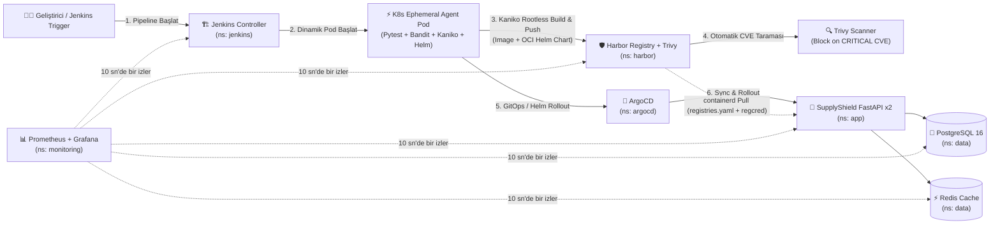

# Proje 6 / Project 6: SupplyShield — Harbor + Trivy + Jenkins CI/CD + Kaniko + ArgoCD GitOps Enterprise DevSecOps Platform

[🇹🇷 Türkçe](#-içindekiler) | [🇬🇧 English](#-english-version)

> [!IMPORTANT]
> **Bu Projenin Felsefesi:** Önceki projelerimizde (Proje 4 ve 5) dağıtık veri katmanı (Kafka, RabbitMQ, Cassandra) ve kaos mühendisliğini (Chaos Mesh) kurduk. Ancak gerçek dünyadaki kurumsal şirketlerde (bankalar, savunma sanayii, finans, büyük ölçekli SaaS) bir kodun canlıya çıkabilmesi için **Docker Hub gibi dış servislere güvenilmez!**  
> Kurumlar kendi **Özel Konteyner Kayıt Defterini (Harbor)** kurar, içine yüklenen her imajı **Trivy** ile güvenlik açıklarına (CVE) karşı tarar, kritik açık varsa canlıya çıkışını otomatik engeller ve **Jenkins + Kubernetes Dinamik Ajan Pod'ları + Kaniko (Rootless Build)** ile imajları derleyip **ArgoCD GitOps** üzerinden kümeye dağıtır. **SupplyShield (Proje 6)**, bu uçtan uca kurumsal yazılım tedarik zinciri (Software Supply Chain Security) mimarisini tek komutla sıfır hatayla ayağa kaldırır ve bizzat deneyimlemenizi sağlar!

---

## 📑 İçindekiler

1. [Mimari Genel Bakış ve 3 Düğümlü Sunucu Topolojisi](#1-mimari-genel-bakış-ve-3-düğümlü-sunucu-topolojisi)
2. [Neden Bu Teknolojiler? (Harbor, Trivy, Jenkins, Kaniko, JCasC Ne İşe Yarar?)](#2-neden-bu-teknolojiler-harbor-trivy-jenkins-kaniko-jcasc-ne-işe-yarar)
3. [Proje Dizin Yapısı](#3-proje-dizin-yapısı)
4. [Sıfır Hatalı Kurulum Rehberi (Adım Adım + Ön-Kontrol & Doğrulama)](#4-sıfır-hatalı-kurulum-rehberi-adım-adım--ön-kontrol--doğrulama)
5. [Web Arayüzleri, Erişim Bilgileri ve Servis DNS Haritası](#5-web-arayüzleri-erişim-bilgileri-ve-servis-dns-haritası)
6. [Uçtan Uca DevSecOps & GitOps Yaşam Döngüsü ve Kritik Mimari Notlar (Soru - Cevap Rehberi)](#6-uçtan-uca-devsecops--gitops-yaşam-döngüsü-ve-kritik-mimari-notlar-soru---cevap-rehberi)
7. [5 Uygulamalı DevSecOps Laboratuvar Senaryosu](#7-5-uygulamalı-devsecops-laboratuvar-senaryosu)
8. [Derinlemesine Mühendislik Dokümanları ve Sorun Çözme Rehberi](#8-derinlemesine-mühendislik-dokümanları-ve-sorun-çözme-rehberi)
9. [Altyapıyı Güvenle Silme (Cleanup)](#9-altyapıyı-güvenle-silme-cleanup)

---

## 1. Mimari Genel Bakış ve 3 Düğümlü Sunucu Topolojisi



### Azure Kota Optimizasyonu (3 Sunucu, Toplam 6 vCPU, 3 Public IP)

Azure for Students aboneliğindeki **6 vCPU ve 3 Public IP** sınırını OOMKilled veya CPU darboğazı yaşamadan kullanmak için 3 katmanlı (Tiered) izolasyon uygulanmıştır:

| Sunucu Adı | Boyut (vCPU / RAM) | Özel IP | Public IP | Kubernetes Taint & Label | Üzerinde Çalışan İş Yükleri |
| :--- | :--- | :--- | :--- | :--- | :--- |
| **`vm-master`** | `Standard_B2s_v2` (2 vCPU / **8 GB RAM**) | `10.40.1.4` | Public IP #1 | `CriticalAddonsOnly=true:NoSchedule` `tier=platform` | RKE2 Control Plane + etcd, Ingress NGINX, Rancher, ArgoCD, Prometheus, Grafana, Alertmanager |
| **`vm-worker-secops`** | `Standard_B2s` (2 vCPU / **4 GB RAM**) | `10.40.1.5` | Yok (NAT GW Public IP #3 ile internete çıkar) | `dedicated=secops:NoSchedule` `tier=secops` | **Harbor OCI Registry** (Core, Portal, Registry, Jobservice, **Trivy**, DB, Redis — `ns: harbor`) + **Jenkins Controller & Dinamik K8s Ajan Pod'ları** (`ns: jenkins`) |
| **`vm-worker-app`** | `Standard_B2s` (2 vCPU / **4 GB RAM**) | `10.40.1.6` | Public IP #2 | Taint yok, `tier=app` | **SupplyShield FastAPI API (×2)** (`ns: app`), **PostgreSQL 16**, **Redis** (`ns: data`) |

---

## 2. Neden Bu Teknolojiler? (Harbor, Trivy, Jenkins, Kaniko, JCasC Ne İşe Yarar?)

| Teknoloji | Bu Mimarideki Görevi | Neden Prod'da Vazgeçilmezdir? |
| :--- | :--- | :--- |
| **Harbor (CNCF Graduated)** | Kendi sunucumuzda çalışan kurumsal OCI Konteyner İmaj ve Helm Chart Kayıt Defteri (`http://harbor.<MASTER_IP>.nip.io`). | **Tam Veri Egemenliği & Proxy Cache:** Şirket içi kaynak kodlarını dış buluta çıkarmaz. **Proxy Cache** (`dockerhub-proxy`) özelliğiyle Docker Hub'ın `429 TooManyRequests` limitini ortadan kaldırır. Hem Docker imajlarını hem de **OCI Helm Chart** paketlerini saklar. |
| **Trivy Vulnerability Scanner** | Harbor'a yüklenen her imajın işletim sistemi (`apt`/`apk`) ve dil (`pip`) paketlerini CVE veritabanına karşı tarar. | **Otomatik Güvenlik Kapısı (Security Gate):** İçinde `CRITICAL` veya `HIGH` güvenlik açığı bulunan bir imajın Kubernetes pod'ları tarafından çekilmesini (Deployment Security Policy) otomatik olarak engeller. |
| **Jenkins + Kubernetes Cloud Plugin** | `Jenkinsfile` içerisindeki 7 aşamalı CI/CD boru hattını çalıştırır. | **Dinamik (Ephemeral) Pod Ajanları:** Klasik Jenkins kurulumlarında derleme sunucuları 7/24 açık kalıp RAM tüketir. Burada ise Jenkins sadece "Build" butonuna bastığınızda Kubernetes üzerinde geçici bir pod başlatır, iş bitince pod'u siler! |
| **JCasC (Jenkins Configuration as Code)** | `helm-values/jenkins-values.yaml` içindeki YAML tanımlarından Jenkins ayarlarını ve `supplyshield-pipeline` işini otomatik üretir. | **Sıfır Manuel Tıklama:** Jenkins kurulduğunda kurulum sihirbazı (Setup Wizard) veya eklenti ekranlarıyla uğraşmazsınız; giriş yaptığınız anda boru hattınız hazır bekler. |
| **Kaniko (Rootless Builder)** | Kubernetes pod'u içinde Docker Daemon (`docker.sock` veya `privileged: true`) olmadan `Dockerfile` derleyip Harbor'a pushlar. | **Konteyner Kaçışı (Container Escape) Önleme:** Kubernetes içinde Docker-in-Docker çalıştırmak kök (root) yetkisi gerektirir ve büyük bir güvenlik açığıdır. Kaniko kullanıcı alanında (userspace) güvenli derleme yapar. |
| **RKE2 `registries.yaml`** | Tüm düğümlerdeki `containerd` çalışma zamanına özel Harbor sunucumuzu tanıtır. | **Sertifika ve Kimlik Doğrulama Otomasyonu:** Kubelet'in özel Harbor sunucumuzdan `x509` veya `HTTP response to HTTPS client` hatası almadan doğrudan imaj çekmesini sağlar. |

---

## 3. Proje Dizin Yapısı

```text
devops-capstone-project-6/
├── terraform/                  # Azure 3 VM, VNet (10.40.0.0/16), NSG, NAT Gateway ve otomatik hosts.ini
├── ansible/                    # 01..06 tam otomatik kurulum playbook'ları (Harbor API bootstrap + Kaniko seed dahil)
│   ├── site.yml                # Tek komutla uçtan uca kurulum orkestrasyonu
│   └── playbooks/              # 01-os-hardening, 02-rke2-master, 03-rke2-workers, 04-node-isolation, 05-platform-and-harbor, 06-jenkins-and-gitops
├── helm-values/                # Harbor+Trivy, Jenkins+JCasC, ArgoCD, Rancher, Monitoring, PostgreSQL, Redis
├── app/                        # SupplyShield FastAPI API + Pytest testleri + Dockerfile + Helm Chart
│   ├── src/                    # config.py, metrics.py, main.py (BackgroundHealthProber + Artifact Audit API)
│   ├── tests/                  # test_main.py (Jenkins Stage 2 birim testleri)
│   └── chart/                  # Deployment (x2, harbor-regcred), Service, Ingress, ServiceMonitor, PDB
├── Jenkinsfile                 # 7 aşamalı Declarative Pipeline (Pytest -> Bandit -> Kaniko -> Trivy Gate -> Helm OCI -> Rollout -> Smoke Test)
├── gitops/                     # ArgoCD Application manifesti (supplyshield)
├── observability/              # PrometheusRule alarmları ve 2 hazır Grafana Dashboard JSON
└── docs/                       # 01..04 derinlemesine Harbor, Jenkins, Uygulamalı Lab ve Sorun Çözme rehberleri
```

---

## 4. Sıfır Hatalı Kurulum Rehberi (Adım Adım + Ön-Kontrol & Doğrulama)

> [!CAUTION]
> **Ön Koşul — Önceki Projeyi Silin!**  
> Azure for Students aboneliğinde bölgesel **6 vCPU ve 3 Public IP** sınırı vardır. Başlamadan önce önceki proje kaynak grubunu (`az group delete -n rg-resiliencestream-5 --yes`) sildiğinizden emin olun.

### Adım 0: Kurulum Öncesi Ön-Kontrol (Pre-Flight Check)

```bash
# 1) Azure CLI oturumunu kontrol et
az account show --output table

# 2) Bölgede (denmarkeast) boş vCPU kotası olduğunu doğrula (CurrentValue == 0 olmalı)
az vm list-usage --location denmarkeast --output table | grep -E "Total Regional vCPUs|Standard BS Family|Standard Bv2 Family"

# 3) SSH açık anahtarının (~/.ssh/id_rsa.pub) mevcut olduğunu kontrol et
ls -la ~/.ssh/id_rsa.pub
```

---

### Adım 1: Terraform ile Azure Altyapısını Oluşturma (~3-4 Dakika)

```bash
cd /home/ysf/k8s-hands-on-labs/projects/devops-capstone-project-6/terraform

terraform init
terraform validate
terraform apply -auto-approve
```

#### ✅ Adım 1 Doğrulama Komutu:
```bash
terraform output
cat ../ansible/inventory/hosts.ini
```

---

### Adım 2: Ansible ile RKE2, Harbor + Trivy, Jenkins ve GitOps Kurulumu (~15-20 Dakika)

`site.yml` sırasıyla 6 playbook'u çalıştırır, Harbor projelerini (`supplyshield` ve `dockerhub-proxy`) REST API ile otomatik açar, ilk imajı Kaniko ile derleyip Harbor'a yükler ve duman testlerini tamamlar:

```bash
cd /home/ysf/k8s-hands-on-labs/projects/devops-capstone-project-6/ansible

# 1) Tüm düğümlere SSH bağlantısını doğrula:
ansible all -m ping

# 2) Tüm platformu tek komutla kur:
ansible-playbook site.yml
```

#### ✅ Adım 2 Doğrulama Komutları:
```bash
MASTER_IP=$(cd ../terraform && terraform output -raw master_public_ip)
APP_IP=$(cd ../terraform && terraform output -raw app_worker_public_ip)

# 1) Harbor API üzerinden 'supplyshield' projesini ve Trivy ile taranmış ilk imajı sorgula:
curl -s -u 'admin:AdminPassword2026!' "http://harbor.${MASTER_IP}.nip.io/api/v2.0/projects/supplyshield/repositories" | jq .

# 2) Canlı SupplyShield API durumunu ve doğrulanmış konteyner imajlarını sorgula:
curl -s "http://app.${APP_IP}.nip.io/" | jq .
curl -s "http://app.${APP_IP}.nip.io/api/artifacts" | jq .
```

---

## 5. Web Arayüzleri, Erişim Bilgileri ve Servis DNS Haritası

### 5.1. Dış Web Arayüzleri (Ingress)

| Arayüz | URL Şablonu | Kullanıcı Adı | Şifre |
| :--- | :--- | :--- | :--- |
| **Harbor OCI Registry & Trivy UI** | `http://harbor.<MASTER_IP>.nip.io` | `admin` | `AdminPassword2026!` |
| **Jenkins CI/CD Dashboard** | `http://jenkins.<MASTER_IP>.nip.io` | `admin` | `AdminPassword2026!` |
| **SupplyShield Canlı API** | `http://app.<APP_IP>.nip.io` | — (Açık API) | — |
| **Swagger / OpenAPI Docs** | `http://app.<APP_IP>.nip.io/docs` | — | — |
| **Grafana (2 Dashboard Hazır)** | `http://grafana.<MASTER_IP>.nip.io` | `admin` | `AdminPassword2026!` |
| **ArgoCD UI** | `https://argocd.<MASTER_IP>.nip.io` | `admin` | `AdminPassword2026!` |
| **Rancher UI** | `https://rancher.<MASTER_IP>.nip.io` | `admin` | `AdminPassword2026!` |

### 5.2. Küme İçi (In-Cluster) Servis DNS Haritası

| Bileşen | Namespace | Küme İçi Tam DNS Adı (FQDN) | Port | Kimlik Bilgileri |
| :--- | :--- | :--- | :--- | :--- |
| **Harbor Core / Registry** | `harbor` | `harbor-core.harbor.svc.cluster.local` | `80` | `admin` / `AdminPassword2026!` |
| **Harbor Trivy Adapter** | `harbor` | `harbor-trivy.harbor.svc.cluster.local` | `8080` | Küme içi |
| **Jenkins Controller** | `jenkins` | `jenkins.jenkins.svc.cluster.local` | `8080` / `50000` | `admin` / `AdminPassword2026!` |
| **PostgreSQL 16** | `data` | `postgres-postgresql.data.svc.cluster.local` | `5432` | `supplyshield` / `AdminPassword2026!` (DB: `supplyshield`) |
| **Redis** | `data` | `redis-master.data.svc.cluster.local` | `6379` | Şifre: `AdminPassword2026!` |

---

## 6. 5 Uygulamalı DevSecOps Laboratuvar Senaryosu

Kurulum tamamlandıktan sonra Harbor, Trivy ve Jenkins'in nasıl çalıştığını bizzat deneyimlemek için [`docs/03-devsecops-hands-on-labs.md`](docs/03-devsecops-hands-on-labs.md) içindeki 5 deneyi sırasıyla uygulayın:

1. **Lab 1 — Harbor Arayüzü, Trivy CVE Raporu İnceleme ve Güvenlik Kapısı (Policy) Açma:** `supplyshield/supplyshield-api:1.0.0` imajının Trivy raporunu inceleme ve `CRITICAL` açık barındıran imajların çekilmesini engelleme.
2. **Lab 2 — Jenkins'te Dinamik Kubernetes Pod Ajanı ile Uçtan Uca Build Tetikleme:** Jenkins'te **Build Now** butonuna basıp `kubectl get pods -n jenkins -w` ile geçici ajan pod'unun doğuşunu, Kaniko derlemesini ve iş bitince silinişini izleme.
3. **Lab 3 — Harbor Proxy Cache (`dockerhub-proxy`) ile Docker Hub Rate-Limit Aşma:** Dış dünyadaki bir imajı Harbor Proxy Cache üzerinden çekip önbelleğe alındığını görme.
4. **Lab 4 — Helm Chart'larını OCI Artifact Olarak Harbor'a Gönderme ve Çekme:** `helm push oci://...` ile Helm paketlerini Harbor içinde versiyonlama.
5. **Lab 5 — Zafiyetli İmaj Simülasyonu ve Trivy Engelleme Testi:** Bilerek eski/zafiyetli bir imaj gönderip Harbor'ın `Prevent vulnerable images from running` kuralıyla `ImagePullBackOff` / `412 Precondition Failed` engelini görme!

---

## 7. Derinlemesine Mühendislik Dokümanları ve Sorun Çözme Rehberi

- 📘 [`docs/01-harbor-deep-dive.md`](docs/01-harbor-deep-dive.md): Harbor iç mimarisi (7 mikroservis), Trivy tarayıcı nasıl çalışır, Proxy Cache, Robot Account ve RKE2 `registries.yaml` entegrasyonu.
- 📙 [`docs/02-jenkins-ci-deep-dive.md`](docs/02-jenkins-ci-deep-dive.md): Jenkins Controller vs Agent mimarisi, Kubernetes Cloud Plugin, JCasC, neden Docker-in-Docker yerine Kaniko kullanılır ve 7 aşamalı `Jenkinsfile` analizi.
- 📗 [`docs/03-devsecops-hands-on-labs.md`](docs/03-devsecops-hands-on-labs.md): Kurulum sonrası adım adım uygulanacak 5 interaktif DevSecOps laboratuvarı.
- 📕 [`docs/04-troubleshooting-playbook.md`](docs/04-troubleshooting-playbook.md): Harbor `x509` / `http response to HTTPS client`, `harbor-regcred`, Jenkins JNLP agent bağlantı ve Kaniko derleme hataları çözüm rehberi.

---

## 8. Altyapıyı Güvenle Silme (Cleanup)

```bash
cd /home/ysf/k8s-hands-on-labs/projects/devops-capstone-project-6/terraform
terraform destroy -auto-approve
```

---

<br>

---

## 🇬🇧 English Version

# 🛡️ Project 6: SupplyShield — Enterprise DevSecOps & Software Supply Chain Platform (Harbor + Trivy + Jenkins CI/CD + Kaniko + ArgoCD GitOps)

> [!IMPORTANT]
> **Engineering Philosophy:** Enterprise organizations (banking, defense, sovereign cloud, large-scale SaaS) never rely on public registries without strict controls. They run a **Self-Hosted OCI Container & Helm Registry (Harbor)**, scan every pushed image for CVEs with **Trivy**, block vulnerable images from running in Kubernetes (**Deployment Security Gate**), cache upstream images via **Proxy Cache** to eliminate Docker Hub `429 TooManyRequests` limits, and execute rootless builds using **Jenkins + Kubernetes Ephemeral Agent Pods + Kaniko** with **ArgoCD GitOps** delivery.

---

### 1. Architecture & 3-Node Azure Quota-Optimized Topology (6 vCPUs, 3 Public IPs)

| Node Name | VM SKU (vCPU / RAM) | Private IP | Public IP | Kubernetes Taint & Label | Hosted Workloads |
| :--- | :--- | :--- | :--- | :--- | :--- |
| **`vm-master`** | `Standard_B2s_v2` (2 vCPU / **8 GB RAM**) | `10.40.1.4` | Public IP #1 | `CriticalAddonsOnly=true:NoSchedule` `tier=platform` | RKE2 Control Plane + etcd, Ingress NGINX, Rancher UI, ArgoCD, Prometheus, Grafana, Alertmanager |
| **`vm-worker-secops`** | `Standard_B2s` (2 vCPU / **4 GB RAM**) | `10.40.1.5` | None (Outbound via NAT GW Public IP #3) | `dedicated=secops:NoSchedule` `tier=secops` | **Harbor OCI Registry** (Core, Portal, Registry, Jobservice, **Trivy**, DB, Redis — `ns: harbor`) + **Jenkins Controller & Ephemeral K8s Build Pods** (`ns: jenkins`) |
| **`vm-worker-app`** | `Standard_B2s` (2 vCPU / **4 GB RAM**) | `10.40.1.6` | Public IP #2 | Untainted, `tier=app` | **SupplyShield FastAPI API (×2)** (`ns: app`), **PostgreSQL 16**, **Redis** (`ns: data`) |

---

### 2. Core DevSecOps Capabilities

1. **Zero-Touch Harbor + Trivy Bootstrap:**
   - Ansible automatically configures `/etc/rancher/rke2/registries.yaml` across all RKE2 nodes so `containerd` trusts the self-hosted Harbor registry without `x509` or `HTTP response to HTTPS client` errors.
   - Via Harbor REST API (`/api/v2.0/projects`), Ansible creates the `supplyshield` project (`auto_scan: "true"`) and the `dockerhub-proxy` **Proxy Cache** project, injects `harbor-regcred` pull secrets, and seeds `supplyshield-api:1.0.0` using a one-shot Kaniko Job.
2. **Zero-Touch Jenkins + JCasC + Kubernetes Dynamic Agent Pods:**
   - Configured via **JCasC (Jenkins Configuration as Code)** in `helm-values/jenkins-values.yaml`, the `supplyshield-pipeline` job is pre-created on startup (`numExecutors: 0` on controller).
   - Triggering a build dynamically spawns a multi-container Kubernetes Pod (`python`, `kaniko`, `k8s-tools`) on `vm-worker-secops` and terminates it immediately after completion.
3. **7-Stage Declarative `Jenkinsfile`:**
   - **Stage 1:** Workspace & Source Checkout
   - **Stage 2:** Unit Testing (`pytest`) & Static Application Security Testing (`bandit` SAST)
   - **Stage 3:** Rootless Container Image Build & Push to Harbor (`kaniko`)
   - **Stage 4:** Harbor + Trivy Vulnerability Scan Gate (REST API polling)
   - **Stage 5:** OCI Helm Chart Packaging & Push (`helm push oci://harbor.../supplyshield/charts`)
   - **Stage 6:** Kubernetes Rolling Update (`helm upgrade --install` in `namespace: app`)
   - **Stage 7:** Post-Deploy Smoke Test & PostgreSQL Artifact Audit Recording

---

### 3. Step-by-Step Deployment Guide

#### Step 1: Provision Azure Infrastructure with Terraform
```bash
cd /home/ysf/k8s-hands-on-labs/projects/devops-capstone-project-6/terraform
terraform init
terraform validate
terraform apply -auto-approve
```

#### Step 2: Bootstrap RKE2, Harbor, Trivy, Jenkins & GitOps with Ansible
```bash
cd /home/ysf/k8s-hands-on-labs/projects/devops-capstone-project-6/ansible
ansible all -m ping
ansible-playbook site.yml
```

#### Step 3: Verify Endpoints & Credentials

| Web Interface | URL Pattern | Username | Password |
| :--- | :--- | :--- | :--- |
| **Harbor OCI Registry & Trivy UI** | `http://harbor.<MASTER_IP>.nip.io` | `admin` | `AdminPassword2026!` |
| **Jenkins CI/CD Dashboard** | `http://jenkins.<MASTER_IP>.nip.io` | `admin` | `AdminPassword2026!` |
| **SupplyShield Live API** | `http://app.<APP_IP>.nip.io` | — | — |
| **Swagger / OpenAPI Docs** | `http://app.<APP_IP>.nip.io/docs` | — | — |
| **Grafana Dashboards** | `http://grafana.<MASTER_IP>.nip.io` | `admin` | `AdminPassword2026!` |
| **ArgoCD UI** | `https://argocd.<MASTER_IP>.nip.io` | `admin` | `AdminPassword2026!` |
| **Rancher UI** | `https://rancher.<MASTER_IP>.nip.io` | `admin` | `AdminPassword2026!` |

---

### 4. Cleanup
```bash
cd /home/ysf/k8s-hands-on-labs/projects/devops-capstone-project-6/terraform
terraform destroy -auto-approve
```

