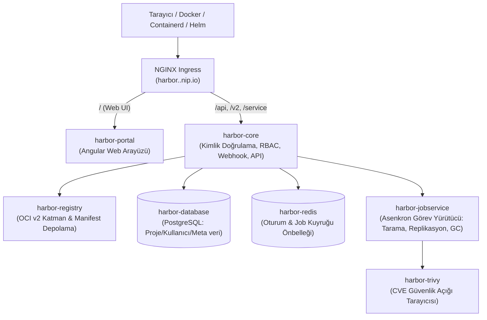

# 01 — Harbor OCI Registry & Trivy Derinlemesine Mimari Rehberi

## 1. Harbor Nedir ve Neden Sadece "Docker Registry" Değildir?

Standart bir `registry:2` konteyneri sadece dosyaları diske kaydeden basit bir HTTP sunucusudur; içinde kullanıcı arayüzü, yetkilendirme (RBAC), güvenlik taraması veya önbellekleme yoktur.  
**Harbor** ise CNCF (Cloud Native Computing Foundation) bünyesinde **Graduated** statüsünde olan, %100 ücretsiz ve açık kaynaklı kurumsal bir **OCI (Open Container Initiative) Kayıt Defteridir**.

### Harbor'ın İçindeki 7 Mikroservis (`kubectl get pods -n harbor`)

Kümemizde `harbor` namespace'ine baktığınızda tek bir pod yerine birbiriyle konuşan 7 bileşen görürsünüz:



1. **`harbor-portal`:** Web tarayıcınızdan girdiğiniz görsel yönetim arayüzüdür.
2. **`harbor-core`:** Sistemin beynidir. Tüm `/api/v2.0` çağrılarını, kullanıcı/robot token doğrulamalarını ve proje politikalarını yönetir.
3. **`harbor-registry`:** Asıl konteyner katmanlarını (`sha256:...` blob dosyalarını) ve Helm chart paketlerini PVC diske (`local-path`) yazan bileşendir.
4. **`harbor-trivy`:** Aqua Security tarafından geliştirilen **Trivy** tarayıcısını barındırır. İmajın içindeki işletim sistemi paketlerini (`dpkg`, `apk`, `rpm`) ve uygulama kütüphanelerini (`pip`, `npm`, `jar`, `go.mod`) Ulusal Zafiyet Veritabanı (NVD) ile karşılaştırır.
5. **`harbor-jobservice`:** Uzun süren işleri (Trivy taraması başlatma, çöp toplama / Garbage Collection, başka bir Harbor'a imaj kopyalama) arka planda yürüten işçi servisidir.
6. **`harbor-database` (PostgreSQL):** Projeleri, kullanıcıları, Robot hesaplarını ve Trivy tarama sonuç raporlarını tutar.
7. **`harbor-redis`:** Jobservice görev kuyruğunu ve oturum önbelleğini tutar.

---

## 2. Harbor'ın 4 Kritik Kurumsal Özelliği

### 2.1. Otomatik Güvenlik Taraması ve Dağıtım Engelleme (Vulnerability Prevention)
`supplyshield` projemizi oluştururken `auto_scan: "true"` özelliğini açtık. Bu sayede:
1. Jenkins (Kaniko) yeni bir imajı Harbor'a push ettiği saniyede `harbor-core` otomatik olarak `harbor-trivy`'yi tetikler.
2. Eğer proje ayarlarından **"Prevent potential vulnerable images from being deployed"** seçeneğini aktif edip eşiği `Critical` yaparsanız; içinde kritik açık bulunan bir imajı Kubernetes (`kubelet`) çekmeye çalıştığında Harbor **`HTTP 412 Precondition Failed`** döndürür ve podun canlıya çıkmasını engeller!

### 2.2. Proxy Cache (Docker Hub Rate-Limit 429 Çözümü)
Docker Hub, ücretsiz kullanıcılar için **6 saatte 100 imaj çekme (pull)** sınırı uygular. Çok düğümlü bir Kubernetes kümesinde pod'lar yeniden başladığında bu sınır hemen dolar ve tüm küme `ErrImagePull: TooManyRequests` hatasıyla kilitlenir.
- Çözüm olarak Harbor içinde `dockerhub-proxy` adında bir **Proxy Cache** projesi açtık.
- Siz `harbor.<MASTER_IP>.nip.io/dockerhub-proxy/library/nginx:alpine` çektiğinizde:
  1. İlk seferde Harbor imajı Docker Hub'dan indirir ve kendi diskine kaydeder.
  2. Sonraki 1000 çekişte Docker Hub'a hiç gitmez; doğrudan yerel ağdan (Harbor diskinden) saniyeler içinde teslim eder!

### 2.3. OCI Helm Chart Kaydı (`oci://`)
Eskiden Helm chart'ları için `ChartMuseum` adında ayrı bir sunucu kurulurdu. Harbor v2.8+ ile birlikte Helm chart'ları da tıpkı Docker imajları gibi standart **OCI Artifact** olarak doğrudan aynı proje altına (`oci://harbor.<MASTER_IP>.nip.io/supplyshield/charts`) yüklenir.

### 2.4. Robot Accounts (CI/CD Hizmet Hesapları)
Gerçek üretimde Jenkins veya GitLab CI içerisine `admin` şifresi yazılmaz! Harbor arayüzünden **Robot Account** (`robot$supplyshield+jenkins`) oluşturulur. Bu hesabın yetkisi sadece `supplyshield` projesine imaj yüklemekle (`push`/`pull`) sınırlandırılır ve süresi dolabilen bir token verilir.

---

## 3. RKE2 ve `containerd` Entegrasyonu (`/etc/rancher/rke2/registries.yaml`)

Kendi Harbor sunucunuzu kurduğunuzda karşılaşacağınız en önemli altyapı detayı şudur:
- Kubernetes pod'u içinde imaj çekme işlemini `kubectl` veya `docker` değil, işçi düğümdeki **`containerd`** servisi yapar.
- `containerd` varsayılan olarak tüm kayıt defterlerine **HTTPS (Port 443)** üzerinden bağlanmaya çalışır.
- Laboratuvar ortamımızda Harbor `http://harbor.<MASTER_IP>.nip.io` (HTTP) üzerinde çalıştığı için, tüm RKE2 düğümlerinde `/etc/rancher/rke2/registries.yaml` dosyası Ansible tarafından otomatik yapılandırılmıştır:

```yaml
mirrors:
  "harbor.<MASTER_IP>.nip.io":
    endpoint:
      - "http://harbor.<MASTER_IP>.nip.io"
configs:
  "harbor.<MASTER_IP>.nip.io":
    tls:
      insecure_skip_verify: true
    auth:
      username: admin
      password: "AdminPassword2026!"
```

Bu dosya sayesinde RKE2 her düğümde `containerd` ayarlarını otomatik günceller ve hiçbir düğümde `http: server gave HTTP response to HTTPS client` hatası yaşanmaz!
