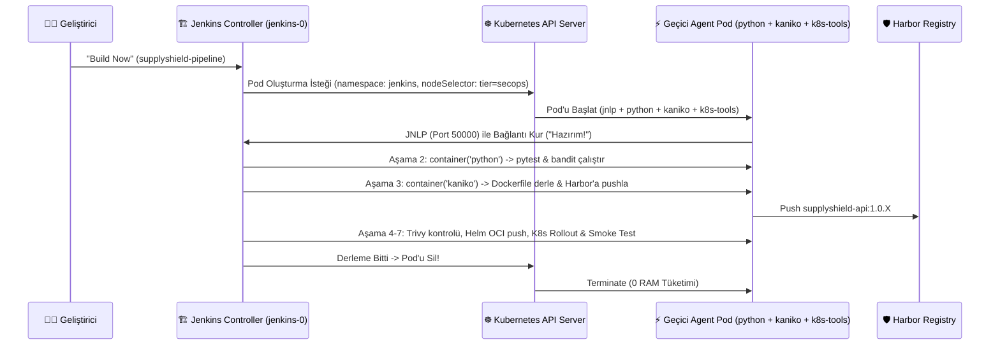

# 02 — Jenkins + Kubernetes Dynamic Agent Pod + Kaniko & JCasC Rehberi

## 1. Klasik Jenkins vs Kubernetes Native Jenkins Mimarisi

### Klasik (Eski) Yöntem: Sabit Sanal Makine Ajanları
Geleneksel kurulumlarda Jenkins'in yanında 2-3 adet "Build Server" (Sanal Makine) 7/24 açık bırakılır:
- **Sorun 1 (Kaynak İsrafı):** Gece kimse kod yazmazken bile bu sunucular boş yere RAM ve CPU tüketir.
- **Sorun 2 (Ortam Kirliliği & Bağımlılık Çakışması):** Bir ekip Python 3.9, diğer ekip Python 3.12 istediğinde aynı sunucuda paketler birbirini bozar ("Snowflake Server" sendromu).

### Modern Yöntem: Kubernetes Cloud Plugin ile Geçici (Ephemeral) Pod Ajanları
Bu projede (`SupplyShield`) kurduğumuz mimaride **`numExecutors: 0`** ayarıyla Jenkins Controller üzerinde hiçbir derleme çalıştırılmaz! Bunun yerine:

---

## 2. JCasC (Jenkins Configuration as Code) Nedir?

Normalde Jenkins'i ilk kurduğunuzda:
1. Pod loglarından `initialAdminPassword` şifresini bulup kopyalamanız,
2. "Install Suggested Plugins" ekranında dakikalarca beklemeniz,
3. "Manage Jenkins -> Clouds -> Kubernetes" menüsüne girip URL ve sertifikaları elle doldurmanız,
4. "New Item -> Pipeline" diyerek işi elle oluşturmanız gerekir.

**JCasC (`configuration-as-code` eklentisi)** tüm bu manuel adımları ortadan kaldırır. [`helm-values/jenkins-values.yaml`](../helm-values/jenkins-values.yaml) dosyamızın içindeki `JCasC.configScripts` bloğu sayesinde Jenkins açılır açılmaz:
- Yönetici şifresi `admin` / `AdminPassword2026!` olarak ayarlanır,
- Kubernetes küme bağlantısı otomatik tanımlanır,
- `supplyshield-pipeline` işi ana ekranda hazır olarak oluşturulur!

---

## 3. Neden Docker-in-Docker (DinD) Yerine Kaniko Kullanıyoruz?

Kubernetes pod'unun içinde `docker build` çalıştırmak istediğinizde iki seçeneğiniz vardır:

| Özellik | Docker-in-Docker (DinD) / Host `docker.sock` | Google Kaniko (`gcr.io/kaniko-project/executor`) |
| :--- | :--- | :--- |
| **Root / Privileged Yetkisi** | `privileged: true` zorunludur (Pod tüm düğümün çekirdeğine tam yetkiyle erişir!). | **Gerekmez!** Standart konteyner yetkileriyle kullanıcı alanında (userspace) çalışır. |
| **RKE2 Uyumluluğu** | RKE2'de Docker Daemon yoktur (`containerd` vardır), bu yüzden `/var/run/docker.sock` bağlanamaz! | Herhangi bir daemon'a ihtiyaç duymaz; `Dockerfile` komutlarını tek tek dosya sisteminde çalıştırıp katmanları doğrudan Harbor'a gönderir. |
| **Güvenlik Riski** | Çok Yüksek (Container Escape riski). | Çok Düşük (Zero-Trust DevSecOps standardı). |

---

## 4. `Jenkinsfile` 7 Aşamasının Satır Satır Anatomisi

Proje kök dizinindeki [`Jenkinsfile`](../Jenkinsfile) dosyamız bir **Multi-Container Pod** tanımlar ve her aşamada o işe özel konteynerin içine girer (`container('...')`):

1. **`Stage 1 (Checkout & Workspace Prep)` — `container('k8s-tools')`:**
   Uygulama kaynak kodunu çalışma dizinine (`${WORKSPACE}/app`) çıkartır.
2. **`Stage 2 (Unit Tests & SAST)` — `container('python')`:**
   - `pytest -v tests/`: FastAPI uç noktalarının (`/healthz`, `/`, `/metrics`) doğru yanıt verdiğini doğrular.
   - `bandit -r src/ -ll`: Python kaynak kodunda硬kodlanmış şifre, SQL Injection veya güvensiz fonksiyon (`eval`, `subprocess` shell=True) olup olmadığını tarar (**SAST — Static Application Security Testing**).
3. **`Stage 3 (Kaniko Rootless Build & Push)` — `container('kaniko')`:**
   `/kaniko/executor` komutuyla `app/Dockerfile` dosyasını derler ve doğrudan `harbor.<MASTER_IP>.nip.io/supplyshield/supplyshield-api:1.0.${BUILD_NUMBER}` adresine yükler.
4. **`Stage 4 (Harbor Trivy Vulnerability Gate)` — `container('k8s-tools')`:**
   Harbor REST API'sini (`/api/v2.0/.../artifacts/${IMAGE_TAG}?with_scan_overview=true`) sorgulayarak Trivy taramasının tamamlanmasını bekler ve bulunan güvenlik açıklarının özetini (`Critical`, `High`, `Medium`, `Low`) konsola basar.
5. **`Stage 5 (OCI Helm Chart Package & Push)` — `container('k8s-tools')`:**
   `helm package` ile `supplyshield-1.0.X.tgz` paketini oluşturur ve `helm push ... oci://harbor.../supplyshield/charts` komutuyla Helm chart'ını da Harbor'a arşivler!
6. **`Stage 6 (Deploy to Kubernetes)` — `container('k8s-tools')`:**
   `helm upgrade --install` ile `app` namespace'indeki canlı uygulamayı yeni imaj etiketine (`1.0.${BUILD_NUMBER}`) günceller ve `kubectl rollout status` ile pod'ların sağlıklı kalktığını doğrular.
7. **`Stage 7 (Post-Deploy Smoke Test & Artifact Audit)` — `container('k8s-tools')`:**
   Canlı servise HTTP isteği atarak yeni derlenen imajın kaydını PostgreSQL veritabanına ve Redis önbelleğine işler!
