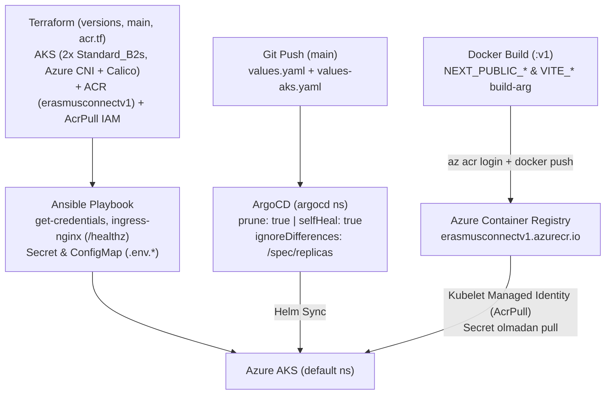

# Erasmus Connect — Cloud-Native Kubernetes, IaC & GitOps Mimarisi

🇹🇷 Türkçe (aşağıda) · 🇬🇧 [English version](#english-version)

> **Adım Adım Kurulum & Lab Rehberi:** Projeyi sıfırdan Minikube üzerinde kurmak, Azure AKS + ACR + ArgoCD + Chaos Mesh adımlarını tek tek uygulamak ve gerçek ortamda karşılaşılan hata çözümlerini görmek için **[SETUP-README.md](./SETUP-README.md)** dosyasını takip et.

**Erasmus Connect**, tam yığın bir web platformunun (**Next.js** kullanıcı arayüzü, **Vite/Nginx** yönetim paneli, **Express** backend API ve **Redis** oturum/önbellek katmanı) yerel Kubernetes (Minikube + Calico) ortamından **Azure AKS** üzerine üretime hazır (production-grade) taşınmasını, **Terraform** ile altyapı kodlamasını, **Ansible** ile bootstrap edilmesini, **Chaos Mesh / HPA / PDB** ile dayanıklılık doğrulamasını ve **ArgoCD + Azure Container Registry (`AcrPull`)** ile şifresiz GitOps dağıtımını kapsayan uçtan uca bir DevOps / SRE projesidir.

---

## 1. Uçtan Uca Proje Akışı (Neler Yaptık?)

Proje 8 faz boyunca kademeli olarak inşa edildi:

1. **Konteyner & Helm Orkestrasyonu (Faz 1–2):** Express backend, Next.js frontend, Admin paneli (`nginx:alpine`) ve kalıcı veri gerektiren Redis (`StatefulSet` + `Headless Service`) tek bir [Helm chart](./helm/erasmus-connect/Chart.yaml) altında toplandı. Hassas bilgiler Git dışı `.env` dosyalarından `envFrom` (`Secret` + `ConfigMap`) ile podlara aktarıldı; kaynak sınırları (`requests`/`limits`) ve `readinessProbe`/`livenessProbe` sağlık kontrolleri eklendi.
2. **Ingress Yönlendirme & Zero-Trust Ağ (Faz 3):** `ingress-nginx` üzerinden host/path bazlı yönlendirme (`/`, `/api`, `admin.*`) kuruldu. Calico CNI altında **Post-DNAT NetworkPolicy** kuralları yazılarak Redis'e Next.js dahil yetkisiz erişimler kapatıldı ve Express poduna yalnızca Ingress ile Next.js'in (`4000` portundan) erişmesine izin verildi.
3. **Altyapı Kodlama & Otomasyon (Faz 4–5):** **Terraform** ([terraform/](./terraform/main.tf)) ile `DenmarkEast` bölgesinde Calico destekli AKS kümesi (`aks-erasmus-connect-dev`, `Standard_B2s`), **Ansible** ([ansible/playbook.yml](./ansible/playbook.yml)) ile de kubeconfig alma, Azure LB `/healthz` annotation'lı NGINX Ingress kurulumu, Secret/ConfigMap yükleme ve Helm dağıtımı otomatikleştirildi.
4. **Yüksek Erişilebilirlik & Kaos Mühendisliği (Faz 6):** Express ve Next.js için CPU tabanlı **HPA** (`min: 2`, `max: 4` @ `%60`), bakım kesintilerine karşı **PodDisruptionBudget (`minAvailable: 1`)** tanımlandı ve **Chaos Mesh** ([chaos/](./chaos/01-pod-kill-express.yaml)) ile pod silme, Redis ağ gecikmesi ve CPU stres deneyleri doğrulandı.
5. **Ölçekleme & ArgoCD GitOps (Faz 7):** Azure CNI'ın node başına `30 pod` sınırını aşmak için Terraform ile node sayısı `1 -> 2` olarak yerinde artırıldı. **ArgoCD** ([argocd/erasmus-app.yaml](./argocd/erasmus-app.yaml)) `prune: true` ve `selfHeal: true` ile devreye alındı; HPA'nın artırdığı replikaların geri düşmemesi için `ignoreDifferences` (`/spec/replicas`) eklendi.
6. **Şifresiz ACR & Managed Identity (Faz 8):** Docker Hub PAT (`dockerhub-secret`) bağımlılığı kaldırıldı. Terraform ([terraform/acr.tf](./terraform/acr.tf)) ile Azure Container Registry (`erasmusconnectv1.azurecr.io`, `Basic`, `admin_enabled = false`) kuruldu ve AKS `kubelet_identity` hesabına **`AcrPull`** rolü atanarak ArgoCD üzerinden `:v1` imajlarının şifresiz çekilmesi sağlandı.

---

## 2. Sistem ve Trafik Akışı (Runtime Architecture)

```mermaid
flowchart LR
    User["Kullanıcı / Tarayıcı"] -->|"HTTP :80"| LB["Azure LoadBalancer<br/>(/healthz probe)"]
    LB --> Ingress["NGINX Ingress Controller<br/>(ingress-nginx ns)"]

    Ingress -->|"Host: &lt;IP&gt;.nip.io<br/>Path: /"| NextSvc["Next.js Service (:8090)"]
    Ingress -->|"Host: &lt;IP&gt;.nip.io<br/>Path: /api"| ExpSvc["Express Service (:8080)"]
    Ingress -->|"Host: admin.&lt;IP&gt;.nip.io<br/>Path: /"| AdmSvc["Admin Service (:80)"]

    NextSvc --> NextPod["Next.js Pod (:3000)<br/>HPA 2-4 | PDB min 1"]
    ExpSvc --> ExpPod["Express Pod (:4000)<br/>HPA 2-4 | PDB min 1"]
    AdmSvc --> AdmPod["Admin Nginx Pod (:80)"]

    NextPod -.->|"SSR /api çağrısı"| ExpSvc
    ExpPod -->|"Calico NetPol: TCP 6379<br/>(Sadece Express izinli)"| RedisSvc["Redis Headless Service<br/>(clusterIP: None)"]
    RedisSvc --> RedisPod["Redis StatefulSet (:6379)<br/>PVC 1Gi"]

    ExpPod -->|"Egress"| Atlas["Harici: MongoDB Atlas &amp; Supabase"]
```



### Yaşam Döngüsü ve GitOps Dağıtım Akışı (Build → IaC → GitOps)



---

## 3. Dizin ve Dosya Yapısı

```text
devops-ec-project/
├── README.md                              # Proje özeti, mimari ve uçtan uca akış (bu dosya)
├── SETUP-README.md                        # 8 Faz / 23 Biletlik adım adım kurulum ve hata çözüm rehberi
├── .env.example                           # Yerel/AKS Secret & build-arg ortam değişkeni şablonu
├── .gitignore                             # .env.* (şifreler), terraform.tfvars ve state dosyalarını Git dışı tutar
│
├── helm/erasmus-connect/                  # Uygulama Helm Chart'ı
│   ├── Chart.yaml                         # Chart metadata (erasmus-connect)
│   ├── .helmignore                        # Paketleme dışı bırakılacak dosyalar
│   ├── values.yaml                        # Varsayılan değerler (portlar, HPA, resource request/limit, envFrom adları)
│   ├── values-aks.yaml                    # AKS & ACR override'ları (*.azurecr.io/...:v1 imajları ve nip.io hostları)
│   └── templates/
│       ├── _helpers.tpl                   # Ortak isimlendirme ve label helper şablonları
│       ├── express-deployment.yaml        # Express API pod şablonu (/health probe, envFrom, resources)
│       ├── express-service.yaml           # ClusterIP Service (8080 -> 4000)
│       ├── nextjs-deployment.yaml         # Next.js SSR pod şablonu (HOSTNAME=0.0.0.0, :3000)
│       ├── nextjs-service.yaml            # ClusterIP Service (8090 -> 3000)
│       ├── admin-deployment.yaml          # Vite Admin SPA (nginx:alpine, :80)
│       ├── admin-service.yaml             # ClusterIP Service (80 -> 80)
│       ├── redis-statefulset.yaml         # Kalıcı diskli (1Gi PVC) Redis (:6379)
│       ├── redis-service.yaml             # Headless Service (clusterIP: None)
│       ├── ingress.yaml                   # NGINX Ingress kuralları (<host>/, <host>/api, admin.<host>/)
│       ├── networkpolicy-express.yaml     # Post-DNAT Calico kuralı (Ingress + Next.js -> Express :4000)
│       ├── networkpolicy-redis.yaml       # Zero-Trust Calico kuralı (Sadece Express -> Redis :6379)
│       ├── hpa-express.yaml               # Express HorizontalPodAutoscaler (2-4 replica @ %60 CPU)
│       ├── hpa-nextjs.yaml                # Next.js HorizontalPodAutoscaler (2-4 replica @ %60 CPU)
│       └── pdb.yaml                       # PodDisruptionBudget (minAvailable: 1)
│
├── terraform/                             # Azure AKS & ACR Infrastructure-as-Code
│   ├── versions.tf                        # azurerm ~> 4.0 provider sabitlemesi ve features{}
│   ├── variables.tf                       # Bölge, küme adı, node_count, vm_size (Standard_B2s)
│   ├── main.tf                            # Resource Group + AKS (SystemAssigned, Azure CNI + Calico)
│   ├── acr.tf                             # Azure Container Registry (Basic) + kubelet AcrPull rol ataması
│   ├── outputs.tf                         # Resource group, cluster adı, kube_config_raw, acr_login_server
│   └── terraform.tfvars.example           # Değişken override şablonu (gerçek terraform.tfvars Git dışıdır)
│
├── ansible/                               # Küme Bootstrap Otomasyonu
│   ├── ansible.cfg                        # Yerel çalışma ve çıktı formatı ayarları
│   ├── inventory.ini                      # localhost ansible_connection=local tanımı
│   └── playbook.yml                       # get-credentials, ingress-nginx (/healthz), Secret/ConfigMap, Helm deploy
│
├── argocd/                                # GitOps Tanımı
│   └── erasmus-app.yaml                   # ArgoCD Application (values.yaml + values-aks.yaml, selfHeal, HPA uyumu)
│
└── chaos/                                 # Chaos Mesh Dayanıklılık Deneyleri
    ├── 01-pod-kill-express.yaml           # Express pod öldürme deneyi (replica & PDB kurtarma testi)
    ├── 02-network-delay-redis.yaml        # Redis ağına gecikme enjeksiyonu (timeout/resilience testi)
    └── 03-stress-cpu-express.yaml         # Express podlarına yapay CPU yükü (HPA tetikleme testi)
```

---

## 4. Öne Çıkan Mühendislik Kararları ve Öğrenilen Dersler

| Konu | Uygulanan Çözüm | Mühendislik Gerekçesi |
| :--- | :--- | :--- |
| **Post-DNAT NetworkPolicy** | Kural hedeflerinde Service portu (`8080`) değil Pod `containerPort` (`4000`) ve Ingress için `namespaceSelector` kullanıldı. | Calico kuralları Kubernetes `kube-proxy` DNAT dönüşümünden **sonra** değerlendirir; Ingress trafiği `default` dışındaki `ingress-nginx` namespace'inden gelir. |
| **Build-Time vs Run-Time Env** | `NEXT_PUBLIC_*` ve `VITE_BACKEND_URL` imaj build aşamasında (`--build-arg`) gömülürken; DB/JWT sırları K8s `Secret` (`envFrom`) üzerinden runtime'da verildi. | İstemci tarafı JS paketleri `next/vite build` anında derlenir; pod ortam değişkeni değişse bile mevcut JS bundle'ı değişmez. |
| **Azure LB Health Probe** | `ingress-nginx` Service üzerine `service.beta.kubernetes.io/azure-load-balancer-health-probe-request-path: "/healthz"` eklendi. | Azure LoadBalancer varsayılan olarak `/` yoluna `Host` header'ı olmadan istek atar; NGINX `404` döndüğü için dış trafik zaman aşımına düşer. |
| **GitOps & HPA Çakışması** | ArgoCD `Application` manifestosuna `ignoreDifferences` (`/spec/replicas` for `apps/Deployment`) eklendi. | Aksi halde `selfHeal: true` açıkken ArgoCD, HPA'nın trafik altında artırdığı pod sayısını Git'teki değere geri düşürür. |
| **Node Kapasite Planı** | Terraform ile `node_count` `1 -> 2` (`Standard_B2s`) ölçeklendi. | Azure CNI varsayılan olarak node başına en fazla **30 pod** destekler; ArgoCD + Chaos Mesh + uygulama HPA replikaları tek node sınırını aşar. |
| **Şifresiz ACR (`AcrPull`)** | `azurerm_role_assignment` ile AKS `kubelet_identity` nesnesine ACR üzerinde `AcrPull` verildi; `dockerhub-secret` kaldırıldı. | Docker Hub PAT ve cluster içinde imaj çekme secret'ı yönetme ihtiyacını ortadan kaldırır (`admin_enabled = false`). |
| **Release Sahipliği** | ArgoCD'ye geçerken eski manuel `helm uninstall erasmus` temizliği yapıldı. | İki farklı release aynı Ingress host/path'i sahiplenmeye çalıştığında `validate.nginx.ingress.kubernetes.io` webhook'u senkronizasyonu engeller. |

---

## 5. Hızlı İşletim ve Doğrulama Komutları

### Küme Maliyet Kontrolü (Öğrenci Bütçesi)

```bash
# Çalışma bitince VM maliyetini durdur (diskler ve IP korunur):
az aks stop --resource-group rg-erasmus-connect-dev --name aks-erasmus-connect-dev

# Ertesi gün kümeyi tekrar uyandır:
az aks start --resource-group rg-erasmus-connect-dev --name aks-erasmus-connect-dev
```

### ArgoCD Arayüzü ve Helm Doğrulaması

```bash
# ArgoCD UI erişimi (http://localhost:8085)
kubectl port-forward svc/argocd-server -n argocd 8085:80

# Helm şablonlarının AKS değerleriyle doğru render edildiğini kontrol et
helm template erasmus ./helm/erasmus-connect \
  -f ./helm/erasmus-connect/values.yaml \
  -f ./helm/erasmus-connect/values-aks.yaml | grep "image:"
```

### Canlı Uç Nokta Kontrolleri (`nip.io`)

```bash
INGRESS_IP=$(kubectl get svc ingress-nginx-controller -n ingress-nginx -o jsonpath='{.status.loadBalancer.ingress[0].ip}')

curl -i "http://${INGRESS_IP}.nip.io/"
curl -i "http://admin.${INGRESS_IP}.nip.io/"
curl -i -X POST "http://${INGRESS_IP}.nip.io/api/v1/ping"
```

---

## 6. Sıfırdan Kurulum

Kendi ortamında tüm fazları sıfırdan ayağa kaldırmak ve her adımın teknik açıklamasını görmek için **[SETUP-README.md](./SETUP-README.md)** rehberiyle devam et.

---

<a id="english-version"></a>

# 🇬🇧 English Version

> **Step-by-step setup & lab guide:** to build the project from scratch on Minikube, then Azure AKS + ACR + ArgoCD + Chaos Mesh, and to see real-world troubleshooting notes, follow **[SETUP-README.md](./SETUP-README.md)** (written in Turkish).

**Erasmus Connect** is an end-to-end DevOps / SRE project that moves a full-stack web platform (**Next.js** frontend, **Vite/Nginx** admin panel, **Express** backend API, **Redis** session/cache layer) from a local Kubernetes (Minikube + Calico) environment to **Azure AKS**. It covers infrastructure as code with **Terraform**, bootstrap automation with **Ansible**, resilience validation with **Chaos Mesh / HPA / PDB**, and secret-less GitOps delivery with **ArgoCD + Azure Container Registry (`AcrPull`)**.

## 1. End-to-End Flow (What We Did)

1. **Containers & Helm (Phases 1–2):** Express, Next.js, the Admin panel (`nginx:alpine`) and Redis (`StatefulSet` + headless Service) live in one [Helm chart](./helm/erasmus-connect/Chart.yaml). Sensitive values come from Git-ignored `.env` files via `envFrom` (`Secret` + `ConfigMap`); `requests`/`limits` and readiness/liveness probes were added.
2. **Ingress & Zero-Trust Networking (Phase 3):** host/path routing through `ingress-nginx` (`/`, `/api`, `admin.*`). Under Calico, **Post-DNAT NetworkPolicies** block unauthorized access to Redis and restrict Express to Ingress and Next.js on port `4000`.
3. **IaC & Automation (Phases 4–5):** **Terraform** ([terraform/](./terraform/main.tf)) provisions a Calico-enabled AKS cluster (`aks-erasmus-connect-dev`, `Standard_B2s`) in `DenmarkEast`; **Ansible** ([ansible/playbook.yml](./ansible/playbook.yml)) fetches kubeconfig, installs NGINX Ingress with the Azure LB `/healthz` probe annotation, loads Secrets/ConfigMaps and deploys via Helm.
4. **High Availability & Chaos (Phase 6):** CPU-based **HPA** for Express and Next.js (`min: 2`, `max: 4` @ 60%), a **PodDisruptionBudget**, and **Chaos Mesh** experiments ([chaos/](./chaos/01-pod-kill-express.yaml)): pod kill, Redis network delay, CPU stress.
5. **Scaling & ArgoCD GitOps (Phase 7):** `node_count` raised `1 -> 2` in place to get past Azure CNI's 30-pods-per-node limit. **ArgoCD** ([argocd/erasmus-app.yaml](./argocd/erasmus-app.yaml)) runs with `prune: true` and `selfHeal: true`; `ignoreDifferences` on `/spec/replicas` keeps it from reverting HPA scaling.
6. **Secret-less ACR (Phase 8):** the Docker Hub PAT (`dockerhub-secret`) dependency was removed. Terraform ([terraform/acr.tf](./terraform/acr.tf)) creates the registry (`erasmusconnectv1.azurecr.io`, `Basic`, `admin_enabled = false`) and grants the AKS `kubelet_identity` the **`AcrPull`** role, so `:v1` images are pulled without credentials.

## 2. Architecture

The runtime traffic flow and the build → IaC → GitOps lifecycle diagrams are in the Turkish section above (section 2). In short:

`User -> Azure LoadBalancer (/healthz probe) -> NGINX Ingress -> { Next.js (/), Express (/api), Admin (admin.*) } -> Redis (only Express allowed via Calico) / external MongoDB Atlas & Supabase`

`Terraform (AKS + ACR + AcrPull) -> Ansible (bootstrap) · Docker build -> ACR · Git push -> ArgoCD -> AKS`

## 3. Repository Layout

| Path | Purpose |
| :--- | :--- |
| `README.md` / `SETUP-README.md` | Overview & flow / step-by-step setup guide (8 phases, 23 tickets) |
| `.env.example`, `.gitignore` | Env template; `.env.*`, `terraform.tfvars` and state files stay out of Git |
| `helm/erasmus-connect/` | App chart: `values.yaml`, `values-aks.yaml` (ACR images + nip.io hosts) and `templates/` (Deployments, Services, Redis StatefulSet, Ingress, NetworkPolicies, HPAs, PDB) |
| `terraform/` | `versions.tf` (`azurerm ~> 4.0`), `variables.tf`, `main.tf` (AKS), `acr.tf` (ACR + `AcrPull`), `outputs.tf`, `terraform.tfvars.example` |
| `ansible/` | `ansible.cfg`, `inventory.ini`, `playbook.yml` (cluster bootstrap) |
| `argocd/` | `erasmus-app.yaml` (ArgoCD Application) |
| `chaos/` | Three Chaos Mesh experiments (pod kill, network delay, CPU stress) |

## 4. Key Engineering Decisions

| Topic | Decision | Rationale |
| :--- | :--- | :--- |
| **Post-DNAT NetworkPolicy** | Rules target the pod `containerPort` (`4000`), not the Service port (`8080`), and use a `namespaceSelector` for Ingress. | Calico evaluates rules after kube-proxy DNAT; Ingress traffic originates in the `ingress-nginx` namespace. |
| **Build-time vs run-time env** | `NEXT_PUBLIC_*` and `VITE_BACKEND_URL` are baked in via `--build-arg`; DB/JWT secrets are injected at runtime via `Secret`. | Client JS bundles are compiled at build time; changing pod env does not change them. |
| **Azure LB health probe** | `azure-load-balancer-health-probe-request-path: "/healthz"` on the ingress-nginx Service. | Azure probes `/` without a `Host` header, NGINX returns `404`, and external traffic times out. |
| **GitOps vs HPA** | `ignoreDifferences` on `/spec/replicas`. | With `selfHeal: true`, ArgoCD would otherwise reset HPA-scaled replicas. |
| **Node capacity** | `node_count` `1 -> 2`. | Azure CNI defaults to 30 pods per node. |
| **Secret-less ACR** | `AcrPull` for `kubelet_identity`; `dockerhub-secret` removed. | No registry credentials to manage (`admin_enabled = false`). |
| **Release ownership** | `helm uninstall erasmus` before ArgoCD takes over. | Two releases owning the same Ingress host/path trip the NGINX admission webhook. |

## 5. Quick Operations

```bash
# Stop / start the cluster to save credits
az aks stop  --resource-group rg-erasmus-connect-dev --name aks-erasmus-connect-dev
az aks start --resource-group rg-erasmus-connect-dev --name aks-erasmus-connect-dev

# ArgoCD UI at http://localhost:8085
kubectl port-forward svc/argocd-server -n argocd 8085:80

# Verify rendered images
helm template erasmus ./helm/erasmus-connect \
  -f ./helm/erasmus-connect/values.yaml \
  -f ./helm/erasmus-connect/values-aks.yaml | grep "image:"

# Live endpoint checks
INGRESS_IP=$(kubectl get svc ingress-nginx-controller -n ingress-nginx -o jsonpath='{.status.loadBalancer.ingress[0].ip}')
curl -i "http://${INGRESS_IP}.nip.io/"
curl -i "http://admin.${INGRESS_IP}.nip.io/"
curl -i -X POST "http://${INGRESS_IP}.nip.io/api/v1/ping"
```

## 6. Setup From Scratch

Continue with **[SETUP-README.md](./SETUP-README.md)** for the full step-by-step guide.
