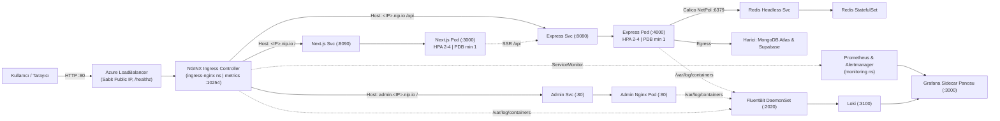
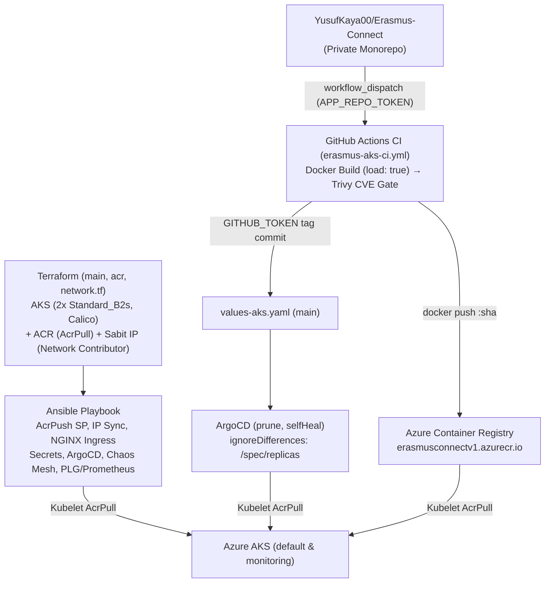

# Erasmus Connect — Cloud-Native Kubernetes, IaC, GitOps & Observability Mimarisi

🇹🇷 Türkçe (aşağıda) · 🇬🇧 [English version](#english-version)

> **Adım Adım Kurulum & Lab Rehberi:** Projeyi sıfırdan Minikube üzerinde kurmak, Azure AKS + ACR + ArgoCD + Chaos Mesh + PLG/Prometheus Gözlemlenebilirlik ve Trivy CI kapısı adımlarını tek tek uygulamak için **[SETUP-README.md](./SETUP-README.md)** dosyasını takip et.

**Erasmus Connect**, tam yığın bir web platformunun (**Next.js** kullanıcı arayüzü, **Vite/Nginx** yönetim paneli, **Express** backend API ve **Redis** oturum/önbellek katmanı) yerel Kubernetes (Minikube + Calico) ortamından **Azure AKS** üzerine üretime hazır taşınmasını; **Terraform** (AKS + Sabit IP + ACR `AcrPull`), **Ansible** (tek komutla bootstrap), **Chaos Mesh / HPA / PDB** (dayanıklılık), **ArgoCD** (GitOps), **GitHub Actions + Trivy** (DevSecOps CI) ve **Prometheus + Alertmanager + Loki + FluentBit + Grafana** (tam gözlemlenebilirlik) katmanlarıyla uçtan uca birleştiren bir DevOps / SRE projesidir.

---

## 1. Uçtan Uca Proje Akışı (11 Faz / 31 Bilet)

1. **Konteyner & Helm Orkestrasyonu (Faz 1–2):** Express, Next.js, Admin paneli (`nginx:alpine`) ve Redis (`StatefulSet` + `Headless Service`) tek bir [Helm chart](./helm/erasmus-connect/Chart.yaml) altında paketlendi. Hassas bilgiler Git dışı `.env` dosyalarından `envFrom` (`Secret` + `ConfigMap`) ile verildi; `requests`/`limits` ve `readinessProbe`/`livenessProbe` eklendi.
2. **Ingress & Zero-Trust Ağ (Faz 3):** `ingress-nginx` üzerinden host/path yönlendirmesi (`/`, `/api`, `admin.*`) kuruldu. Calico CNI altında **Post-DNAT NetworkPolicy** kurallarıyla Redis'e yetkisiz erişimler kapatıldı ve Express yalnızca Ingress ile Next.js'in (`4000`) erişimine açıldı.
3. **Altyapı Kodlama & Otomasyon (Faz 4–5):** **Terraform** ([terraform/](./terraform/main.tf)) ile `DenmarkEast` bölgesinde Calico destekli AKS kümesi (`aks-erasmus-connect-dev`, `Standard_B2s`), **Ansible** ([ansible/playbook.yml](./ansible/playbook.yml)) ile kubeconfig, Azure LB `/healthz` probe annotation'lı NGINX Ingress ve Secret/ConfigMap yüklemesi otomatikleştirildi.
4. **Yüksek Erişilebilirlik & Kaos Mühendisliği (Faz 6):** CPU tabanlı **HPA** (`min: 2`, `max: 4` @ `%60`), **PodDisruptionBudget (`minAvailable: 1`)** eklendi; **Chaos Mesh** ([chaos/](./chaos/01-pod-kill-express.yaml)) ile pod kill, Redis ağ gecikmesi ve CPU stres deneyleri kuruldu.
5. **Ölçekleme & ArgoCD GitOps (Faz 7):** Azure CNI'ın node başına `30 pod` sınırını aşmak için Terraform ile node sayısı `1 -> 2` artırıldı. **ArgoCD** ([argocd/erasmus-app.yaml](./argocd/erasmus-app.yaml)) `prune: true`, `selfHeal: true` ve HPA replika çakışmasını önleyen `ignoreDifferences` (`/spec/replicas`) ile devreye alındı.
6. **Şifresiz ACR & Managed Identity (Faz 8):** Docker Hub PAT (`dockerhub-secret`) kaldırıldı; Terraform ([terraform/acr.tf](./terraform/acr.tf)) ile ACR (`erasmusconnectv1.azurecr.io`, `admin_enabled = false`) ve AKS `kubelet_identity` için **`AcrPull`** rolü tanımlandı.
7. **Sabit IP, Tek Komutla Ortam Kurulumu & İzole CI (Faz 9):** Terraform ([terraform/network.tf](./terraform/network.tf)) ile `Standard / Static` Public IP ve AKS `Network Contributor` rolü eklendi. Ansible yeni IP'yi otomatik olarak `values-aks.yaml`/`.env.*` içine işleyip Ingress, ArgoCD, Chaos Mesh ve `sp-erasmus-acr-push` `AcrPush` yetkisini tek komutla kurar. Canlı uygulama reposuna dokunmadan [erasmus-aks-ci.yml](../../.github/workflows/erasmus-aks-ci.yml) (`workflow_dispatch`) imajları build edip ACR'ye atar ve GitOps tag'ini günceller.
8. **Tam Gözlemlenebilirlik — Metrikler, Alarmlar & Merkezi Loglama (Faz 10):** `2x Standard_B2s` kapasitesine uyarlanmış `kube-prometheus-stack` ([monitoring/values-prometheus.yaml](./monitoring/values-prometheus.yaml)), NGINX Ingress `ServiceMonitor` RED metrikleri, Chaos Mesh Game Day ile canlı `FIRING` doğrulaması yapılan SRE alarmları ([monitoring/prometheus-rules.yaml](./monitoring/prometheus-rules.yaml)) ve **FluentBit DaemonSet + Loki + Grafana Sidecar DataSource & Panosu** ([monitoring/logging-loki-fluentbit.yaml](./monitoring/logging-loki-fluentbit.yaml)) `monitoring` namespace'ine kuruldu.
9. **DevSecOps Shift-Left Güvenlik Kapısı (Faz 11):** GitHub Actions CI ([erasmus-aks-ci.yml](../../.github/workflows/erasmus-aks-ci.yml)) içine imaj ACR'ye pushlanmadan **önce** (`load: true` → Trivy → `docker push`) çalışan **Trivy CVE (`CRITICAL,HIGH`)** taraması ve `trivy_enforce` kapısı eklendi (kümede `0` ek pod/RAM tüketir).

---

## 2. Sistem, Gözlemlenebilirlik ve GitOps Akışı



### Build → Trivy → IaC → GitOps Yaşam Döngüsü



---

## 3. Dizin ve Dosya Yapısı

```text
k8s-hands-on-labs/
├── .github/workflows/
│   └── erasmus-aks-ci.yml                 # İzole AKS CI: Checkout -> Build -> Trivy Scan -> ACR Push -> GitOps Tag
│
└── projects/devops-ec-project/
    ├── README.md                          # Proje özeti, mimari ve uçtan uca akış (bu dosya)
    ├── SETUP-README.md                    # 11 Faz / 31 Biletlik adım adım kurulum ve hata çözüm rehberi
    ├── .env.example                       # Yerel/AKS Secret & build-arg ortam değişkeni şablonu
    ├── .gitignore                         # .env.* (şifreler), terraform.tfvars ve state dosyalarını Git dışı tutar
    │
    ├── ci/
    │   └── README.md                      # İzole CI kurulumu ve gereken 5 GitHub Secret kılavuzu
    │
    ├── helm/erasmus-connect/              # Uygulama Helm Chart'ı
    │   ├── Chart.yaml                     # Chart metadata (erasmus-connect)
    │   ├── .helmignore                    # Paketleme dışı bırakılacak dosyalar
    │   ├── values.yaml                    # Varsayılan değerler (portlar, HPA, resources, envFrom adları)
    │   ├── values-aks.yaml                # AKS & ACR override'ları (*.azurecr.io/...:<sha> ve <IP>.nip.io)
    │   └── templates/                     # Deployments, Services, Redis StatefulSet, Ingress, NetPols, HPAs, PDB
    │
    ├── terraform/                         # Azure AKS, ACR & Sabit IP Infrastructure-as-Code
    │   ├── versions.tf                    # azurerm ~> 4.0 provider sabitlemesi ve features{}
    │   ├── variables.tf                   # Bölge, küme adı, node_count, vm_size (Standard_B2s)
    │   ├── main.tf                        # Resource Group + AKS (SystemAssigned, Azure CNI + Calico)
    │   ├── acr.tf                         # Azure Container Registry (Basic) + kubelet AcrPull rol ataması
    │   ├── network.tf                     # Sabit Standard Public IP + AKS Network Contributor rolü
    │   ├── outputs.tf                     # cluster/RG adları, kube_config_raw, acr_login_server, ingress_public_ip
    │   └── terraform.tfvars.example       # Değişken override şablonu (gerçek terraform.tfvars Git dışıdır)
    │
    ├── ansible/                           # Tek Komutla Küme Bootstrap Otomasyonu
    │   ├── ansible.cfg & inventory.ini    # localhost ansible_connection=local
    │   └── playbook.yml                   # AcrPush SP, IP Sync, Ingress (ServiceMonitor), Secrets, ArgoCD, Chaos, Monitoring
    │
    ├── argocd/
    │   └── erasmus-app.yaml               # ArgoCD Application (values.yaml + values-aks.yaml, selfHeal, HPA uyumu)
    │
    ├── monitoring/                        # Observability Yığını (PLG + Prometheus + SRE Alerts)
    │   ├── values-prometheus.yaml         # Hafif kube-prometheus-stack ayarları (AKS control-plane scraper kapalı)
    │   ├── prometheus-rules.yaml          # Özel PrometheusRule SRE alarmları (ExpressDown, CrashLoop, High5xx)
    │   └── logging-loki-fluentbit.yaml    # Loki + FluentBit DaemonSet (RBAC/CRI) + Grafana Sidecar DataSource & Panosu
    │
    └── chaos/                             # Chaos Mesh Dayanıklılık Deneyleri
        ├── 01-pod-kill-express.yaml       # Express pod öldürme deneyi (PDB & self-healing testi)
        ├── 02-network-delay-redis.yaml    # Redis ağına gecikme enjeksiyonu
        └── 03-stress-cpu-express.yaml     # Express podlarına CPU stresi (HPA tetikleme testi)
```

---

## 4. Öne Çıkan Mühendislik Kararları ve Öğrenilen Dersler

| Konu | Uygulanan Çözüm | Mühendislik Gerekçesi |
| :--- | :--- | :--- |
| **Post-DNAT NetworkPolicy** | Kural hedeflerinde Service portu (`8080`) değil Pod `containerPort` (`4000`) ve Ingress için `namespaceSelector` kullanıldı. | Calico kuralları `kube-proxy` DNAT dönüşümünden **sonra** değerlendirir; Ingress trafiği `ingress-nginx` namespace'inden gelir. |
| **Build-Time vs Run-Time Env** | `NEXT_PUBLIC_*` ve `VITE_BACKEND_URL` build aşamasında (`--build-arg`), DB/JWT sırları K8s `Secret` ile runtime'da verildi. | İstemci JS paketleri derlenirken sabitlenir; pod env değişse de mevcut JS bundle değişmez. |
| **Sabit IP & Otomatik Sync** | [network.tf](./terraform/network.tf) ile Standard Static IP ayrıldı; Ansible yeni IP'yi `values-aks.yaml` ve `.env.*`'a yazar. | Pod/Ingress yeniden kurulumunda IP sabit kalır; `destroy -> apply` sonrası da tek komutla senkronlanır. |
| **Azure LB Health Probe** | `ingress-nginx` Service üzerine `azure-load-balancer-health-probe-request-path: "/healthz"` eklendi. | Azure LB varsayılan `/` yoluna `Host` olmadan vurur; NGINX `404` dönüp trafiği keser. |
| **GitOps & HPA Çakışması** | ArgoCD manifestosuna `ignoreDifferences` (`/spec/replicas` for `apps/Deployment`) kondu. | `selfHeal: true` açıkken ArgoCD'nin HPA replikalarını geri düşürmesini engeller. |
| **30-Pod Sınırı & Hafif İzleme** | Node sayısı `2`, Chaos controller `1`, `GF_PLUGINS_PREINSTALL_DISABLED: "true"`, `serviceMonitorSelectorNilUsesHelmValues: false`. | Azure CNI'ın 30-pod/node sınırına takılmadan Prometheus, Grafana, Alertmanager, Loki ve FluentBit aynı kümede rahat çalışır. |
| **Grafana Sidecar Otomasyonu** | DataSource ve 5 panelli dashboard `grafana_datasource: "1"` / `grafana_dashboard: "1"` etiketli ConfigMap olarak verildi. | Sidecar konteynerlar Grafana'yı restart etmeden Loki kaynağını ve canlı log panosunu yükler. |
| **Shift-Left Trivy Kapısı** | CI'da `load: true` → Trivy `CRITICAL,HIGH` → `docker push` sırası kuruldu. | Kümede 0 pod harcayarak zafiyetli imajların daha ACR'ye girmeden engellenmesini sağlar. |

---

## 5. Hızlı İşletim ve Doğrulama Komutları

### Küme Maliyet Kontrolü

```bash
# Çalışma bitince VM maliyetini durdur (IP ve ACR imajları korunur):
az aks stop --resource-group rg-erasmus-connect-dev --name aks-erasmus-connect-dev

# Ertesi gün kümeyi tekrar uyandır:
az aks start --resource-group rg-erasmus-connect-dev --name aks-erasmus-connect-dev
```

### Tüm Panellere Port-Forward Erişimi

```bash
kubectl port-forward -n monitoring svc/monitoring-grafana 3001:80                       # Grafana (admin / erasmus-grafana-123)
kubectl port-forward -n argocd svc/argocd-server 8085:80                                # ArgoCD
kubectl port-forward -n monitoring svc/monitoring-kube-prometheus-prometheus 9090:9090  # Prometheus
kubectl port-forward -n monitoring svc/monitoring-kube-prometheus-alertmanager 9093:9093 # Alertmanager
kubectl port-forward -n chaos-mesh svc/chaos-dashboard 2333:2333                        # Chaos Mesh UI
```

### Canlı Uç Nokta & Helm Kontrolleri

```bash
helm template erasmus ./helm/erasmus-connect \
  -f ./helm/erasmus-connect/values.yaml \
  -f ./helm/erasmus-connect/values-aks.yaml | grep -E "image:|host:"

INGRESS_IP=$(kubectl get svc ingress-nginx-controller -n ingress-nginx -o jsonpath='{.status.loadBalancer.ingress[0].ip}')
curl -i "http://${INGRESS_IP}.nip.io/"
curl -i "http://admin.${INGRESS_IP}.nip.io/"
curl -i -X POST "http://${INGRESS_IP}.nip.io/api/v1/ping"
```

---

## 6. Sıfırdan Kurulum

Tüm fazları (1–11) bilet bilet kurmak, `# TODO` şablonlarını çözmek ve her katmanın teknik gerekçesini görmek için **[SETUP-README.md](./SETUP-README.md)** rehberiyle devam et.

---

<a id="english-version"></a>

# 🇬🇧 English Version

> **Step-by-step setup & lab guide:** to build all 11 phases (31 tickets) from scratch across Minikube and Azure AKS — including `# TODO` scaffolds and real-world troubleshooting notes — follow **[SETUP-README.md](./SETUP-README.md)**.

**Erasmus Connect** is an end-to-end Cloud-Native DevOps & SRE platform project migrating a full-stack web application (**Next.js** storefront, **Vite/Nginx** admin SPA, **Express** API, **Redis** cache/session store, external **MongoDB Atlas** & **Supabase**) from local Kubernetes (Minikube + Calico) to **Azure AKS**. It integrates **Terraform** (AKS + Static IP + ACR `AcrPull`), **Ansible** (single-command bootstrap), **Chaos Mesh / HPA / PDB** (resilience), **ArgoCD** (GitOps), **GitHub Actions + Trivy** (shift-left DevSecOps CI), and **Prometheus + Alertmanager + Loki + FluentBit + Grafana** (full observability).

## 1. End-to-End Flow (11 Phases / 31 Tickets)

1. **Containers & Helm (Phases 1–2):** Express, Next.js, Admin SPA (`nginx:alpine`), and Redis (`StatefulSet` + Headless `Service`) packaged in [helm/erasmus-connect/](./helm/erasmus-connect/Chart.yaml) with `.env` `Secret`/`ConfigMap` `envFrom`, resource bounds, and health probes.
2. **Ingress & Zero-Trust Calico (Phase 3):** Host/path routing (`/`, `/api`, `admin.*`) via `ingress-nginx` and **Post-DNAT Calico `NetworkPolicy`** isolating Redis (`:6379`) to Express and restricting Express (`:4000`) to Ingress + Next.js.
3. **IaC & Bootstrap (Phases 4–5):** **Terraform** ([terraform/](./terraform/main.tf)) provisions Calico-enabled AKS (`Standard_B2s` in `DenmarkEast`); **Ansible** ([ansible/playbook.yml](./ansible/playbook.yml)) fetches kubeconfig, deploys `ingress-nginx` with `/healthz` Azure LB probe, and creates Secrets/ConfigMaps.
4. **High Availability & Chaos (Phase 6):** CPU **HPA** (`2–4` replicas @ `60%`), **PodDisruptionBudget**, and **Chaos Mesh** experiments ([chaos/](./chaos/01-pod-kill-express.yaml)).
5. **Scaling & ArgoCD GitOps (Phase 7):** In-place scaling `node_count: 1 -> 2` (Azure CNI 30-pods/node limit) and **ArgoCD** ([argocd/erasmus-app.yaml](./argocd/erasmus-app.yaml)) with `prune: true`, `selfHeal: true`, and `ignoreDifferences` on `/spec/replicas`.
6. **Secret-less ACR (Phase 8):** Provisioned ACR (`erasmusconnectv1.azurecr.io`, `admin_enabled = false`) via [terraform/acr.tf](./terraform/acr.tf) and granted `kubelet_identity` **`AcrPull`**, eliminating `dockerhub-secret`.
7. **Static IP, Full Rebuild & Isolated CI (Phase 9):** Reserved a static Standard Public IP + `Network Contributor` role ([terraform/network.tf](./terraform/network.tf)); Ansible syncs new IPs automatically and bootstraps the full stack. [erasmus-aks-ci.yml](../../.github/workflows/erasmus-aks-ci.yml) (`workflow_dispatch`) builds from the private monorepo without touching its live CI, pushes to ACR, and commits tag bumps.
8. **Full Observability (Phase 10):** Deployed tuned `kube-prometheus-stack` ([monitoring/values-prometheus.yaml](./monitoring/values-prometheus.yaml)), NGINX Ingress `ServiceMonitor` metrics, custom SRE alerts ([monitoring/prometheus-rules.yaml](./monitoring/prometheus-rules.yaml)) verified via Chaos Mesh Game Day (`FIRING` in Prometheus & Alertmanager), plus **FluentBit DaemonSet + Loki + auto-provisioned Grafana Sidecar Dashboard** ([monitoring/logging-loki-fluentbit.yaml](./monitoring/logging-loki-fluentbit.yaml)).
9. **DevSecOps Trivy Gate (Phase 11):** Added **Trivy** (`CRITICAL,HIGH`, `ignore-unfixed: true`) scanning locally (`load: true`) inside [erasmus-aks-ci.yml](../../.github/workflows/erasmus-aks-ci.yml) before `docker push`, adding zero pod/RAM footprint to AKS.

## 2. Repository Layout

| Path | Purpose |
| :--- | :--- |
| [`.github/workflows/erasmus-aks-ci.yml`](../../.github/workflows/erasmus-aks-ci.yml) & [`ci/README.md`](./ci/README.md) | Isolated `workflow_dispatch` CI: Checkout -> Build (`load: true`) -> Trivy Gate -> ACR Push -> GitOps tag commit |
| [`README.md`](./README.md) / [`SETUP-README.md`](./SETUP-README.md) | Architecture overview / 11-phase, 31-ticket step-by-step setup & troubleshooting guide |
| [`helm/erasmus-connect/`](./helm/erasmus-connect/Chart.yaml) | Helm chart (`values.yaml`, `values-aks.yaml` ACR/nip.io overrides, workloads, Ingress, NetPols, HPA, PDB) |
| [`terraform/`](./terraform/main.tf) | `versions.tf` (`azurerm ~> 4.0`), `variables.tf`, `main.tf` (AKS), `acr.tf` (ACR + `AcrPull`), `network.tf` (Static IP), `outputs.tf` |
| [`ansible/`](./ansible/playbook.yml) | Single-command bootstrap: SP `AcrPush`, IP sync, `ingress-nginx` (`ServiceMonitor`), Secrets, ArgoCD, Chaos Mesh, Monitoring |
| [`argocd/erasmus-app.yaml`](./argocd/erasmus-app.yaml) | ArgoCD Application (`values.yaml` + `values-aks.yaml`, `selfHeal`, HPA `ignoreDifferences`) |
| [`monitoring/`](./monitoring/values-prometheus.yaml) | `values-prometheus.yaml`, `prometheus-rules.yaml` (`PrometheusRule`), `logging-loki-fluentbit.yaml` (Loki + FluentBit + Grafana sidecar) |
| [`chaos/`](./chaos/01-pod-kill-express.yaml) | Chaos Mesh experiments (pod kill, Redis network delay, Express CPU stress) |

## 3. Quick Operations

```bash
# Save cloud credits (preserves static IP & ACR images)
az aks stop  --resource-group rg-erasmus-connect-dev --name aks-erasmus-connect-dev
az aks start --resource-group rg-erasmus-connect-dev --name aks-erasmus-connect-dev

# UI port-forwards
kubectl port-forward -n monitoring svc/monitoring-grafana 3001:80
kubectl port-forward -n argocd svc/argocd-server 8085:80
kubectl port-forward -n monitoring svc/monitoring-kube-prometheus-prometheus 9090:9090
kubectl port-forward -n monitoring svc/monitoring-kube-prometheus-alertmanager 9093:9093
kubectl port-forward -n chaos-mesh svc/chaos-dashboard 2333:2333
```

## 4. Setup From Scratch

Continue with **[SETUP-README.md](./SETUP-README.md)** for the full 11-phase walkthrough.
