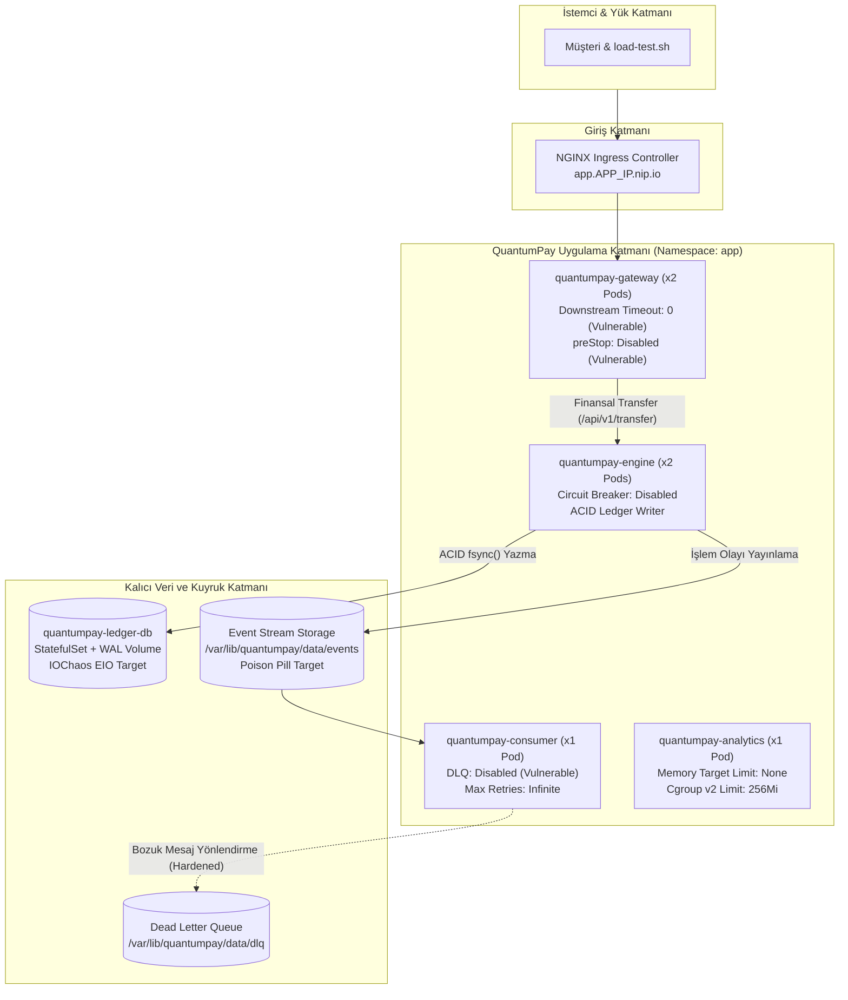
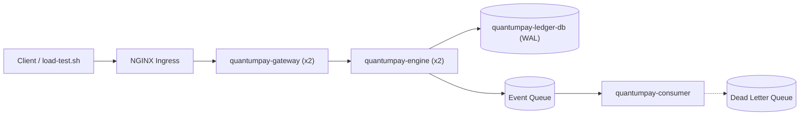

# 🔥 Kubernetes Chaos Engineering & Distributed SRE Game Day Lab 5 (QuantumPay Core)

> **[🇹🇷 Türkçe](#-1-mimari-ve-sre-karar-matrisi) | [🇬🇧 English](#-english-documentation)**

Bu laboratuvar, **QuantumPay Distributed Core** kurumsal finansal işlem ve dağıtık defter (ledger) mimarisi üzerinde **Chaos Mesh**, **Prometheus**, **Grafana** ve **Argo CD** kullanarak modern DevOps ve SRE ekiplerinin üretimde (Production) karşılaştığı en karmaşık çekirdek seviyesi (kernel-level), ağ bozulması (packet corruption/reorder) ve kuyruk zehirlenmesi (poison pill) arıza modlarını simüle etmek, teşhis etmek ve kalıcı olarak iyileştirmek için tasarlanmıştır.

> [!IMPORTANT]
> **Lab 5'in Temel Felsefesi: "Pristine Baseline, Dağıtık Çekirdek Arızaları ve Sıfır Yanıltıcı Çöküş"**
> 1. **%100 Kararlı Başlangıç (Pristine Baseline):** Sistem ayağa kalktığında gizli hatalar asla kendiliğinden patlamaz. Kurulumda tüm podlar `1/1 Running`, `0 restart`, kuyruk lag'i `0` ve API `%100 Availability` ile başlar. Hatalar **yalnızca kaos enjekte edildiğinde veya aşırı yük bindirildiğinde** açığa çıkar!
> 2. **Labs 1-4'ten Tamamen Farklı Yeni Senaryolar:** Önceki lab'larda incelenen temel pod silme veya DNS hataları yerine; TCP paket bozulması (corrupt) ve sıra kayması (reorder) kaynaklı soket sızıntısı, dosya sistemi `EIO` (I/O error) ve Devre Kesici (Circuit Breaker) ihtiyacı, rolling update sırasında Ingress drain yarış durumu (`502 Bad Gateway`), zehirli mesaj (poison pill) kaynaklı Kafka/Kuyruk Rebalance Fırtınası, Cgroup v2 bellek sınırı ve `GOMEMLIMIT` uyumsuzluğundan doğan OOM Killer (137) ve Slowloris yarım açık bağlantı açlığı test edilir.
> 3. **Google SRE Standartları:** Multi-Stage Chaos Mesh `Workflow` orkestrasyonu, otomatik blast-radius kontrolü (`StatusCheck`) ve blameless postmortem kültürü içerir.

---

## 🧭 1. Mimari ve SRE Karar Matrisi



### SRE Teknoloji ve Arıza Matrisi

| Bileşen | Sistemdeki Rolü | Lab 5'e Özgü Kaos & Arıza Tipi | İzlenecek Metrik & Belirti |
|:---|:---|:---|:---|
| **`quantumpay-gateway`** | İstemci isteklerini karşılayan API ağ geçidi. | **T1:** `NetworkChaos` corrupt %35 & reorder %25<br>**T3:** Pod restart altında Ingress drain yarışı<br>**T6:** `NetworkChaos` 20kbps Slowloris bağlantı açlığı | `HTTP 504 Gateway Timeout`<br>`HTTP 502 Bad Gateway / ECONNRESET`<br>`quantumpay_active_connections` |
| **`quantumpay-engine`** | Finansal transferleri yürüten işlem motoru. | **T2:** `IOChaos` `fault: EIO (errno 5)` WAL diski | `HTTP 500 Internal Server Error`<br>`quantumpay_circuit_breaker_state` |
| **`quantumpay-consumer`**| İşlem mutabakatını yürüten asenkron tüketici. | **T4:** Zehirli mesaj (poison pill) enjeksiyonu | `Consumer Group Rebalance Storm`<br>`max.poll.interval.ms Timeout Alert` |
| **`quantumpay-analytics`**| Risk skorlaması ve analitik yürüten worker. | **T5:** `StressChaos` memory 180MB (Cgroup OOM) | `ExitCode 137 (OOMKilled)`<br>`Pod CrashLoopBackOff` |
| **`quantumpay-ledger-db`**| İşlem kayıtlarının tutulduğu StatefulSet. | **A1:** `PodChaos` `pod-kill` Gateway yedeklilik<br>**A2:** `NetworkChaos` 40ms ağ jitter'ı | `p99 Latency (< 100ms)`<br>`0% Error Rate (Control Pass)` |

---

## 🛠️ 2. Hızlı Başlangıç

### Ortamı Başlatma ve Sıfırlama
```bash
cd /home/ysf/k8s-hands-on-labs/troubleshoot/chaos-troubleshooting-5

# Lab ortamını kararlı (baseline) modda başlatın:
./scripts/setup-lab.sh

# Pristine Baseline doğrulamasını çalıştırın (Tüm podlar 1/1 Running ve sıfır restart olmalıdır):
./scripts/check-system.sh --strict
```

### Sentetik Yük Testi Çalıştırma
```bash
./scripts/load-test.sh
```

---

## 🔬 3. Senaryo Yönetimi ve Kaos Deneyleri

Tüm senaryolar `./scripts/trigger-scenario.sh` betiği üzerinden tek komutla yönetilir:

```bash
# Kullanılabilir senaryoları listeleyin:
./scripts/trigger-scenario.sh --list

# Aktif kaos durumunu kontrol edin:
./scripts/trigger-scenario.sh --status

# Tüm aktif deneyleri temizleyip sistemi normale döndürün:
./scripts/trigger-scenario.sh --clean-chaos
```

### Bölüm A: Kontrol Deneyleri (Sistem Dayanmalı)
* **Senaryo 1 (A1) - PodChaos Pod Kill (Gateway Yedeklilik):**
  Gateway'in 2 replikası varken 1 pod öldürülür. K8s Service yükü otomatik aktarır, hata oranı %0 kalır.
  ```bash
  ./scripts/trigger-scenario.sh 1 apply
  ./scripts/check-system.sh
  ./scripts/trigger-scenario.sh 1 delete
  ```
* **Senaryo 2 (A2) - NetworkChaos Jitter (Hafif Ağ Gecikmesi):**
  Engine pod'larına 40ms gecikme ve 10ms jitter enjekte edilir. İşlemler başarıyla tamamlanır.
  ```bash
  ./scripts/trigger-scenario.sh 2 apply
  ./scripts/load-test.sh
  ./scripts/trigger-scenario.sh 2 delete
  ```

### Bölüm B: Troubleshoot Deneyleri (Dağıtık Sistem Zafiyetleri)
* **Senaryo 3 (T1) - Paket Bozulması ve Sıra Kayması (Soket Sızıntısı):**
  Ağ paketleri bozulur. Downstream timeout olmadığı için worker thread'ler sonsuza dek kilitlenir.
  ```bash
  ./scripts/trigger-scenario.sh 3 apply
  ./scripts/load-test.sh   # 504 Gateway Timeout gözlemlenir
  ./scripts/trigger-scenario.sh 3 delete
  ```
* **Senaryo 4 (T2) - IOChaos Fault EIO (Devre Kesici Eksikliği):**
  WAL diski I/O hatası verir. Devre kesici olmadığı için diske yazma istisnaları API'yi 500'e boğar.
  ```bash
  ./scripts/trigger-scenario.sh 4 apply
  ./scripts/load-test.sh   # 500 Disk IO Error gözlemlenir
  ./scripts/trigger-scenario.sh 4 delete
  ```
* **Senaryo 5 (T3) - Ingress Drain Yarış Durumu (Zero-Downtime Zaafı):**
  Pod aniden durdurulur. `preStop` hook eksik olduğu için Ingress kapalı sokete istek atar (502 Bad Gateway).
  ```bash
  ./scripts/trigger-scenario.sh 5 apply
  ./scripts/load-test.sh   # 502 Bad Gateway / ECONNRESET gözlemlenir
  ./scripts/trigger-scenario.sh 5 delete
  ```
* **Senaryo 6 (T4) - Zehirli Mesaj ve Rebalance Fırtınası:**
  Sıraya bozuk mesaj enjekte edilir. DLQ olmadığı için consumer aynı mesajda kilitlenir ve rebalance fırtınası başlar.
  ```bash
  ./scripts/trigger-scenario.sh 6 apply
  kubectl logs -n app -l app.kubernetes.io/component=consumer --tail=50
  ./scripts/trigger-scenario.sh 6 delete
  ```
* **Senaryo 7 (T5) - Cgroup v2 Bellek Stresi ve OOM Killer (137):**
  180MB bellek stresi bindirilir. GC cgroup sınırından habersiz olduğu için Linux çekirdeği podu öldürür.
  ```bash
  ./scripts/trigger-scenario.sh 7 apply
  kubectl get pods -n app -l app.kubernetes.io/component=analytics   # OOMKilled / ExitCode 137
  ./scripts/trigger-scenario.sh 7 delete
  ```
* **Senaryo 8 (T6) - Slowloris Bağlantı Açlığı:**
  Bant genişliği kısıtlanır. Yavaş bağlantılar soketleri tüketir, yeni meşru kullanıcılar bağlanamaz.
  ```bash
  ./scripts/trigger-scenario.sh 8 apply
  ./scripts/load-test.sh
  ./scripts/trigger-scenario.sh 8 delete
  ```

### Bölüm C: Automated Game Day Workflow
* **Senaryo 9 (C1) - Multi-Stage Resilience Workflow:**
  Paket bozulması, disk hatası ve otomatik durum doğrulamasını (StatusCheck) arka arkaya çalıştırır.
  ```bash
  ./scripts/trigger-scenario.sh 9 apply
  ./scripts/trigger-scenario.sh --status
  ```

---

## 🛡️ 4. Kalıcı Çözüm ve Doğrulama (Hardened Mode)

Tüm zafiyetlerin kalıcı çözümü `helm-chart/values-hardened.yaml` içinde tanımlanmıştır:
- Downstream socket timeout: `3s`
- Storage Circuit Breaker: `enabled: true, errorThreshold: 3`
- Ingress preStop sleep: `5s`, grace period: `30s`
- Consumer Dead Letter Queue: `enabled: true, maxRetries: 3`
- Analytics runtime memory target: `192MiB`
- Slowloris readHeaderTimeout: `2s`, idleTimeout: `5s`

Laboratuvarı güçlendirilmiş modda güncellemek için:
```bash
./scripts/setup-lab.sh --hardened
./scripts/check-system.sh --strict
```

Detaylı teknik analiz ve diff'ler için:
👉 **[SOLUTION.md Dosyasını İnceleyin](SOLUTION.md)**

---

# 🇬🇧 English Documentation

# 🔥 Kubernetes Chaos Engineering & Distributed SRE Game Day Lab 5 (QuantumPay Core)

This lab simulates advanced production failure modes on **QuantumPay Distributed Core**, a mission-critical financial ledger engine, leveraging **Chaos Mesh**, **Prometheus**, **Grafana**, and **Argo CD**.

> [!IMPORTANT]
> **Lab 5 Core Tenet: "Pristine Baseline, Deep Distributed Systems Faults & Zero Misleading Crashes"**
> 1. **100% Pristine Baseline:** The architecture starts completely healthy (`1/1 Running`, `0 restarts`, 0 queue lag, and 100% HTTP 200 availability). Faults only reveal themselves when chaos or synthetic concurrency is applied!
> 2. **Novel Failure Modes (Distinct from Labs 1-4):** Focuses on kernel-level and distributed concurrency pitfalls: TCP packet corrupt/reorder socket saturation, disk `EIO` storage circuit breakers, Ingress drain race conditions (`502 Bad Gateway`), poison-pill Kafka rebalance storms, Cgroup v2 OOM Killer vs runtime memory tuning (`GOMEMLIMIT`), and Slowloris half-open connection starvation.
> 3. **Google SRE Standards:** Automated Chaos Mesh `Workflow` orchestration with automated blast-radius containment (`StatusCheck`).

---

## 🧭 Architecture & SRE Decision Matrix



### SRE Failure Modes Matrix

| Component | Architecture Role | Lab 5 Chaos Experiment | Observed Metric & Symptom |
|:---|:---|:---|:---|
| **`quantumpay-gateway`** | Public API Entrypoint | **T1:** `NetworkChaos` corrupt 35% & reorder 25%<br>**T3:** Pod restart during rolling update<br>**T6:** `NetworkChaos` 20kbps Slowloris | `HTTP 504 Gateway Timeout`<br>`HTTP 502 Bad Gateway / ECONNRESET`<br>`Active Connection Saturation` |
| **`quantumpay-engine`** | ACID Transaction Execution | **T2:** `IOChaos` `fault: EIO (errno 5)` WAL storage | `HTTP 500 Internal Server Error`<br>`quantumpay_circuit_breaker_state` |
| **`quantumpay-consumer`**| Settlement Consumer | **T4:** Poison pill event injection | `Continuous Kafka Rebalance Storm`<br>`max.poll.interval.ms Heartbeat Timeout` |
| **`quantumpay-analytics`**| Risk Computation Worker | **T5:** `StressChaos` memory 180MB | `ExitCode 137 (OOMKilled)`<br>`Cgroup v2 Memory Limit Breach` |
| **`quantumpay-ledger-db`**| Persistent Transaction DB | **A1:** `PodChaos` `pod-kill` Gateway redundancy<br>**A2:** `NetworkChaos` 40ms network jitter | `p99 Latency (< 100ms)`<br>`0% Error Rate (Control Pass)` |

---

## 🛠️ Quick Start & Usage

```bash
cd /home/ysf/k8s-hands-on-labs/troubleshoot/chaos-troubleshooting-5

# 1. Initialize pristine baseline environment:
./scripts/setup-lab.sh

# 2. Verify pristine health (all pods 1/1 Running, 0 restarts):
./scripts/check-system.sh --strict

# 3. Trigger a scenario (e.g., T1 Packet Corruption):
./scripts/trigger-scenario.sh 3 apply

# 4. Run synthetic load test:
./scripts/load-test.sh

# 5. Reset chaos:
./scripts/trigger-scenario.sh --clean-chaos

# 6. Apply hardened configuration:
./scripts/setup-lab.sh --hardened
./scripts/check-system.sh --strict
```

For the complete technical breakdown and post-mortem analysis:
👉 **[Read SOLUTION.md](SOLUTION.md)**
