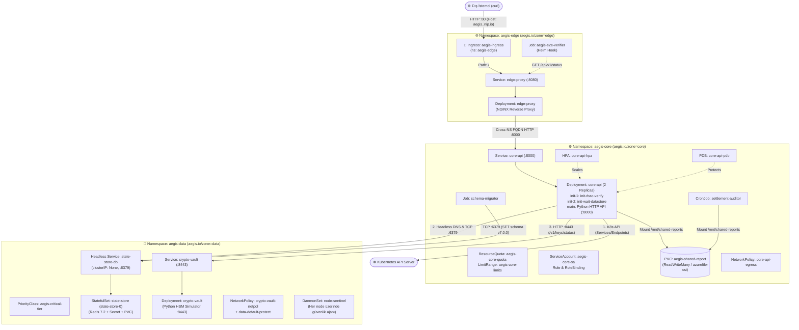

# 🚨 K8s Troubleshoot Lab 24: AegisCloud v7.0 — Cascading Full-Cluster Outage

[🇹🇷 Türkçe](#-türkçe-bölüm) | [🇬🇧 English](#-english-section)

---

## 🇹🇷 Türkçe Bölüm

### 📋 Olay Özeti (Incident Briefing)

| Alan | Detay |
| :--- | :--- |
| **Platform** | **AegisCloud v7.0** — Multi-Tier Sovereign Financial & Security Platform |
| **Şiddet Seviyesi** | **SEV-0 (Tam Küme Kesintisi & Zincirleme Başlatma Çöküşü)** |
| **Etkilenen Alanlar** | `aegis-edge`, `aegis-core`, `aegis-data` (3 Namespace, 18 Kubernetes Obje Türü) |
| **Dağıtım Aracı** | Helm (`helm/aegiscloud`) + Terraform (AKS + Calico CNI + NGINX Ingress) |
| **Özel Mekanik** | **Domino Etkisi (Cascading / "Soğan Kabuğu" Hataları)** — Bir katmandaki engeli çözdüğünüzde pod yaşam döngüsünün bir sonraki aşaması tetiklenir ve gizli kalan yeni bir hata ortaya çıkar! |

Finansal mutabakat ve kriptografik anahtar doğrulama platformu olan **AegisCloud v7.0**, yeni güvenlik sıkılaştırmaları, çok katmanlı ağ izolasyonu, paylaşımlı denetim depolaması ve kaynak kotalarıyla üretime alındı. Ancak dağıtım sonrasında:
1. Kritik iş yüklerinin bir kısmı `kubectl get pods` çıktısında **hiç görünmüyor** (`0/1` veya `0/2` replica).
2. Düğümlerde çalışması gereken güvenlik ajanları (`DaemonSet`) hiçbir düğüme yerleşmiyor.
3. Çalışıyor (`1/1 Running`) görünen güvenlik servisleri bile dış bağlantıları reddediyor veya zaman aşımına uğratıyor.
4. Bir sorunu düzelttiğinizde podlar `Pending` -> `CreateContainerConfigError` -> `Init:0/2` -> `Init:1/2` -> `CrashLoopBackOff` -> `Running (Endpoints: <none>)` -> `502 Bad Gateway` -> `404 Not Found` zincirinden geçerek size gerçek bir **Full-Cluster SRE deneyimi** yaşatıyor.

---

### 🏗️ Hedeflenen Mimari (Target Architecture)



---

### 📂 Dosya Yapısı (Repository Map)

```text
k8-troubleshoot-24/
├── setup.sh                                              # AKS + Helm kurulum scripti
├── cleanup.sh                                            # Temizlik scripti
├── terraform/
│   └── main.tf                                           # AKS (Calico CNI) + NGINX Ingress Controller
├── helm/
│   └── aegiscloud/
│       ├── Chart.yaml                                    # Helm Chart üst verisi
│       ├── values.yaml                                   # Merkezi yapılandırma değerleri
│       └── templates/
│           ├── 00-namespaces-and-quotas.yaml             # Namespace (x3), PriorityClass, ResourceQuota, LimitRange
│           ├── 01-rbac.yaml                              # ServiceAccount, Role, RoleBinding
│           ├── 02-configs-and-secrets.yaml               # Secret, core-api ConfigMap, edge-proxy NGINX ConfigMap
│           ├── 03-shared-storage.yaml                    # Paylaşımlı PVC (aegis-shared-report)
│           ├── 04-state-store-statefulset.yaml           # Headless Service & Redis StatefulSet + volumeClaimTemplates
│           ├── 05-crypto-vault-deployment.yaml           # Crypto-Vault Service & Deployment
│           ├── 06-core-api-deployment.yaml               # Core-API Service & Deployment (2 InitContainer + Main)
│           ├── 07-batch-jobs-and-cronjob.yaml            # schema-migrator Job & settlement-auditor CronJob
│           ├── 08-node-sentinel-daemonset.yaml           # node-sentinel DaemonSet
│           ├── 09-scaling-and-pdb.yaml                   # HorizontalPodAutoscaler & PodDisruptionBudget
│           ├── 10-edge-proxy-and-ingress.yaml            # Edge-Proxy Service, Deployment & Ingress
│           ├── 11-network-policies.yaml                  # Ingress & Egress NetworkPolicy kuralları
│           └── 12-e2e-verification-job.yaml              # Uçtan uca doğrulama Helm Hook Job'ı
├── README.md                                             # Bu vaka rehberi (Spoiler içermez!)
└── SOLUTION.md                                           # 16 zincirleme hatanın kök neden analizi ve çözümleri
```

---

### 🚀 Kurulum (Quick Start)

```bash
chmod +x setup.sh cleanup.sh
./setup.sh
```

Değişikliklerinizi `helm/aegiscloud/values.yaml` (veya gerekli şablonlar) üzerinde yaptıktan sonra kümeyi güncellemek için:

```bash
INGRESS_IP=$(kubectl get svc -n ingress-nginx ingress-nginx-controller -o jsonpath='{.status.loadBalancer.ingress[0].ip}')
helm upgrade --install aegiscloud ./helm/aegiscloud \
  --namespace aegis-core \
  --set global.ingressHost="aegis.${INGRESS_IP}.nip.io"
```

> [!WARNING]
> Kubernetes'te bazı objelerin (`StatefulSet.spec.volumeClaimTemplates`, `StatefulSet.spec.serviceName`, `PersistentVolumeClaim.spec`, `Job.spec.template`) alanları **immutable** (değiştirilemez) yapıdadır. Bu alanları `values.yaml` içinde düzelttikten sonra `helm upgrade` çalıştırmadan önce ilgili eski objeyi (`kubectl delete sts ...`, `kubectl delete pvc ...`, `kubectl delete job ...`) silmeniz gerekebilir!

---

### 🔍 7 Aşamalı Teşhis Metodolojisi (Spoiler İçermeyen İpuçları)

Sorunları rastgele çözmek yerine aşağıdaki **7 katmanlı sırayı** takip edin:

#### Aşama 1: Neden Bazı Podlar Hiç Oluşmuyor? (Admission & Scheduling)
- `kubectl get sts,ds,deploy -A` çıktısına baktığınızda `state-store` (`0/1`), `node-sentinel` (`DESIRED: 0`) ve `core-api` (`0/2`) podlarının `kubectl get pods -A` listesinde dahi olmadığını göreceksiniz.
- **İpucu:** Bir `StatefulSet` veya `ReplicaSet` pod oluşturamıyorsa `kubectl describe sts -n aegis-data state-store`, `kubectl describe rs -n aegis-core` ve `kubectl describe ds -n aegis-data node-sentinel` çıktılarındaki `Events` tablosunu inceleyin. Kümedeki `PriorityClass`, `ResourceQuota` ve node etiketlerini (`kubectl get nodes --show-labels`) kontrol edin.

#### Aşama 2: Depolama (PVC) ve Dosya Sistemi Engelleri
- Podlar oluşmaya başladığında neden `Pending` veya `CreateContainerConfigError` veya `CrashLoopBackOff` durumuna düşüyor?
- **İpucu:** `kubectl get pvc -A` ve `kubectl describe pvc` ile `StorageClass` isimlerini (`kubectl get sc`) ve `AccessMode` (`ReadWriteOnce` vs `ReadWriteMany`) gereksinimlerini karşılaştırın.
- Güvenlik ajanı podlarının (`node-sentinel`) loglarını (`kubectl logs`) ve `securityContext` ayarlarını inceleyin.

#### Aşama 3: RBAC ve InitContainer Yaşam Döngüsü
- `core-api` podları oluştuğunda `Init:0/2` ve ardından `Init:1/2` aşamalarında takıldığını göreceksiniz.
- **İpucu:** Init container loglarını okumak için:
  ```bash
  kubectl logs -n aegis-core <core-api-pod-adi> -c init-rbac-verify
  kubectl logs -n aegis-core <core-api-pod-adi> -c init-wait-datastore
  ```
- Podun hangi `ServiceAccount` ile çalıştığını ve `Role` içindeki izinleri kontrol edin.

#### Aşama 4: Headless DNS ve Egress/Ingress NetworkPolicy İzolasyonu
- `init-wait-datastore` neden `state-store-0` adresini çözemiyor veya bağlanamıyor?
- **İpucu:** `StatefulSet`'in `spec.serviceName` alanı ile Headless Service'in `metadata.name` alanının birebir aynı olup olmadığını kontrol edin. Ayrıca `aegis-core` ve `aegis-data` içindeki `NetworkPolicy` objelerini (`kubectl describe netpol -A`) inceleyin: CoreDNS (`53/UDP-TCP`) ve hedef portlar açık mı?

#### Aşama 5: Uygulama Başlatma, Ortam Değişkeni Önceliği ve Probe Tuzakları
- `crypto-vault` podu `1/1 Running` olmasına rağmen neden diğer podlar ona bağlanırken `Connection refused` veya `Connection timed out` alıyor?
- `core-api` ana konteyneri başladığında neden `CrashLoopBackOff` oluyor veya sürekli yeniden başlatılıyor?
- **İpucu:** Bir podda hem `envFrom` (`ConfigMap`) hem de `env` tanımlıysa hangisi diğerini ezer? Ayrıca `livenessProbe` port ve path değerlerini uygulamanın dinlediği gerçek portla karşılaştırın.

#### Aşama 6: Service Endpoints, Batch İşleri (Job/CronJob), HPA ve PDB
- Podlar `1/1 Running` ve `READY` olduğunda `kubectl get endpoints -A` çıktısını kontrol edin. `core-api` servisinin arkasında neden IP yok?
- `schema-migrator` Job'ı neden `Failed` oluyor ve `settlement-auditor` CronJob'ı neden hiç tetiklenmiyor?
- `kubectl get hpa,pdb -n aegis-core` çıktısında `TARGETS: <unknown>` veya `ALLOWED DISRUPTIONS: 0` uyarıları var mı?

#### Aşama 7: Cross-Namespace Reverse Proxy ve Ingress Yönlendirmesi
- İç servisler çalıştıktan sonra `edge-proxy` üzerinden ve dış `Ingress` adresinden (`http://aegis.<INGRESS_IP>.nip.io/api/v1/status`) yapılan istekler neden `502 Bad Gateway` veya `404 Not Found` dönüyor?
- **İpucu:** Farklı bir namespace'teki servise kısa adla (`http://core-api:8000`) erişilebilir mi? Kümedeki aktif `IngressClass` (`kubectl get ingressclass`) adı nedir?

---

### ✅ Başarı Kriterleri (Success Criteria)

Tüm 16 hatayı giderdiğinizde aşağıdaki doğrulama tablosunun tamamı yeşil olmalıdır:

1. **Tüm Podlar ve StatefulSet/DaemonSet Hazır:**
   - `aegis-data`: `state-store-0` (`1/1 Running`), `crypto-vault-xxx` (`1/1 Running`), `node-sentinel-xxx` (Her node için `1/1 Running`).
   - `aegis-core`: 2x `core-api-xxx` (`1/1 Running`, `RESTARTS: 0`), `schema-migrator-xxx` (`Completed`), `settlement-auditor` (`SUSPEND: False`).
   - `aegis-edge`: `edge-proxy-xxx` (`1/1 Running`), `aegis-e2e-verifier-xxx` (`Completed`).
2. **Depolama (PVC) Durumu:**
   - `aegis-data/state-data-state-store-0` -> `Bound`
   - `aegis-core/aegis-shared-report` -> `Bound` (`RWX`)
3. **HPA & PDB Sağlığı:**
   - `core-api-hpa`: `REFERENCE: Deployment/core-api`
   - `core-api-pdb`: `ALLOWED DISRUPTIONS: 1`
4. **Uçtan Uca HTTP Doğrulaması:**
   ```bash
   INGRESS_IP=$(kubectl get svc -n ingress-nginx ingress-nginx-controller -o jsonpath='{.status.loadBalancer.ingress[0].ip}')
   curl -i "http://aegis.${INGRESS_IP}.nip.io/api/v1/status"
   ```
   Beklenen Çıktı (`HTTP/1.1 200 OK`):
   ```json
   {
     "platform": "AegisCloud v7.0",
     "status": "operational",
     "state_store": "connected",
     "crypto_vault": "verified",
     "pod": "core-api-..."
   }
   ```

---

## 🇬🇧 English Section

### 📋 Incident Briefing

| Field | Detail |
| :--- | :--- |
| **Platform** | **AegisCloud v7.0** — Multi-Tier Sovereign Financial & Security Platform |
| **Severity** | **SEV-0 (Full-Cluster Cascading Outage)** |
| **Affected Scopes** | `aegis-edge`, `aegis-core`, `aegis-data` (3 Namespaces, 18 Kubernetes Object Kinds) |
| **Deployment Tool** | Helm (`helm/aegiscloud`) + Terraform (AKS + Calico CNI + NGINX Ingress) |
| **Special Mechanic** | **Cascading "Onion-Peel" Failures** — Fixing one layer unblocks the next Kubernetes controller/lifecycle stage and reveals a deeper hidden failure! |

**AegisCloud v7.0** was deployed with strict multi-namespace zero-trust policies, resource quotas, shared audit storage, and cryptographic verification. Immediately after rollout:
1. Several mission-critical workloads do not even appear in `kubectl get pods` (`0/1` or `0/2` replicas).
2. Security `DaemonSet` agents show `DESIRED: 0` across all nodes.
3. Even pods showing `1/1 Running` refuse or time out cross-namespace connections.
4. Resolving one bug advances pods through `Pending` -> `CreateContainerConfigError` -> `Init:0/2` -> `Init:1/2` -> `CrashLoopBackOff` -> `Running (Endpoints: <none>)` -> `502 Bad Gateway` -> `404 Not Found`.

Follow the **7-Stage Diagnostic Methodology** above to peel back each layer and restore full cluster health without peeking at `SOLUTION.md`!
