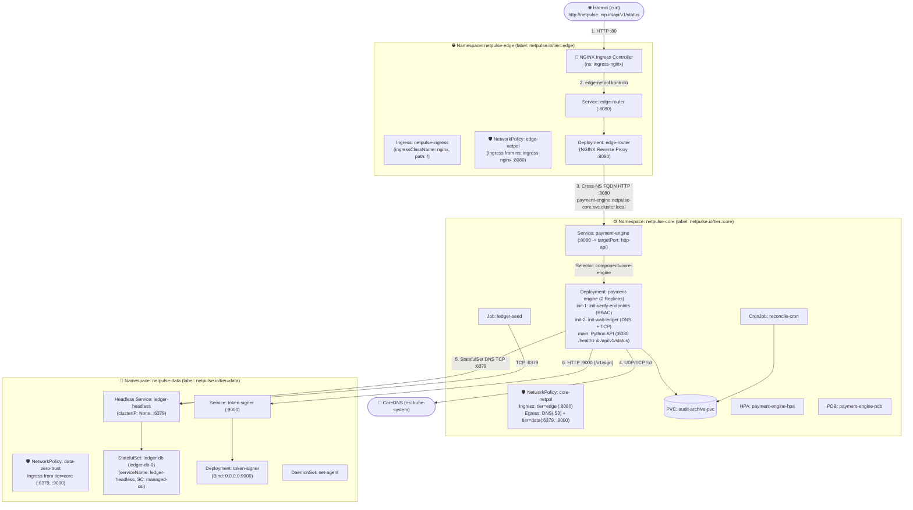
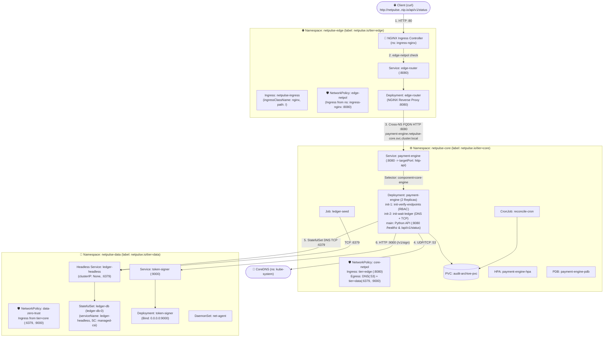

# 🌐 K8s Troubleshoot Lab 25: NetPulse v8.0 — Zero-Trust Network, DNS, Service & Ingress Deep-Dive

> **[🇹🇷 Türkçe](#-türkçe-bölüm) | [🇬🇧 English](#-english-section)**

---

## 🇹🇷 Türkçe Bölüm

### 📋 Lab Özeti (Incident Briefing)

| Alan | Detay |
| :--- | :--- |
| **Platform** | **NetPulse v8.0** — Zero-Trust Cloud-Native Telemetry & Payment Mesh |
| **Odak Noktası** | **Kubernetes Networking (%75 Ağ & Güvenlik: Ingress, NetworkPolicy, DNS, Service/Endpoints, Headless DNS, Loopback Bind) + (%25 Core Workloads: StatefulSet, DaemonSet, RBAC, Job/HPA/PDB)** |
| **Etkilenen Alanlar** | `netpulse-data`, `netpulse-core`, `netpulse-edge` (3 Namespace, 16 Görev) |
| **Kontrol Aracı** | `./check.sh` — İstediğiniz her an çalıştırabileceğiniz, 16 adımı tek tek test eden interaktif doğrulama scripti (Helm hook engeli **yoktur**!) |
| **Çözüm Anahtarı** | [`SOLUTION.md`](./SOLUTION.md) — Tüm 16 hatanın detaylı kök neden analizi, teşhis komutları ve tam çözümleri |

---

### 🧠 Lab Öncesi Aklında Kalması Gereken 7 Altın Kubernetes Ağ Kuralı

Bu labı çözerken aşağıdaki **7 temel ağ kuralını** bizzat deneyimleyerek kalıcı olarak pekiştireceksin:

1. **Ingress `ADDRESS` Neden Boş Kalır?**
   - `Ingress` tek başına bir yönlendirici değil, bir kural kağıdıdır. Kümedeki `ingress-nginx-controller` podu yalnızca `spec.ingressClassName: nginx` olan Ingress objelerini sahiplenir. Eğer `ingressClassName` yanlışsa (`istio-external` vb.), Controller o Ingress'i görmezden gelir ve **`ADDRESS` sütunu boş kalır**.
2. **Ingress Hata Kodlarının Anlamı (`404` vs `502` vs `504`):**
   - **`404 Not Found`:** İstek NGINX Ingress Controller'a ulaştı ama Ingress içindeki `host` veya `path` (`/v2/internal` vs `/`) istekle eşleşmedi.
   - **`502 Bad Gateway`:** Ingress veya Reverse Proxy arka uçtaki servise gitmek istedi ama ya Service'in `Endpoints` listesi boş (`<none>`) ya da pod `Connection refused` döndü (yanlış port veya `127.0.0.1` loopback bind).
   - **`504 Gateway Time-out`:** Paket yolda bir **NetworkPolicy** (güvenlik duvarı) tarafından sessizce düşürüldü (`DROP`).
3. **`127.0.0.1` (Loopback) vs `0.0.0.0` Bind Tuzağı:**
   - Bir uygulama pod içinde `127.0.0.1:9000` adresini dinlerse, sadece o podun kendi içinden (`localhost`) erişilebilir. Kubelet (Readiness/Liveness probe) ve diğer podlar **Pod IP'si** üzerinden geldiği için `Connection refused` alır! Container uygulamaları her zaman **`0.0.0.0`** dinlemelidir.
4. **Service -> Endpoints -> Pod Bağlantısı:**
   - Bir `Service` objesinin trafiği podlara iletebilmesi için:
     1. `Service.spec.selector` etiketleri ile Pod etiketleri **birebir** eşleşmelidir (eşleşmezse `kubectl get endpoints` çıktısı `<none>` olur).
     2. `Service.spec.ports[].targetPort` değeri, Podun `containerPort` numarası veya `name` (`http-api`) alanıyla eşleşmelidir.
5. **Headless Service (`clusterIP: None`) ve StatefulSet Pod DNS Kaydı:**
   - Bir `StatefulSet` poduna (`ledger-db-0`) doğrudan DNS adıyla (`ledger-db-0.ledger-headless.netpulse-data.svc.cluster.local`) erişebilmek için `StatefulSet.spec.serviceName` alanı ile Headless `Service.metadata.name` alanı (`ledger-headless`) **birebir aynı** olmalıdır. Farklıysa CoreDNS kayıt oluşturmaz (`NXDOMAIN`).
6. **Farklı Namespace'ler Arası (Cross-Namespace) DNS Kuralı:**
   - Aynı namespace içindeki podlar birbirine kısa servis adıyla (`http://payment-engine:8080`) ulaşabilir. Ancak `netpulse-edge` içindeki bir pod, `netpulse-core` içindeki bir servise kısa adla **ulaşamaz**; tam **FQDN** (`http://payment-engine.netpulse-core.svc.cluster.local:8080`) kullanmak zorundadır.
7. **NetworkPolicy `Egress` ve CoreDNS (`Port 53`) Tuzağı:**
   - Bir namespace'te `policyTypes: ["Egress"]` içeren bir `NetworkPolicy` tanımladığınız an, izin verilmeyen **tüm çıkışlar kapanır**. Eğer `kube-system` namespace'ine **`UDP 53` ve `TCP 53`** (CoreDNS) çıkış izni vermezseniz, pod hiçbir domain adını IP'ye çeviremez (`Temporary failure in name resolution`)!

---

### 🏗️ Hedeflenen Mimari ve Ağ Akışı (Target Architecture)



---

### 🚀 Kurulum ve Güncelleme Komutları

#### 1. Ortamı Kurmak İçin:
```bash
chmod +x setup.sh cleanup.sh check.sh
./setup.sh
```

#### 2. Durumu ve İlerlemeni Kontrol Etmek İçin (`check.sh`):
Herhangi bir anda kaç hatayı çözdüğünü ve sıradaki hatanın ne olduğunu görmek için:
```bash
./check.sh
```

#### 3. `helm/netpulse/values.yaml` Dosyasını Güncelledikten Sonra Uygulamak İçin:
> Bu labda `helm upgrade` komutunu engelleyen hiçbir hook yoktur! Doğrudan çalıştırabilirsin:
```bash
INGRESS_IP=$(kubectl get svc -n ingress-nginx ingress-nginx-controller -o jsonpath='{.status.loadBalancer.ingress[0].ip}')

helm upgrade --install netpulse ./helm/netpulse \
  --namespace netpulse-core \
  --set global.ingressHost="netpulse.${INGRESS_IP}.nip.io"
```

---

### 🛠️ Adım Adım Sorun Giderme Rehberi (Namespace Bazlı 16 Görev)

Sorunları rastgele aramak yerine `./check.sh` çıktısındaki sırayla, **aşağıdan yukarıya (`netpulse-data` -> `netpulse-core` -> `netpulse-edge`)** doğru çöz:

---

#### 📦 BÖLÜM 1: Veri Katmanı (`namespace: netpulse-data`)

Önce `netpulse-data` içindeki tüm kaynakları listele:
```bash
kubectl get sts,deploy,ds,pods,svc,pvc,netpol -n netpulse-data
```

* **Görev 1 — `ledger-db-0` Podu Neden `Pending` Durumunda?**
  - **Teşhis Komutu:**
    ```bash
    kubectl describe pvc ledger-storage-ledger-db-0 -n netpulse-data
    kubectl get sc
    ```
  - **İpucu / İnceleme Alanı:** `kubectl describe pvc` çıktısındaki `Events` bölümünü inceleyin. PVC'nin talep ettiği `storageClassName` değeri ile kümede tanımlı olan dinamik depolama sınıflarını (`kubectl get sc`) karşılaştırın.
  - **Önemli Hatırlatma:** `StatefulSet.spec.volumeClaimTemplates` ve `PersistentVolumeClaim` tanımları Kubernetes üzerinde *immutable* (değiştirilemez) niteliktedir. Yapılandırmayı düzelttikten sonra eski StatefulSet ve takılı kalan PVC objesini silip güncellemeyi uygulayın:
    ```bash
    kubectl delete sts ledger-db -n netpulse-data
    kubectl delete pvc ledger-storage-ledger-db-0 -n netpulse-data
    ```

* **Görev 2 — `ledger-db-0` Podunun Headless DNS Kaydı Neden Oluşmuyor?**
  - **Teşhis Komutu:**
    ```bash
    kubectl get svc -n netpulse-data
    kubectl get sts ledger-db -n netpulse-data -o jsonpath='{.spec.serviceName}{"\n"}'
    ```
  - **İpucu / İnceleme Alanı:** Kubernetes mimarisinde bir StatefulSet podunun `<pod-adi>.<headless-svc-adi>` şeklinde DNS kaydı alabilmesi için `StatefulSet.spec.serviceName` ile arkasındaki Headless `Service.metadata.name` birebir aynı olmalıdır. İki tanım arasındaki isim eşleşmesini doğrulayın. Değişiklik sonrası eski StatefulSet'i silip upgrade yapmayı unutmayın.

* **Görev 3 — `token-signer` Podu `Running` Olduğu Halde Neden `0/1 Ready` Kalıyor?**
  - **Teşhis Komutu:**
    ```bash
    kubectl logs -n netpulse-data -l app=token-signer
    kubectl describe pod -n netpulse-data -l app=token-signer
    ```
  - **İpucu / İnceleme Alanı:** Konteyner loglarındaki dinleme soketini ve podun `Events` kısmındaki `Readiness probe failed` uyarısını inceleyin. Konteyner içinde çalışan uygulama `127.0.0.1` (loopback) mi dinliyor yoksa tüm arayüzleri (`0.0.0.0`) mi? Kubelet'in pod IP'si üzerinden yaptığı prob kontrollerinin neden reddedildiğini araştırın.

* **Görev 4 — `data-zero-trust` NetworkPolicy Neden `netpulse-core` Trafiğini Engelliyor?**
  - **Teşhis Komutu:**
    ```bash
    kubectl describe netpol data-zero-trust -n netpulse-data
    kubectl get ns --show-labels
    ```
  - **İpucu / İnceleme Alanı:** NetworkPolicy ingress kurallarındaki `namespaceSelector.matchLabels` etiketini kaynak namespace'in gerçek etiketleriyle karşılaştırın. Ayrıca `token-signer` servisinin çalıştığı hedef portun bu kuralda tanımlı olup olmadığını denetleyin.

* **Görev 5 — `net-agent` DaemonSet Neden `0` Pod Oluşturuyor ve Başlayınca Çöküyor?**
  - **Teşhis Komutu:**
    ```bash
    kubectl describe ds net-agent -n netpulse-data
    kubectl get nodes --show-labels
    ```
  - **İpucu / İnceleme Alanı:** DaemonSet'in `nodeSelector` alanında tanımlanan etiketlerin kümedeki worker düğümlerde bulunup bulunmadığını kontrol edin. Düğümlerde bulunmayan etiketler pod oluşumunu engeller. Konteyner dosya sistemi yazma izinlerini ve volume bağlama yapılandırmasını inceleyin.

---

#### ⚙️ BÖLÜM 2: Çekirdek Katman (`namespace: netpulse-core`)

Önce `netpulse-core` içindeki kaynakları listele:
```bash
kubectl get deploy,pods,svc,endpoints,job,cronjob,hpa,pdb,netpol -n netpulse-core
```

* **Görev 6 — `payment-engine` Podu Neden `Init:0/2` (`init-verify-endpoints`) Aşamasında Kalıyor?**
  - **Teşhis Komutu:**
    ```bash
    kubectl logs -n netpulse-core -l app=payment-engine -c init-verify-endpoints
    kubectl get role core-endpoint-reader -n netpulse-core -o yaml
    ```
  - **İpucu / İnceleme Alanı:** Init container loglarında görülen API yetki hatasını inceleyin. Podun kullandığı ServiceAccount'a bağlı `Role` tanımında hangi Kubernetes kaynaklarına (`services`, `endpoints`) erişim izni verildiğini kontrol edin.

* **Görev 7 — `payment-engine` Podu `Init:1/2` (`init-wait-ledger`) Aşamasında Neden DNS Çözemiyor?**
  - **Teşhis Komutu:**
    ```bash
    kubectl logs -n netpulse-core -l app=payment-engine -c init-wait-ledger
    kubectl describe netpol core-netpol -n netpulse-core
    ```
  - **İpucu / İnceleme Alanı:** `core-netpol` üzerinde `Egress` kısıtlaması aktif olduğunda, CoreDNS erişimi varsayılan olarak engellenir. Namespace'teki podların `kube-system` üzerindeki CoreDNS servislerine (`53/UDP` ve `53/TCP`) erişip erişemediğini inceleyin.

* **Görev 8 — DNS Çözüldükten Sonra `init-wait-ledger` Neden `token-signer:9000` Bağlantısında Takılıyor?**
  - **Teşhis Komutu:**
    ```bash
    kubectl describe netpol core-netpol -n netpulse-core
    ```
  - **İpucu / İnceleme Alanı:** `core-netpol` Egress kurallarında `netpulse-data` katmanına doğru hangi portlara izin verilmiş? `token-signer` servisinin dinlediği TCP portunun bu izin listesinde bulunup bulunmadığını denetleyin.

* **Görev 9 — `payment-engine` Ana Konteyneri Başladıktan Sonra Neden Sürekli Restart Oluyor?**
  - **Teşhis Komutu:**
    ```bash
    kubectl describe pod -n netpulse-core -l app=payment-engine
    ```
  - **İpucu / İnceleme Alanı:** Podun `Events` kısmındaki `Liveness probe failed` mesajını inceleyin. Uygulamanın dinlediği HTTP portu ile liveness probe'un yokladığı port numarasını karşılaştırın.

* **Görev 10 — `payment-engine` Podları `1/1 Running` Olduğu Halde `Service` Arkasında Neden `Endpoints` Yok (`<none>`)?**
  - **Teşhis Komutu:**
    ```bash
    kubectl get endpoints payment-engine -n netpulse-core
    kubectl describe svc payment-engine -n netpulse-core
    kubectl get pods -n netpulse-core --show-labels
    ```
  - **İpucu / İnceleme Alanı:** Service nesnesinin podları bulabilmesi için iki temel eşleşme şarttır:
    1. Service `spec.selector` etiketleri ile Pod'un `metadata.labels` etiketlerinin tam uyumu.
    2. Service `spec.ports[].targetPort` değeri ile Pod konteynerinin port adı veya numarası eşleşmesi.

* **Görev 11 — `ledger-seed` Job'ı Neden `Error` Veriyor ve `HPA` / `PDB` Neden Hatalı?**
  - **Teşhis Komutu:**
    ```bash
    kubectl logs -n netpulse-core -l app=ledger-seed
    kubectl get hpa,pdb -n netpulse-core
    ```
  - **İpucu / İnceleme Alanı:** Job loglarında veritabanı bağlantı hatasını inceleyin; Redis/Ledger servisinin çalıştığı standart port numarası ile job'ın bağlanmaya çalıştığı portu karşılaştırın (Job düzeltildikten sonra eski job silinmelidir). HPA'nın hedeflediği Deployment adını ve PDB'nin `minAvailable` değerini pod replika sayısıyla uyumlu olacak şekilde değerlendirin.

---

#### 🚪 BÖLÜM 3: Edge Gateway & Ingress Katmanı (`namespace: netpulse-edge`)

Önce `netpulse-edge` içindeki kaynakları listele:
```bash
kubectl get deploy,pods,svc,endpoints,ingress,netpol -n netpulse-edge
```

* **Görev 12 — `edge-router` Podu Neden `CrashLoopBackOff` Durumunda?**
  - **Teşhis Komutu:**
    ```bash
    kubectl logs -n netpulse-edge -l app=edge-router
    kubectl get cm edge-router-conf -n netpulse-edge -o yaml
    ```
  - **İpucu / İnceleme Alanı:** NGINX logunda `host not found in upstream` hatasını inceleyin. Kubernetes'te farklı namespace'ler arasındaki servis çağrılarında kısa servis adı mı yoksa tam nitelikli alan adı (FQDN: `service.namespace.svc.cluster.local`) mı kullanılmalıdır?

* **Görev 13 — `edge-router` Çalıştıktan Sonra `payment-engine`'e Giden İstekler Neden `core-netpol` Tarafından Bloklanıyor?**
  - **Teşhis Komutu:**
    ```bash
    kubectl describe netpol core-netpol -n netpulse-core
    kubectl get ns netpulse-edge --show-labels
    ```
  - **İpucu / İnceleme Alanı:** `core-netpol` Ingress kuralında gelen trafiğe izin verilen namespace etiketi ile `netpulse-edge` namespace'inin gerçek etiketlerini karşılaştırın.

* **Görev 14 — NGINX Ingress Controller'dan `edge-router` Poduna Gelen İstekler Neden `edge-netpol` Tarafından Bloklanıyor?**
  - **Teşhis Komutu:**
    ```bash
    kubectl describe netpol edge-netpol -n netpulse-edge
    kubectl get ns ingress-nginx --show-labels
    ```
  - **İpucu / İnceleme Alanı:** `edge-netpol` kuralında Ingress trafiğine izin verilen namespace adının, kümedeki Ingress Controller'ın fiilen çalıştığı namespace ile eşleşip eşleşmediğini denetleyin.

* **Görev 15 — `kubectl get ingress -n netpulse-edge` Çıktısında `ADDRESS` Neden Boş?**
  - **Teşhis Komutu:**
    ```bash
    kubectl get ingress -n netpulse-edge
    kubectl get ingressclass
    ```
  - **İpucu / İnceleme Alanı:** Kümede çalışan Ingress Controller'ın sahiplendiği aktif `IngressClass` adı ile Ingress nesnesindeki `spec.ingressClassName` alanını karşılaştırın. Controller yalnızca kendi sınıfına ait Ingress kurallarını işler.

* **Görev 16 — `ADDRESS` Dolduktan Sonra `curl http://netpulse.<IP>.nip.io/api/v1/status` Neden `404 Not Found` Dönüyor?**
  - **Teşhis Komutu:**
    ```bash
    kubectl describe ingress netpulse-ingress -n netpulse-edge
    ```
  - **İpucu / İnceleme Alanı:** Ingress kuralındaki `Path` yolunu inceleyin. Dış istemcilerden gelen `/api/...` isteklerini karşılayabilmesi için yolun `/` kök dizinini kapsayıp kapsamadığını değerlendirin.

---

### ✅ Başarı Kriterleri (Success Criteria)

Tüm değişiklikleri uyguladıktan sonra:
```bash
./check.sh
```

Çıktıda **`16/16 Başarılı`** ve aşağıdaki JSON yanıtını görüyorsan labı başarıyla tamamladın demektir:
```json
{
  "platform": "NetPulse v8.0",
  "status": "operational",
  "ledger_db": "v8.0-ready",
  "token_signer": "ed25519-verified",
  "pod": "payment-engine-..."
}
```

---

<br>

---

## 🇬🇧 English Section

### 📋 Incident Briefing

| Field | Detail |
| :--- | :--- |
| **Platform** | **NetPulse v8.0** — Zero-Trust Cloud-Native Telemetry & Payment Mesh |
| **Focus Area** | **Kubernetes Networking (75% Network & Security: Ingress, NetworkPolicy, DNS, Service/Endpoints, Headless DNS, Loopback Bind) + (25% Core Workloads: StatefulSet, DaemonSet, RBAC, Job/HPA/PDB)** |
| **Affected Scopes** | `netpulse-data`, `netpulse-core`, `netpulse-edge` (3 Namespaces, 16 Tasks) |
| **Audit Tool** | `./check.sh` — Interactive verification script testing all 16 tasks on demand (No Helm hook blockers!) |
| **Solution Key** | [`SOLUTION.md`](./SOLUTION.md) — Comprehensive root cause analysis, diagnostic commands, and full solutions for all 16 errors |

---

### 🧠 7 Golden Rules of Kubernetes Networking

Master these **7 foundational networking principles** through hands-on troubleshooting in this lab:

1. **Why Ingress `ADDRESS` Remains Blank:**
   - An `Ingress` resource is purely a routing rule sheet, not a router process. The `ingress-nginx-controller` pod only discovers and configures rules matching `spec.ingressClassName: nginx`. If `ingressClassName` is invalid, the controller ignores it and **`ADDRESS` remains empty**.
2. **Decoding Ingress Status Codes (`404` vs `502` vs `504`):**
   - **`404 Not Found`:** The request reached the Ingress Controller, but the configured `host` or `path` rule did not match the request URL.
   - **`502 Bad Gateway`:** The Ingress or reverse proxy attempted upstream communication, but the backend Service has empty `Endpoints` (`<none>`) or the pod returned `Connection refused` (wrong port or loopback bind).
   - **`504 Gateway Time-out`:** Upstream packets were silently dropped (`DROP`) by a **NetworkPolicy** firewall.
3. **The Loopback (`127.0.0.1`) vs `0.0.0.0` Binding Trap:**
   - When an application inside a container binds to `127.0.0.1`, it can only accept connections originating from within the container itself. Kubelet health probes and external pods arriving via **Pod IP** receive `Connection refused`. Containerized microservices must always bind to **`0.0.0.0`**.
4. **Service -> Endpoints -> Pod Wiring:**
   - For a Kubernetes `Service` to forward traffic to pods:
     1. `Service.spec.selector` labels must match Pod labels **identically** (otherwise `Endpoints` reports `<none>`).
     2. `Service.spec.ports[].targetPort` must match the Pod container's `containerPort` number or named port (`http-api`).
5. **Headless Services (`clusterIP: None`) & StatefulSet Pod DNS Records:**
   - For a `StatefulSet` pod (`ledger-db-0`) to receive a direct DNS record (`ledger-db-0.ledger-headless.netpulse-data.svc.cluster.local`), `StatefulSet.spec.serviceName` must match Headless `Service.metadata.name` **exactly**. Any discrepancy results in `NXDOMAIN`.
6. **Cross-Namespace DNS Routing Rule:**
   - Pods within the same namespace can communicate using short service names (`http://payment-engine:8080`). However, pods in other namespaces must use the fully qualified domain name (**FQDN**: `http://payment-engine.netpulse-core.svc.cluster.local:8080`).
7. **NetworkPolicy `Egress` & CoreDNS (`Port 53`) Trap:**
   - Once a `NetworkPolicy` specifies `policyTypes: ["Egress"]`, **all unlisted outbound traffic is blocked**. If egress to `kube-system` on **`UDP 53` and `TCP 53`** (CoreDNS) is omitted, pods cannot resolve any domain names (`Temporary failure in name resolution`).

---

### 🏗️ Target Architecture & Traffic Topology



---

### 🚀 Provisioning and Verification Commands

#### 1. Initialize the Environment:
```bash
chmod +x setup.sh cleanup.sh check.sh
./setup.sh
```

#### 2. Check Progress with `check.sh`:
Run this interactive verification script at any point to inspect remaining blockers:
```bash
./check.sh
```

#### 3. Apply Configuration Updates:
```bash
INGRESS_IP=$(kubectl get svc -n ingress-nginx ingress-nginx-controller -o jsonpath='{.status.loadBalancer.ingress[0].ip}')

helm upgrade --install netpulse ./helm/netpulse \
  --namespace netpulse-core \
  --set global.ingressHost="netpulse.${INGRESS_IP}.nip.io"
```

---

### 🛠️ Step-by-Step Triage Methodology (16 Namespace-Tiered Tasks)

Triage bottom-up following the natural dependency chain: **`netpulse-data` -> `netpulse-core` -> `netpulse-edge`**.

---

#### 📦 TIER 1: Data Layer (`namespace: netpulse-data`)

List all resources in `netpulse-data`:
```bash
kubectl get sts,deploy,ds,pods,svc,pvc,netpol -n netpulse-data
```

* **Task 1 — Why is `ledger-db-0` Stuck in `Pending`?**
  - **Diagnostic Command:**
    ```bash
    kubectl describe pvc ledger-storage-ledger-db-0 -n netpulse-data
    kubectl get sc
    ```
  - **Investigation Clue:** Review the `Events` section of `kubectl describe pvc`. Compare the PVC's requested `storageClassName` against the active storage classes (`kubectl get sc`) available in your cluster.
  - **Important Operational Note:** `StatefulSet.spec.volumeClaimTemplates` and PVC definitions are immutable. After correcting the configuration, delete the stale StatefulSet and pending PVC before applying the upgrade:
    ```bash
    kubectl delete sts ledger-db -n netpulse-data
    kubectl delete pvc ledger-storage-ledger-db-0 -n netpulse-data
    ```

* **Task 2 — Why Does `ledger-db-0` Lack a Headless DNS Record?**
  - **Diagnostic Command:**
    ```bash
    kubectl get svc -n netpulse-data
    kubectl get sts ledger-db -n netpulse-data -o jsonpath='{.spec.serviceName}{"\n"}'
    ```
  - **Investigation Clue:** In Kubernetes, a StatefulSet pod only acquires a direct `<pod-name>.<service-name>` DNS address when `StatefulSet.spec.serviceName` matches the Headless `Service.metadata.name` exactly. Compare both definitions for any naming discrepancy.

* **Task 3 — Why Does `token-signer` Remain `0/1 Ready` Despite Being `Running`?**
  - **Diagnostic Command:**
    ```bash
    kubectl logs -n netpulse-data -l app=token-signer
    kubectl describe pod -n netpulse-data -l app=token-signer
    ```
  - **Investigation Clue:** Inspect the application startup logs and the pod's `Events` for readiness probe failures. Is the application listening on the loopback interface (`127.0.0.1`) or on all network interfaces (`0.0.0.0`)? Consider why Kubelet health checks arriving over the Pod IP are rejected.

* **Task 4 — Why Does `data-zero-trust` Block Traffic from `netpulse-core`?**
  - **Diagnostic Command:**
    ```bash
    kubectl describe netpol data-zero-trust -n netpulse-data
    kubectl get ns --show-labels
    ```
  - **Investigation Clue:** Inspect the `namespaceSelector.matchLabels` inside the NetworkPolicy ingress rules and compare them against the labels of the originating namespace. Also verify whether the TCP port used by the `token-signer` service is permitted by the ingress policy.

* **Task 5 — Why Does `net-agent` DaemonSet Schedule 0 Pods and Crash Upon Startup?**
  - **Diagnostic Command:**
    ```bash
    kubectl describe ds net-agent -n netpulse-data
    kubectl get nodes --show-labels
    ```
  - **Investigation Clue:** Check whether the labels specified in the DaemonSet's `nodeSelector` exist on any worker nodes in the cluster. Unmatched node selectors prevent scheduling entirely. Additionally, examine container file system write permissions and volume mounts in the pod specification.

---

#### ⚙️ TIER 2: Core Processing Layer (`namespace: netpulse-core`)

List resources in `netpulse-core`:
```bash
kubectl get deploy,pods,svc,endpoints,job,cronjob,hpa,pdb,netpol -n netpulse-core
```

* **Task 6 — Why Does `payment-engine` Stall at `Init:0/2` (`init-verify-endpoints`)?**
  - **Diagnostic Command:**
    ```bash
    kubectl logs -n netpulse-core -l app=payment-engine -c init-verify-endpoints
    kubectl get role core-endpoint-reader -n netpulse-core -o yaml
    ```
  - **Investigation Clue:** Inspect the API authorization failure in the init container logs. Review the `Role` bound to the pod's ServiceAccount to ensure both `services` and `endpoints` resources are granted `get` and `list` permissions.

* **Task 7 — Why Does `payment-engine` Fail DNS Resolution at `Init:1/2` (`init-wait-ledger`)?**
  - **Diagnostic Command:**
    ```bash
    kubectl logs -n netpulse-core -l app=payment-engine -c init-wait-ledger
    kubectl describe netpol core-netpol -n netpulse-core
    ```
  - **Investigation Clue:** When an `Egress` NetworkPolicy is applied, all unlisted outbound communication is denied. Check whether pods in this namespace have an egress rule allowing access to CoreDNS (`kube-system` port `53` over UDP and TCP).

* **Task 8 — Why Does `init-wait-ledger` Hang When Connecting to `token-signer:9000`?**
  - **Diagnostic Command:**
    ```bash
    kubectl describe netpol core-netpol -n netpulse-core
    ```
  - **Investigation Clue:** Check the `core-netpol` egress rules targeting the `netpulse-data` tier. Verify whether the TCP port utilized by `token-signer` is permitted alongside the database port.

* **Task 9 — Why Does `payment-engine` Enter a Restart Loop After Starting?**
  - **Diagnostic Command:**
    ```bash
    kubectl describe pod -n netpulse-core -l app=payment-engine
    ```
  - **Investigation Clue:** Check the `Events` log for `Liveness probe failed` messages. Compare the container's listening HTTP port against the port configured in the liveness probe.

* **Task 10 — Why Does the `payment-engine` Service Show `<none>` Under Endpoints?**
  - **Diagnostic Command:**
    ```bash
    kubectl get endpoints payment-engine -n netpulse-core
    kubectl describe svc payment-engine -n netpulse-core
    kubectl get pods -n netpulse-core --show-labels
    ```
  - **Investigation Clue:** A Service requires two exact matches to populate its endpoints:
    1. The Service `spec.selector` labels must match the Pod `metadata.labels`.
    2. The Service `spec.ports[].targetPort` must correspond to the container's port name or number.

* **Task 11 — Why Does `ledger-seed` Fail and Why are HPA & PDB Misconfigured?**
  - **Diagnostic Command:**
    ```bash
    kubectl logs -n netpulse-core -l app=ledger-seed
    kubectl get hpa,pdb -n netpulse-core
    ```
  - **Investigation Clue:** Review the connection error in the job logs and check which port the job attempts to contact versus the database's actual listening port (delete the failed job before re-running). For HPA and PDB, verify the target deployment reference and disruption budget limits.

---

#### 🚪 TIER 3: Edge Gateway & Ingress Layer (`namespace: netpulse-edge`)

List resources in `netpulse-edge`:
```bash
kubectl get deploy,pods,svc,endpoints,ingress,netpol -n netpulse-edge
```

* **Task 12 — Why is `edge-router` Stuck in `CrashLoopBackOff`?**
  - **Diagnostic Command:**
    ```bash
    kubectl logs -n netpulse-edge -l app=edge-router
    kubectl get cm edge-router-conf -n netpulse-edge -o yaml
    ```
  - **Investigation Clue:** Inspect the NGINX logs for `host not found in upstream`. In Kubernetes cross-namespace networking, can pods reach services in other namespaces using short names, or is a Fully Qualified Domain Name (FQDN) required?

* **Task 13 — Why Does `core-netpol` Block Traffic from `edge-router`?**
  - **Diagnostic Command:**
    ```bash
    kubectl describe netpol core-netpol -n netpulse-core
    kubectl get ns netpulse-edge --show-labels
    ```
  - **Investigation Clue:** Compare the namespace label expected by the `core-netpol` ingress rule against the actual labels applied to the `netpulse-edge` namespace.

* **Task 14 — Why Does `edge-netpol` Block Incoming Traffic from the Ingress Controller?**
  - **Diagnostic Command:**
    ```bash
    kubectl describe netpol edge-netpol -n netpulse-edge
    kubectl get ns ingress-nginx --show-labels
    ```
  - **Investigation Clue:** Examine the namespace allowlist in `edge-netpol` and confirm whether it matches the namespace where the NGINX Ingress Controller is actively deployed.

* **Task 15 — Why Does `kubectl get ingress` Show a Blank `ADDRESS`?**
  - **Diagnostic Command:**
    ```bash
    kubectl get ingress -n netpulse-edge
    kubectl get ingressclass
    ```
  - **Investigation Clue:** Verify the active `IngressClass` registered in the cluster against the `spec.ingressClassName` declared in the Ingress resource. Controllers ignore ingress rules that specify an unmanaged class name.

* **Task 16 — Why Does Requesting `/api/v1/status` Return `404 Not Found`?**
  - **Diagnostic Command:**
    ```bash
    kubectl describe ingress netpulse-ingress -n netpulse-edge
    ```
  - **Investigation Clue:** Inspect the routing paths defined in the Ingress resource. Determine whether the configured path pattern captures inbound API requests or routes to an unintended internal sub-path.

---

### ✅ Success Verification

Once all fixes are deployed:
```bash
./check.sh
```

A successful triage displays **`16/16 Succeeded`** and returns the operational JSON payload:
```json
{
  "platform": "NetPulse v8.0",
  "status": "operational",
  "ledger_db": "v8.0-ready",
  "token_signer": "ed25519-verified",
  "pod": "payment-engine-..."
}
```
