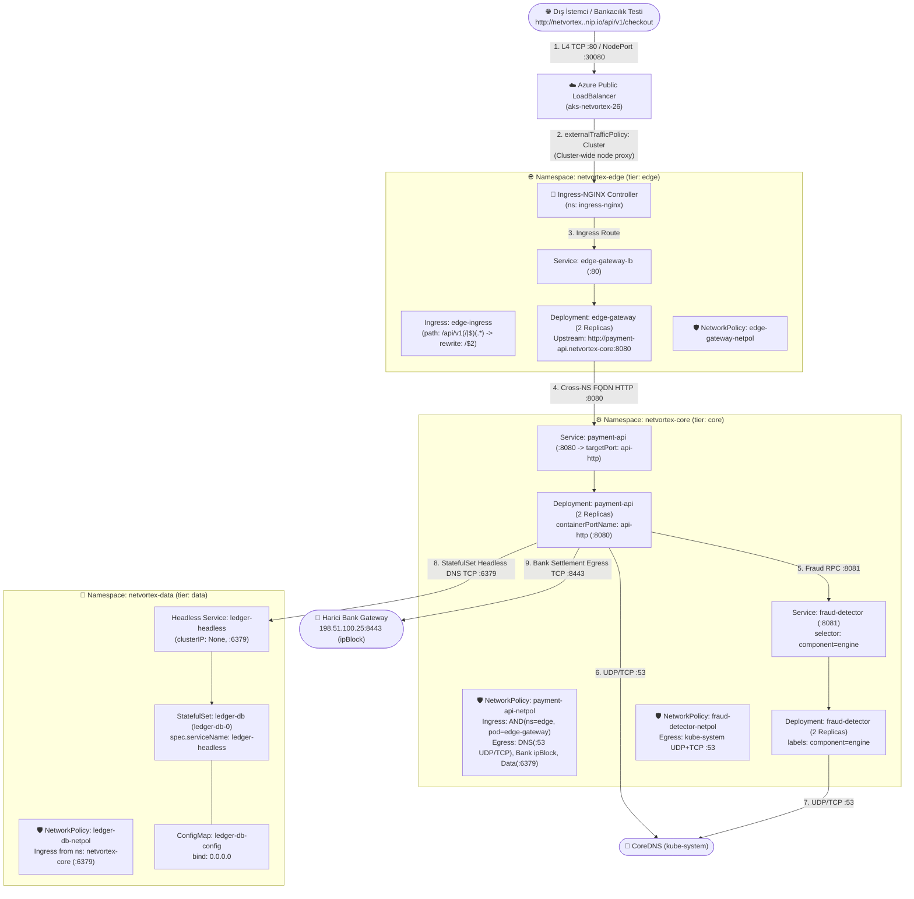

# 🌐 K8s Troubleshoot Lab 26: NetVortex v9.0 — Advanced Kubernetes Networking & Zero-Trust Mesh Outage

> **[🇹🇷 Türkçe](#-türkçe-bölüm) | [🇬🇧 English](#-english-section)**

---

<a id="-türkçe-bölüm"></a>
## 🇹🇷 Türkçe Bölüm

### 📋 Lab Özeti (Incident Briefing)

| Alan | Detay |
| :--- | :--- |
| **Platform** | **NetVortex v9.0** — High-Throughput Financial Routing & Zero-Trust Mesh |
| **Odak Noktası** | **%100 Derin Kubernetes Ağ & Güvenlik:** L4 LoadBalancer (`externalTrafficPolicy: Local`), L7 Ingress (Regex Rewrite), Cross-NS DNS FQDN, Named Ports, NetworkPolicy (AND vs OR mantık tuzağı), Egress `ipBlock` CIDR maskeleme, Empty EndpointSlices, CoreDNS TCP 53 fallback, Headless DNS & StatefulSet `serviceName`, Socket Bind (`127.0.0.1` vs `0.0.0.0`) |
| **Altyapı (Terraform)** | **Azure Kubernetes Service (AKS)** — 2 Düğümlü (`Standard_B2s_v2`), Calico Ağ İlkesi Motoru (`network_policy = "calico"`), NGINX Ingress Controller |
| **Etkilenen Alanlar** | `netvortex-data`, `netvortex-core`, `netvortex-edge` (3 Namespace, 10 Kritik Ağ Arızası) |
| **Kontrol Aracı** | `./check.sh` — 10 ağ adımını tek tek test eden, teşhis yönlendirmeleri sunan interaktif kontrol betiği |
| **Çözüm Anahtarı** | [`SOLUTION.md`](./SOLUTION.md) — 10 arızanın ayrıntılı kök neden analizi, L4/L7 paket akış teorisi ve tam çözümleri |

---

### 🧠 Lab Öncesi Aklında Kalması Gereken 8 Altın Kubernetes Ağ Kuralı

Bu laboratuvarda karşılaşacağın ağ tuzaklarını metodolojik olarak çözebilmek için aşağıdaki **8 temel ağ kuralını** derinlemesine anlamış olmalısın:

1. **`externalTrafficPolicy: Local` vs `Cluster` Farkı ve Paket Düşüşü:**
   - `Cluster` (varsayılan): Dışarıdan gelen paket hangi Kubernetes düğümüne ulaşırsa ulaşsın, `kube-proxy` paketi SNAT yaparak hedef podun bulunduğu düğüme aktarır (2. sekme / hop).
   - `Local`: İstemcinin gerçek kaynak IP'sini (`Client Source IP`) korumak için 2. sekmeyi engeller. Paket, üzerinde ilgili podun koştuğu bir düğüme gelirse pod'a iletilir; ancak **üzerinde pod bulunmayan bir düğüme gelirse kube-proxy paketi sessizce düşürür (`DROP`)**! Çok düğümlü (multi-node) kümelerde bu durum rastlantısal bağlantı zaman aşımlarına yol açar.
2. **NGINX Ingress Path Regex ve Rewrite Target (`/$2`):**
   - Dış istemci `/api/v1/checkout` çağırdığında, arka uçtaki mikroservis yalnızca `/checkout` yolunu dinliyor olabilir.
   - NGINX Ingress'te `path: /api/v1(/|$)(.*)` kullanıldığında, prefix'i soymak için `nginx.ingress.kubernetes.io/rewrite-target: /$2` annotasyonu gereklidir. Bu regex'in çalışması için `nginx.ingress.kubernetes.io/use-regex: "true"` ve `pathType: ImplementationSpecific` tanımlanmalıdır.
3. **Farklı Namespace'ler Arası DNS Çözümleme (Search Domains & FQDN):**
   - Bir podun `/etc/resolv.conf` dosyasında arama listesi yerel namespace'i önceler: `<ns>.svc.cluster.local svc.cluster.local cluster.local`.
   - `netvortex-edge` içindeki bir pod `http://payment-api:8080` çağırdığında CoreDNS bunu `payment-api.netvortex-edge...` altında arar ve `NXDOMAIN` döner. Farklı namespace'teki servise ulaşmak için FQDN veya en azından `<servis>.<hedef-namespace>` yazılmalıdır.
4. **Service `targetPort` — Named Port (İsimlendirilmiş Port) Tuzağı:**
   - Servis tanımında `targetPort: api-http` (string) yazıldığında, pod konteyner manifestindeki `ports[].name` alanında tam olarak `api-http` adı aranır.
   - Eğer konteyner port adı `http` olarak bırakılmışsa veya numeric port (`8080`) ile eşleşmiyorsa, Kubernetes `Endpoints` nesnesinde portu eşleyemez ve istekler `Connection refused` alır.
5. **NetworkPolicy `AND` vs `OR` Tuzağı (`namespaceSelector` & `podSelector`):**
   - NetworkPolicy kuralında tek bir liste elemanı içinde (`- namespaceSelector: ... podSelector: ...`) yazıldığında **`AND`** mantığı çalışır: *"Yalnızca belirtilen namespace'teki belirtilen etiketli podlar gelebilir."*
   - Eğer kuralda `namespaceSelector` yazılmayıp sadece `- podSelector: ...` bırakılırsa, Kubernetes bu kuralı **YALNIZCA AYNI NAMESPACE** içinde değerlendirir! Farklı bir namespace'teki pod etiketleri eşleşse bile tüm paketler Default Deny tarafından düşürülür.
6. **Egress NetworkPolicy `ipBlock` CIDR ve `except` Tuzağı:**
   - Dış dünyaya (örneğin `198.51.100.25` bankacılık gateway IP'sine) giden trafiğe izin vermek için `ipBlock.cidr: 198.51.100.0/24` tanımlanabilir.
   - Ancak `except` listesinde bu alt ağın tamamı (`198.51.100.0/24`) hariç tutulursa, dışlama kuralı izni ezer ve tüm egress paketleri CNI (Calico) tarafından engellenir.
7. **CoreDNS TCP Port 53 Fallback Mekanizması:**
   - Standart DNS sorguları UDP 53 üzerinden iletilir. Ancak yanıt 512 baytı aştığında (örneğin büyük SRV/TXT kayıtları veya DNSSEC), CoreDNS yanıtta `TC` (Truncated) bayrağını set eder.
   - DNS istemcisi sorguyu derhal **TCP Port 53** üzerinden yineler. Egress kuralında yalnızca `UDP 53` izni verilip `TCP 53` unutulursa, büyük DNS sorguları timeout'a girer ve kilitlenir.
8. **Loopback (`127.0.0.1`) vs Tüm Arayüzler (`0.0.0.0`) Soket Dinleme:**
   - Konteyner içindeki bir process (örneğin veritabanı veya API sunucusu) soketini `127.0.0.1` adresine bağlarsa (`bind`), işletim sistemi yalnızca yerel loopback (`lo`) arayüzünden gelen paketleri kabul eder.
   - Podun `eth0` IP'sine veya Service Virtual IP'sine gelen paketler Linux çekirdeği tarafından derhal `RST` bayrağı ile reddedilir (`Connection refused`). Pod dışı erişim için daima `0.0.0.0` dinlenmelidir.

---

### 🏗️ Hedeflenen Mimari ve Ağ Akışı (Target Architecture)



---

### 🚀 Kurulum ve Güncelleme Komutları

#### 1. Ortamı Kurmak İçin (Terraform ile AKS Sağlama):
```bash
chmod +x setup.sh cleanup.sh check.sh
./setup.sh
```
> **İpucu:** Eğer cluster'ınız zaten çalışıyorsa ve yalnızca Helm chart'ı sıfırdan kurmak istiyorsanız `./setup.sh --skip-terraform` parametresini kullanabilirsiniz.

#### 2. Durumu ve İlerlemeni Kontrol Etmek İçin (`check.sh`):
Herhangi bir anda kaç hatayı çözdüğünüzü ve sıradaki hatanın teşhis ipuçlarını görmek için:
```bash
./check.sh
```

#### 3. Yapılandırmayı Güncelledikten Sonra Uygulamak İçin:
```bash
INGRESS_IP=$(kubectl get svc -n ingress-nginx ingress-nginx-controller -o jsonpath='{.status.loadBalancer.ingress[0].ip}')

helm upgrade --install netvortex ./helm/netvortex \
  --namespace netvortex-edge \
  --set global.ingressHost="netvortex.${INGRESS_IP}.nip.io"
```

---

### 🛠️ Adım Adım Sorun Giderme Rehberi (Namespace Bazlı 10 Görev)

Sorunları rastgele aramak yerine `./check.sh` çıktısındaki sırayla, **aşağıdan yukarıya (`netvortex-data` -> `netvortex-core` -> `netvortex-edge`)** doğru metodolojik olarak çözün:

---

#### 📦 BÖLÜM 1: Veri Katmanı & Soket Dinleme (`namespace: netvortex-data`)

Önce `netvortex-data` içindeki kaynakları listeleyin:
```bash
kubectl get sts,pods,svc,netpol,cm -n netvortex-data
```

* **Görev 1 — `ledger-db-0` Poduna Neden Headless DNS Adresiyle Erişilemiyor?**
  - **Teşhis Komutu:**
    ```bash
    kubectl get svc -n netvortex-data
    kubectl get sts ledger-db -n netvortex-data -o jsonpath='{.spec.serviceName}{"\n"}'
    ```
  - **İnceleme Alanı:** Kubernetes StatefulSet podlarının `<pod-adi>.<headless-svc-adi>` şeklinde deterministik DNS A ve SRV kayıtları alabilmesi için `StatefulSet.spec.serviceName` alanı ile Headless `Service.metadata.name` alanı birebir aynı olmalıdır. İki tanım arasındaki isim uyumsuzluğunu inceleyin.
  - **Önemli Hatırlatma:** `spec.serviceName` alanı değiştirildiğinde StatefulSet podunun bu değişikliği alabilmesi için mevcut StatefulSet nesnesini silip tekrar oluşturun:
    ```bash
    kubectl delete sts ledger-db -n netvortex-data --cascade=orphan 2>/dev/null || true
    ```

* **Görev 2 — Veritabanı Podu Ayakta Olduğu Halde Diğer Podlar Neden `Connection refused` Alıyor?**
  - **Teşhis Komutu:**
    ```bash
    kubectl get cm ledger-db-config -n netvortex-data -o yaml
    kubectl logs -n netvortex-data ledger-db-0
    ```
  - **İnceleme Alanı:** `ledger-db-config` içindeki `redis.conf` dosyasında `bind` direktifini inceleyin. Uygulamanın yalnızca pod içi yerel döngü arayüzünü (`127.0.0.1`) mi dinlediğini, yoksa tüm ağ arayüzlerini (`0.0.0.0`) mi dinlediğini değerlendirin.

---

#### ⚙️ BÖLÜM 2: Çekirdek Katman, Portlar & Zero-Trust Politikaları (`namespace: netvortex-core`)

Önce `netvortex-core` içindeki kaynakları listeleyin:
```bash
kubectl get deploy,pods,svc,endpoints,netpol -n netvortex-core
```

* **Görev 3 — `fraud-detector` Podları Çalıştığı Halde Servisin Endpoint Listesi Neden Boş (`<none>`)?**
  - **Teşhis Komutu:**
    ```bash
    kubectl get endpoints fraud-detector -n netvortex-core
    kubectl get svc fraud-detector -n netvortex-core -o yaml
    kubectl get pods -n netvortex-core -l app.kubernetes.io/name=fraud-detector --show-labels
    ```
  - **İnceleme Alanı:** Service nesnesinin podları seçebilmesi için `Service.spec.selector` alanındaki etiketlerin pod manifestindeki etiketlerle tam olarak eşleşmesi gerekir. Servis seçicisindeki typo veya bileşen etiketi farkını tespit edin.

* **Görev 4 — `fraud-detector` Podunun Büyük DNS Sorguları Neden Zaman Aşımına Uğruyor?**
  - **Teşhis Komutu:**
    ```bash
    kubectl describe netpol fraud-detector-netpol -n netvortex-core
    ```
  - **İnceleme Alanı:** `fraud-detector-netpol` içindeki egress kurallarını inceleyin. DNS protokolünde yanıt boyutu 512 baytı aştığında veya truncation olduğunda DNS istemcileri otomatik olarak `TCP Port 53` üzerinden sorgu tekrarlar. Egress kuralında yalnızca `UDP 53` mü tanımlı, yoksa `TCP 53` izni de var mı?

* **Görev 5 — `payment-api` Podunun Servis Portu Neden Çözümlenemiyor (Named Port Uyumsuzluğu)?**
  - **Teşhis Komutu:**
    ```bash
    kubectl describe svc payment-api -n netvortex-core
    kubectl get deploy payment-api -n netvortex-core -o yaml
    ```
  - **İnceleme Alanı:** `payment-api` servisinde `targetPort` string olarak verilmiştir. Pod container manifestindeki `ports[].name` alanının bu string ad ile birebir eşleşip eşleşmediğini kontrol edin.

* **Görev 6 — Cross-Namespace Ingress Trafiği Neden `payment-api-netpol` Tarafından Sessizce Düşürülüyor?**
  - **Teşhis Komutu:**
    ```bash
    kubectl describe netpol payment-api-netpol -n netvortex-core
    kubectl get ns netvortex-edge --show-labels
    ```
  - **İnceleme Alanı:** Kubernetes NetworkPolicy kuralında `from` altında yalnızca `podSelector` yazıldığında, Kubernetes'in bu kuralı **yalnızca yerel namespace** içinde aradığını unutmayın. Farklı bir namespace'teki pod'a izin vermek için kuralda hem `namespaceSelector` hem de `podSelector`'ın aynı liste elemanı içinde (`AND` koşuluyla) tanımlanıp tanımlanmadığını inceleyin.

* **Görev 7 — Harici Bankacılık Ağ Geçidine Giden Egress İstekleri Neden Bloklanıyor?**
  - **Teşhis Komutu:**
    ```bash
    kubectl describe netpol payment-api-netpol -n netvortex-core
    ```
  - **İnceleme Alanı:** `payment-api-netpol` içindeki `egress.to[].ipBlock` kuralını inceleyin. `cidr` ile izin verilen IP bloğunun `except` listesi tarafından tamamen hariç tutulup tutulmadığını kontrol edin.

---

#### 🚪 BÖLÜM 3: Edge Gateway, Ingress & L4 Yük Dağıtımı (`namespace: netvortex-edge`)

Önce `netvortex-edge` içindeki kaynakları listeleyin:
```bash
kubectl get deploy,pods,svc,ingress,netpol -n netvortex-edge
```

* **Görev 8 — `edge-gateway` Podu Core API'ye Bağlanırken Neden `502 Bad Gateway` Veriyor?**
  - **Teşhis Komutu:**
    ```bash
    kubectl logs -n netvortex-edge -l app.kubernetes.io/name=edge-gateway
    kubectl get cm edge-gateway-config -n netvortex-edge -o yaml
    ```
  - **İnceleme Alanı:** `edge-gateway` NGINX reverse proxy konfigürasyonundaki `upstreamUrl` değerini inceleyin. Farklı bir namespace'teki servise kısa isimle (`payment-api`) mi yoksa FQDN / namespace nitelemesiyle (`payment-api.netvortex-core`) mi erişilmesi gerektiğini değerlendirin.

* **Görev 9 — Ingress Üzerinden `/api/v1/checkout` İstekleri Neden `404 Not Found` Dönüyor?**
  - **Teşhis Komutu:**
    ```bash
    kubectl describe ingress edge-ingress -n netvortex-edge
    ```
  - **İnceleme Alanı:** Ingress kuralındaki `Path`, `pathType` ve NGINX Controller annotasyonlarını (`rewrite-target`, `use-regex`) inceleyin. Gelen URL prefix'inin soyularak arka uç pod'a aktarılabilmesi için regex yakalama grubunun doğru yapılandırılıp yapılandırılmadığını denetleyin.

* **Görev 10 — Dış Ağdan Yapılan İstekler Neden Bazı Düğümlerde Zaman Aşımına Uğruyor?**
  - **Teşhis Komutu:**
    ```bash
    kubectl get nodes -o wide
    kubectl get pods -n netvortex-edge -o wide
    kubectl get svc edge-gateway-lb -n netvortex-edge -o yaml
    ```
  - **İnceleme Alanı:** `edge-gateway-lb` servisinin `spec.externalTrafficPolicy` alanını inceleyin. `Local` politikası kullanıldığında, üzerinde pod bulunmayan düğümlere gelen dış trafiğe ne olduğunu hatırlayın. Küme genelinde yük dağılımı sağlamak için politikanın ne olması gerektiğini değerlendirin.

---

### ✅ Başarı Kriterleri (Success Criteria)

Tüm adımları tamamladıktan sonra:
```bash
./check.sh
```

Aşağıdaki çıktıyı ve **`10 Passed / 0 Failed`** sonucunu gördüğünüzde labı başarıyla tamamladınız demektir:
```text
======================================================================
   Audit Summary: 10 Passed / 0 Failed (Total: 10)
======================================================================
🎉 CONGRATULATIONS! All NetVortex v9.0 networking issues are resolved!
   The cluster network mesh is fully healthy and zero-trust compliant.
```

---

<a id="-english-section"></a>
## 🇬🇧 English Section

### 📋 Incident Briefing

| Field | Detail |
| :--- | :--- |
| **Platform** | **NetVortex v9.0** — High-Throughput Financial Routing & Zero-Trust Mesh |
| **Focus** | **100% Deep Kubernetes Networking & Security:** L4 LoadBalancer (`externalTrafficPolicy: Local`), L7 Ingress (Regex Rewrite), Cross-NS DNS FQDN, Named Ports, NetworkPolicy (AND vs OR logic), Egress `ipBlock` CIDR masking, Empty EndpointSlices, CoreDNS TCP 53 fallback, Headless DNS & StatefulSet `serviceName`, Socket Bind (`127.0.0.1` vs `0.0.0.0`) |
| **Infrastructure (Terraform)** | **Azure Kubernetes Service (AKS)** — 2 Nodes (`Standard_B2s_v2`), Calico Network Policy Engine (`network_policy = "calico"`), NGINX Ingress Controller |
| **Affected Areas** | `netvortex-data`, `netvortex-core`, `netvortex-edge` (3 Namespaces, 10 Critical Network Failures) |
| **Verification Tool** | `./check.sh` — Interactive verification script testing all 10 network layers with diagnostic hints |
| **Solution Key** | [`SOLUTION.md`](./SOLUTION.md) — Comprehensive root cause analysis, L4/L7 packet flow mechanics, and full YAML solutions |

---

### 🧠 8 Golden Kubernetes Networking Rules to Master

To methodically troubleshoot and solve the network outages in this lab, ensure you understand these **8 core networking principles**:

1. **`externalTrafficPolicy: Local` vs `Cluster` & Silent Packet Drops:**
   - `Cluster` (default): Regardless of which Kubernetes node receives incoming traffic, `kube-proxy` applies SNAT and proxies the packet to a node hosting the backend pod (2nd hop).
   - `Local`: Preserves the client's true source IP by eliminating the 2nd hop. If traffic hits a node hosting the pod, it routes directly; however, **if traffic hits a node without a local pod endpoint, kube-proxy silently DROPS the packet**! In multi-node clusters, this results in intermittent connection timeouts.
2. **NGINX Ingress Path Regex & Rewrite Target (`/$2`):**
   - When external clients call `/api/v1/checkout`, backend microservices often expect `/checkout`.
   - In NGINX Ingress, using regex path `path: /api/v1(/|$)(.*)` requires `nginx.ingress.kubernetes.io/rewrite-target: /$2`, `nginx.ingress.kubernetes.io/use-regex: "true"`, and `pathType: ImplementationSpecific` to strip the prefix.
3. **Cross-Namespace DNS Resolution (Search Domains & FQDN):**
   - A pod's `/etc/resolv.conf` defaults search domains to the local namespace: `<ns>.svc.cluster.local svc.cluster.local cluster.local`.
   - A pod in `netvortex-edge` calling `http://payment-api:8080` resolves against `payment-api.netvortex-edge...`, returning `NXDOMAIN`. Addressing services in another namespace requires FQDN or `<service>.<target-namespace>`.
4. **Service `targetPort` — Named Port Resolution:**
   - When a Service specifies `targetPort: api-http` (string), Kubernetes searches the pod container spec for a port matching `ports[].name: api-http`.
   - If the container port name is mismatched (`http`) or numeric, Kubernetes cannot resolve the endpoint port, causing `Connection refused`.
5. **NetworkPolicy `AND` vs `OR` Logic (`namespaceSelector` & `podSelector`):**
   - In Kubernetes NetworkPolicies, defining `namespaceSelector` and `podSelector` within the SAME list element (`- namespaceSelector: ... podSelector: ...`) enforces **`AND`** logic: *"Only pods matching label X in namespaces matching label Y are permitted."*
   - Omitting `namespaceSelector` and providing only `- podSelector: ...` causes Kubernetes to evaluate the selector **STRICTLY WITHIN THE LOCAL NAMESPACE**! Pods in foreign namespaces are rejected by Default Deny.
6. **Egress NetworkPolicy `ipBlock` CIDR & `except` Masking:**
   - Egress traffic to external services (`198.51.100.25`) is allowed using `ipBlock.cidr: 198.51.100.0/24`.
   - If the `except` block excludes the entire target subnet, the exception overrides the rule, causing the CNI (Calico) to drop all outbound transactions.
7. **CoreDNS TCP Port 53 Fallback Mechanism:**
   - DNS defaults to UDP 53. When response sizes exceed 512 bytes (or trigger truncation), CoreDNS sets the `TC` bit.
   - DNS clients immediately retry over **TCP Port 53**. Permitting only UDP 53 in egress rules causes large DNS lookups to hang and time out.
8. **Loopback (`127.0.0.1`) vs All Interfaces (`0.0.0.0`) Socket Binding:**
   - Binding a server daemon to `127.0.0.1` restricts the socket to the pod's local loopback (`lo`) interface.
   - Packets arriving via `eth0` or Service virtual IPs are rejected by the Linux kernel with `RST` (`Connection refused`). Services must bind to `0.0.0.0` for cluster-wide reachability.

---

### 🚀 Setup and Verification Commands

#### 1. Provision Infrastructure via Terraform:
```bash
chmod +x setup.sh cleanup.sh check.sh
./setup.sh
```

#### 2. Run Audit Verification Script:
```bash
./check.sh
```

#### 3. Apply Configuration Updates via Helm:
```bash
INGRESS_IP=$(kubectl get svc -n ingress-nginx ingress-nginx-controller -o jsonpath='{.status.loadBalancer.ingress[0].ip}')

helm upgrade --install netvortex ./helm/netvortex \
  --namespace netvortex-edge \
  --set global.ingressHost="netvortex.${INGRESS_IP}.nip.io"
```

---

### 🛠️ Methodological Troubleshooting Guide (10 Tasks)

---

#### 📦 SECTION 1: Data Tier & Sockets (`namespace: netvortex-data`)

* **Task 1 — Why is `ledger-db-0` Unreachable via Headless DNS?**
  - **Diagnostic Command:**
    ```bash
    kubectl get svc -n netvortex-data
    kubectl get sts ledger-db -n netvortex-data -o jsonpath='{.spec.serviceName}{"\n"}'
    ```
  - **Diagnostic Direction:** In Kubernetes, StatefulSets require `spec.serviceName` to match the headless `Service.metadata.name` exactly to generate deterministic `<pod>.<service>` DNS records. Re-create the StatefulSet after correcting the field.

* **Task 2 — Why Do External Pods Receive `Connection refused` When Connecting to the Database?**
  - **Diagnostic Command:**
    ```bash
    kubectl get cm ledger-db-config -n netvortex-data -o yaml
    kubectl logs -n netvortex-data ledger-db-0
    ```
  - **Diagnostic Direction:** Inspect the `bind` parameter in `redis.conf`. Determine whether the process binds strictly to loopback (`127.0.0.1`) or listens on all interfaces (`0.0.0.0`).

---

#### ⚙️ SECTION 2: Core Tier, Ports & Zero-Trust (`namespace: netvortex-core`)

* **Task 3 — Why Does the `fraud-detector` Service Have Empty Endpoints (`<none>`)?**
  - **Diagnostic Command:**
    ```bash
    kubectl get endpoints fraud-detector -n netvortex-core
    kubectl get svc fraud-detector -n netvortex-core -o yaml
    kubectl get pods -n netvortex-core -l app.kubernetes.io/name=fraud-detector --show-labels
    ```
  - **Diagnostic Direction:** Compare `Service.spec.selector` against the pod's `metadata.labels`. Identify any typo in component or instance labels.

* **Task 4 — Why Do Large DNS Lookups Hang in `fraud-detector`?**
  - **Diagnostic Command:**
    ```bash
    kubectl describe netpol fraud-detector-netpol -n netvortex-core
    ```
  - **Diagnostic Direction:** Inspect egress rules targeting `kube-system`. When DNS queries trigger truncation, clients fallback to TCP port 53. Verify that both UDP and TCP 53 are allowed.

* **Task 5 — Why Does `payment-api` Fail to Resolve Named Ports?**
  - **Diagnostic Command:**
    ```bash
    kubectl describe svc payment-api -n netvortex-core
    kubectl get deploy payment-api -n netvortex-core -o yaml
    ```
  - **Diagnostic Direction:** Verify that the string in `Service.spec.ports[].targetPort` matches the container's `ports[].name`.

* **Task 6 — Why is Cross-Namespace Ingress Dropped by `payment-api-netpol`?**
  - **Diagnostic Command:**
    ```bash
    kubectl describe netpol payment-api-netpol -n netvortex-core
    kubectl get ns netvortex-edge --show-labels
    ```
  - **Diagnostic Direction:** A `podSelector` without a `namespaceSelector` strictly matches pods in the local namespace. Combine `namespaceSelector` and `podSelector` under the same list element.

* **Task 7 — Why Are Outbound Banking Transactions Blocked by Egress NetPol?**
  - **Diagnostic Command:**
    ```bash
    kubectl describe netpol payment-api-netpol -n netvortex-core
    ```
  - **Diagnostic Direction:** Check the `ipBlock` definition. Ensure the `except` block does not inadvertently exclude the target banking subnet.

---

#### 🚪 SECTION 3: Edge Gateway & Ingress (`namespace: netvortex-edge`)

* **Task 8 — Why Does `edge-gateway` Return `502 Bad Gateway` When Calling Core API?**
  - **Diagnostic Command:**
    ```bash
    kubectl logs -n netvortex-edge -l app.kubernetes.io/name=edge-gateway
    kubectl get cm edge-gateway-config -n netvortex-edge -o yaml
    ```
  - **Diagnostic Direction:** Check the NGINX upstream configuration. Calling a service in another namespace requires namespace qualification (`<service>.<namespace>`).

* **Task 9 — Why Does `/api/v1/checkout` Return `404 Not Found` Through Ingress?**
  - **Diagnostic Command:**
    ```bash
    kubectl describe ingress edge-ingress -n netvortex-edge
    ```
  - **Diagnostic Direction:** Verify that the ingress path regex, `rewrite-target: /$2`, and `use-regex: "true"` annotations are active to strip the path prefix.

* **Task 10 — Why Do External Requests Experience Intermittent Timeouts on Some Nodes?**
  - **Diagnostic Command:**
    ```bash
    kubectl get nodes -o wide
    kubectl get pods -n netvortex-edge -o wide
    kubectl get svc edge-gateway-lb -n netvortex-edge -o yaml
    ```
  - **Diagnostic Direction:** Inspect `externalTrafficPolicy`. With `Local`, traffic hitting nodes without a local pod endpoint is dropped. Switch to `Cluster` for cluster-wide routing.

---

### ✅ Success Criteria

Execute:
```bash
./check.sh
```

Achieving **`10 Passed / 0 Failed`** confirms that all NetVortex v9.0 networking layers and zero-trust policies are operational!
