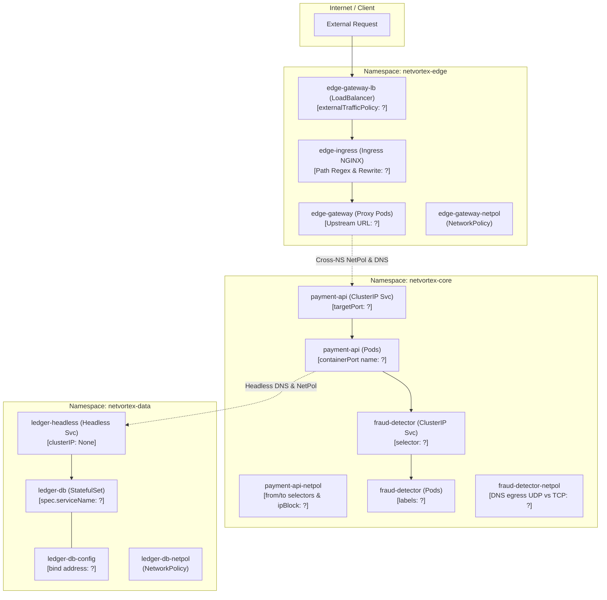

# NetVortex v9.0 — Kubernetes Deep Network & Zero-Trust Outage

> **[🇹🇷 Türkçe](#-türkçe-bölüm) | [🇬🇧 English](#-english-section)**

---

<a id="-türkçe-bölüm"></a>
## 🇹🇷 Türkçe Bölüm

### 1. Senaryo & Mimariye Genel Bakış

**NetVortex v9.0**, çok katmanlı ve yüksek işlem hacimli bir finansal yönlendirme platformudur. Sistem, Zero-Trust güvenlik standartlarına uygun olarak 3 farklı namespace (`netvortex-edge`, `netvortex-core`, `netvortex-data`) üzerinde izole edilmiştir.

Son altyapı dağıtımının ardından, sistemde şu kritik ağ anomalileri bildirilmiştir:
1. Dış ağdan gelen bazı istekler bağlantı zaman aşımına (`Connection timed out`) düşerken, diğerleri başarıyla dönmektedir.
2. Ingress üzerinden `/api/v1/checkout` yoluna giden istekler `404 Not Found` almaktadır.
3. Edge katmanından Core API'ye giden istekler `502 Bad Gateway` vermektedir.
4. Core API podları çalışır görünmesine rağmen Service IP üzerinden gelen trafik podlara ulaşamamaktadır.
5. Cross-namespace Zero-Trust kuralları devreye girdiğinde, izin verilmesi gereken API trafiği sessizce düşürülmektedir (`packet drop`).
6. Bankacılık harici entegrasyonuna giden ödeme takas (`settlement`) istekleri engellenmektedir.
7. Sahtekarlık tespit (`fraud-detector`) motoruna giden servis çağrıları boş endpoint (`<none>`) nedeniyle başarısız olmaktadır.
8. CoreDNS sorguları bazen başarılı olurken, büyük yanıt gerektiren durumlarda podlar DNS timeout yaşamaktadır.
9. StatefulSet olarak çalışan veri katmanı podları, headless servis DNS adı üzerinden birbirini ve veritabanını çözememektedir.
10. Veritabanı podu ayakta ve `Ready` görünmesine rağmen, diğer podlar bağlandığında `Connection refused` hatası almaktadır.

---

### 2. Mimari Ağ Şeması


---

### 3. Laboratuvarı Başlatma

Kurulum betiği ortamınızı otomatik olarak tespit eder (Minikube / Kind veya Cloud K8s) ve başlangıçtaki hatalı NetVortex sürümünü yükler:

```bash
./setup.sh
```

Durumu kontrol etmek ve başarısız ağ testlerini görmek için istediğiniz an doğrulama betiğini çalıştırabilirsiniz:

```bash
./check.sh
```

---

### 4. Metodolojik Teşhis & Araştırma Rehberi

> [!IMPORTANT]
> Bu rehberde doğrudan çözüm satırları veya kopyalar verilmemiştir. Bir Cloud/Network Mühendisi olarak sistemdeki semptomları izlemek, katman katman teşhis koymak ve sorunun kök nedenine ulaşmak için aşağıdaki adımları sırasıyla takip edin.

---

#### 🧭 Katman 1: Dış Ağ Girişi, L4 LoadBalancer & L7 Ingress (`netvortex-edge`)

##### 🔍 Teşhis 1: Dengesiz Dış Trafik & Node Bazlı Paket Düşüşleri
- **Semptom:** Dışarıdan Service veya NodePort IP'sine istek attığınızda bazı node'lar üzerinden yanıt gelirken, diğer node'lar üzerinden atılan istekler zaman aşımına uğruyor (`Connection timed out`).
- **Neden Olabilir?** L4 Kubernetes servislerinde `externalTrafficPolicy` varsayılan olarak `Cluster` modundadır (tüm node'lar gelen trafiği arka uç pod'un bulunduğu node'a SNAT ile yönlendirir). Ancak `Local` seçildiğinde kube-proxy yalnızca üzerinde ilgili pod'un bizzat koştuğu node'larda trafiği kabul eder; pod bulunmayan node'lara gelen paketler sessizce düşürülür.
- **Nasıl İncelemelisiniz?**
  ```bash
  # 1. Kümenizdeki node'ları ve IP'lerini listeleyin:
  kubectl get nodes -o wide

  # 2. edge-gateway pod'larının hangi node'lar üzerinde koştuğunu inceleyin:
  kubectl get pods -n netvortex-edge -o wide

  # 3. edge-gateway-lb servisinin yapılandırmasını inceleyin:
  kubectl get svc edge-gateway-lb -n netvortex-edge -o yaml
  ```
- **Kritik Soru:** Pod'un olmadığı bir node'a gelen trafiğin istemci IP'si korunurken diğer node'lara yönlendirilmesi mi gerekiyor, yoksa tüm küme genelinde yük dağılımı mı hedefleniyor?

---

##### 🔍 Teşhis 2: Ingress Path Regex & URL Yeniden Yazma (Rewrite Target)
- **Semptom:** Ingress üzerinden `/api/v1/checkout` çağrıldığında arka uç API'ye ulaşamıyor ve `404 Not Found` dönüyor.
- **Neden Olabilir?** NGINX Ingress Controller'da path `/api/v1` veya regex olarak tanımlandığında, arka uç mikroservis yalnızca `/checkout` bekliyorsa, prefix'in soyulması (`rewrite-target`) gerekir. Regex yakalama grubu (`$2`) kullanılıyorsa Ingress annotasyonlarında regex desteği açık olmalıdır.
- **Nasıl İncelemelisiniz?**
  ```bash
  kubectl get ingress edge-ingress -n netvortex-edge -o yaml
  ```
- **Kritik Soru:** `pathType` alanı `Prefix` mi yoksa regex için `ImplementationSpecific` mi olmalı? `nginx.ingress.kubernetes.io/use-regex` ve `nginx.ingress.kubernetes.io/rewrite-target` annotasyonları eşleşiyor mu?

---

##### 🔍 Teşhis 3: Cross-Namespace Servis Keşfi (DNS FQDN)
- **Semptom:** `edge-gateway` podu Ingress'ten gelen isteği Core API'ye iletmeye çalıştığında `502 Bad Gateway` alıyor ve nginx loglarında `payment-api could not be resolved` hatası görünüyor.
- **Neden Olabilir?** `edge-gateway`, `netvortex-edge` namespace'indedir. `payment-api` ise `netvortex-core` namespace'indedir. Kubernetes DNS resolv.conf dosyasındaki `search` alanları yerel namespace'i önceler. Farklı bir namespace'teki servise sadece servis adıyla erişilemez.
- **Nasıl İncelemelisiniz?**
  ```bash
  # 1. edge-gateway pod loglarını inceleyin:
  kubectl logs -n netvortex-edge -l app.kubernetes.io/name=edge-gateway

  # 2. edge-gateway NGINX konfigürasyonunu kontrol edin:
  kubectl get cm edge-gateway-config -n netvortex-edge -o yaml
  ```
- **Kritik Soru:** Farklı bir namespace'teki bir servise erişmek için standart Kubernetes FQDN veya namespace nitelemesi (`service.namespace`) nasıl yazılmalıdır?

---

#### 🧭 Katman 2: Core Mikroservisler, Portlar & Zero-Trust Politikaları (`netvortex-core`)

##### 🔍 Teşhis 4: Named Port (İsimlendirilmiş Port) Uyumsuzluğu
- **Semptom:** Servis mevcut, Pod çalışıyor (`1/1 Running`), ancak `kubectl describe svc payment-api -n netvortex-core` çıktısında Endpoints portu tanımlanmamış veya istekler porta ulaşamıyor.
- **Neden Olabilir?** Bir Kubernetes Service tanımında `targetPort` string olarak (örn. `api-http`) verildiğinde, Kubernetes Pod manifestindeki `containerPort` listesinde adı tam olarak bu olan bir port arar. Ad eşleşmezse kube-proxy yönlendirmeyi kuramaz.
- **Nasıl İncelemelisiniz?**
  ```bash
  # 1. Servisin targetPort tanımını inceleyin:
  kubectl get svc payment-api -n netvortex-core -o yaml

  # 2. Pod'un containerPort ve port name tanımını inceleyin:
  kubectl get deploy payment-api -n netvortex-core -o yaml
  ```
- **Kritik Soru:** Servisteki `targetPort` ile pod container'ındaki `ports[].name` birbiriyle birebir uyuşuyor mu?

---

##### 🔍 Teşhis 5: NetworkPolicy'de AND vs OR Mantık Tuzağı (Cross-Namespace Ingress)
- **Semptom:** `edge-gateway` doğru adrese istek atmasına rağmen bağlantı zaman aşımına uğruyor (`Connection timed out`), paketler Core API'ye hiç ulaşamıyor.
- **Neden Olabilir?** Kubernetes NetworkPolicy kurallarında:
  - `- podSelector: ...` (yalnızca podSelector varsa, K8s bu kuralı **YALNIZCA AYNI NAMESPACE** içinde değerlendirir!).
  - Başka bir namespace'ten gelen pod'a izin vermek için **aynı dizi elemanı içinde** hem `namespaceSelector` hem de `podSelector` bulunmalıdır.
- **Nasıl İncelemelisiniz?**
  ```bash
  # 1. payment-api ingress NetworkPolicy kuralını inceleyin:
  kubectl get netpol payment-api-netpol -n netvortex-core -o yaml

  # 2. netvortex-edge namespace etiketlerini kontrol edin:
  kubectl get ns netvortex-edge --show-labels
  ```
- **Kritik Soru:** Kuralınız `netvortex-edge` namespace'ini açıkça seçiyor mu? Yoksa podSelector tek başına kaldığı için yalnızca `netvortex-core` içindeki podları mı arıyor?

---

##### 🔍 Teşhis 6: Egress NetworkPolicy `ipBlock` CIDR & `except` Tuzağı
- **Semptom:** `payment-api` podu dış dünyadaki bankacılık gateway IP'sine (`198.51.100.25`) HTTP/HTTPS çağrısı yaptığında istekler engelleniyor.
- **Neden Olabilir?** `payment-api-netpol` içindeki egress kurallarında harici IP aralığı için bir `ipBlock` tanımlanmıştır. Ancak `except` bloğu yanlış bir CIDR maskesiyle hedef alt ağı tamamen dışlamış olabilir.
- **Nasıl İncelemelisiniz?**
  ```bash
  kubectl get netpol payment-api-netpol -n netvortex-core -o yaml
  ```
- **Kritik Soru:** `ipBlock.cidr` izin verirken `ipBlock.except` alanı gitmek istediğiniz IP adresini yanlışlıkla engelliyor mu?

---

##### 🔍 Teşhis 7: Servis Seçici (Selector) Typo'su & Boş EndpointSlices
- **Semptom:** `fraud-detector` podu sağlıklı çalışıyor, ancak servise giden istekler `503 Service Unavailable` veya `Connection refused` alıyor.
- **Neden Olabilir?** Servisin `spec.selector` alanındaki etiketler, pod'un `metadata.labels` alanındaki etiketlerle tam olarak eşleşmediğinde kube-controller-manager hiçbir Endpoint veya EndpointSlice üretemez.
- **Nasıl İncelemelisiniz?**
  ```bash
  # 1. Servisin endpoint'lerini listeleyin:
  kubectl get endpoints,endpointslices -n netvortex-core

  # 2. Servis selector'ını pod etiketleriyle karşılaştırın:
  kubectl get svc fraud-detector -n netvortex-core -o jsonpath='{.spec.selector}'
  kubectl get pods -n netvortex-core -l app.kubernetes.io/name=fraud-detector --show-labels
  ```
- **Kritik Soru:** Servis seçicisindeki hangi etiket pod'da tanımlı olandan farklı?

---

##### 🔍 Teşhis 8: CoreDNS Egress NetworkPolicy (UDP vs TCP Port 53)
- **Semptom:** `fraud-detector` podu standart kısa DNS sorgularını çözebilirken, büyük SRV veya TXT kayıtları sorgulandığında ya da DNSSEC doğrulaması gerektiğinde DNS sorguları donuyor ve zaman aşımına uğruyor.
- **Neden Olabilir?** DNS protokolü standart olarak UDP 53 kullanır. Ancak yanıt 512 baytı aştığında (veya EDNS0 tamponu dolduğunda), DNS istemcisi otomatik olarak **TCP Port 53** fallback'i yapar. Egress NetworkPolicy'de yalnızca UDP 53'e izin verilip TCP 53 unutulursa bu sorgular düşürülür.
- **Nasıl İncelemelisiniz?**
  ```bash
  kubectl get netpol fraud-detector-netpol -n netvortex-core -o yaml
  ```
- **Kritik Soru:** Egress kuralları altında `kube-system` yönüne giden port listesinde hem `UDP` hem `TCP` port 53 tanımlanmış mı?

---

#### 🧭 Katman 3: Veri Katmanı, Headless DNS & Socket Dinleme (`netvortex-data`)

##### 🔍 Teşhis 9: StatefulSet `spec.serviceName` & Headless Service Eşleşmesi
- **Semptom:** `payment-api` podu `ledger-db-0.ledger-headless.netvortex-data.svc.cluster.local` adresine erişmek istediğinde `NXDOMAIN` (böyle bir alan adı yok) hatası alıyor.
- **Neden Olabilir?** Kubernetes StatefulSet podlarının öngörülebilir DNS A/SRV kayıtlarına sahip olabilmesi için `spec.serviceName` alanı ile headless servisin (`clusterIP: None`) `metadata.name` alanı **birebir aynı** olmalıdır.
- **Nasıl İncelemelisiniz?**
  ```bash
  # 1. Headless servisin adını kontrol edin:
  kubectl get svc -n netvortex-data

  # 2. StatefulSet spec.serviceName alanını kontrol edin:
  kubectl get sts ledger-db -n netvortex-data -o jsonpath='{.spec.serviceName}'
  ```
- **Kritik Soru:** StatefulSet'in `spec.serviceName` değeri headless servisin adıyla uyuşuyor mu?

---

##### 🔍 Teşhis 10: Daemon Socket Bağlantısı (Loopback `127.0.0.1` vs `0.0.0.0`)
- **Semptom:** `ledger-db` podu ayakta, kendi içindeki liveness probe'lar geçiyor, ancak `payment-api` veya headless service IP'si üzerinden pod'a bağlanılmak istendiğinde anında `Connection refused` alınıyor.
- **Neden Olabilir?** Bir servis daemon'ı (örneğin Redis veya API sunucusu) konfigürasyonunda `bind 127.0.0.1` olarak ayarlanırsa, socket yalnızca pod içi loopback (`lo`) arayüzünü dinler. Pod'un `eth0` arayüzüne veya servis IP'sine gelen paketler Linux çekirdeği tarafından reddedilir.
- **Nasıl İncelemelisiniz?**
  ```bash
  # 1. ledger-db konfigürasyonunu kontrol edin:
  kubectl get cm ledger-db-config -n netvortex-data -o yaml

  # 2. Pod içinde dinlenen soketleri inceleyin:
  kubectl exec -it ledger-db-0 -n netvortex-data -- netstat -tlpn 2>/dev/null || true
  ```
- **Kritik Soru:** Veritabanı daemon'ı tüm pod arayüzlerinden gelen trafiği kabul etmek için hangi IP adresine bağlanmalıdır (`0.0.0.0`)?

---

### 5. Değişiklikleri Uygulama & Doğrulama

Sorunları tespit ettikten sonra, Helm değerlerinizi güncelleyerek release'i yenileyin:

```bash
# Değişiklikleri uygulayın:
helm upgrade --install netvortex ./helm/netvortex \
  --namespace netvortex-edge \
  -f ./helm/netvortex/values.yaml

# StatefulSet serviceName alanını değiştirdiğinizde:
kubectl delete sts ledger-db -n netvortex-data --cascade=orphan 2>/dev/null || true
helm upgrade --install netvortex ./helm/netvortex \
  --namespace netvortex-edge \
  -f ./helm/netvortex/values.yaml

# Doğrulama testini çalıştırın:
./check.sh
```

Tüm 10 kontrol yeşil olduğunda tebrikler! Kubernetes ağ katmanının en derin tuzaklarını başarıyla çözdünüz.

---

<a id="-english-section"></a>
## 🇬🇧 English Section

### 1. Scenario & Architectural Overview

**NetVortex v9.0** is a multi-tier, high-throughput financial transaction routing platform. Designed following Zero-Trust security principles, the system is strictly segmented across three namespaces (`netvortex-edge`, `netvortex-core`, `netvortex-data`).

Following a recent platform migration, several critical networking outages have been reported:
1. External ingress traffic experiences intermittent `Connection timed out` depending on which node receives the request.
2. Ingress requests to `/api/v1/checkout` return `404 Not Found`.
3. Edge gateway proxies receive `502 Bad Gateway` when routing to Core microservices.
4. Core API pods are active and ready, yet Service traffic fails to connect to the containers.
5. Cross-namespace Zero-Trust NetworkPolicies silently drop legitimate inter-tier traffic.
6. Outbound settlement calls to the external banking partner gateway are blocked at the egress boundary.
7. Fraud evaluation calls fail because the target Service has `<none>` endpoints registered.
8. CoreDNS resolution hangs or times out whenever responses exceed standard UDP packet limits.
9. Stateful database replicas cannot be resolved via Headless Service deterministic DNS names.
10. Database pods report healthy liveness status locally, but cluster services receive immediate `Connection refused` upon connecting.

---

### 2. Architecture Diagram



---

### 3. Getting Started

Initialize the lab using the setup script:

```bash
./setup.sh
```

Run the verification script at any time to inspect failing network checks:

```bash
./check.sh
```

---

### 4. Methodological Diagnostic Workflow

> [!IMPORTANT]
> This guide contains zero spoilers or direct answer cheats. As a Kubernetes Network Engineer, follow the methodical steps below to trace packets from L4/L7 ingress through Zero-Trust NetworkPolicies down to socket bindings.

---

#### 🧭 Layer 1: External Edge, L4 LoadBalancer & L7 Ingress (`netvortex-edge`)

##### 🔍 Diagnostic 1: Node-Dependent Packet Drops & Traffic Policies
- **Symptom:** External requests hitting the LoadBalancer or NodePort succeed on some nodes but hang with `Connection timed out` on others.
- **Root Cause Context:** By default, Kubernetes Service `externalTrafficPolicy` is `Cluster`, which proxies traffic across nodes using SNAT. When set to `Local`, kube-proxy only routes packets on nodes where an endpoint pod is physically scheduled. Traffic arriving at nodes without a local pod is dropped.
- **Diagnostic Commands:**
  ```bash
  kubectl get nodes -o wide
  kubectl get pods -n netvortex-edge -o wide
  kubectl get svc edge-gateway-lb -n netvortex-edge -o yaml
  ```
- **Guiding Question:** Do you require cluster-wide routing across all nodes, or are pods scheduled on every single node?

---

##### 🔍 Diagnostic 2: Ingress Path Regex & URL Rewrite Target
- **Symptom:** Routing through Ingress to `/api/v1/checkout` returns `404 Not Found`.
- **Root Cause Context:** When NGINX Ingress forwards traffic, path prefix stripping requires `nginx.ingress.kubernetes.io/rewrite-target: /$2` alongside `nginx.ingress.kubernetes.io/use-regex: "true"` and `pathType: ImplementationSpecific`.
- **Diagnostic Commands:**
  ```bash
  kubectl get ingress edge-ingress -n netvortex-edge -o yaml
  ```
- **Guiding Question:** Does the ingress path match the regex capture group referenced in `rewrite-target`?

---

##### 🔍 Diagnostic 3: Cross-Namespace Service Discovery (FQDN)
- **Symptom:** Edge gateway returns `502 Bad Gateway` with upstream resolution errors in NGINX logs.
- **Root Cause Context:** `edge-gateway` resides in `netvortex-edge`, while `payment-api` is deployed in `netvortex-core`. Unqualified hostnames resolve against the local namespace's search domain.
- **Diagnostic Commands:**
  ```bash
  kubectl logs -n netvortex-edge -l app.kubernetes.io/name=edge-gateway
  kubectl get cm edge-gateway-config -n netvortex-edge -o yaml
  ```
- **Guiding Question:** How must a service in another namespace be addressed in Kubernetes DNS (`<service>.<namespace>`)?

---

#### 🧭 Layer 2: Core Microservices & Zero-Trust Policies (`netvortex-core`)

##### 🔍 Diagnostic 4: Named Port Resolution Mismatch
- **Symptom:** Service exists and pods are ready, but `kubectl describe svc payment-api` shows missing target ports or connections fail.
- **Root Cause Context:** When a Service specifies a named string in `targetPort`, the target pod's container spec must define an identical string in `ports[].name`.
- **Diagnostic Commands:**
  ```bash
  kubectl get svc payment-api -n netvortex-core -o yaml
  kubectl get deploy payment-api -n netvortex-core -o yaml
  ```
- **Guiding Question:** Does the service `targetPort` string exactly match the container port name?

---

##### 🔍 Diagnostic 5: NetworkPolicy Ingress Scope (AND vs OR Logic)
- **Symptom:** Legitimate traffic from `edge-gateway` to `payment-api` is silently dropped by Default Deny.
- **Root Cause Context:** In Kubernetes NetworkPolicies, specifying a `podSelector` without a `namespaceSelector` **only selects pods within the SAME namespace**. To match pods in a foreign namespace, both `namespaceSelector` and `podSelector` must be defined together within the same list item.
- **Diagnostic Commands:**
  ```bash
  kubectl get netpol payment-api-netpol -n netvortex-core -o yaml
  kubectl get ns netvortex-edge --show-labels
  ```
- **Guiding Question:** Is `namespaceSelector` explicitly included to match `netvortex-edge`?

---

##### 🔍 Diagnostic 6: Egress NetworkPolicy `ipBlock` Subnet Exclusions
- **Symptom:** Outbound API calls to external banking partner `198.51.100.25` are blocked.
- **Root Cause Context:** NetworkPolicy egress uses `ipBlock` to whitelist external CIDRs. An errant `except` clause can unintentionally mask the target subnet.
- **Diagnostic Commands:**
  ```bash
  kubectl get netpol payment-api-netpol -n netvortex-core -o yaml
  ```
- **Guiding Question:** Does the `except` array exclude the subnet containing the gateway IP?

---

##### 🔍 Diagnostic 7: Service Selector Typo & Empty Endpoints
- **Symptom:** Inter-service calls to `fraud-detector` return `503` or connection errors; `kubectl get ep` shows `<none>`.
- **Root Cause Context:** If a Service `spec.selector` has even a single character mismatch with the pod's `metadata.labels`, Kubernetes will not register endpoints.
- **Diagnostic Commands:**
  ```bash
  kubectl get ep fraud-detector -n netvortex-core
  kubectl get svc fraud-detector -n netvortex-core -o jsonpath='{.spec.selector}'
  kubectl get pods -n netvortex-core -l app.kubernetes.io/name=fraud-detector --show-labels
  ```
- **Guiding Question:** Which label key/value differs between the service selector and pod template?

---

##### 🔍 Diagnostic 8: CoreDNS Egress NetworkPolicy (UDP vs TCP 53)
- **Symptom:** Pod DNS lookups fail or hang when querying large records.
- **Root Cause Context:** DNS queries exceeding 512 bytes or requiring truncation fallback switch from UDP to TCP port 53. Restricting egress to UDP 53 causes TCP DNS queries to drop.
- **Diagnostic Commands:**
  ```bash
  kubectl get netpol fraud-detector-netpol -n netvortex-core -o yaml
  ```
- **Guiding Question:** Does the DNS egress rule permit both UDP and TCP on port 53?

---

#### 🧭 Layer 3: Data Tier & Socket Bindings (`netvortex-data`)

##### 🔍 Diagnostic 9: StatefulSet `spec.serviceName` & Headless DNS
- **Symptom:** Database pod DNS hostname `ledger-db-0.ledger-headless.netvortex-data.svc.cluster.local` returns NXDOMAIN.
- **Root Cause Context:** Kubernetes generates deterministic DNS records for StatefulSet pods only when `spec.serviceName` in the StatefulSet matches the `metadata.name` of the headless service.
- **Diagnostic Commands:**
  ```bash
  kubectl get svc -n netvortex-data
  kubectl get sts ledger-db -n netvortex-data -o jsonpath='{.spec.serviceName}'
  ```
- **Guiding Question:** Does `spec.serviceName` match the headless service name (`ledger-headless`)?

---

##### 🔍 Diagnostic 10: Loopback Interface Binding (`127.0.0.1` vs `0.0.0.0`)
- **Symptom:** Service endpoints exist and local probes succeed, but external pods receive `Connection refused`.
- **Root Cause Context:** Binding a server daemon to `127.0.0.1` restricts the socket to the pod's local loopback interface. Traffic arriving via `eth0` or Service virtual IPs is rejected.
- **Diagnostic Commands:**
  ```bash
  kubectl get cm ledger-db-config -n netvortex-data -o yaml
  ```
- **Guiding Question:** To accept cluster network traffic, should the process bind to `127.0.0.1` or `0.0.0.0`?

---

### 5. Verification

After updating your configurations, apply the changes and verify:

```bash
helm upgrade --install netvortex ./helm/netvortex \
  --namespace netvortex-edge \
  -f ./helm/netvortex/values.yaml

# Re-create StatefulSet if spec.serviceName was modified:
kubectl delete sts ledger-db -n netvortex-data --cascade=orphan 2>/dev/null || true
helm upgrade --install netvortex ./helm/netvortex \
  --namespace netvortex-edge \
  -f ./helm/netvortex/values.yaml

./check.sh
```

When all 10 checks pass, your network troubleshooting audit is complete!
