# 🌐 K8s Troubleshoot Lab 27: CloudApex v10.0 — Enterprise Multi-Tier Mesh & Cloud LoadBalancer Outage

> **[🇹🇷 Türkçe](#-türkçe-bölüm) | [🇬🇧 English](#-english-section)**

---

<a id="-türkçe-bölüm"></a>
## 🇹🇷 Türkçe Bölüm

### 📋 Lab Özeti (Incident Briefing)

| Alan | Detay |
| :--- | :--- |
| **Platform** | **CloudApex v10.0** — Enterprise E-Commerce Gateway, Multi-Tier Zero-Trust Mesh |
| **Odak Noktası** | **%100 Gerçek Hayat Kubernetes & Bulut Ağı:** Çift Azure Public LoadBalancer (Doğrudan LB IP'si + Ingress LB IP'si), Azure LB Health Probe arızası, Ingress Prefix vs Exact yönlendirme, Calico Zero-Trust ile Cloud IMDS (`169.254.169.254`), L4 vs L7 Session Affinity Hotspotting, Cross-Namespace NetPol izolasyonu, CoreDNS `ndots: 5` gecikme optimizasyonu, Headless Stateful Cache, Socket dinleme (`127.0.0.1` vs `0.0.0.0`) |
| **Altyapı (Terraform)** | **Azure Kubernetes Service (AKS)** — 2 Düğümlü (`Standard_B2s_v2`), Calico Ağ İlkesi Motoru (`network_policy = "calico"`), NGINX Ingress Controller |
| **Etkilenen Alanlar** | `cloudapex-edge`, `cloudapex-core`, `cloudapex-inventory` (3 Namespace, 10 Kritik Kurumsal Ağ Arızası) |
| **Kontrol Aracı** | `./check.sh` — 10 ağ adımını tek tek test eden, dış IP'leri denetleyen ve teşhis ipuçları sunan interaktif doğrulama betiği |
| **Çözüm Anahtarı** | [`SOLUTION.md`](./SOLUTION.md) — 10 arızanın ayrıntılı kök neden analizi, L4/L7 paket akış teorisi ve tam çözümleri |

---

### 🧠 Lab Öncesi Aklında Kalması Gereken 8 Altın Kubernetes Ağ Kuralı

Bu laboratuvarda kurumsal ölçekte karşılaşacağın gerçek dünya ağ senaryolarını çözebilmek için aşağıdaki **8 temel ağ kuralını** derinlemesine kavramış olmalısın:

1. **Azure Cloud LoadBalancer Sağlık Kontrolü (Health Probe) Mekanizması:**
   - Azure Load Balancer, `type: LoadBalancer` olan servislere dışarıdan gelen trafiği düğümlere iletmeden önce periyodik olarak bir sağlık yoklaması (`Health Probe`) yapar.
   - Bu yoklama varsayılan olarak `service.beta.kubernetes.io/azure-load-balancer-health-probe-request-path` annotasyonundaki yola (örneğin `/healthz`) HTTP GET isteği atar.
   - Eğer arka uçtaki uygulama bu yolda `404 Not Found` dönerse veya bu yolu dinlemiyorsa, **Azure Load Balancer ilgili düğümleri 'unhealthy' (sağlıksız) işaretler ve dış Public IP'ye gelen tüm paketleri anında reddeder / zaman aşımına düşürür!** Pod küme içinde ayakta olsa dahi dış dünyadan erişilemez.
2. **Ingress `pathType: Exact` vs `Prefix` Tuzağı:**
   - Ingress kuralında `/api/orders` yolu `pathType: Exact` olarak tanımlandığında, Ingress Controller yalnızca tam olarak `/api/orders` adresine gelen istekleri backend servise iletir.
   - İstemciler `/api/orders/checkout` veya `/api/orders/101` gibi alt yollara istek attığında kural eşleşmez ve Ingress `404 Not Found` döner. Dinamik REST API'ler için daima `pathType: Prefix` kullanılmalıdır.
3. **L4 (TCP/IP) vs L7 (HTTP/Cookie) Session Affinity Tuzağı (Proxy Hotspotting):**
   - Kubernetes Service nesnesinde `sessionAffinity: ClientIP` tanımlandığında `kube-proxy`, gelen paketin kaynak IP'sine (Client IP) göre her zaman aynı pod'a yönlendirme yapar.
   - Ancak araya bir **Ingress Controller** veya Reverse Proxy girdiğinde, Ingress podu istekleri kendi dahili Pod IP'si üzerinden backend servise iletir.
   - Sonuç olarak tüm müşterilerden gelen binlerce istek `kube-proxy` gözünde **aynı tek bir IP'den (Ingress podu)** geliyormuş gibi görünür ve trafik %100 oranında tek bir pod'a kilitlenir (`hotspotting`)! Servis düzeyindeki L4 affinity kaldırılmalı (`None`), oturum sabitleme Ingress düzeyinde çerez ile (`nginx.ingress.kubernetes.io/affinity: cookie`) yapılmalıdır.
4. **Calico Zero-Trust ve Bulut Metadata Servisi (`169.254.169.254`):**
   - Bulutta çalışan podlar (örneğin Azure Managed Identity, AWS IAM Roles for Service Accounts) kimlik doğrulaması yapmak için link-local IP adresi olan `169.254.169.254` (IMDS - Instance Metadata Service) adresine HTTP isteği atarlar.
   - Namespace üzerinde katı bir `default-deny` egress NetworkPolicy varsa ve yalnızca küme içi IP blokları (`10.0.0.0/8`) izinli bırakılmışsa, podlar `169.254.169.254` adresine erişemez ve bulut kimlik doğrulama token'ı alamayarak çöker. Bu IP NetworkPolicy'de açıkça `ipBlock.cidr: 169.254.169.254/32` olarak izin listesine eklenmelidir.
5. **CoreDNS `ndots: 5` Sorgu Şişmesi ve Performans Kaybı:**
   - Kubernetes podlarının varsayılan `/etc/resolv.conf` yapılandırmasında `ndots: 5` yer alır.
   - Bir pod dış dünyadaki bir servise (örneğin `api.stripe.com` - 2 nokta içerir) bağlanırken, nokta sayısı 5'ten az olduğu için resolver önce yerel namespace search domain'lerini dener:
     `api.stripe.com.<ns>.svc.cluster.local`, `api.stripe.com.svc.cluster.local`, `api.stripe.com.cluster.local`...
   - Bu durum her harici API çağrısında 4 adet başarısız sorgu üretir, CoreDNS'i aşırı yükler ve gecikmeyi tırmandırır. Pod tanımında `dnsConfig.options: [{name: ndots, value: "2"}]` verilerek bu sorun engellenmelidir.
6. **Cross-Namespace NetworkPolicy İzolasyonu ve Etiket Uyuşmazlığı:**
   - Çekirdek bir servis (`order-service`) envanter servisine (`inventory-service`) stok rezerve etmek için çağrı yaptığında, envanter namespace'indeki NetworkPolicy gelen trafiğe izin vermelidir.
   - Ingress kuralındaki `namespaceSelector.matchLabels` etiketinde yapılacak tek bir harf hatası (örneğin `cloudapex-orders` yerine `cloudapex-core`), iki servis arasındaki iletişimi sessizce keserek `504 Gateway Timeout` oluşturur.
7. **Service Named Port Eşleşmesi ve Endpoint Üretimi:**
   - Servis `targetPort: rpc-http` olarak tanımlandığında, pod container manifestindeki `ports[].name` alanında tam olarak bu string aranır. Eşleşme olmazsa `kubectl get ep` üzerinde port eşlenemez ve istemciler `Connection refused` alır.
8. **Loopback (`127.0.0.1`) vs Tüm Ağ Arayüzleri (`0.0.0.0`) Soket Bağlantısı:**
   - Konteyner içindeki bir servis `127.0.0.1` dinlerse, Kubelet ve diğer servisler pod'un `eth0` IP'si üzerinden geldiğinde Linux kernel TCP stack isteği `RST` bayrağı ile anında reddeder (`Connection refused`).

---

### 🏗️ Hedeflenen Mimari ve Ağ Akışı (Target Architecture)

```mermaid
flowchart TD
    subgraph Clients["🌐 Dış Dünyadan Gelen İstemciler"]
        WebUser["İnternet Kullanıcısı<br/>(E-Commerce Web)"]
        WebhookClient["Harici Ödeme Webhook'u<br/>(Stripe / Adyen)"]
    end

    subgraph AzureCloud["☁️ Azure Cloud Ağ Katmanı (aks-cloudapex-27)"]
        IngressLB["Public IP 1: Ingress LoadBalancer<br/>(cloudapex.<IP>.nip.io)"]
        DirectLB["Public IP 2: Dedicated Order Gateway LB<br/>(<DIRECT_LB_IP>:8080)<br/>Probe: /api/health"]
    end

    subgraph EdgeNS ["🌐 Namespace: cloudapex-edge (tier: edge)"]
        IngCtrl["🚪 Ingress-NGINX Controller<br/>(Cookie Sticky Affinity)"]
        IngObj["Ingress: cloudapex-ingress<br/>- /api/orders (pathType: Prefix)<br/>- /api/inventory (pathType: Prefix)"]
        GatewaySvc["Service: order-gateway-lb (LoadBalancer :8080)"]
        GatewayPod["Deployment: order-gateway (2 Replicas)<br/>Health: /api/health"]
        
        DirectLB -->|"1. Dedicated LB Trafiği"| GatewaySvc
        GatewaySvc --> GatewayPod
        IngressLB -->|"2. L7 Ingress Trafiği"| IngCtrl
        IngCtrl --> IngObj
    end

    subgraph CoreNS ["⚙️ Namespace: cloudapex-core (tier: core)"]
        OrderSvc["Service: order-service (:8080)<br/>sessionAffinity: None"]
        OrderPod["Deployment: order-service (2 Replicas)<br/>dnsConfig: ndots=2"]
        OrderNP["🛡️ NetPol: order-service-netpol<br/>Egress to: DNS, Inventory, IMDS"]

        AuthSvc["Service: auth-service (:8082)"]
        AuthPod["Deployment: auth-service<br/>bind: 0.0.0.0:8082"]

        IngObj -->|"3. /api/orders"| OrderSvc
        OrderSvc --> OrderPod
        OrderPod -->|"4. /api/auth/verify"| AuthSvc
        AuthSvc --> AuthPod
    end

    subgraph InvNS ["🔐 Namespace: cloudapex-inventory (tier: inventory)"]
        InvSvc["Service: inventory-service (:8081)<br/>targetPort: http"]
        InvPod["Deployment: inventory-service (2 Replicas)<br/>containerPortName: http"]
        InvNP["🛡️ NetPol: inventory-service-netpol<br/>Ingress from: cloudapex-core"]

        CacheSvc["Headless Service: cache-headless<br/>(:6379, clusterIP: None)"]
        CacheSTS["StatefulSet: inventory-cache<br/>spec.serviceName: cache-headless"]

        IngObj -->|"5. /api/inventory"| InvSvc
        OrderPod -->|"6. Cross-NS Stock Reserve :8081"| InvSvc
        InvSvc --> InvPod
        InvPod -->|"7. Headless Cache DNS :6379"| CacheSvc
        CacheSvc --> CacheSTS
    end

    OrderPod -->|"8. Link-Local TCP :80"| IMDS(["☁️ Azure IMDS<br/>169.254.169.254/32"])
    OrderPod -->|"9. UDP/TCP :53"| CoreDNS(["🧭 CoreDNS (kube-system)"])
```



---

### 🚀 Kurulum ve Güncelleme Komutları

#### 1. Ortamı Kurmak İçin (Terraform ile AKS Sağlama):
```bash
chmod +x setup.sh cleanup.sh check.sh
./setup.sh
```
> **İpucu:** Eğer cluster'ınız zaten çalışıyorsa ve yalnızca Helm chart'ı sıfırdan kurmak istiyorsanız `./setup.sh --skip-terraform` parametresini kullanabilirsiniz.

#### 2. Durumu ve İlerlemeni Kontrol Etmek İçin (`check.sh`):
Herhangi bir anda kaç hatayı çözdüğünüzü ve sıradaki hatanın teşhis ipuçlarını görmek için:
```bash
./check.sh
```

#### 3. Dış Public IP'leri Doğrudan Test Etmek İçin:
Kurulum tamamlandığında `setup.sh` size iki adet Public IP sunar:
```bash
# 1. Ingress üzerinden L7 erişimi:
INGRESS_IP=$(kubectl get svc -n ingress-nginx ingress-nginx-controller -o jsonpath='{.status.loadBalancer.ingress[0].ip}')
curl -v "http://cloudapex.${INGRESS_IP}.nip.io/api/orders"
curl -v "http://cloudapex.${INGRESS_IP}.nip.io/api/orders/checkout"

# 2. Doğrudan Azure Public LoadBalancer IP'sine L4 erişimi:
DIRECT_LB_IP=$(kubectl get svc -n cloudapex-edge order-gateway-lb -o jsonpath='{.status.loadBalancer.ingress[0].ip}')
curl -v "http://${DIRECT_LB_IP}:8080/api/orders"
```

#### 4. Yapılandırmayı Güncelledikten Sonra Uygulamak İçin:
```bash
helm upgrade --install cloudapex ./helm/cloudapex \
  --namespace cloudapex-edge \
  --set global.ingressHost="cloudapex.${INGRESS_IP}.nip.io"
```

---

### 🛠️ Adım Adım Sorun Giderme Rehberi (Namespace Bazlı 10 Görev)

Sorunları rastgele aramak yerine `./check.sh` çıktısındaki sırayla çözün:

---

#### 🚪 BÖLÜM 1: Bulut LoadBalancer & Ingress Ağ Geçitleri (`namespace: cloudapex-edge`)

Önce `cloudapex-edge` içindeki kaynakları ve dış IP'leri listeleyin:
```bash
kubectl get svc,deploy,ingress,pods,netpol -n cloudapex-edge
```

* **Görev 1 — Doğrudan Azure Public LoadBalancer IP'sine Yapılan İstekler Neden Yanıt Vermiyor?**
  - **Teşhis Komutu:**
    ```bash
    kubectl describe svc order-gateway-lb -n cloudapex-edge
    kubectl logs -n cloudapex-edge -l app.kubernetes.io/name=order-gateway
    ```
  - **İnceleme Alanı:** `order-gateway-lb` servisinin `annotations` bölümünde tanımlı `service.beta.kubernetes.io/azure-load-balancer-health-probe-request-path` değerini pod loglarıyla karşılaştırın. Uygulama hangi sağlık yolunu dinliyor, Azure Load Balancer probe hangi yola GET atıyor? Azure'un düğümleri sağlıklı görmesi için bu yolun ne olması gerektiğini değerlendirin.

* **Görev 2 — Ingress Üzerinden `/api/orders/checkout` İstekleri Neden `404 Not Found` Alıyor?**
  - **Teşhis Komutu:**
    ```bash
    kubectl describe ingress cloudapex-ingress -n cloudapex-edge
    ```
  - **İnceleme Alanı:** `/api/orders` kuralının `PathType` alanını inceleyin. `Exact` ile `Prefix` arasındaki farkı hatırlayın; alt yolların (`/checkout`) eşleşebilmesi için `PathType` ne olmalıdır?

* **Görev 3 — Ingress Üzerinde Oturum Sabitleme (Sticky Session) Neden Çalışmıyor?**
  - **Teşhis Komutu:**
    ```bash
    kubectl get ingress cloudapex-ingress -n cloudapex-edge -o yaml
    ```
  - **İnceleme Alanı:** Ingress annotasyonlarında L7 oturum sabitleme (`nginx.ingress.kubernetes.io/affinity`) tanımlanmış mı?

---

#### ⚙️ BÖLÜM 2: Çekirdek Mikroservisler & Zero-Trust Politikaları (`namespace: cloudapex-core`)

Önce `cloudapex-core` içindeki kaynakları listeleyin:
```bash
kubectl get deploy,svc,pods,netpol -n cloudapex-core
```

* **Görev 4 — `order-service` Arkasında Neden Şiddetli Pod Trafik Dengesizliği (Hotspotting) Yaşanıyor?**
  - **Teşhis Komutu:**
    ```bash
    kubectl get svc order-service -n cloudapex-core -o yaml
    ```
  - **İnceleme Alanı:** Servisin `sessionAffinity` değerini inceleyin. Ingress arkasındaki bir serviste `ClientIP` kullanıldığında, tüm istemcilerin Ingress podunun IP'siyle gelmesi durumunda kube-proxy'nin trafiği nasıl dağıttığını değerlendirin. Bu alanın `None` yapılması gerektiğini hatırlayın.

* **Görev 5 — `order-service` Bulut Metadata Servisinden (`169.254.169.254`) Neden Token Alamıyor?**
  - **Teşhis Komutu:**
    ```bash
    kubectl describe netpol order-service-netpol -n cloudapex-core
    ```
  - **İnceleme Alanı:** `order-service-netpol` içindeki egress kurallarını inceleyin. Podun Azure Managed Identity servisine (`169.254.169.254:80`) erişebilmesi için `ipBlock` kurallarına link-local IP'nin eklenip eklenmediğini kontrol edin.

* **Görev 6 — `order-service` Dış DNS Sorgularında Neden Yüksek Gecikme Yaşıyor?**
  - **Teşhis Komutu:**
    ```bash
    kubectl get deploy order-service -n cloudapex-core -o yaml
    ```
  - **İnceleme Alanı:** Pod spec içindeki `dnsConfig.options` alanını inceleyin. Kubernetes varsayılanı olan `ndots: 5` değerinin harici FQDN sorgularında (örneğin `api.stripe.com`) kaç adet gereksiz yerel arama yaptığını ve bu değerin `ndots: 2` olarak optimize edilmesi gerektiğini hatırlayın.

* **Görev 7 — `auth-service` Podu Ayakta Olduğu Halde İstekler Neden `Connection refused` Alıyor?**
  - **Teşhis Komutu:**
    ```bash
    kubectl get deploy auth-service -n cloudapex-core -o yaml
    kubectl logs -n cloudapex-core -l app.kubernetes.io/name=auth-service
    ```
  - **İnceleme Alanı:** `auth-service` ortam değişkenlerindeki `BIND_ADDRESS` değerini inceleyin. Uygulamanın yalnızca `127.0.0.1` mi yoksa tüm arayüzleri (`0.0.0.0`) mi dinlediğini değerlendirin.

---

#### 🔐 BÖLÜM 3: Envanter Katmanı & Dağıtık Önbellek (`namespace: cloudapex-inventory`)

Önce `cloudapex-inventory` içindeki kaynakları listeleyin:
```bash
kubectl get deploy,sts,svc,endpoints,pods,netpol -n cloudapex-inventory
```

* **Görev 8 — Sipariş Servisinden Envanter Servisine Gelen Stok Çağrıları Neden `504 Gateway Timeout` Veriyor?**
  - **Teşhis Komutu:**
    ```bash
    kubectl describe netpol inventory-service-netpol -n cloudapex-inventory
    kubectl get ns --show-labels
    ```
  - **İnceleme Alanı:** `inventory-service-netpol` Ingress kuralındaki `namespaceSelector.matchLabels` etiketini inceleyin. Kaynak namespace adı ile kuralda seçilen namespace adını karşılaştırarak etiketteki typo'yu tespit edin.

* **Görev 9 — `inventory-service` Servis Portu Neden Çözümlenemiyor (Named Port Uyumsuzluğu)?**
  - **Teşhis Komutu:**
    ```bash
    kubectl describe svc inventory-service -n cloudapex-inventory
    kubectl get deploy inventory-service -n cloudapex-inventory -o yaml
    ```
  - **İnceleme Alanı:** Servis `targetPort` string değeri ile pod manifestindeki container port adını karşılaştırın.

* **Görev 10 — Dağıtık Önbellek (`inventory-cache`) Podu Neden Headless DNS Adresiyle Çözümlenemiyor?**
  - **Teşhis Komutu:**
    ```bash
    kubectl get svc -n cloudapex-inventory
    kubectl get sts inventory-cache -n cloudapex-inventory -o jsonpath='{.spec.serviceName}{"\n"}'
    ```
  - **İnceleme Alanı:** StatefulSet `spec.serviceName` alanı ile arkasındaki Headless `Service.metadata.name` alanının birebir aynı olup olmadığını denetleyin. StatefulSet tanımı güncellendikten sonra eski StatefulSet'i silip upgrade yapmayı unutmayın:
    ```bash
    kubectl delete sts inventory-cache -n cloudapex-inventory --cascade=orphan 2>/dev/null || true
    ```

---

### ✅ Başarı Kriterleri (Success Criteria)

Tüm adımları tamamladıktan sonra:
```bash
./check.sh
```

Aşağıdaki çıktıyı ve **`10 Passed / 0 Failed`** sonucunu gördüğünüzde labı başarıyla tamamladınız demektir:
```text
======================================================================
   Audit Summary: 10 Passed / 0 Failed (Total: 10)
======================================================================
🎉 CONGRATULATIONS! All CloudApex v10.0 networking issues are resolved!
   Both external Azure LoadBalancers and the Zero-Trust mesh are fully healthy.
```

---

<a id="-english-section"></a>
## 🇬🇧 English Section

### 📋 Incident Briefing

| Field | Detail |
| :--- | :--- |
| **Platform** | **CloudApex v10.0** — Enterprise E-Commerce Gateway, Multi-Tier Zero-Trust Mesh |
| **Focus** | **100% Real-World Kubernetes & Cloud Networking:** Dual Azure Public LoadBalancers (Direct LB IP + Ingress LB IP), Azure LB Health Probe failures, Ingress Prefix vs Exact routing, Calico Zero-Trust with Cloud IMDS (`169.254.169.254`), L4 vs L7 Session Affinity Hotspotting, Cross-Namespace NetPol isolation, CoreDNS `ndots: 5` latency optimization, Headless Stateful Cache, Socket binding (`127.0.0.1` vs `0.0.0.0`) |
| **Infrastructure (Terraform)** | **Azure Kubernetes Service (AKS)** — 2 Nodes (`Standard_B2s_v2`), Calico Network Policy Engine (`network_policy = "calico"`), NGINX Ingress Controller |
| **Affected Areas** | `cloudapex-edge`, `cloudapex-core`, `cloudapex-inventory` (3 Namespaces, 10 Critical Enterprise Network Failures) |
| **Verification Tool** | `./check.sh` — Interactive verification script testing all 10 network layers with external public IP validation and diagnostic hints |
| **Solution Key** | [`SOLUTION.md`](./SOLUTION.md) — Comprehensive root cause analysis, L4/L7 packet flow mechanics, and full YAML solutions |

---

### 🧠 8 Golden Kubernetes Networking Rules to Master

To methodically troubleshoot and solve the network outages in this lab, ensure you understand these **8 core networking principles**:

1. **Azure Cloud LoadBalancer Health Probe Mechanism:**
   - Azure Load Balancer periodically probes services of `type: LoadBalancer` before routing external packets to nodes.
   - Probes target the path configured in `service.beta.kubernetes.io/azure-load-balancer-health-probe-request-path`.
   - If the application responds with `404 Not Found`, **Azure LB marks node probes as down and drops all external public IP traffic!** Even if pods are running locally, the public IP remains completely unreachable from the outside.
2. **Ingress `pathType: Exact` vs `Prefix`:**
   - When an Ingress path `/api/orders` uses `pathType: Exact`, only exact matches forward to the backend. Sub-paths like `/api/orders/checkout` fail to match and return 404. REST APIs require `pathType: Prefix`.
3. **L4 vs L7 Session Affinity & Ingress Hotspotting:**
   - Setting `sessionAffinity: ClientIP` on a Service behind Ingress causes `kube-proxy` to hash the Ingress pod's IP, concentrating 100% of external traffic onto a single backend pod. Sticky sessions must be managed at L7 using cookies (`nginx.ingress.kubernetes.io/affinity: cookie`).
4. **Calico Zero-Trust Egress & Cloud IMDS (`169.254.169.254`):**
   - Pods utilizing Azure Managed Identities fetch OAuth tokens from link-local `169.254.169.254:80`. Under default-deny egress policies, link-local addresses must be explicitly permitted via `ipBlock: 169.254.169.254/32`.
5. **CoreDNS `ndots: 5` Query Amplification:**
   - The default `ndots: 5` generates 4 sequential failed search domain queries for external FQDNs with fewer than 5 dots (e.g. `api.stripe.com`). Setting `dnsConfig.options: [{name: ndots, value: "2"}]` eliminates this latency penalty.
6. **Cross-Namespace Egress NetPol Isolation:**
   - Egress calls across namespaces require matching `namespaceSelector.matchLabels` in the destination's ingress NetworkPolicy. Label typos result in silent drops (`504 Gateway Timeout`).
7. **Service Named Port Alignment:**
   - When a Service specifies `targetPort: rpc-http`, the pod's container spec must define an identical string in `ports[].name`.
8. **Loopback (`127.0.0.1`) vs All Interfaces (`0.0.0.0`) Socket Binding:**
   - Binding to `127.0.0.1` restricts listeners to the loopback interface, rejecting external and service traffic with `Connection refused`.

---

### 🚀 Setup and Verification Commands

#### 1. Provision Infrastructure via Terraform:
```bash
chmod +x setup.sh cleanup.sh check.sh
./setup.sh
```

#### 2. Test Live External Public IPs:
```bash
# Ingress L7 Gateway:
INGRESS_IP=$(kubectl get svc -n ingress-nginx ingress-nginx-controller -o jsonpath='{.status.loadBalancer.ingress[0].ip}')
curl -v "http://cloudapex.${INGRESS_IP}.nip.io/api/orders"

# Direct Dedicated Azure Public LB IP:
DIRECT_LB_IP=$(kubectl get svc -n cloudapex-edge order-gateway-lb -o jsonpath='{.status.loadBalancer.ingress[0].ip}')
curl -v "http://${DIRECT_LB_IP}:8080/api/orders"
```

#### 3. Run Diagnostic Audit Script:
```bash
./check.sh
```

#### 4. Apply Configuration Updates via Helm:
```bash
helm upgrade --install cloudapex ./helm/cloudapex \
  --namespace cloudapex-edge \
  --set global.ingressHost="cloudapex.${INGRESS_IP}.nip.io"
```

---

### 🛠️ Methodological Troubleshooting Guide (10 Tasks)

---

#### 🚪 SECTION 1: Cloud LoadBalancers & Ingress Gateways (`namespace: cloudapex-edge`)

* **Task 1 — Why Does the Direct Azure Public LoadBalancer IP Reject External Traffic?**
  - **Diagnostic Command:**
    ```bash
    kubectl describe svc order-gateway-lb -n cloudapex-edge
    kubectl logs -n cloudapex-edge -l app.kubernetes.io/name=order-gateway
    ```
  - **Diagnostic Direction:** Inspect `service.beta.kubernetes.io/azure-load-balancer-health-probe-request-path`. Compare the probe path against the application's actual health endpoint.

* **Task 2 — Why Does Ingress Return 404 for `/api/orders/checkout`?**
  - **Diagnostic Command:**
    ```bash
    kubectl describe ingress cloudapex-ingress -n cloudapex-edge
    ```
  - **Diagnostic Direction:** Verify the `pathType` of `/api/orders`. Ensure it uses `Prefix` rather than `Exact` to match sub-paths.

* **Task 3 — Why is L7 Sticky Session Affinity Inactive?**
  - **Diagnostic Command:**
    ```bash
    kubectl get ingress cloudapex-ingress -n cloudapex-edge -o yaml
    ```
  - **Diagnostic Direction:** Ensure `nginx.ingress.kubernetes.io/affinity: cookie` is configured on the Ingress resource.

---

#### ⚙️ SECTION 2: Core Microservices & Zero-Trust Mesh (`namespace: cloudapex-core`)

* **Task 4 — Why Does `order-service` Suffer Severe Traffic Hotspotting Behind Ingress?**
  - **Diagnostic Command:**
    ```bash
    kubectl get svc order-service -n cloudapex-core -o yaml
    ```
  - **Diagnostic Direction:** Inspect `sessionAffinity`. When enabled behind Ingress, `kube-proxy` hashes the Ingress controller's internal IP. Set `sessionAffinity: None`.

* **Task 5 — Why Does `order-service` Fail to Acquire Azure IMDS Tokens?**
  - **Diagnostic Command:**
    ```bash
    kubectl describe netpol order-service-netpol -n cloudapex-core
    ```
  - **Diagnostic Direction:** Inspect egress rules. Ensure link-local IP `169.254.169.254/32` is explicitly permitted on port 80.

* **Task 6 — Why Does `order-service` Suffer High External DNS Latency?**
  - **Diagnostic Command:**
    ```bash
    kubectl get deploy order-service -n cloudapex-core -o yaml
    ```
  - **Diagnostic Direction:** Inspect `dnsConfig.options`. Optimize `ndots` to `2` to eliminate excessive local search queries for external FQDNs.

* **Task 7 — Why Does `auth-service` Reject Connections with `Connection refused`?**
  - **Diagnostic Command:**
    ```bash
    kubectl get deploy auth-service -n cloudapex-core -o yaml
    ```
  - **Diagnostic Direction:** Check the `BIND_ADDRESS` environment variable. Ensure the server binds to `0.0.0.0` rather than `127.0.0.1`.

---

#### 🔐 SECTION 3: Inventory Tier & Distributed Cache (`namespace: cloudapex-inventory`)

* **Task 8 — Why Do Inter-Service Checkout Calls Return `504 Gateway Timeout`?**
  - **Diagnostic Command:**
    ```bash
    kubectl describe netpol inventory-service-netpol -n cloudapex-inventory
    ```
  - **Diagnostic Direction:** Check `namespaceSelector.matchLabels` in the ingress rule. Identify the typo in the allowed namespace name.

* **Task 9 — Why Does `inventory-service` Fail to Resolve Named Ports?**
  - **Diagnostic Command:**
    ```bash
    kubectl describe svc inventory-service -n cloudapex-inventory
    kubectl get deploy inventory-service -n cloudapex-inventory -o yaml
    ```
  - **Diagnostic Direction:** Ensure `targetPort` matches the container's `ports[].name`.

* **Task 10 — Why is `inventory-cache` Unresolvable via Headless DNS?**
  - **Diagnostic Command:**
    ```bash
    kubectl get sts inventory-cache -n cloudapex-inventory -o jsonpath='{.spec.serviceName}{"\n"}'
    kubectl get svc -n cloudapex-inventory
    ```
  - **Diagnostic Direction:** Ensure `spec.serviceName` matches `cache-headless`. Re-create the StatefulSet after updating.

---

### ✅ Success Criteria

Execute:
```bash
./check.sh
```

Achieving **`10 Passed / 0 Failed`** confirms that all CloudApex v10.0 networking layers, external Azure LoadBalancers, and Zero-Trust policies are operational!
