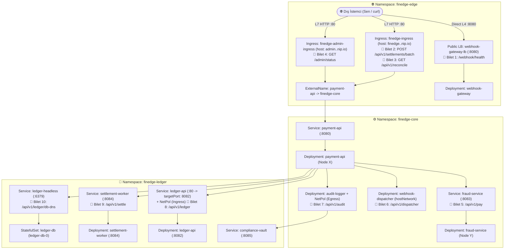

# 🌐 K8s Troubleshoot Lab 28: FinEdge v11.0 — Gerçek Dünya Üretim Ağı & Canlı Trafik Teşhis Laboratuvarı

> **[🇹🇷 Türkçe](#-türkçe-bölüm) | [🇬🇧 English](#-english-section)**

---

<a id="-türkçe-bölüm"></a>
## 🇹🇷 Türkçe Bölüm

### 📋 Olay Özeti (Incident Briefing)

| Alan | Detay |
| :--- | :--- |
| **Platform** | **FinEdge v11.0** — Gerçek Zamanlı Ödeme, Uzlaşma (Settlement) ve Webhook Geçidi |
| **Gerçekçi Senaryo** | Tüm podlar **`1/1 Running`** durumunda görünmektedir; ancak üretim ortamındaki 10 kritik API uç noktasının **tamamı canlı trafikte hata vermektedir!** (`Connection timed out`, `413`, `504`, `502`, cross-node düşüşleri, DNS körlüğü ve post-DNAT NetworkPolicy kesintileri) |
| **Odak Noktası** | **%100 Sektör Odaklı Üretim Ağı Teşhisi:** Azure LB `loadBalancerSourceRanges` NSG blokajı, NGINX `proxy-body-size` (`413`), NGINX `proxy-read-timeout` (`504`), NGINX `backend-protocol` TLS hatası (`502`), Service `internalTrafficPolicy` düğümler arası trafik kaybı, `hostNetwork` DNS izolasyonu, Post-DNAT Egress `ipBlock` tuzağı, Post-DNAT Ingress NetPol port uyuşmazlığı, Service `UDP`/`TCP` protokol hatası, Headless `clusterIP` tuzakları |
| **Altyapı (Terraform)** | **Azure Kubernetes Service (AKS)** — 2 Düğümlü (`Standard_B2s_v2`), Calico CNI NetworkPolicy, NGINX Ingress Controller |
| **Etkilenen Alanlar** | `finedge-edge`, `finedge-core`, `finedge-ledger` (3 Namespace, 10 Canlı Üretim Bileti) |
| **Canlı Doğrulama** | `./check.sh` — YAML okumak yerine **doğrudan dış Public IP'lere ve canlı HTTP uç noktalarına gerçek istekler atan** uçtan uca doğrulama betiği |
| **Çözüm Anahtarı** | [`SOLUTION.md`](./SOLUTION.md) — Yalnızca kendi başına teşhis edip çözemediğin adımlarda başvur |

---

### 🧠 Tüm Podlar `1/1 Running` İken Sorunu Nasıl Tespit Edersin? (Canlı Teşhis Metodolojisi)

Gerçek üretim ortamlarında `kubectl get pods` çıktısının tamamen yeşil (`Running`) olması sistemin çalıştığı anlamına gelmez. Bir **Ağ Mühendisi / SRE** ezbere YAML aramaz; **belirtiden (HTTP kodu / zaman aşımı / log) yola çıkarak paketin hangi katmanda düştüğünü kanıtlar:**

```text
İstemci (curl) ──▶ [1. Cloud LB / NSG] ──▶ [2. NGINX Ingress L7] ──▶ [3. Service / kube-proxy] ──▶ [4. Calico NetPol] ──▶ [5. Pod / DNS]
```

Aşağıdaki **4 Altın İzolasyon Yöntemini** kullanarak her arızanın yerini tahmin etmeden %100 kesinlikle bulabilirsin:

1. **Belirti: `curl` tamamen asılı kalıyor ve HTTP kodu bile dönmüyor (`Operation timed out` / exit 28)**
   * **Ne anlama gelir?** TCP `SYN` paketi yolda sessizce `DROP` ediliyor.
   * **Nasıl izole edilir?** Aynı isteği önce dış IP'den, sonra küme içindeki bir podun içinden (`kubectl exec`) at.
     * *İçeriden çalışıyor, dışarıdan zaman aşımına düşüyorsa:* Sorun podlarda değil, **Cloud LoadBalancer / Azure NSG** katmanındadır.
     * *Küme içinde **Pod IP'sine** (`curl http://<POD_IP>:<PORT>`) istek gidiyor ama **Service Adına/ClusterIP'ye** gitmiyorsa:* Sorun NetworkPolicy veya uygulama değil, **`kube-proxy` / Service tanımıdır** (protokol, hedef port veya düğüm içi trafik politikası).
     * *Küme içinde **Pod IP'sine bile** istek gitmiyorsa:* Arada bir **Calico NetworkPolicy** paketi düşürüyordur.

2. **Belirti: Yanıt hemen geliyor ama `413`, `502` veya `504` (`Server: nginx`)**
   * **Ne anlama gelir?** İstek NGINX Ingress'e kadar ulaştı, ancak L7 proxy katmanında kesildi.
   * **Nasıl izole edilir?** Her zaman **NGINX Ingress Controller logları** (`kubectl logs -n ingress-nginx -l app.kubernetes.io/name=ingress-nginx`) ile **Backend Pod loglarını** (`kubectl logs -n finedge-core -l app.kubernetes.io/name=payment-api`) yan yana oku!
     * Backend pod logunda isteğe dair hiçbir kayıt yoksa NGINX isteği arka uca geçirmeden reddetmiştir (`413`, yanlış `backend-protocol` TLS hatası vb.).
     * Backend logu isteği işleyip sonradan `BrokenPipeError` yazıyorsa, NGINX zaman aşımı (timeout) dolduğu için istemci bağlantısını erken kesmiştir (`504`).

3. **Belirti: `Name or service not known` veya `NXDOMAIN` (DNS Çözümlenemiyor)**
   * **Nasıl izole edilir?** Doğrudan hata veren podun içine girip `/etc/resolv.conf` dosyasını oku ve `nameserver` adresinin `kube-dns` (`10.0.0.10`) olup olmadığını kontrol et. Eğer `kube-dns` kullanıldığı halde yalnızca `<pod-0>.<servis>` kaydı çözülmüyorsa, ilgili Service nesnesinin `CLUSTER-IP` sütununa bak!

4. **Belirti: NetworkPolicy üzerinde Namespace ve Pod etiketleri doğru, ama trafik yine de kesiliyor!**
   * **Post-DNAT Yasası:** Kubernetes'te `kube-proxy`, gelen `Service ClusterIP : Service Port` bilgisini `Pod IP : TargetPort` bilgisine çevirdikten **SONRA** Calico NetworkPolicy kuralları işletilir!
   * Bu yüzden **Egress** kuralları hedef Service ClusterIP'sini (`10.0.x.x`) değil **Pod IP bloğunu (`10.224.0.0/16`)** veya selector'ları görür; **Ingress** kuralları ise Service portunu değil **konteynerin `targetPort` numarasını** görür!

---

### 🏗️ Mimari ve Canlı Uç Noktalar



---

### 🚀 Kurulum ve Çalışma Ortamı Hazırlığı

#### 1. Laboratuvarı Başlat (Terraform + AKS + Helm):
```bash
chmod +x setup.sh cleanup.sh check.sh
./setup.sh
```

#### 2. Test Değişkenlerini Terminale Tanımla:
```bash
INGRESS_IP=$(kubectl get svc -n ingress-nginx ingress-nginx-controller -o jsonpath='{.status.loadBalancer.ingress[0].ip}')
GATEWAY_IP=$(kubectl get svc -n finedge-edge webhook-gateway-lb -o jsonpath='{.status.loadBalancer.ingress[0].ip}')
FINEDGE_URL="http://finedge.${INGRESS_IP}.nip.io"
ADMIN_URL="http://admin.${INGRESS_IP}.nip.io"
```

Önce temel sağlık ucunun ayakta olduğunu doğrula (`200 OK` dönmelidir):
```bash
curl -s "${FINEDGE_URL}/api/v1/health"
```

#### 3. Yapılandırmayı (`helm/finedge/values.yaml`) Düzelttikten Sonra Uygula:
```bash
helm upgrade --install finedge ./helm/finedge \
  --namespace finedge-edge \
  --set global.ingressHost="finedge.${INGRESS_IP}.nip.io"
```
> **Not:** Kubernetes'te `Service.spec.clusterIP` alanı değiştirilemez (*immutable*). Bu alanı etkileyen bir değişiklik yaptığında eski servisi silip ardından `helm upgrade` çalıştırmalısın.

#### 4. Tüm Canlı Uç Noktaları Test Et:
```bash
./check.sh
```

---

### 🛠️ 10 Üretim Olayı (Incident Tickets) — Gözlem, İzolasyon ve Kanıt Rehberi

> Aşağıdaki her bileti önce canlı `curl` ile **kendin kırık halde gör**, ardından **izole et**, `helm/finedge/values.yaml` içinde düzelt ve canlı olarak tekrar doğrula.

---

#### 🌐 BÖLÜM 1: Dış Kenar, Cloud LoadBalancer ve Ingress (`finedge-edge`)

##### 🎫 Bilet 1: Doğrudan Public LoadBalancer IP'si Dış Dünyaya Yanıt Vermiyor
* **Olay Bildirimi:** Ödeme sağlayıcısı (Stripe/Adyen) webhook teslimatlarının `webhook-gateway-lb` Public IP adresine ulaşamadığını ve zaman aşımına düştüğünü raporluyor. Ancak `kubectl get pods -n finedge-edge` `1/1 Running` gösteriyor!
* **1️⃣ Belirtiyi Canlı Gözlemle:**
  ```bash
  curl -v --connect-timeout 4 "http://${GATEWAY_IP}:8080/webhook/health"
  ```
  *Beklenen kırık sonuç:* Bağlantı kurulmaz ve `Connection timed out` ile sonlanır.
* **2️⃣ Katmanı İzole Et (Sorunun Podda Olmadığını Kanıtla):**
  Aynı isteği kümenin **içinden** (örneğin `payment-api` podundan) doğrudan `webhook-gateway-lb` servisine at:
  ```bash
  kubectl exec -n finedge-core deploy/payment-api -- python3 -c \
    "import urllib.request; print(urllib.request.urlopen('http://webhook-gateway-lb.finedge-edge.svc.cluster.local:8080/webhook/health', timeout=3).read().decode())"
  ```
  *Yorumlama:* Küme içinden `200 OK` alabiliyorsan pod, konteyner portu ve kube-proxy **tamamen sağlamdır!** Paket yalnızca **dış Public IP -> Azure Cloud LB/NSG** sınırından geçerken düşüyordur. Şimdi `webhook-gateway-lb` servisinin YAML tanımını incele ve dışarıdan gelen kaynak IP'leri kısıtlayan bir kural olup olmadığını kontrol et:
  ```bash
  kubectl get svc webhook-gateway-lb -n finedge-edge -o yaml
  ```
* **3️⃣ Çözümü Canlı Doğrula:** Düzeltme sonrası (Azure NSG güncellemesi 15–30 sn sürebilir) yukarıdaki `curl` komutu `{"gateway": "webhook-gateway", "status": "online", ...}` dönmelidir.

---

##### 🎫 Bilet 2: Toplu Mutabakat (Batch Settlement) Yüklemeleri Reddediliyor
* **Olay Bildirimi:** Küçük mutabakat dosyaları sorunsuz yükleniyor; ancak partnerler 1.5 MB'lık toplu işlem JSON'ı gönderdiğinde API hata veriyor.
* **1️⃣ Belirtiyi Canlı Gözlemle (Küçük vs Büyük İstek Kıyaslaması):**
  ```bash
  # Küçük istek (Çalışır):
  curl -i -X POST -d '{"records":["ok"]}' "${FINEDGE_URL}/api/v1/settlements/batch"

  # 1.5 MB istek (Kırılır):
  python3 -c 'import json; print(json.dumps({"records": ["x" * 1000 for _ in range(1500)]}))' | \
    curl -i -X POST -H "Content-Type: application/json" --data-binary @- "${FINEDGE_URL}/api/v1/settlements/batch"
  ```
  *Beklenen kırık sonuç:* İlk istek `200 OK` dönerken, 1.5 MB'lık istek **`HTTP/1.1 413 Request Entity Too Large`** ve `Server: nginx` başlığı ile döner.
* **2️⃣ Katmanı İzole Et (İstek Pod'a Ulaştı mı?):**
  ```bash
  kubectl logs -n finedge-core -l app.kubernetes.io/name=payment-api --tail=15
  kubectl logs -n ingress-nginx -l app.kubernetes.io/name=ingress-nginx --tail=20 | grep -iE "413|body|large|settlements"
  ```
  *Yorumlama:* `payment-api` loglarında 1.5 MB'lık isteğe dair **hiçbir satır göremezsin**, çünkü istek pod'a hiç ulaşmadı. Buna karşılık `ingress-nginx` logları isteğin neden kenar proxy'de kesildiğini söyler. `finedge-ingress` tanımını inceleyip NGINX'in varsayılan istek gövdesi sınırını kontrol et:
  ```bash
  kubectl get ingress finedge-ingress -n finedge-edge -o yaml
  ```
* **3️⃣ Çözümü Canlı Doğrula:** Düzeltme sonrası 1.5 MB POST isteği `HTTP/1.1 200 OK` ve `{"status": "accepted", "payload_bytes": ...}` dönmelidir.

---

##### 🎫 Bilet 3: Uzun Süren Mutabakat İşlemi 2. Saniyede Kesiliyor
* **Olay Bildirimi:** `/api/v1/reconcile` uç noktası arka planda normalde 4 saniye süren bir veritabanı hesaplaması yapar. Kullanıcılar bu adresi çağırdığında hep tam 2. saniyede `504 Gateway Time-out` alıyor.
* **1️⃣ Belirtiyi Canlı Gözlemle:**
  ```bash
  time curl -i "${FINEDGE_URL}/api/v1/reconcile"
  ```
  *Beklenen kırık sonuç:* Yaklaşık `2.0s` sonunda **`HTTP/1.1 504 Gateway Time-out`** döner.
* **2️⃣ Katmanı İzole Et (Pod Yavaş mı, Proxy Sabırsız mı?):**
  1. Önce aynı isteği küme içinden doğrudan `payment-api` servisine atarak işlemin gerçekte kaç saniyede bittiğini gör:
     ```bash
     kubectl exec -n finedge-core deploy/payment-api -- python3 -c \
       "import urllib.request, time; t=time.time(); print(round(time.time()-t,2), urllib.request.urlopen('http://payment-api:8080/api/v1/reconcile', timeout=10).read().decode())"
     ```
  2. Ardından `payment-api` ve `ingress-nginx` loglarına bak:
     ```bash
     kubectl logs -n finedge-core -l app.kubernetes.io/name=payment-api --tail=15
     kubectl logs -n ingress-nginx -l app.kubernetes.io/name=ingress-nginx --tail=15 | grep -iE "timed out|reconcile"
     ```
  *Yorumlama:* Doğrudan servis çağrısı 4 saniyede başarıyla bitiyor ve `payment-api` loglarında `BrokenPipeError` (istemci bağlantıyı erken kapattı) görünüyor! `ingress-nginx` logu ise upstream yanıt başlığını beklerken zaman aşımına uğradığını söylüyor. `finedge-ingress` üzerindeki okuma zaman aşımı (read timeout) değerini incele.
* **3️⃣ Çözümü Canlı Doğrula:** `curl -i "${FINEDGE_URL}/api/v1/reconcile"` 4 saniye bekleyip `{"status": "reconciled", ...}` dönmelidir.

---

##### 🎫 Bilet 4: Admin Portalı (`admin.<IP>.nip.io`) Anında `502 Bad Gateway` Veriyor
* **Olay Bildirimi:** Ana API (`finedge.<IP>.nip.io`) çalışırken aynı `payment-api` servisine yönlenen Admin Ingress'i (`/admin/status`) tüm isteklerde `502 Bad Gateway` dönüyor.
* **1️⃣ Belirtiyi Canlı Gözlemle:**
  ```bash
  curl -i "${ADMIN_URL}/admin/status"
  ```
  *Beklenen kırık sonuç:* **`HTTP/1.1 502 Bad Gateway`**.
* **2️⃣ Katmanı İzole Et (NGINX Upstream İle Nasıl Konuşmaya Çalışıyor?):**
  1. Doğrudan pod içinde `/admin/status` yanıt veriyor mu kontrol et:
     ```bash
     kubectl exec -n finedge-core deploy/payment-api -- python3 -c \
       "import urllib.request; print(urllib.request.urlopen('http://payment-api:8080/admin/status').read().decode())"
     ```
  2. `ingress-nginx` hata loglarını incele:
     ```bash
     kubectl logs -n ingress-nginx -l app.kubernetes.io/name=ingress-nginx --tail=25 | grep -iE "SSL|502|upstream|handshake"
     ```
  *Yorumlama:* Backend HTTP ile `200 OK` dönerken NGINX loglarında **SSL/TLS el sıkışma hatası** (`wrong version number` / `SSL handshaking to upstream`) göreceksin! Düz HTTP dinleyen bir arka uca Ingress hangi protokolle bağlanmaya çalışıyor? `kubectl get ingress finedge-admin-ingress -n finedge-edge -o yaml` ile kontrol et.
* **3️⃣ Çözümü Canlı Doğrula:** `curl -i "${ADMIN_URL}/admin/status"` `200 OK` dönmelidir.

---

#### ⚙️ BÖLÜM 2: Çekirdek Mikroservisler, Kube-Proxy & DNS (`finedge-core`)

##### 🎫 Bilet 5: Sahtecilik Kontrolü (`/api/v1/pay`) Pod Ayaktayken Başarısız Oluyor
* **Olay Bildirimi:** `payment-api` ödeme alırken `fraud-service`'e (`:8083`) ulaşamıyor. İki pod da `1/1 Running` ve `Endpoints` dolu!
* **1️⃣ Belirtiyi Canlı Gözlemle:**
  ```bash
  curl -i "${FINEDGE_URL}/api/v1/pay"
  ```
  *Beklenen kırık sonuç:* `HTTP/1.1 502` veya `504` ve `"upstream": "fraud-service:8083"` hata detayı.
* **2️⃣ Katmanı İzole Et (Pod IP vs ClusterIP ve Düğüm Yerleşimi):**
  1. Podların hangi düğümlerde (node) koştuğuna ve `fraud-service` pod IP'sine bak:
     ```bash
     kubectl get pods -n finedge-core -o wide
     kubectl get ep fraud-service -n finedge-core
     ```
  2. `payment-api` podunun içinden **doğrudan `fraud-service` Pod IP'sine** ve **Service ClusterIP'sine** ayrı ayrı istek at:
     ```bash
     FRAUD_POD_IP=$(kubectl get pod -n finedge-core -l app.kubernetes.io/name=fraud-service -o jsonpath='{.items[0].status.podIP}')
     kubectl exec -n finedge-core deploy/payment-api -- python3 -c \
       "import urllib.request; print('POD_IP_OK:', urllib.request.urlopen('http://${FRAUD_POD_IP}:8083/verify', timeout=2).read().decode())"
     kubectl exec -n finedge-core deploy/payment-api -- python3 -c \
       "import urllib.request; print('SVC_OK:', urllib.request.urlopen('http://fraud-service:8083/verify', timeout=2).read().decode())"
     ```
  *Yorumlama:* **Pod IP çalışıyor, ancak ClusterIP çalışmıyor!** Bu iki şeyi kesin olarak kanıtlar: (a) Arada NetworkPolicy engeli **yok**; (b) Konteyner portu **doğru dinliyor**. Sorun yalnızca iki pod **farklı düğümlerde** koşarken Service yönlendirmesinin (`kube-proxy`) trafiği düğümler arası aktarmamasıdır! `kubectl get svc fraud-service -n finedge-core -o yaml` ile trafik yönlendirme politikasını incele.
* **3️⃣ Çözümü Canlı Doğrula:** `curl -s "${FINEDGE_URL}/api/v1/pay"` içinde `"payment": "approved"` ve farklı `caller_node` / `fraud_service.node` isimlerini görmelisin.

---

##### 🎫 Bilet 6: `webhook-dispatcher` Küme İçi Hiçbir Servisi Çözümleyemiyor
* **Olay Bildirimi:** Yüksek ağ performansı için ana makine ağını paylaşan `webhook-dispatcher` podu, `payment-api.finedge-core.svc.cluster.local` adresini DNS üzerinden çözemiyor.
* **1️⃣ Belirtiyi Canlı Gözlemle:**
  ```bash
  curl -i "${FINEDGE_URL}/api/v1/dispatcher"
  ```
  *Beklenen kırık sonuç:* `HTTP/1.1 502` ve JSON içinde `"dns_ok": false`, `"error": "... Name or service not known"` (ve `nameservers` alanı!).
* **2️⃣ Katmanı İzole Et (Pod Hangi DNS Sunucusunu Kullanıyor?):**
  1. Podun `/etc/resolv.conf` dosyasını ve ağ modunu kümedeki `kube-dns` servisi ile karşılaştır:
     ```bash
     kubectl exec -n finedge-core deploy/webhook-dispatcher -- cat /etc/resolv.conf
     kubectl get svc kube-dns -n kube-system
     kubectl get deploy webhook-dispatcher -n finedge-core -o yaml | grep -E "hostNetwork|dnsPolicy"
     ```
  2. Küme içi bağlantının (DNS hariç) aslında açık olduğunu kanıtlamak için `payment-api` ClusterIP'sine IP üzerinden doğrudan bağlan:
     ```bash
     PAY_VIP=$(kubectl get svc payment-api -n finedge-core -o jsonpath='{.spec.clusterIP}')
     kubectl exec -n finedge-core deploy/webhook-dispatcher -- python3 -c \
       "import urllib.request; print(urllib.request.urlopen('http://${PAY_VIP}:8080/api/v1/health', timeout=2).read().decode())"
     ```
  *Yorumlama:* Pod, `10.0.0.10` (`kube-dns`) yerine Azure düğümünün kendi DNS adresini (`168.63.129.16`) kullanıyor! Kubernetes'te `hostNetwork: true` ayarlandığında varsayılan `dnsPolicy` davranışı nasıl değişir? Pod manifestindeki `dnsPolicy` alanını incele.
* **3️⃣ Çözümü Canlı Doğrula:** `curl -s "${FINEDGE_URL}/api/v1/dispatcher"` çıktısında `"dns_ok": true` ve `nameservers` listesinde `10.0.0.10` görünmelidir.

---

##### 🎫 Bilet 7: `audit-logger` DNS Çözdüğü Halde `compliance-vault` Çağrısı Zaman Aşımına Düşüyor
* **Olay Bildirimi:** `audit-logger` podu `compliance-vault.finedge-ledger.svc.cluster.local` adresinin IP'sini (`10.0.x.x`) başarıyla çözüyor ama TCP bağlantısı kuramayıp timeout alıyor.
* **1️⃣ Belirtiyi Canlı Gözlemle:**
  ```bash
  curl -i "${FINEDGE_URL}/api/v1/audit"
  ```
  *Beklenen kırık sonuç:* `HTTP/1.1 504` ve JSON içinde `"audit_status": "blocked"`, `"resolved_vip": "10.0.x.x"`, `"error": "timed out"`.
* **2️⃣ Katmanı İzole Et (Service VIP vs Gerçek Pod IP):**
  1. Hedef `compliance-vault` servisinin ClusterIP'si ile arkasındaki **gerçek Pod IP'sini** yan yana koy:
     ```bash
     kubectl get svc,ep compliance-vault -n finedge-ledger
     ```
  2. Şimdi `audit-logger-netpol` Egress kurallarını incele:
     ```bash
     kubectl describe netpol audit-logger-netpol -n finedge-core
     ```
  *Yorumlama:* `audit-logger-netpol` yalnızca belirli bir `IPBlock` bloğuna çıkış izni veriyor (`10.0.0.0/16` — yani Service ClusterIP aralığı!). Oysa Kubernetes'te `kube-proxy`, hedef adresi Service VIP'sinden gerçek Pod IP'sine (`10.224.x.x`) **DNAT ile çevirdikten SONRA** Calico Egress kuralını çalıştırır. Calico bu paket üzerinde Service VIP'sini değil Pod IP'sini görür! (Ayrıca hedef namespace/pod selector kullanmak neden IP'ye göre çok daha güvenlidir?)
* **3️⃣ Çözümü Canlı Doğrula:** NetPol'u silmeden doğru Egress kuralı ile güncellediğinde `curl -s "${FINEDGE_URL}/api/v1/audit"` `200 OK` ve `"vault_status": "recorded"` dönecektir.

---

#### 🔐 BÖLÜM 3: Defter Katmanı, Protokoller & Stateful DNS (`finedge-ledger`)

##### 🎫 Bilet 8: `ledger-api-netpol` İzinli Göründüğü Halde Defter Çağrısı Timeout Alıyor
* **Olay Bildirimi:** `payment-api` -> `ledger-api:80` çağrısı zaman aşımına düşüyor. İlk bakışta `ledger-api-netpol` üzerinde hem `finedge-core` namespace etiketi hem de `payment-api` pod etiketi eksiksiz tanımlanmış görünüyor!
* **1️⃣ Belirtiyi Canlı Gözlemle:**
  ```bash
  curl -i "${FINEDGE_URL}/api/v1/ledger"
  ```
  *Beklenen kırık sonuç:* `HTTP/1.1 504` ve `"ledger_call": "failed"`, `"error": "timed out"`.
* **2️⃣ Katmanı İzole Et (Service Port vs Pod TargetPort):**
  `ledger-api` Service tanımı ile `ledger-api-netpol` Ingress port kuralını yan yana karşılaştır:
  ```bash
  kubectl get svc ledger-api -n finedge-ledger
  kubectl describe svc ledger-api -n finedge-ledger
  kubectl describe netpol ledger-api-netpol -n finedge-ledger
  ```
  *Yorumlama:* İstemci `ledger-api:80` portuna istek atıyor, Service bunu konteynerin `TargetPort` (`8082`) portuna çeviriyor. Peki Calico NetworkPolicy paketi **DNAT öncesi** (`80`) mi, yoksa **DNAT sonrası** (`8082`) mı yakalar?
* **3️⃣ Çözümü Canlı Doğrula:** NetPol aktif kalacak şekilde portu düzelttiğinde `curl -s "${FINEDGE_URL}/api/v1/ledger"` `200 OK` ve `"ledger": "balanced"` dönecektir.

---

##### 🎫 Bilet 9: `settlement-worker` Endpoints Dolu Olduğu Halde Bağlantı Kurulamıyor
* **Olay Bildirimi:** `settlement-worker` podu çalışıyor ve `Endpoints` listesinde IP:Port görünüyor; ancak `payment-api` üzerinden gelen çağrılar zaman aşımına uğruyor.
* **1️⃣ Belirtiyi Canlı Gözlemle:**
  ```bash
  curl -i "${FINEDGE_URL}/api/v1/settle"
  ```
  *Beklenen kırık sonuç:* `HTTP/1.1 504` ve `"settlement_call": "failed"`.
* **2️⃣ Katmanı İzole Et (Endpoints Dolu Ama Neden Hâlâ Zaman Aşımı?):**
  1. Doğrudan Pod IP'sine ulaşılıp ulaşılamadığını ve Service çıktısındaki `PORT(S)` sütununu kontrol et:
     ```bash
     SETTLE_POD_IP=$(kubectl get pod -n finedge-ledger -l app.kubernetes.io/name=settlement-worker -o jsonpath='{.items[0].status.podIP}')
     kubectl exec -n finedge-core deploy/payment-api -- python3 -c \
       "import urllib.request; print('POD_IP_OK:', urllib.request.urlopen('http://${SETTLE_POD_IP}:8084/settle', timeout=2).read().decode())"
     kubectl get svc,ep settlement-worker -n finedge-ledger
     ```
  *Yorumlama:* Pod IP `200 OK` döndü ve `Endpoints` dolu! Şimdi `kubectl get svc settlement-worker -n finedge-ledger` çıktısındaki `8084/...` protokolüne dikkatle bak! Bir HTTP/TCP servisi yanlış L4 protokolü ile yayınlanırsa `kube-proxy` TCP yönlendirmesi kurar mı?
* **3️⃣ Çözümü Canlı Doğrula:** `curl -s "${FINEDGE_URL}/api/v1/settle"` `200 OK` ve `"settlement": "committed"` dönmelidir.

---

##### 🎫 Bilet 10: `ledger-db-0` Pod DNS Kaydı `serviceName` Doğru Olduğu Halde Çözülmüyor
* **Olay Bildirimi:** `ledger-db` StatefulSet podu çalışıyor ve `spec.serviceName` alanı `ledger-headless` ile birebir eşleşiyor. Buna rağmen `ledger-db-0.ledger-headless.finedge-ledger.svc.cluster.local` DNS sorgusu başarısız oluyor (`NXDOMAIN`).
* **1️⃣ Belirtiyi Canlı Gözlemle:**
  ```bash
  curl -i "${FINEDGE_URL}/api/v1/ledger/db-dns"
  ```
  *Beklenen kırık sonuç:* `HTTP/1.1 502` ve `"db_dns": "failed"`, `"error": "[Errno -2] Name or service not known"`.
* **2️⃣ Katmanı İzole Et (`serviceName` Doğruysa Ne Eksik?):**
  StatefulSet'in `serviceName` alanını ve arkasındaki `ledger-headless` servisinin `CLUSTER-IP` sütununu incele:
  ```bash
  kubectl get sts ledger-db -n finedge-ledger -o jsonpath='{.spec.serviceName}{"\n"}'
  kubectl get svc ledger-headless -n finedge-ledger
  ```
  *Yorumlama:* CoreDNS, yalnızca **Headless** (`CLUSTER-IP: None`) olan servisler için pod bazlı `<pod-0>.<servis>` A kaydı üretir! Eğer `CLUSTER-IP` sütununda `10.0.x.x` gibi sanal bir IP görüyorsan bu servis gerçek bir Headless servis değildir.
  > **Unutma:** `Service.spec.clusterIP` Kubernetes'te sonradan değiştirilemez (*immutable*). `values.yaml` dosyasını düzelttikten sonra önce eski servisi silip (`kubectl delete svc ledger-headless -n finedge-ledger`), ardından `helm upgrade` çalıştır!
* **3️⃣ Çözümü Canlı Doğrula:** `curl -s "${FINEDGE_URL}/api/v1/ledger/db-dns"` `200 OK` ve `"db_dns": "ok"` dönmelidir.

---

### ✅ Tam Başarı Kriterleri

Tüm biletleri canlı doğruladıktan sonra:
```bash
./check.sh
```

**`10 Passed / 0 Failed`** çıktısını aldığında tüm 10 gerçek üretim ağ arızasını uçtan uca canlı trafik üzerinde başarıyla çözmüş olacaksın!

---

<a id="-english-section"></a>
## 🇬🇧 English Section

### 📋 Incident Briefing

| Field | Detail |
| :--- | :--- |
| **Platform** | **FinEdge v11.0** — Real-Time Payment, Settlement & Webhook Gateway |
| **Realistic Scenario** | Every pod reports **`1/1 Running`**, yet **all 10 live production API endpoints fail under real traffic!** (`Connection timed out`, `413`, `504`, `502`, cross-node blackhole, hostNetwork DNS loss, and post-DNAT NetworkPolicy drops) |
| **Focus Areas** | **100% Industry Production Networking:** Cloud LB `loadBalancerSourceRanges` NSG drop, NGINX `proxy-body-size` (`413`), NGINX `proxy-read-timeout` (`504`), NGINX `backend-protocol` TLS mismatch (`502`), Service `internalTrafficPolicy` cross-node blackhole, `hostNetwork` DNS behavior, Post-DNAT Egress `ipBlock` trap, Post-DNAT Ingress NetPol port mismatch, Service `UDP`/`TCP` mismatch, Headless `clusterIP: None` missing |
| **Infrastructure (Terraform)** | **Azure Kubernetes Service (AKS)** — 2 Nodes (`Standard_B2s_v2`), Calico CNI NetworkPolicy, NGINX Ingress Controller |
| **Namespaces** | `finedge-edge`, `finedge-core`, `finedge-ledger` |
| **Live Verification** | `./check.sh` — Performs real end-to-end HTTP requests against live external LoadBalancers and Ingress endpoints |
| **Solution Key** | [`SOLUTION.md`](./SOLUTION.md) — Use only if stuck after investigating the diagnostic steps |

---

### 🧠 How to Diagnose When All Pods Are `1/1 Running` (Packet Tracing Methodology)

In production Kubernetes clusters, `1/1 Running` only means the container process started—not that traffic can traverse the network. Always isolate **which hop** dropped the packet before editing YAML:

1. **`curl` hangs completely (Timeout / exit 28, no HTTP status):**
   - Test the exact same URL from **inside** the cluster (`kubectl exec`).
   - Internal works + External times out -> **Cloud LB / NSG perimeter**.
   - Direct **Pod IP** works + **Service ClusterIP** fails -> **`kube-proxy` / Service spec** (not NetworkPolicy!).
   - Both Pod IP and ClusterIP fail -> **Calico NetworkPolicy** (or container socket).
2. **Immediate `413`, `502`, or `504` from `Server: nginx`:**
   - Compare **`ingress-nginx-controller` logs** side-by-side with **`payment-api` logs**.
   - If the request never appears in backend logs, NGINX rejected it at the edge (`413`, upstream TLS handshake failure, etc.). If backend logs show `BrokenPipeError` later, NGINX aborted early on timeout (`504`).
3. **DNS errors (`Name or service not known` / `NXDOMAIN`):**
   - Inspect `/etc/resolv.conf` inside the failing pod (`10.0.0.10` vs node DNS) and verify `CLUSTER-IP` on any Headless Service.
4. **NetworkPolicy looks right, yet traffic still drops (Post-DNAT Rule):**
   - `kube-proxy` translates `ClusterIP:ServicePort` -> `PodIP:TargetPort` **BEFORE** Calico evaluates NetworkPolicy!
   - Egress rules evaluate the destination **Pod IP** (not Service `10.0.0.0/16`), and Ingress rules evaluate the container **`targetPort`** (not Service `port`).

---

### 🚀 Setup & Live Test Commands

```bash
chmod +x setup.sh cleanup.sh check.sh
./setup.sh

INGRESS_IP=$(kubectl get svc -n ingress-nginx ingress-nginx-controller -o jsonpath='{.status.loadBalancer.ingress[0].ip}')
GATEWAY_IP=$(kubectl get svc -n finedge-edge webhook-gateway-lb -o jsonpath='{.status.loadBalancer.ingress[0].ip}')
FINEDGE_URL="http://finedge.${INGRESS_IP}.nip.io"
ADMIN_URL="http://admin.${INGRESS_IP}.nip.io"

# Baseline health check (should return 200 OK):
curl -s "${FINEDGE_URL}/api/v1/health"

# Apply Helm updates after editing ./helm/finedge/values.yaml:
helm upgrade --install finedge ./helm/finedge \
  --namespace finedge-edge \
  --set global.ingressHost="finedge.${INGRESS_IP}.nip.io"

# Run full live audit:
./check.sh
```

---

### 🛠️ 10 Production Incident Tickets

1. **Ticket 1 — Direct Public LB `webhook-gateway-lb` Timeout (`http://${GATEWAY_IP}:8080/webhook/health`):**
   - *Reproduce:* External `curl -v --connect-timeout 4 http://${GATEWAY_IP}:8080/webhook/health` times out, whereas `kubectl exec` inside the cluster against `webhook-gateway-lb.finedge-edge:8080` returns `200 OK`.
   - *Isolate:* Inspect `kubectl get svc webhook-gateway-lb -n finedge-edge -o yaml` for external source IP restrictions enforced by Azure NSGs.
2. **Ticket 2 — 1.5MB Settlement Upload Returns `413 Request Entity Too Large` (`POST ${FINEDGE_URL}/api/v1/settlements/batch`):**
   - *Reproduce:* Small JSON POST returns `200 OK`; 1.5MB JSON POST returns `413` from NGINX with zero lines in `payment-api` logs.
   - *Isolate:* Check `ingress-nginx-controller` logs vs `finedge-ingress` YAML for NGINX body size limits.
3. **Ticket 3 — 4-Second Reconciliation Endpoint Drops at 2s with `504` (`GET ${FINEDGE_URL}/api/v1/reconcile`):**
   - *Reproduce:* `time curl -i ${FINEDGE_URL}/api/v1/reconcile` aborts at 2s (`504`), while direct cluster Service call completes in 4s (`payment-api` logs `BrokenPipeError`).
   - *Isolate:* Check `ingress-nginx` timeout logs and `finedge-ingress` upstream read timeout settings.
4. **Ticket 4 — Admin Portal Returns Instant `502` (`GET ${ADMIN_URL}/admin/status`):**
   - *Reproduce:* Direct HTTP call inside cluster returns `200 OK`; Ingress returns `502`.
   - *Isolate:* Check `ingress-nginx-controller` logs (`wrong version number` TLS handshake error) and inspect `finedge-admin-ingress` backend protocol annotations.
5. **Ticket 5 — Cross-Node `fraud-service` Call Fails (`GET ${FINEDGE_URL}/api/v1/pay`):**
   - *Reproduce:* Direct Pod IP curl from `payment-api` to `fraud-service` Pod IP succeeds, while ClusterIP fails across nodes (`kubectl get pods -n finedge-core -o wide`).
   - *Isolate:* Inspect `kubectl get svc fraud-service -n finedge-core -o yaml` traffic routing policy.
6. **Ticket 6 — `hostNetwork` Pod Fails Cluster DNS (`GET ${FINEDGE_URL}/api/v1/dispatcher`):**
   - *Reproduce:* Returns `Name or service not known`, while direct ClusterIP curl works.
   - *Isolate:* Run `kubectl exec -n finedge-core deploy/webhook-dispatcher -- cat /etc/resolv.conf` and compare against `kube-dns`; inspect `webhook-dispatcher` `dnsPolicy`.
7. **Ticket 7 — `audit-logger` Resolves DNS But TCP Times Out (`GET ${FINEDGE_URL}/api/v1/audit`):**
   - *Reproduce:* `compliance-vault` ClusterIP (`10.0.x.x`) resolves, yet TCP connect hangs.
   - *Isolate:* Compare `kubectl get svc,ep compliance-vault -n finedge-ledger` (Service IP vs Pod IP) against `kubectl describe netpol audit-logger-netpol -n finedge-core` remembering post-DNAT evaluation.
8. **Ticket 8 — `ledger-api` NetPol Allows Right Labels Yet Times Out (`GET ${FINEDGE_URL}/api/v1/ledger`):**
   - *Reproduce:* Calling `ledger-api:80` times out even though `ledger-api-netpol` matches `finedge-core` and `payment-api`.
   - *Isolate:* Compare `kubectl describe svc ledger-api -n finedge-ledger` (`port` vs `targetPort`) against `kubectl describe netpol ledger-api-netpol -n finedge-ledger`.
9. **Ticket 9 — `settlement-worker` Has Endpoints Yet ClusterIP Times Out (`GET ${FINEDGE_URL}/api/v1/settle`):**
   - *Reproduce:* `kubectl get ep settlement-worker -n finedge-ledger` is populated and Pod IP curl works, yet Service call hangs.
   - *Isolate:* Inspect `PORT(S)` protocol on `kubectl get svc settlement-worker -n finedge-ledger`.
10. **Ticket 10 — StatefulSet Pod DNS Fails (`GET ${FINEDGE_URL}/api/v1/ledger/db-dns`):**
    - *Reproduce:* `ledger-db-0.ledger-headless.finedge-ledger.svc.cluster.local` fails with `NXDOMAIN` despite matching `spec.serviceName`.
    - *Isolate:* Inspect `CLUSTER-IP` on `kubectl get svc ledger-headless -n finedge-ledger` (delete the immutable Service before re-applying via Helm once fixed!).

Achieving **`10 Passed / 0 Failed`** in `./check.sh` confirms every live production networking issue is resolved!
