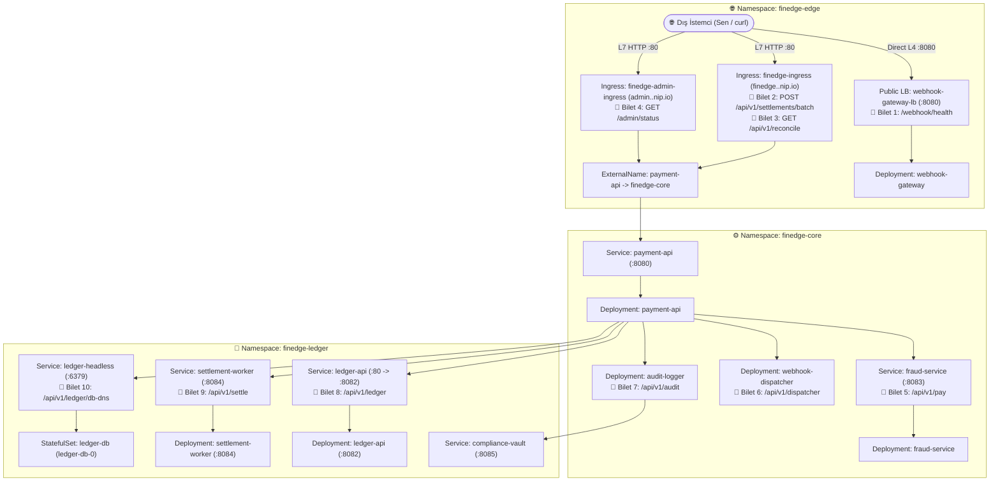

# 🌐 K8s Troubleshoot Lab 28: FinEdge v11.0 — Gerçek Dünya Üretim Ağı & Canlı Trafik Teşhis Laboratuvarı

> **[🇹🇷 Türkçe](#-türkçe-bölüm) | [🇬🇧 English](#-english-section)**

---

<a id="-türkçe-bölüm"></a>
## 🇹🇷 Türkçe Bölüm

### 📋 Olay Özeti (Incident Briefing)

| Alan | Detay |
| :--- | :--- |
| **Platform** | **FinEdge v11.0** — Gerçek Zamanlı Ödeme, Uzlaşma (Settlement) ve Webhook Geçidi |
| **Senaryo** | Kümedeki tüm podlar **`1/1 Running`** durumunda görünmektedir; ancak üretim ortamındaki 10 kritik API uç noktasının **tamamı canlı trafikte başarısız olmaktadır!** |
| **Amaç** | YAML dosyalarında tahmin yürüterek hata aramak yerine **canlı trafik belirtisinden yola çıkıp katman katman eleme yaparak** kök nedeni kendi başına kanıtlamak |
| **Altyapı (Terraform)** | **Azure Kubernetes Service (AKS)** — 2 Düğümlü (`Standard_B2s_v2`), Calico CNI NetworkPolicy, NGINX Ingress Controller |
| **Etkilenen Alanlar** | `finedge-edge`, `finedge-core`, `finedge-ledger` (3 Namespace, 10 Canlı Üretim Bileti) |
| **Canlı Doğrulama** | `./check.sh` — Doğrudan dış Public IP'lere ve canlı HTTP uç noktalarına gerçek istekler atan doğrulama betiği |
| **Çözüm Anahtarı** | [`SOLUTION.md`](./SOLUTION.md) — Yalnızca kendi başına teşhis edip çözemediğin adımlarda başvur |

---

### 🧠 Tüm Podlar `1/1 Running` İken Nasıl Teşhis Koyarsın?

Gerçek bir üretim ortamında `kubectl get pods` çıktısının tamamen yeşil olması sistemin çalıştığını kanıtlamaz. Bir paket dış istemciden pod'a kadar şu **5 kapıdan** geçer:

```text
İstemci (curl) ──▶ [1. Cloud LB / NSG] ──▶ [2. NGINX Ingress (L7)] ──▶ [3. Service / kube-proxy (L4)] ──▶ [4. Calico NetPol] ──▶ [5. Pod / DNS]
```

Bir bilet geldiğinde doğrudan YAML açmak yerine önce **hangi kapıda koptuğunu** şu 4 kuralla ele:

1. **Belirti: `curl` tamamen asılı kalıp timeout yiyor (HTTP kodu bile dönmüyor):**
   * Paket L3/L4 katmanında sessizce `DROP` ediliyor demektir.
   * **Nasıl elersin?** İsteği önce **dışarıdan**, sonra **küme içinden (başka bir poddan `exec` ile)**, gerekirse doğrudan **hedef Pod IP'sine** at.
   * *İçeriden çalışıp dışarıdan düşüyorsa:* Küme içi sağlamdır, sorun **1. Kapı (Cloud LB / NSG)** sınırındadır.
   * *Pod IP çalışıp Service adı/ClusterIP düşüyorsa:* Güvenlik duvarı ve uygulama sağlamdır, sorun **3. Kapı (Service / kube-proxy)** katmanındadır.
   * *Hem Pod IP hem Service düşüyorsa:* Arada **4. Kapı (NetworkPolicy)** trafiği kesiyordur.

2. **Belirti: Anında HTTP `413`, `502` veya `504` dönüyor (`Server: nginx`):**
   * Paket **2. Kapıya (NGINX Ingress)** ulaştı ama orada kesildi.
   * **Nasıl elersin?** Her zaman **NGINX Controller logu** ile **hedef Pod logunu** yan yana incele. İstek pod loguna hiç düşmediyse NGINX isteği kenarda kesmiştir; pod logunda işlem bitip bağlantı kopması (`BrokenPipeError`) görünüyorsa NGINX erken vazgeçmiştir.

3. **Belirti: `Name does not resolve` / DNS çözümleme hatası:**
   * **Nasıl elersin?** Önce hedefin doğrudan IP'sine bağlanarak ağın açık olduğunu doğrula. Ardından hata veren podun `/etc/resolv.conf` dosyasını okuyup hangi DNS sunucusunu (`kube-dns` mi, düğüm DNS'i mi?) kullandığına bak.

4. **Belirti: NetworkPolicy etiketleri doğru görünüyor ama yine de timeout var:**
   * **Post-DNAT Yasası:** Kubernetes'te `kube-proxy`, Service IP + Service Port bilgisini Pod IP + TargetPort bilgisine çevirdikten **SONRA** Calico NetworkPolicy kuralları işletilir. Kuralın gördüğü IP ve Port değerlerinin ne olduğunu buna göre kontrol et.

---

### 🧰 Saha Mühendisi Alet Çantası (Genel Teşhis Komutları)

Aşağıdaki kalıpları kendi seçtiğin namespace, pod ve hedeflerle kullanarak her katmanı test edebilirsin:

```bash
# 1. Herhangi bir podun içinden başka bir servisi veya Pod IP'yi canlı test etmek:
kubectl exec -n <namespace> deploy/<pod-adi> -- python3 -c \
  "import urllib.request; print(urllib.request.urlopen('http://<hedef-ip-veya-servis>:<port>/<yol>', timeout=3).read().decode())"

# 2. Podun kullandığı DNS sunucusunu (resolv.conf) ve küme DNS IP'sini görmek:
kubectl exec -n <namespace> deploy/<pod-adi> -- cat /etc/resolv.conf
kubectl get svc kube-dns -n kube-system

# 3. Ingress Controller ve uygulama loglarını yan yana incelemek:
kubectl logs -n ingress-nginx -l app.kubernetes.io/name=ingress-nginx --tail=30
kubectl logs -n <namespace> -l app.kubernetes.io/name=<uygulama> --tail=30

# 4. Pod yerleşimini (hangi node'da?), Endpoints ve Service/NetPol/Ingress detaylarını görmek:
kubectl get pods -A -o wide
kubectl get svc,ep,netpol,ingress -n <namespace>
kubectl get <kaynak-turu> <kaynak-adi> -n <namespace> -o yaml
```

---

### 🏗️ Mimari ve Canlı Uç Noktalar



---

### 🚀 Kurulum ve Çalışma Komutları

#### 1. Ortamı Kur veya Sıfırla:
```bash
chmod +x setup.sh cleanup.sh check.sh
./setup.sh
```

#### 2. Test Değişkenlerini Tanımla:
```bash
INGRESS_IP=$(kubectl get svc -n ingress-nginx ingress-nginx-controller -o jsonpath='{.status.loadBalancer.ingress[0].ip}')
GATEWAY_IP=$(kubectl get svc -n finedge-edge webhook-gateway-lb -o jsonpath='{.status.loadBalancer.ingress[0].ip}')
FINEDGE_URL="http://finedge.${INGRESS_IP}.nip.io"
ADMIN_URL="http://admin.${INGRESS_IP}.nip.io"
```

Temel API sağlığının (`200 OK`) ayakta olduğunu gör:
```bash
curl -s "${FINEDGE_URL}/api/v1/health"
```

#### 3. Düzeltmeleri `helm/finedge/values.yaml` Üzerinden Uygula:
```bash
helm upgrade --install finedge ./helm/finedge \
  --namespace finedge-edge \
  --set global.ingressHost="finedge.${INGRESS_IP}.nip.io"
```

#### 4. Canlı Doğrulama Betiğini Çalıştır:
```bash
./check.sh
```

---

### 🛠️ 10 Üretim Olayı (Incident Tickets) — Yaklaşım ve İzolasyon Rehberi

> Her bileti çözerken **"Önce canlı test et -> Eleme testiyle katmanı kanıtla -> İlgili objeyi inceleyip `helm/finedge/values.yaml` içinde düzelt -> Canlı tekrar doğrula"** döngüsünü izle.

---

#### 🌐 BÖLÜM 1: Dış Kenar, Cloud LoadBalancer ve Ingress (`finedge-edge`)

##### 🎫 Bilet 1: Doğrudan Public LoadBalancer IP'sine Erişilemiyor
* **Olay Bildirimi:** Harici ödeme ortakları `webhook-gateway-lb` Public IP adresine yaptıkları webhook çağrılarının yanıt vermeden zaman aşımına uğradığını bildiriyor.
* **Canlı Test:**
  ```bash
  curl -v --connect-timeout 4 "http://${GATEWAY_IP}:8080/webhook/health"
  ```
* **Bu Bilete Nasıl Yaklaşmalısın?**
  1. Dışarıdan attığın `curl` isteğinin TCP bağlantı aşamasında asılı kaldığını gözlemle.
  2. Sorunun podda mı yoksa dış sınırdan içeri girişte mi olduğunu anlamak için **küme içindeki herhangi bir podun içine `exec` ile girip** doğrudan `webhook-gateway-lb` servisine aynı HTTP isteğini atmayı dene.
  3. Eğer küme içinden `200 OK` alıp dış dünyadan timeout yiyorsan, podun ve dahili servisin sağlam olduğunu kanıtlamış olursun. O halde paketin dışarıdan içeri girerken takıldığı **LoadBalancer / Cloud sınır erişim ayarlarını** incelemek için ilgili servisin YAML tanımına bak.
* **Çözüm Kanıtı:** Düzelttikten sonra (Azure NSG güncellemesi 15–30 sn sürebilir) yukarıdaki harici `curl` isteği `200 OK` JSON dönmelidir.

---

##### 🎫 Bilet 2: Toplu Mutabakat Yüklemeleri Büyük Dosyalarda Reddediliyor
* **Olay Bildirimi:** Küçük mutabakat verileri API tarafından kabul edilirken, 1.5 MB boyutundaki toplu işlem JSON istekleri hata ile reddediliyor.
* **Canlı Test:**
  ```bash
  # Küçük istek (Başarılı):
  curl -i -X POST -d '{"records":["ok"]}' "${FINEDGE_URL}/api/v1/settlements/batch"

  # 1.5 MB istek (Hatalı):
  python3 -c 'import json; print(json.dumps({"records": ["x" * 1000 for _ in range(1500)]}))' | \
    curl -i -X POST -H "Content-Type: application/json" --data-binary @- "${FINEDGE_URL}/api/v1/settlements/batch"
  ```
* **Bu Bilete Nasıl Yaklaşmalısın?**
  1. Dönen HTTP durum koduna ve yanıt başlıklarındaki `Server` bilgisini incele.
  2. Bu reddin uygulamadan (`payment-api`) mı yoksa aradaki L7 proxy'den mi geldiğini ayırmak için büyük isteği gönderdikten sonra **hedef podun logları ile Ingress Controller loglarını** karşılaştır.
  3. İstek hedef podun loguna hiç düşmüyorsa, bağlantıyı henüz upstream'e iletmeden kesen kenar katmanın (Ingress) **istek gövde boyutu (body size)** kısıtlamalarını incele.
* **Çözüm Kanıtı:** 1.5 MB POST isteği `HTTP/1.1 200 OK` ve `{"status": "accepted", ...}` dönmelidir.

---

##### 🎫 Bilet 3: Uzun Süren Mutabakat İşlemi Yarıda Kesiliyor
* **Olay Bildirimi:** `/api/v1/reconcile` uç noktası normalde ~5 saniye süren senkron bir hesaplama yapar. Ancak kullanıcılar bu adresi çağırdığında işlem bitmeden `504 Gateway Time-out` hatası alıyor.
* **Canlı Test:**
  ```bash
  time curl -i "${FINEDGE_URL}/api/v1/reconcile"
  ```
* **Bu Bilete Nasıl Yaklaşmalısın?**
  1. `curl` komutunun kaçıncı saniyede `504` aldığını ölç.
  2. Arka uçtaki uygulamanın gerçekten yanıt veremeyecek kadar kilitlenip kilitlenmediğini görmek için **Ingress'i devreden çıkararak küme içindeki bir poddan doğrudan `payment-api` servisine** aynı isteği at ve ne kadar sürede tamamlandığını gözlemle.
  3. Ardından hem uygulama podunun loglarına hem Ingress loglarına bak: Eğer doğrudan istek 5 saniyede `200 OK` ile bitiyor ve dış istekte uygulama loguna "istemci bağlantıyı erken kapattı" (`BrokenPipeError`) düşüyorsa, hangi katmanın sabırsız davrandığını belirleyip zaman aşımı yapılandırmasını incele.
* **Çözüm Kanıtı:** Dış `curl` isteği 5 saniyenin sonunda `HTTP/1.1 200 OK` ve `{"status": "reconciled", ...}` dönmelidir.

---

##### 🎫 Bilet 4: Admin Portalı Anında `502 Bad Gateway` Veriyor
* **Olay Bildirimi:** Ana API domaini sorunsuz çalışırken aynı backend servise giden Admin Ingress adresi tüm isteklerde anında `502` dönüyor.
* **Canlı Test:**
  ```bash
  curl -i "${ADMIN_URL}/admin/status"
  ```
* **Bu Bilete Nasıl Yaklaşmalısın?**
  1. Önce uygulamanın gerçekten `/admin/status` yoluna hizmet verdiğini kanıtlamak için küme içinden doğrudan ilgili servise `http` üzerinden istek at.
  2. Uygulama `200 OK` dönüyorsa sorun kenar proxy ile arka uç arasındaki iletişimdedir. **`502` aldığın anda Ingress Controller loglarını oku**; proxy'nin arkadaki pod ile el sıkışırken nasıl bir protokol/SSL hatası aldığını gör.
  3. Logda gördüğün bulguyu admin Ingress kaynağının yapılandırması ile karşılaştır.
* **Çözüm Kanıtı:** `curl -i "${ADMIN_URL}/admin/status"` `HTTP/1.1 200 OK` dönmelidir.

---

#### ⚙️ BÖLÜM 2: Çekirdek Mikroservisler, Kube-Proxy & DNS (`finedge-core`)

##### 🎫 Bilet 5: Sahtecilik Kontrolü (`fraud-service`) Pod Ayaktayken Zaman Aşımına Düşüyor
* **Olay Bildirimi:** Ödeme akışı `fraud-service`'e ulaşamıyor. İki pod da `Running` durumunda görünmesine rağmen istekler düşüyor.
* **Canlı Test:**
  ```bash
  curl -i "${FINEDGE_URL}/api/v1/pay"
  ```
* **Bu Bilete Nasıl Yaklaşmalısın?**
  1. Önce ilgili namespace'teki podların **hangi Kubernetes düğümlerinde (node)** çalıştığını (`-o wide`) ve servisin `Endpoints` listesinin dolu olup olmadığını kontrol et.
  2. Şimdi ağ duvarı (NetworkPolicy) ihtimalini elemek için **çağıran podun (`payment-api`) içinden doğrudan hedef podun kendi Pod IP adresine** (`8083/verify`) istek atmayı dene.
  3. Ardından aynı yerden **Service adını/ClusterIP'sini** kullanarak istek at. Eğer **Pod IP ile yanıt alıp Service üzerinden alamıyorsan**, aradaki NetworkPolicy engeli yoktur ve pod portu doğru dinliyordur! Sorun, **iki pod farklı düğümlerde koşarken Service trafik yönlendirme politikasının** paketi diğer düğüme iletmemesindedir. İlgili Service YAML'ını incele.
* **Çözüm Kanıtı:** `curl -s "${FINEDGE_URL}/api/v1/pay"` çıktısı `200 OK` ve `"payment": "approved"` dönmelidir.

---

##### 🎫 Bilet 6: `webhook-dispatcher` Küme İçi İsimleri Çözümleyemiyor
* **Olay Bildirimi:** Sistem monitörleri `webhook-dispatcher` podunun küme içi servis adlarına DNS sorgusu atamadığını gösteriyor.
* **Canlı Test:**
  ```bash
  curl -i "${FINEDGE_URL}/api/v1/dispatcher"
  ```
* **Bu Bilete Nasıl Yaklaşmalısın?**
  1. Dönen JSON içindeki hata mesajına ve `nameservers` listesine dikkat et.
  2. Podun içine girip DNS istemci ayarını (`/etc/resolv.conf`) incele ve kümedeki `kube-dns` servis IP'si ile karşılaştır: Pod gerçekten küme DNS'ine mi soruyor, yoksa başka bir DNS'e mi gidiyor?
  3. Ağ bağlantısının kendisinde bir sorun olmadığını doğrulamak için **aynı podun içinden `payment-api` servisinin ClusterIP adresine doğrudan IP ile** istek atmayı dene. IP çalışıyor ama isim çalışmıyorsa, podun Deployment speğindeki ağ ve DNS yapılandırma tercihlerinin nasıl etkileştiğini incele.
* **Çözüm Kanıtı:** `curl -s "${FINEDGE_URL}/api/v1/dispatcher"` `200 OK` ve `"dns_ok": true` dönmelidir.

---

##### 🎫 Bilet 7: `audit-logger` DNS Çözdüğü Halde `compliance-vault`'a Bağlanamıyor
* **Olay Bildirimi:** Denetim kayıtları DNS'ten hedef VIP adresini alabiliyor ancak TCP bağlantısı kurulurken zaman aşımına düşüyor.
* **Canlı Test:**
  ```bash
  curl -i "${FINEDGE_URL}/api/v1/audit"
  ```
* **Bu Bilete Nasıl Yaklaşmalısın?**
  1. Çıktıda `resolved_vip` alanının dolu olduğunu gör; yani DNS (:53) çalışıyor.
  2. Sorun giden TCP bağlantısında olduğu için hedef servisin (`compliance-vault`) **Service IP'sini (`get svc`)** ve arkasındaki **gerçek Pod IP'sini (`get ep`)** yan yana koy.
  3. Ardından `audit-logger` üzerindeki Egress NetworkPolicy kuralını incele: Kural dışarı çıkarken hangi IP bloğuna veya seçiciye izin veriyor? **Post-DNAT Yasasını** hatırla: `kube-proxy` yönlendirmeyi yaptıktan sonra paket çıkışta Service IP'sini mi taşır, yoksa Pod IP'sini mi? *(Not: NetworkPolicy'yi silmeden kuralı düzeltmelisin.)*
* **Çözüm Kanıtı:** `curl -s "${FINEDGE_URL}/api/v1/audit"` `200 OK` ve `"audit_status": "ok"` dönmelidir.

---

#### 🔐 BÖLÜM 3: Defter Katmanı, Protokoller & Stateful DNS (`finedge-ledger`)

##### 🎫 Bilet 8: `ledger-api` NetworkPolicy İzinli Göründüğü Halde Bağlantı Zaman Aşımına Düşüyor
* **Olay Bildirimi:** `payment-api`, `ledger-api` servisine (`:80`) ulaşamıyor. İlk bakışta gelen trafik kuralı doğru namespace ve podu seçiyor gibi görünüyor.
* **Canlı Test:**
  ```bash
  curl -i "${FINEDGE_URL}/api/v1/ledger"
  ```
* **Bu Bilete Nasıl Yaklaşmalısın?**
  1. Hedef namespace'teki NetworkPolicy'nin kaynak namespace ve kaynak pod etiketlerini incele — burada bir yazım hatası var mı?
  2. Etiketler doğruysa **hedef Service tanımındaki `Port` ve `TargetPort`** değerlerini podun dinlediği port ile karşılaştır.
  3. Şimdi NetworkPolicy'deki port kuralına dön ve **Post-DNAT Yasasını** uygula: Calico gelen paketi pod arayüzünde değerlendirirken paketin hedef portu Service portu mudur, yoksa `TargetPort` mudur? *(Not: NetworkPolicy'yi silmeden port kuralını düzeltmelisin.)*
* **Çözüm Kanıtı:** `curl -s "${FINEDGE_URL}/api/v1/ledger"` `200 OK` ve `"ledger_call": "ok"` dönmelidir.

---

##### 🎫 Bilet 9: `settlement-worker` Endpoints Dolu Olmasına Rağmen Bağlanılamıyor
* **Olay Bildirimi:** `settlement-worker` podu çalışıyor ve servisin `Endpoints` listesi dolu görünüyor; ancak `payment-api` üzerinden gelen çağrılar zaman aşımına düşüyor.
* **Canlı Test:**
  ```bash
  curl -i "${FINEDGE_URL}/api/v1/settle"
  ```
* **Bu Bilete Nasıl Yaklaşmalısın?**
  1. Önce sorunun NetworkPolicy veya konteyner uygulamasından kaynaklanmadığını kanıtlamak için `payment-api` podunun içinden **doğrudan `settlement-worker` Pod IP'sine** (`:8084/settle`) istek atmayı dene.
  2. Doğrudan Pod IP çalışıyor ve `get ep` çıktısı da doluysa, hatanın yalnızca **Service / `kube-proxy`** katmanında olduğu kesinleşir.
  3. Şimdi `settlement-worker` Service tanımını (`get svc` ve `-o yaml`) inceleyerek bu TCP/HTTP servisinin hangi L4 parametreleriyle yayınlandığını dikkatle kontrol et.
* **Çözüm Kanıtı:** `curl -s "${FINEDGE_URL}/api/v1/settle"` `200 OK` ve `"settlement_call": "ok"` dönmelidir.

---

##### 🎫 Bilet 10: `ledger-headless` DNS Sorgusu Pod IP Yerine Sanal ClusterIP Dönüyor
* **Olay Bildirimi:** Redis kümesi doğrudan pod IP'lerini keşfetmek için `ledger-headless` adresini sorguluyor; ancak dönen IP adresinin podun gerçek IP'si değil sanal bir ClusterIP olduğu görülüyor.
* **Canlı Test:**
  ```bash
  curl -i "${FINEDGE_URL}/api/v1/ledger/db-dns"
  ```
* **Bu Bilete Nasıl Yaklaşmalısın?**
  1. Dönen JSON çıktısındaki `svc_dns_ip` ile `pod_dns_ip` adreslerini karşılaştır.
  2. StatefulSet'in `serviceName` alanının doğru servis adına işaret edip etmediğini doğrula.
  3. Ardından ilgili namespace'teki `get svc` çıktısında `CLUSTER-IP` sütununa bak: Bir servisin gerçekten **Headless** davranıp doğrudan backing pod IP'lerini dönebilmesi için bu alanda ne yer almalıdır?
  4. **Operasyonel Not:** Kubernetes'te `Service.spec.clusterIP` sonradan güncellenemeyen (*immutable*) bir alandır; değişiklik sonrası eski servisi silip Helm upgrade çalıştırmayı unutma!
* **Çözüm Kanıtı:** `curl -s "${FINEDGE_URL}/api/v1/ledger/db-dns"` `200 OK` ve `"db_dns": "ok"` dönmelidir.

---

### ✅ Tam Başarı Kriterleri

Tüm biletleri çözdükten sonra:
```bash
./check.sh
```

**`10 Passed / 0 Failed`** çıktısını aldığında tüm 10 canlı üretim ağ arızasını başarıyla teşhis edip çözmüş olacaksın!

---

<a id="-english-section"></a>
## 🇬🇧 English Section

### 📋 Incident Briefing

| Field | Detail |
| :--- | :--- |
| **Platform** | **FinEdge v11.0** — Real-Time Payment, Settlement & Webhook Gateway |
| **Scenario** | Every pod reports **`1/1 Running`**, yet **all 10 live production API endpoints fail under real traffic!** |
| **Objective** | Prove which network hop failed using **symptom-driven isolation tests** rather than guessing YAML fields |
| **Infrastructure (Terraform)** | **Azure Kubernetes Service (AKS)** — 2 Nodes (`Standard_B2s_v2`), Calico CNI NetworkPolicy, NGINX Ingress Controller |
| **Namespaces** | `finedge-edge`, `finedge-core`, `finedge-ledger` |
| **Live Verification** | `./check.sh` — Executes real HTTP calls against live external LoadBalancers and Ingress routes |
| **Solution Key** | [`SOLUTION.md`](./SOLUTION.md) — Consult only after attempting systematic diagnosis |

---

### 🧠 How to Diagnose When All Pods Are `1/1 Running`

In production Kubernetes clusters, `1/1 Running` never proves network connectivity. Every request crosses **5 gates**:

```text
Client (curl) ──▶ [1. Cloud LB / NSG] ──▶ [2. NGINX Ingress (L7)] ──▶ [3. Service / kube-proxy (L4)] ──▶ [4. Calico NetPol] ──▶ [5. Pod / DNS]
```

Always isolate the failing gate with these 4 elimination rules:

1. **`curl` hangs completely (Timeout, no HTTP status code):**
   - Test from **outside**, then from **inside the cluster** (`kubectl exec`), and if needed directly to the **target Pod IP**.
   - Internal works + External times out -> **Gate 1 (Cloud LB / NSG)**.
   - Direct Pod IP works + Service ClusterIP times out -> **Gate 3 (Service / kube-proxy)**.
   - Both Pod IP and Service time out -> **Gate 4 (Calico NetworkPolicy)**.
2. **Immediate HTTP `413`, `502`, or `504` from `Server: nginx`:**
   - Read **NGINX Ingress Controller logs** alongside **target Pod logs**. If the request never reaches the pod, NGINX rejected it at the edge; if the pod finishes processing and logs `BrokenPipeError`, NGINX aborted early.
3. **DNS errors (`Name does not resolve`):**
   - Test connectivity directly via ClusterIP first, then check `/etc/resolv.conf` inside the failing pod against `kube-dns`.
4. **NetworkPolicy labels look right, yet traffic still drops (Post-DNAT Law):**
   - `kube-proxy` translates `ClusterIP:ServicePort` -> `PodIP:TargetPort` **BEFORE** Calico evaluates NetworkPolicy rules. Verify what IP and Port Calico sees at the pod interface!

---

### 🧰 Diagnostic Toolbox (Generic Commands)

```bash
# Test an internal Service or Pod IP from inside any pod:
kubectl exec -n <namespace> deploy/<pod-name> -- python3 -c \
  "import urllib.request; print(urllib.request.urlopen('http://<target-ip-or-svc>:<port>/<path>', timeout=3).read().decode())"

# Inspect a pod's DNS resolver vs kube-dns:
kubectl exec -n <namespace> deploy/<pod-name> -- cat /etc/resolv.conf
kubectl get svc kube-dns -n kube-system

# Inspect Ingress Controller and application logs:
kubectl logs -n ingress-nginx -l app.kubernetes.io/name=ingress-nginx --tail=30
kubectl logs -n <namespace> -l app.kubernetes.io/name=<app> --tail=30

# Inspect node placement, Endpoints, Services, NetworkPolicies, and Ingresses:
kubectl get pods -A -o wide
kubectl get svc,ep,netpol,ingress -n <namespace>
kubectl get <resource-kind> <resource-name> -n <namespace> -o yaml
```

---

### 🚀 Setup & Apply Commands

```bash
chmod +x setup.sh cleanup.sh check.sh
./setup.sh

INGRESS_IP=$(kubectl get svc -n ingress-nginx ingress-nginx-controller -o jsonpath='{.status.loadBalancer.ingress[0].ip}')
GATEWAY_IP=$(kubectl get svc -n finedge-edge webhook-gateway-lb -o jsonpath='{.status.loadBalancer.ingress[0].ip}')
FINEDGE_URL="http://finedge.${INGRESS_IP}.nip.io"
ADMIN_URL="http://admin.${INGRESS_IP}.nip.io"

# Baseline health check (returns 200 OK):
curl -s "${FINEDGE_URL}/api/v1/health"

# Apply changes in ./helm/finedge/values.yaml:
helm upgrade --install finedge ./helm/finedge \
  --namespace finedge-edge \
  --set global.ingressHost="finedge.${INGRESS_IP}.nip.io"

# Run live audit:
./check.sh
```

---

### 🛠️ 10 Production Incident Tickets — Investigation Approach

1. **Ticket 1 — Direct Public LB Unreachable (`curl -v --connect-timeout 4 http://${GATEWAY_IP}:8080/webhook/health`):**
   - *How to approach:* Confirm the external `curl` stalls during TCP connect. To prove the pod itself isn't broken, exec into a pod inside the cluster and request `webhook-gateway-lb` directly. If internal succeeds while external times out, investigate the external LoadBalancer / cloud perimeter rules on that Service.
2. **Ticket 2 — Batch Settlement Large Upload Fails (`POST ${FINEDGE_URL}/api/v1/settlements/batch` with 1.5MB JSON vs small JSON):**
   - *How to approach:* Compare a small POST vs a 1.5MB POST (`curl -i`). After reproducing `413`, compare `payment-api` logs with `ingress-nginx` logs to prove the request was rejected at the L7 edge before reaching the backend, then inspect NGINX request size settings.
3. **Ticket 3 — Synchronous Reconciliation Drops Early (`time curl -i ${FINEDGE_URL}/api/v1/reconcile`):**
   - *How to approach:* Measure when `504` occurs externally. Bypass Ingress by calling `payment-api` directly from inside a pod and measure its true execution duration; inspect pod logs for early client disconnects (`BrokenPipeError`) alongside Ingress logs to isolate the impatient proxy timeout.
4. **Ticket 4 — Admin Portal Returns Instant `502` (`curl -i ${ADMIN_URL}/admin/status`):**
   - *How to approach:* Verify `/admin/status` returns `200 OK` when called directly over HTTP from inside the cluster. Then read `ingress-nginx` error logs during the `502` to uncover why the proxy fails its upstream handshake, and compare against the admin Ingress configuration.
5. **Ticket 5 — Fraud Check Times Out (`curl -i ${FINEDGE_URL}/api/v1/pay`):**
   - *How to approach:* Check pod node placement (`-o wide`) and `Endpoints` for `fraud-service`. Exec into `payment-api` and test **direct Pod IP** vs **Service name**. If Pod IP succeeds while Service fails, rule out NetworkPolicy and inspect how the Service routes cross-node traffic.
6. **Ticket 6 — Dispatcher DNS Failure (`curl -i ${FINEDGE_URL}/api/v1/dispatcher`):**
   - *How to approach:* Inspect `/etc/resolv.conf` inside `webhook-dispatcher` and compare its nameserver against `kube-dns`. Prove data-plane connectivity works by curling `payment-api` via raw ClusterIP from `webhook-dispatcher`, then examine how the pod's network mode affects Kubernetes DNS defaults.
7. **Ticket 7 — Audit Logger Resolves DNS But Times Out (`curl -i ${FINEDGE_URL}/api/v1/audit`):**
   - *How to approach:* Notice `resolved_vip` succeeds in the error JSON. Compare `compliance-vault`'s Service ClusterIP against its actual Pod IP (`get ep`), then inspect `audit-logger`'s egress NetworkPolicy remembering that `kube-proxy` performs DNAT **before** Calico evaluates egress rules. (Keep the NetworkPolicy enforced!)
8. **Ticket 8 — Ledger API Times Out Despite Matching NetPol Labels (`curl -i ${FINEDGE_URL}/api/v1/ledger`):**
   - *How to approach:* Verify namespace/pod selectors on `ledger-api-netpol` already match `payment-api`. Compare `ledger-api` Service `port` vs `targetPort` against the port allowed in the NetworkPolicy under post-DNAT evaluation. (Keep the NetworkPolicy enforced!)
9. **Ticket 9 — Settlement Worker Has Endpoints Yet Times Out (`curl -i ${FINEDGE_URL}/api/v1/settle`):**
   - *How to approach:* Test `settlement-worker`'s Pod IP directly from inside `payment-api`. When Pod IP returns `200 OK` and `Endpoints` is populated, examine `kubectl get svc settlement-worker -n finedge-ledger` closely to spot what L4 Service transport mismatch breaks `kube-proxy`.
10. **Ticket 10 — Headless Service Resolves to Virtual VIP (`curl -i ${FINEDGE_URL}/api/v1/ledger/db-dns`):**
    - *How to approach:* Compare `svc_dns_ip` vs `pod_dns_ip` in the error JSON. Verify StatefulSet `serviceName` matches, then inspect `CLUSTER-IP` on `ledger-headless` (`get svc`). Remember `Service.spec.clusterIP` is immutable and requires deleting the old Service before `helm upgrade`.

Achieving **`10 Passed / 0 Failed`** in `./check.sh` confirms all 10 production networking issues are resolved!
