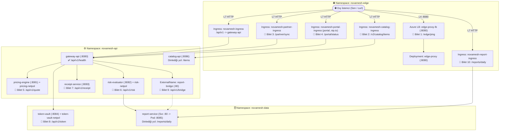

# 🌐 K8s Troubleshoot Lab 29: NovaMesh v12.0 — Gerçek Dünya Üretim Ağı & Canlı Trafik Teşhis Laboratuvarı

> **[🇹🇷 Türkçe](#-türkçe-bölüm) | [🇬🇧 English](#-english-section)**

---

<a id="-türkçe-bölüm"></a>
## 🇹🇷 Türkçe Bölüm

### 📋 Olay Özeti (Incident Briefing)

| Alan | Detay |
| :--- | :--- |
| **Platform** | **NovaMesh v12.0** — Çok Katmanlı API Geçidi, Katalog, Fiyatlama, Risk ve Raporlama Platformu |
| **Senaryo** | Kümedeki tüm podlar **`1/1 Running`** durumunda görünmektedir; ancak üretim ortamındaki **10 kritik dış/iç ağ uç noktasının tamamı canlı trafikte hata vermektedir!** |
| **Amaç** | YAML içinde tahmine dayalı arama yapmak yerine **canlı trafik belirtisinden başlayıp her bileti izolasyon komutlarıyla deneyimleyerek** kök nedeni kendi başına kanıtlamak |
| **Altyapı (Terraform)** | **Azure Kubernetes Service (AKS)** — 2 Düğümlü (`Standard_B2s_v2`), Calico CNI NetworkPolicy, NGINX Ingress Controller |
| **Etkilenen Alanlar** | `novamesh-edge`, `novamesh-api`, `novamesh-data` (3 Namespace, 10 Canlı Üretim Bileti) |
| **Canlı Doğrulama** | `./check.sh` — Doğrudan Azure LoadBalancer ve NGINX Ingress uç noktalarına canlı HTTP istekleri atan denetim betiği |
| **Çözüm Anahtarı** | [`SOLUTION.md`](./SOLUTION.md) — Yalnızca kendi başına teşhis edip takıldığın noktalarda başvur |

---

### 🧠 Tüm Podlar `1/1 Running` İken Nasıl Teşhis Koyarsın? (Saha Notları)

Gerçek üretimde `kubectl get pods` çıktısının yeşil olması trafiğin aktığını kanıtlamaz. Bir istek dış istemciden hedef koda kadar şu **5 kapıdan** geçer:

```text
İstemci (curl) ──▶ [1. Azure LB (L4)] ──▶ [2. NGINX Ingress (L7)] ──▶ [3. Service / Endpoints] ──▶ [4. CoreDNS] ──▶ [5. Calico NetPol / Pod]
```

Doğrudan YAML kurcalamak yerine önce **hangi kapıda takıldığını** şu 4 eleme notuyla daralt:

1. **Belirti: Dış `curl` zaman aşımına uğruyor veya bağlanamıyor (`HTTP 000`):**
   * Paket L3/L4 sınırında düşüyor veya yanlış porta gidiyordur.
   * **Nasıl elersin?** Hedef **Pod IP'sine küme içindeki çalışan başka bir poddan** doğrudan istek at:
     * *Pod IP'den yanıt gelip dış LB IP'den gelmiyorsa:* Uygulama ve NetworkPolicy sağlamdır! Sorun **1. Kapıda (LoadBalancer / port eşleşmesi)** yer alır.
     * *Başka bir poddan Pod IP'ye gidip geliyor ama tek bir belirli poddan veya hiçbir poddan Pod IP'ye bile ulaşılamıyorsa:* Sorun **5. Kapıda (Calico NetworkPolicy)** yer alır.
     * *Pod IP çalışıp Service adı/ClusterIP çalışmıyorsa:* Sorun **3. Kapıda (Service / Endpoints)** yer alır.

2. **Belirti: Anında HTTP `308`, `403`, yanlış `404` JSON veya `503` (`Server: nginx`):**
   * Paket **2. Kapıya (NGINX Ingress)** ulaştı ve kenar proxy seviyesinde kesildi ya da yönlendirilemedi.
   * **Nasıl elersin?** Önce **Ingress'i baypas edip küme içinden doğrudan hedef Service'e** istek at. İçeriden `200 OK` alıyorsan arka uç sağlamdır; sorunun kaynağı NGINX Ingress kuralları, path/rewrite annotasyonları veya Ingress -> Service port eşleşmesidir.

3. **Belirti: `502` + `Name does not resolve` veya DNS zaman aşımı:**
   * **Nasıl elersin?** Hedefe bir kez **doğrudan Pod IP'siyle** bağlanmayı dene, bir kez de **`nslookup`** ile isim çözümle. Pod IP çalışıyor ama `nslookup` başarısız oluyorsa ağ veri yolu açık, **4. Kapı (CoreDNS veya Egress DNS `:53` izni / `ExternalName` FQDN)** kapalı demektir.

4. **Belirti: NetworkPolicy blokluyor gibi görünüyor — nasıl kanıtlanır?**
   * *Önemli Kural:* Bir endpoint'i çalıştırmak için **`NetworkPolicy` kaynaklarını asla silme!** Politikayı silmek üretimi savunmasız bırakır (`./check.sh` da politikaların aktif kaldığını denetler). Bunun yerine politikadaki etiketleri, portları (`targetPort` / `:53`) veya Pod IP CIDR bloklarını kaynak/hedef ile eşleştir.

---

### 🧰 Saha Mühendisi Alet Çantası (Genel Kalıplar)

Bu kümedeki tüm podlarda (`alpine` tabanlı) hem `wget` hem `nslookup` hazırdır. Karmaşık tek satırlar yazmak yerine podların içine girip normal terminal gibi kullanabilirsin:

```bash
# 1. Önce tüm Pod IP adreslerini ve etiketleri gör:
kubectl get pods -A -o wide

# 2. İstediğin bir podun içine terminal ile gir:
kubectl exec -it -n <namespace> deploy/<kaynak-pod> -- sh

# (Podun içindeyken) HTTP / Pod IP / Servis testi yap:
wget -qO- -T 3 http://<pod-ip-veya-servis>:<port>/<yol>

# (Podun içindeyken) DNS testi yap:
nslookup <hedef-servis-adi>

# 3. Ingress Controller loglarını veya kaynak YAML'ını oku:
kubectl logs -n ingress-nginx -l app.kubernetes.io/name=ingress-nginx --tail=25
kubectl get svc,ep,netpol,ingress -n <namespace>
```

---

### 🏗️ Mimari ve Canlı Uç Noktalar



---

### 🚀 Kurulum ve Çalışma Komutları

#### 1. Ortamı Kur (veya Sıfırla):
```bash
chmod +x setup.sh check.sh cleanup.sh
./setup.sh
```

> [!NOTE]
> Önceki labdan (`k8-troubleshoot-28`) kalma bir AKS kümesi `denmarkeast` bölgesinde halen açıksa (Azure for Students 6 vCPU kota sınırı), önce o klasörde `./cleanup.sh` çalıştırın. Mevcut AKS kümesi zaten açıksa `./setup.sh --skip-terraform` kullanabilirsiniz.

#### 2. Test Ortam Değişkenlerini Tanımla:
```bash
export INGRESS_IP=$(kubectl get svc -n ingress-nginx ingress-nginx-controller -o jsonpath='{.status.loadBalancer.ingress[0].ip}')
export LB_IP=$(kubectl get svc -n novamesh-edge edge-proxy-lb -o jsonpath='{.status.loadBalancer.ingress[0].ip}')
export HOST="novamesh.${INGRESS_IP}.nip.io"
export PORTAL_HOST="portal.${INGRESS_IP}.nip.io"
```

Temel hattın çalıştığını doğrula (`200 OK` dönmelidir):
```bash
curl -i --max-time 4 "http://${HOST}/api/v1/health"
```

#### 3. Düzeltmeleri `helm/novamesh/values.yaml` Üzerinden (veya `kubectl` ile) Uygula:
```bash
helm upgrade --install novamesh ./helm/novamesh \
  --namespace novamesh-edge \
  --set global.ingressHost="novamesh.${INGRESS_IP}.nip.io"
```

#### 4. Canlı Doğrulama Betiğini Çalıştır:
```bash
./check.sh
```

---

### 🛠️ 10 Üretim Olayı (Incident Tickets) — Deneyimleme & İzolasyon Rehberi

> Her bilette önce dışarıdan canlı hatayı gör, sonra **"Nasıl Yaklaşmalısın?"** bölümündeki izolasyon komutlarını çalıştırıp katmanları bizzat eleyerek sorunu kendin kanıtla!

---

#### 🌐 BÖLÜM 1: Dış LoadBalancer & L7 NGINX Ingress (`novamesh-edge`)

##### 🎫 Bilet 1: Doğrudan Azure LoadBalancer IP'sine Bağlanılamıyor
* **Olay Bildirimi:** Müşteriler `edge-proxy-lb` Public IP adresinin `8080` portuna erişemediğini, isteklerin zaman aşımına uğradığını söylüyor.
* **Canlı Test:**
  ```bash
  curl -i --connect-timeout 4 "http://${LB_IP}:8080/edge/ping"
  ```
* **Nasıl Yaklaşmalısın? (İzolasyon Deneyi)**
  1. Dışarıdan timeout alınca ilk soru: *Acaba `edge-proxy` podu gerçekten `8080` portunu dinliyor mu ve başka poddan doğrudan Pod IP'sine ulaşılabiliyor mu?* Önce podun IP adresini gör, sonra başka bir podun içine girip doğrudan Pod IP'sine istek at:
     ```bash
     kubectl get pods -n novamesh-edge -o wide
     kubectl exec -it -n novamesh-api deploy/catalog-api -- sh

     # Podun içindeyken (yukarıdaki çıktıdan gördüğün edge-proxy IP'sini yaz):
     wget -qO- -T 3 http://<EDGE_PROXY_POD_IP>:8080/edge/ping
     exit
     ```
  2. Eğer küme içinden Pod IP'sine `200 OK` alabiliyorsan, podun çalıştığı ve arada NetworkPolicy engeli olmadığı kanıtlanmış olur! O halde sorun dış LoadBalancer trafiğini pod portuna bağlayan **Service katmanındadır**; `port`, `targetPort` ve pod `containerPort` üçlüsünü incele:
     ```bash
     kubectl get svc edge-proxy-lb -n novamesh-edge -o yaml
     ```
* **Çözüm Kanıtı:** `curl -i --max-time 4 "http://${LB_IP}:8080/edge/ping"` komutu `HTTP/1.1 200 OK` ve `"status": "online"` dönmelidir.

---

##### 🎫 Bilet 2: `/v2/catalog/items` Endpoint'i `404` JSON Hatası Veriyor
* **Olay Bildirimi:** İstemciler `/v2/catalog/items` adresine GET isteği attığında katalog listesi yerine `404` JSON yanıtı alıyor.
* **Canlı Test:**
  ```bash
  curl -i --max-time 4 "http://${HOST}/v2/catalog/items"
  ```
* **Nasıl Yaklaşmalısın? (İzolasyon Deneyi)**
  1. Dönen JSON gövdesindeki `received_path` alanına bak: `catalog-api` kendisine hangi yolun geldiğini söylüyor?
  2. Şimdi Ingress'i tamamen baypas edip küme içindeki bir podun içine gir ve doğrudan `catalog-api` servisini `/items` ile deneyerek uygulamanın aslında hangi yolu dinlediğini kendin gözlemle:
     ```bash
     kubectl exec -it -n novamesh-api deploy/gateway-api -- sh

     # Podun içindeyken:
     wget -qO- -T 3 http://catalog-api:8086/items
     exit
     ```
  3. Uygulama `/items` üzerinde sorunsuz yanıt veriyorsa, L7 katmanında prefix'i soymayan Ingress kuralını görmek için şuna bak:
     ```bash
     kubectl get ingress novamesh-catalog-ingress -n novamesh-edge -o yaml
     ```
* **Çözüm Kanıtı:** `curl -i --max-time 4 "http://${HOST}/v2/catalog/items"` `HTTP/1.1 200 OK` ve `"service": "catalog-api"` dönmelidir.

---

##### 🎫 Bilet 3: İş Ortağı Senkronizasyonu (`/partner/sync`) Herkese `403 Forbidden` Dönüyor
* **Olay Bildirimi:** İş ortakları `/partner/sync` adresine ulaşmaya çalıştığında NGINX üzerinden `403` alıyor.
* **Canlı Test:**
  ```bash
  curl -i --max-time 4 "http://${HOST}/partner/sync"
  ```
* **Nasıl Yaklaşmalısın? (İzolasyon Deneyi)**
  1. İlk iş olarak `403` yanıtını uygulamanın mı yoksa NGINX Ingress'in mi ürettiğini ayır. Küme içindeki bir poda girip doğrudan `gateway-api` servisini çağır, ardından Ingress Controller loglarına bak:
     ```bash
     kubectl exec -it -n novamesh-api deploy/catalog-api -- sh

     # Podun içindeyken:
     wget -qO- -T 3 http://gateway-api:8080/partner/sync
     exit

     kubectl logs -n ingress-nginx -l app.kubernetes.io/name=ingress-nginx --tail=15
     ```
  2. İçeriden `200 OK` alıp dışarıdan `403` alıyorsan istek daha backend'e çıkmadan NGINX kapısında reddediliyor demektir. Erişim kısıtlamasını görmek için Ingress tanımını incele:
     ```bash
     kubectl get ingress novamesh-partner-ingress -n novamesh-edge -o yaml
     ```
* **Çözüm Kanıtı:** `curl -i --max-time 4 "http://${HOST}/partner/sync"` `HTTP/1.1 200 OK` dönmelidir.

---

##### 🎫 Bilet 4: Portal Uç Noktası (`portal.<IP>.nip.io/portal/status`) İstemeden Yönlendirme (`308`) Yapıyor
* **Olay Bildirimi:** Yeni açılan portal adresi beklenen JSON verisini dönmek yerine tarayıcıları/istemcileri başka bir protokole yönlendiriyor (`308`).
* **Canlı Test (`-L` koymadan çalıştır):**
  ```bash
  curl -i --max-time 4 "http://${PORTAL_HOST}/portal/status"
  ```
* **Nasıl Yaklaşmalısın? (İzolasyon Deneyi)**
  1. Dönen yanıttaki `Location:` başlığını oku — neden `https://` adresine yönlendiriliyorsun?
  2. Pod içine girip backend uygulamanın düz HTTP üzerinde `200 OK` verdiğini kanıtla, ardından sorunsuz çalışan `novamesh-ingress` ile `novamesh-portal-ingress` tanımlarını karşılaştır:
     ```bash
     kubectl exec -it -n novamesh-api deploy/catalog-api -- sh

     # Podun içindeyken:
     wget -qO- -T 3 http://gateway-api:8080/portal/status
     exit

     kubectl get ingress novamesh-portal-ingress novamesh-ingress -n novamesh-edge -o yaml
     ```
* **Çözüm Kanıtı:** `curl -i --max-time 4 "http://${PORTAL_HOST}/portal/status"` yönlendirme olmadan doğrudan `HTTP/1.1 200 OK` dönmelidir.

---

#### ⚙️ BÖLÜM 2: API Katmanı Politikaları, CoreDNS & Service Discovery (`novamesh-api`)

##### 🎫 Bilet 5: Fiyatlama Servisi (`/api/v1/quote`) Zaman Aşımına Uğruyor (`504`)
* **Olay Bildirimi:** Kullanıcılar fiyat teklifi almak istediğinde `gateway-api`, `pricing-engine` servisine ulaşamayıp `504` veriyor.
* **Canlı Test:**
  ```bash
  curl -i --max-time 5 "http://${HOST}/api/v1/quote"
  ```
* **Nasıl Yaklaşmalısın? (İzolasyon Deneyi)**
  1. Önce `pricing-engine` Pod IP'sini ve Endpoints durumunu gör, ardından `gateway-api` içine girip doğrudan Pod IP'sine bağlanmayı dene:
     ```bash
     kubectl get pods,endpoints -n novamesh-api -o wide
     kubectl exec -it -n novamesh-api deploy/gateway-api -- sh

     # Podun içindeyken (pricing-engine Pod IP'si ile):
     wget -qO- -T 2 http://<PRICING_POD_IP>:8081/quote
     exit
     ```
  2. Doğrudan Pod IP'ye atılan bağlantı bile sessizce timeout yiyorsa paket **Calico NetworkPolicy** tarafından `DROP` ediliyor demektir! Şu iki çıktıyı yan yana koyup `gateway-api` etiketleriyle politikanın aradığı etiketi kıyasla *(not: `pricing-netpol` politikasını silmeden düzelt)*:
     ```bash
     kubectl get pods -n novamesh-api --show-labels
     kubectl get netpol pricing-netpol -n novamesh-api -o yaml
     ```
* **Çözüm Kanıtı:** `curl -i --max-time 5 "http://${HOST}/api/v1/quote"` `HTTP/1.1 200 OK` ve `"quote": "149.90 USD"` dönmelidir (`pricing-netpol` aktif kalmalı).

---

##### 🎫 Bilet 6: Risk Değerlendirme Servisi (`/api/v1/risk`) `502` Hatası Veriyor
* **Olay Bildirimi:** `gateway-api` -> `risk-evaluator` -> `report-service` zincirinde risk skoru alınamıyor; hata gövdesi DNS/upstream başarısızlığı gösteriyor.
* **Canlı Test:**
  ```bash
  curl -i --max-time 6 "http://${HOST}/api/v1/risk"
  ```
* **Nasıl Yaklaşmalısın? (İzolasyon Deneyi)**
  1. Sorunun hedef servise TCP bağlantısında mı yoksa **DNS çözümlemesinde mi** olduğunu ayırmak için `report-service` Pod IP'sini al, sonra `risk-evaluator` podunun içine girip önce `nslookup`, sonra doğrudan Pod IP testi yap:
     ```bash
     kubectl get pods -n novamesh-data -o wide
     kubectl exec -it -n novamesh-api deploy/risk-evaluator -- sh

     # Podun içindeyken önce DNS'i dene:
     nslookup report-service.novamesh-data.svc.cluster.local

     # Sonra doğrudan report-service Pod IP'sine (:8085) istek at:
     wget -qO- -T 2 http://<REPORT_POD_IP>:8085/reports/daily
     exit
     ```
  2. Eğer **doğrudan Pod IP çalışıyor ama `nslookup` başarısız oluyorsa**, veri trafiğine izin veren Egress NetworkPolicy'nin küme DNS sunucusunu unutup unutmadığını kontrol et *(not: `risk-netpol` politikasını silmeden düzelt)*:
     ```bash
     kubectl get netpol risk-netpol -n novamesh-api -o yaml
     kubectl get pods -n kube-system -l k8s-app=kube-dns --show-labels
     ```
* **Çözüm Kanıtı:** `curl -i --max-time 6 "http://${HOST}/api/v1/risk"` `HTTP/1.1 200 OK` ve `"risk_score": "low"` dönmelidir (`risk-netpol` aktif kalmalı).

---

##### 🎫 Bilet 7: Makbuz Servisi (`/api/v1/receipt`) Anında `502 Unreachable` Veriyor
* **Olay Bildirimi:** `receipt-service` podu `1/1 Running` olmasına rağmen `/api/v1/receipt` isteği beklemeksizin `502` dönüyor.
* **Canlı Test:**
  ```bash
  curl -i --max-time 4 "http://${HOST}/api/v1/receipt"
  ```
* **Nasıl Yaklaşmalısın? (İzolasyon Deneyi)**
  1. NetworkPolicy veya uygulamanın kendisi mi bozuk? `receipt-service` Pod IP'sini ve Endpoints durumunu gör, ardından `gateway-api` içine girip doğrudan Pod IP'ye istek at:
     ```bash
     kubectl get pods,endpoints -n novamesh-api -o wide
     kubectl exec -it -n novamesh-api deploy/gateway-api -- sh

     # Podun içindeyken (receipt-service Pod IP'si ile):
     wget -qO- -T 2 http://<RECEIPT_POD_IP>:8083/receipt
     exit
     ```
  2. Pod IP `200 OK` verip `Endpoints` boş (`<none>`) geliyorsa uygulama ve ağ duvarı sağlam, **Service -> Pod eşleşmesi** kopuktur! Şu iki çıktıyı satır satır kıyasla:
     ```bash
     kubectl get pod -n novamesh-api -l app.kubernetes.io/name=receipt-service --show-labels
     kubectl get svc receipt-service -n novamesh-api -o yaml
     ```
* **Çözüm Kanıtı:** `curl -i --max-time 4 "http://${HOST}/api/v1/receipt"` `HTTP/1.1 200 OK` ve `"receipt_id": "rcpt-9921"` dönmelidir.

---

#### 🔐 BÖLÜM 3: Cross-Namespace Veri Katmanı & CIDR Politikaları (`novamesh-api` ↔ `novamesh-data`)

##### 🎫 Bilet 8: Cross-Namespace Token Servisi (`/api/v1/token`) Zaman Aşımına Uğruyor (`504`)
* **Olay Bildirimi:** `novamesh-api` içindeki `gateway-api`, `novamesh-data` içindeki `token-vault` servisine giderken `504 Timeout` yiyor.
* **Canlı Test:**
  ```bash
  curl -i --max-time 5 "http://${HOST}/api/v1/token"
  ```
* **Nasıl Yaklaşmalısın? (İzolasyon Deneyi)**
  1. Önce `token-vault` uygulamasının kendi içinde ayakta olduğunu doğrula, sonra `gateway-api` Pod IP'sine (`-o wide`) bakıp `gateway-api` içinden `token-vault` Pod IP'sine erişmeyi dene:
     ```bash
     kubectl exec -it -n novamesh-data deploy/token-vault -- wget -qO- -T 2 http://127.0.0.1:8084/token
     kubectl get pods -n novamesh-api -o wide
     kubectl get pods -n novamesh-data -o wide
     kubectl exec -it -n novamesh-api deploy/gateway-api -- sh

     # Podun içindeyken (token-vault Pod IP'si ile):
     wget -qO- -T 2 http://<TOKEN_VAULT_POD_IP>:8084/token
     exit
     ```
  2. `token-vault` kendi içinde `200 OK` verirken `gateway-api` üzerinden Pod IP'ye sessizce timeout alıyorsan arada **Calico NetworkPolicy** paketi düşürüyor demektir. `gateway-api` Pod IP adresine (`10.224.x.x` gibi) dikkatlice bak ve `token-vault-netpol` kurallarını oku *(not: `token-vault-netpol` politikasını silmeden düzelt)*:
     ```bash
     kubectl get netpol token-vault-netpol -n novamesh-data -o yaml
     ```
* **Çözüm Kanıtı:** `curl -i --max-time 5 "http://${HOST}/api/v1/token"` `HTTP/1.1 200 OK` ve `"token_state": "valid"` dönmelidir (`token-vault-netpol` aktif kalmalı).

---

##### 🎫 Bilet 9: Köprü Servisi (`/api/v1/bridge`) Cross-Namespace İsim Çözemiyor (`502`)
* **Olay Bildirimi:** `gateway-api`, kendi namespace'indeki `report-bridge` köprüsü üzerinden rapor servisini çağırdığında `502` (`Name does not resolve`) alıyor.
* **Canlı Test:**
  ```bash
  curl -i --max-time 4 "http://${HOST}/api/v1/bridge"
  ```
* **Nasıl Yaklaşmalısın? (İzolasyon Deneyi)**
  1. `gateway-api` içine girip önce `report-bridge` adını `nslookup` ile sorgula, ardından hedef namespace'deki gerçek tam FQDN (`report-service.novamesh-data.svc.cluster.local`) adını dene:
     ```bash
     kubectl exec -it -n novamesh-api deploy/gateway-api -- sh

     # Podun içindeyken ikisini yan yana test et:
     nslookup report-bridge
     nslookup report-service.novamesh-data.svc.cluster.local
     exit
     ```
  2. `report-service.novamesh-data.svc.cluster.local` çözülebiliyorken `report-bridge` çözülemiyorsa, köprü servisinin YAML tanımındaki `ExternalName` hedefini incele:
     ```bash
     kubectl get svc report-bridge -n novamesh-api -o yaml
     ```
* **Çözüm Kanıtı:** `curl -i --max-time 4 "http://${HOST}/api/v1/bridge"` `HTTP/1.1 200 OK` ve `"report": "daily-2026"` dönmelidir.

---

##### 🎫 Bilet 10: Doğrudan Raporlama Ingress Yolu (`/reports/daily`) `503` Veriyor
* **Olay Bildirimi:** Bilet 9'daki servisten bağımsız olarak doğrudan dış Ingress üzerinden `/reports/daily` yoluna giden istekler `503 Service Temporarily Unavailable` alıyor.
* **Canlı Test:**
  ```bash
  curl -i --max-time 4 "http://${HOST}/reports/daily"
  ```
* **Nasıl Yaklaşmalısın? (İzolasyon Deneyi)**
  1. Önce `gateway-api` içine girip `report-service` uygulamasının ve cross-namespace Service yapısının küme içinden çalıştığını doğrula:
     ```bash
     kubectl exec -it -n novamesh-api deploy/gateway-api -- sh

     # Podun içindeyken:
     wget -qO- -T 2 http://report-service.novamesh-data.svc.cluster.local:80/reports/daily
     exit
     ```
  2. Küme içinden `:80` portunda `200 OK` aldın! Şimdi neden NGINX Ingress'in `503` döndüğünü görmek için iki namespace'deki `report-service` tanımlarını ve `novamesh-report-ingress` backend portunu yan yana karşılaştır:
     ```bash
     kubectl get svc report-service -n novamesh-data -o yaml
     kubectl get svc report-service -n novamesh-edge -o yaml
     kubectl get ingress novamesh-report-ingress -n novamesh-edge -o yaml
     ```
* **Çözüm Kanıtı:** `curl -i --max-time 4 "http://${HOST}/reports/daily"` `HTTP/1.1 200 OK` ve `"report": "daily-2026"` dönmelidir.

---

### ✅ Tam Doğrulama ve Temizlik

Tüm 10 bileti çözdükten sonra baştan sona canlı testi çalıştır:

```bash
./check.sh
```

Lab bittiğinde Azure maliyetlerini durdurmak için kaynakları temizle:

```bash
./cleanup.sh
```

---

<a id="-english-section"></a>
## 🇬🇧 English Section

### 📋 Incident Briefing

| Field | Detail |
| :--- | :--- |
| **Platform** | **NovaMesh v12.0** — Multi-Tier API Gateway, Catalog, Pricing, Risk & Reporting Platform |
| **Scenario** | Every Pod in the cluster appears **`1/1 Running`**, yet **all 10 critical live endpoints fail under real traffic!** |
| **Goal** | Instead of guessing inside YAML files, start from **live HTTP symptoms and isolate layer by layer using hands-on probe commands** |
| **Infrastructure (Terraform)** | **Azure Kubernetes Service (AKS)** — 2 Nodes (`Standard_B2s_v2`), Calico CNI NetworkPolicy, NGINX Ingress Controller |
| **Namespaces** | `novamesh-edge`, `novamesh-api`, `novamesh-data` (3 Namespaces, 10 Live Production Tickets) |
| **Live Audit** | `./check.sh` — Executes real HTTP probes against external LoadBalancer and NGINX Ingress hosts |
| **Solution Key** | [`SOLUTION.md`](./SOLUTION.md) — Consult only after attempting live isolation yourself |

---

### 🧠 Field Notes: How to Diagnose When Every Pod Is `1/1 Running`

```text
Client (curl) ──▶ [1. Azure LB (L4)] ──▶ [2. NGINX Ingress (L7)] ──▶ [3. Service / Endpoints] ──▶ [4. CoreDNS] ──▶ [5. Calico NetPol / Pod]
```

1. **External `curl` hangs / times out (`HTTP 000`):**
   * Call the target **Pod IP directly from inside another Pod**:
     * *Pod IP works internally while external LB IP hangs:* App and NetPol are healthy -> **Gate 1 (LoadBalancer port mapping)**.
     * *Pod IP fails silently across pods or from a specific pod:* **Gate 5 (Calico NetworkPolicy)** is dropping packets.
     * *Pod IP works while Service/ClusterIP fails:* **Gate 3 (Service / Endpoints)**.
2. **Immediate `308`, `403`, wrong `404` JSON, or `503` (`Server: nginx`):**
   * Bypass Ingress and call the Service directly from inside the cluster. If internal call returns `200 OK`, inspect **Gate 2 (NGINX Ingress annotations/path/port)**.
3. **`502` + DNS failure (`Name does not resolve`):**
   * Test direct **Pod IP reachability** vs **`nslookup`**. If IP connects while DNS fails, inspect **Gate 4 (CoreDNS / Egress `:53` / `ExternalName` FQDN)**.
4. **Never delete a `NetworkPolicy` to "fix" traffic:** Keep zero-trust enforcement intact (`./check.sh` verifies all policies remain present).

---

### 🧰 Field Engineer Toolbox

All Pods run `python:3.11-alpine`, which includes both `wget` and `nslookup`. Step inside a Pod interactively rather than fighting complex one-liners:

```bash
# 1. List Pod IPs and labels across namespaces:
kubectl get pods -A -o wide

# 2. Drop into a Pod shell:
kubectl exec -it -n <namespace> deploy/<source-pod> -- sh

# (Inside the Pod) Probe a Service or Pod IP:
wget -qO- -T 3 http://<pod-ip-or-service>:<port>/<path>

# (Inside the Pod) Test DNS resolution:
nslookup <target-name>

# 3. Inspect Ingress Controller logs & Kubernetes objects:
kubectl logs -n ingress-nginx -l app.kubernetes.io/name=ingress-nginx --tail=25
kubectl get svc,ep,netpol,ingress -n <namespace>
```

---

### 🚀 Setup & Live Variables

```bash
chmod +x setup.sh check.sh cleanup.sh
./setup.sh

export INGRESS_IP=$(kubectl get svc -n ingress-nginx ingress-nginx-controller -o jsonpath='{.status.loadBalancer.ingress[0].ip}')
export LB_IP=$(kubectl get svc -n novamesh-edge edge-proxy-lb -o jsonpath='{.status.loadBalancer.ingress[0].ip}')
export HOST="novamesh.${INGRESS_IP}.nip.io"
export PORTAL_HOST="portal.${INGRESS_IP}.nip.io"

curl -i --max-time 4 "http://${HOST}/api/v1/health"
```

---

### 🛠️ 10 Production Incident Tickets — Hands-On Isolation Steps

#### 🎫 Ticket 1: External Azure LoadBalancer Unreachable
* **Live Test:** `curl -i --connect-timeout 4 "http://${LB_IP}:8080/edge/ping"`
* **How to Approach (Enter a Pod & Probe Pod IP Directly):**
  ```bash
  kubectl get pods -n novamesh-edge -o wide
  kubectl exec -it -n novamesh-api deploy/catalog-api -- sh

  # Inside the Pod (replace with edge-proxy Pod IP):
  wget -qO- -T 3 http://<EDGE_PROXY_POD_IP>:8080/edge/ping
  exit

  kubectl get svc edge-proxy-lb -n novamesh-edge -o yaml
  ```
  If the Pod IP answers `200 OK` on `:8080` while the LB IP fails, inspect `port`, `targetPort`, and `containerPort`.

#### 🎫 Ticket 2: `/v2/catalog/items` Returns `404` JSON
* **Live Test:** `curl -i --max-time 4 "http://${HOST}/v2/catalog/items"`
* **How to Approach:** Inspect `received_path` in the `404` JSON, test `/items` inside a Pod, and check Ingress path rewriting:
  ```bash
  kubectl exec -it -n novamesh-api deploy/gateway-api -- sh
  wget -qO- -T 3 http://catalog-api:8086/items
  exit

  kubectl get ingress novamesh-catalog-ingress -n novamesh-edge -o yaml
  ```

#### 🎫 Ticket 3: `/partner/sync` Returns `403 Forbidden`
* **Live Test:** `curl -i --max-time 4 "http://${HOST}/partner/sync"`
* **How to Approach:** Confirm `gateway-api` returns `200 OK` internally and inspect L7 Ingress annotations:
  ```bash
  kubectl exec -it -n novamesh-api deploy/catalog-api -- sh
  wget -qO- -T 3 http://gateway-api:8080/partner/sync
  exit

  kubectl get ingress novamesh-partner-ingress -n novamesh-edge -o yaml
  ```

#### 🎫 Ticket 4: Portal URL Returns `308 Permanent Redirect`
* **Live Test (without `-L`):** `curl -i --max-time 4 "http://${PORTAL_HOST}/portal/status"`
* **How to Approach:** Read the `Location` header, prove HTTP works directly on `gateway-api`, and diff `novamesh-portal-ingress` against `novamesh-ingress`:
  ```bash
  kubectl exec -it -n novamesh-api deploy/catalog-api -- sh
  wget -qO- -T 3 http://gateway-api:8080/portal/status
  exit

  kubectl get ingress novamesh-portal-ingress novamesh-ingress -n novamesh-edge -o yaml
  ```

#### 🎫 Ticket 5: Pricing Quote (`/api/v1/quote`) Times Out (`504`)
* **Live Test:** `curl -i --max-time 5 "http://${HOST}/api/v1/quote"`
* **How to Approach:** Find `pricing-engine` Pod IP, enter `gateway-api`, and probe Pod IP directly. Silent timeout means NetPol drop — compare Pod labels against `pricing-netpol` (keep the policy intact):
  ```bash
  kubectl get pods,endpoints -n novamesh-api -o wide
  kubectl exec -it -n novamesh-api deploy/gateway-api -- sh
  wget -qO- -T 2 http://<PRICING_POD_IP>:8081/quote
  exit

  kubectl get pods -n novamesh-api --show-labels
  kubectl get netpol pricing-netpol -n novamesh-api -o yaml
  ```

#### 🎫 Ticket 6: Risk Evaluator (`/api/v1/risk`) Fails with `502`
* **Live Test:** `curl -i --max-time 6 "http://${HOST}/api/v1/risk"`
* **How to Approach:** Enter `risk-evaluator` and test `nslookup` vs direct `report-service` Pod IP (`:8085`). If Pod IP works while `nslookup` fails, inspect `risk-netpol` Egress rules (keep the policy intact):
  ```bash
  kubectl get pods -n novamesh-data -o wide
  kubectl exec -it -n novamesh-api deploy/risk-evaluator -- sh
  nslookup report-service.novamesh-data.svc.cluster.local
  wget -qO- -T 2 http://<REPORT_POD_IP>:8085/reports/daily
  exit

  kubectl get netpol risk-netpol -n novamesh-api -o yaml
  ```

#### 🎫 Ticket 7: Receipt Service (`/api/v1/receipt`) Returns Immediate `502`
* **Live Test:** `curl -i --max-time 4 "http://${HOST}/api/v1/receipt"`
* **How to Approach:** Probe `receipt-service` Pod IP from `gateway-api`, then check Endpoints and selector labels:
  ```bash
  kubectl get pods,endpoints -n novamesh-api -o wide
  kubectl exec -it -n novamesh-api deploy/gateway-api -- sh
  wget -qO- -T 2 http://<RECEIPT_POD_IP>:8083/receipt
  exit

  kubectl get pod -n novamesh-api -l app.kubernetes.io/name=receipt-service --show-labels
  kubectl get svc receipt-service -n novamesh-api -o yaml
  ```

#### 🎫 Ticket 8: Token Vault (`/api/v1/token`) Times Out (`504`)
* **Live Test:** `curl -i --max-time 5 "http://${HOST}/api/v1/token"`
* **How to Approach:** Confirm `token-vault` responds locally, inspect `gateway-api` Pod IP (`-o wide`), try hitting `token-vault` Pod IP from `gateway-api`, and inspect `token-vault-netpol` CIDR/except rules (keep the policy intact):
  ```bash
  kubectl exec -it -n novamesh-data deploy/token-vault -- wget -qO- -T 2 http://127.0.0.1:8084/token
  kubectl get pods -n novamesh-api -o wide
  kubectl get pods -n novamesh-data -o wide
  kubectl exec -it -n novamesh-api deploy/gateway-api -- sh
  wget -qO- -T 2 http://<TOKEN_VAULT_POD_IP>:8084/token
  exit

  kubectl get netpol token-vault-netpol -n novamesh-data -o yaml
  ```

#### 🎫 Ticket 9: Report Bridge (`/api/v1/bridge`) Fails Name Resolution (`502`)
* **Live Test:** `curl -i --max-time 4 "http://${HOST}/api/v1/bridge"`
* **How to Approach:** Enter `gateway-api` and compare `nslookup report-bridge` vs `nslookup report-service.novamesh-data.svc.cluster.local`, then inspect the `ExternalName` Service:
  ```bash
  kubectl exec -it -n novamesh-api deploy/gateway-api -- sh
  nslookup report-bridge
  nslookup report-service.novamesh-data.svc.cluster.local
  exit

  kubectl get svc report-bridge -n novamesh-api -o yaml
  ```

#### 🎫 Ticket 10: Direct Report Ingress (`/reports/daily`) Returns `503`
* **Live Test:** `curl -i --max-time 4 "http://${HOST}/reports/daily"`
* **How to Approach:** Verify `report-service` answers on `:80` internally, then compare `report-service` ports against `novamesh-report-ingress`:
  ```bash
  kubectl exec -it -n novamesh-api deploy/gateway-api -- sh
  wget -qO- -T 2 http://report-service.novamesh-data.svc.cluster.local:80/reports/daily
  exit

  kubectl get svc report-service -n novamesh-data -o yaml
  kubectl get svc report-service -n novamesh-edge -o yaml
  kubectl get ingress novamesh-report-ingress -n novamesh-edge -o yaml
  ```

---

### ✅ Verification & Cleanup

```bash
./check.sh
./cleanup.sh
```
