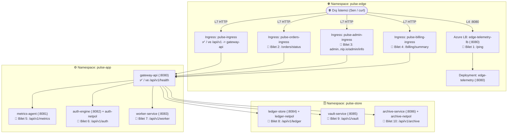

# 🌐 K8s Troubleshoot Lab 30: PulseGrid v13.0 — Genel Production Ağ & Canlı Trafik Teşhis Laboratuvarı

> **[🇹🇷 Türkçe](#-türkçe-bölüm) | [🇬🇧 English](#-english-section)**

---

<a id="-türkçe-bölüm"></a>
## 🇹🇷 Türkçe Bölüm

### 📋 Olay Özeti (Incident Briefing)

| Alan | Detay |
| :--- | :--- |
| **Platform** | **PulseGrid v13.0** — Telemetri, Sipariş, Faturalama ve Arşiv Ağ Geçidi |
| **Senaryo** | Kümedeki tüm podlar **`1/1 Running`** durumunda görünmektedir; ancak üretim ortamındaki **10 genel ağ ve yönlendirme uç noktası canlı trafikte hata vermektedir!** |
| **Amaç** | Canlı HTTP sinyallerinden yola çıkıp **podların içine girerek (`kubectl exec -it`) adım adım eleme testleri yapmak** ve kök nedeni kendi başına kanıtlamak |
| **Altyapı (Terraform)** | **Azure Kubernetes Service (AKS)** — 2 Düğümlü (`Standard_B2s_v2`), Calico CNI NetworkPolicy, NGINX Ingress Controller |
| **Etkilenen Alanlar** | `pulse-edge`, `pulse-app`, `pulse-store` (3 Namespace, 10 Canlı Üretim Bileti) |
| **Canlı Doğrulama** | `./check.sh` — Gerçek Azure LoadBalancer ve NGINX Ingress URL'lerine istek atan doğrulama betiği |
| **Çözüm Anahtarı** | [`SOLUTION.md`](./SOLUTION.md) — Yalnızca kendi başına teşhis edip tıkandığında başvur |

---

### 🧠 Tüm Podlar `1/1 Running` İken Nasıl Teşhis Koyarsın? (Saha Notları)

Gerçek dünyada `kubectl get pods` çıktısının yeşil olması sistemin trafiği ilettiğini göstermez. Bir paket dış istemciden hedef pod içindeki uygulamaya ulaşana kadar sırayla şu **6 kapıdan** geçer:

```text
İstemci (curl) ──▶ [1. Azure LB / Probe] ──▶ [2. NGINX Ingress (L7)] ──▶ [3. CoreDNS (İsim→IP)] ──▶ [4. Service / Endpoints (VIP→PodIP)] ──▶ [5. Calico NetPol] ──▶ [6. Pod Soketi (0.0.0.0:Port)]
```
*(Not: Bir pod başka bir servise giderken **3. Kapıdaki CoreDNS** sorgusu daha paket çıkmadan önce gerçekleşir; dolayısıyla kaynak poddaki bir Egress NetworkPolicy UDP/TCP `53` portunu keserse trafik henüz 3. kapı aşamasında durur.)*

YAML açıp tahmin yürütmek yerine belirtiye göre şu 4 kuralı uygula:

1. **Belirti: Dış LoadBalancer IP'sine giderken timeout (`HTTP 000`) var:**
   * Hedef podun IP'sini al (`-o wide`) ve başka bir podun içine `exec` ile girip **doğrudan Pod IP'ye** `wget` at.
   * *İçeriden Pod IP ve hatta Cluster Service çalışıyor ama dış LB IP düşüyorsa:* Uygulama ve NetworkPolicy sağlamdır! Sorun **1. Kapı (Cloud LoadBalancer sağlık kontrolü / port ayarı)** sınırındadır.

2. **Belirti: Anında HTTP `404` veya `503` (`Server: nginx`):**
   * Paket **2. Kapıya (NGINX Ingress)** ulaştı ama yönlendirilemedi.
   * `kubectl get ingress -n <ns>` ile `CLASS`, `HOSTS` ve `ADDRESS` sütunlarını oku; ardından küme içinden hedef servise doğrudan bağlanarak arka ucun sağlam olduğunu doğrula ve NGINX Ingress loglarına bak.

3. **Belirti: `502 Name does not resolve` vs `502 Connection refused`:**
   * **`Pod IP` çalışıyor ama isim ile `nslookup` başarısız oluyorsa:** Paket daha Service/Calico veri yoluna çıkmadan **3. Kapıda (CoreDNS / cross-namespace FQDN veya Egress `:53`)** kalmıştır.
   * **İki pod arası `Pod IP` ile denerken `Connection refused` alıyorsan** ve hedefin `127.0.0.1` lokal çağrısı çalışıyorsa: Konteyner dış arayüze (`0.0.0.0`) bağlanmamıştır (**6. Kapı: Pod Soketi**). `Pod IP` çalışıyor ama `Service adı:port` reddediliyorsa **4. Kapıda (Service / Endpoints)** kopukluk vardır.

4. **Belirti: Sessiz Timeout (`504`) — NetworkPolicy Şüphesi:**
   * Kendi içinden (`127.0.0.1`) pod yanıt veriyorken başka poddan **`Pod IP` çağrısı bile asılı kalıyorsa** **5. Kapıda (Calico NetworkPolicy)** paket `DROP` ediliyordur.
   * *Önemli Kural:* **Asla bir `NetworkPolicy` nesnesini silerek çözüm arama!** (`./check.sh` politikaların aktif kaldığını da denetler.) Bunun yerine `ingress` kuralının varlığını, `namespaceSelector` + `podSelector` kombinasyonunu ve namespace etiketlerini kontrol et.

---

### 🧰 Saha Mühendisi Alet Çantası (Genel Kalıplar)

Bu kümedeki podlarda `wget`, `nslookup` ve `netstat` araçları hazırdır:

```bash
# 1. Tüm Pod IP'lerini, durumlarını ve namespace etiketlerini görme:
kubectl get pods -A -o wide
kubectl get ns --show-labels

# 2. İstediğin bir podun içine interaktif girip temiz testler yapma:
kubectl exec -it -n <namespace> deploy/<pod-adi> -- sh

# (Podun içindeyken):
wget -qO- -T 3 http://<pod-ip-veya-servis>:<port>/<yol>
nslookup <servis-adi>
netstat -tuln

# 3. Ingress, Service, Endpoints ve NetworkPolicy durumlarını görme:
kubectl get ingress,svc,ep,netpol -n <namespace>
kubectl logs -n ingress-nginx -l app.kubernetes.io/name=ingress-nginx --tail=25
```

---

### 🏗️ Mimari ve Canlı Uç Noktalar



---

### 🚀 Kurulum ve Çalışma Komutları

#### 1. Ortamı Kur:
```bash
chmod +x setup.sh check.sh cleanup.sh
./setup.sh
```

> [!NOTE]
> Önceki labdan (`k8-troubleshoot-29`) kalma bir AKS kümesi `denmarkeast` bölgesinde halen açıksa (Azure for Students 6 vCPU kota sınırı), önce o klasörde `./cleanup.sh` çalıştırın. Mevcut AKS kümeniz zaten açıksa `./setup.sh --skip-terraform` kullanabilirsiniz.

#### 2. Test Ortam Değişkenlerini Yükle:
```bash
export INGRESS_IP=$(kubectl get svc -n ingress-nginx ingress-nginx-controller -o jsonpath='{.status.loadBalancer.ingress[0].ip}')
export LB_IP=$(kubectl get svc -n pulse-edge edge-telemetry-lb -o jsonpath='{.status.loadBalancer.ingress[0].ip}')
export HOST="pulse.${INGRESS_IP}.nip.io"
export ADMIN_HOST="admin.${INGRESS_IP}.nip.io"
```

Temel hattın çalıştığını doğrula (`/` ve `/api/v1/health` doğrudan `200 OK` döner):
```bash
curl -i --max-time 4 "http://${HOST}/api/v1/health"
```

#### 3. Düzeltmeleri `helm/pulsegrid/values.yaml` Üzerinden (veya `kubectl` ile) Uygula:
```bash
helm upgrade --install pulsegrid ./helm/pulsegrid \
  --namespace pulse-edge \
  --set global.ingressHost="pulse.${INGRESS_IP}.nip.io"
```

#### 4. Canlı Doğrulama Betiğini Çalıştır:
```bash
./check.sh
```

---

### 🛠️ 10 Üretim Olayı (Incident Tickets) — Deneyimleme & İzolasyon Rehberi

---

#### 🌐 BÖLÜM 1: Azure LoadBalancer & NGINX Ingress Kenarı (`pulse-edge`)

##### 🎫 Bilet 1: Dış Telemetri LoadBalancer'ı Dışarıdan Yanıt Vermiyor
* **Olay Bildirimi:** İzleme sistemi `edge-telemetry-lb` Public IP adresine yaptığı isteklerde zaman aşımı alıyor.
* **Canlı Test:**
  ```bash
  curl -i --connect-timeout 4 "http://${LB_IP}:8080/ping"
  ```
* **Nasıl Yaklaşmalısın? (İzolasyon Deneyi)**
  1. Sorun podda mı yoksa Cloud LoadBalancer'da mı? Önce `edge-telemetry` Pod IP'sini gör, sonra kümedeki başka bir podun içine girip hem **doğrudan Pod IP'sini** hem de **Service adını** test et:
     ```bash
     kubectl get pods -n pulse-edge -o wide
     kubectl exec -it -n pulse-app deploy/gateway-api -- sh

     # Podun içindeyken:
     wget -qO- -T 3 http://<EDGE_TELEMETRY_POD_IP>:8080/ping
     wget -qO- -T 3 http://edge-telemetry-lb.pulse-edge.svc.cluster.local:8080/ping
     exit
     ```
  2. Küme içinden hem Pod IP hem de `edge-telemetry-lb` çalışıyor ama **dış Public IP** düşüyorsa: Azure LoadBalancer arka uç havuzunu neden sağlıksız sayıyor? Şu komutla Service tanımındaki portları ve **sağlık kontrolü (health probe)** annotasyonlarını incele (`edge-telemetry` podunun dinlediği path ile karşılaştır):
     ```bash
     kubectl get svc edge-telemetry-lb -n pulse-edge -o yaml
     ```
     *(Not: Azure LoadBalancer health probe ayarını düzelttikten sonra Azure'un arka ucu sağlıklı işaretlemesi 15–20 saniye sürebilir.)*
* **Çözüm Kanıtı:** `curl -i --max-time 4 "http://${LB_IP}:8080/ping"` `HTTP/1.1 200 OK` ve `"service": "edge-telemetry"` dönmelidir.

---

##### 🎫 Bilet 2: Sipariş Durumu (`/orders/status`) `404` Dönüyor
* **Olay Bildirimi:** `/api/v1/health` çalışırken `/orders/status` yolu `404 Not Found` veriyor.
* **Canlı Test:**
  ```bash
  curl -i --max-time 4 "http://${HOST}/orders/status"
  ```
* **Nasıl Yaklaşmalısın? (İzolasyon Deneyi)**
  1. Önce `gateway-api` podunun `/orders/status` yoluna içeride yanıt verdiğini doğrula, ardından tüm Ingress nesnelerini yan yana listele:
     ```bash
     kubectl exec -it -n pulse-app deploy/metrics-agent -- sh
     wget -qO- -T 2 http://gateway-api:8080/orders/status
     exit

     kubectl get ingress -n pulse-edge
     ```
  2. `kubectl get ingress` tablosunda **`CLASS`** ve **`ADDRESS`** sütunlarına dikkatle bak! `pulse-orders-ingress` neden IP almamış ve neden NGINX onu tanımıyor? Detayını incele:
     ```bash
     kubectl get ingress pulse-orders-ingress -n pulse-edge -o yaml
     ```
* **Çözüm Kanıtı:** `curl -i --max-time 4 "http://${HOST}/orders/status"` `HTTP/1.1 200 OK` ve `"orders-ok"` dönmelidir.

---

##### 🎫 Bilet 3: Admin Adresi (`admin.<IP>.nip.io/admin/info`) `404 Not Found` Veriyor
* **Olay Bildirimi:** Admin ekibi `http://${ADMIN_HOST}/admin/info` adresine girdiğinde NGINX `404` sayfası görüyor.
* **Canlı Test:**
  ```bash
  curl -i --max-time 4 "http://${ADMIN_HOST}/admin/info"
  ```
* **Nasıl Yaklaşmalısın? (İzolasyon Deneyi)**
  1. Tüm Ingress nesnelerinin `HOSTS` sütununu listele ve beklediğin `ADMIN_HOST` (`admin.<IP>.nip.io`) değeriyle karşılaştır:
     ```bash
     kubectl get ingress -n pulse-edge
     ```
  2. Tabloda gördüğün yanlış `HOSTS` adıyla `Host:` başlığını elle göndererek teorini bizzat test et! Bakalım NGINX diğer host için `200 OK` döndürecek mi:
     ```bash
     curl -i -H "Host: admin.pulse.local" "http://${INGRESS_IP}/admin/info"
     ```
  3. Eğer `Host: admin.pulse.local` yazınca `200 OK` alıyorsan, kök neden tamamen `pulse-admin-ingress` üzerindeki `host` tanımıdır:
     ```bash
     kubectl get ingress pulse-admin-ingress -n pulse-edge -o yaml
     ```
* **Çözüm Kanıtı:** `curl -i --max-time 4 "http://${ADMIN_HOST}/admin/info"` `HTTP/1.1 200 OK` ve `"admin-ok"` dönmelidir.

---

##### 🎫 Bilet 4: Faturalama Yolu (`/billing/summary`) `503 Service Temporarily Unavailable` Veriyor
* **Olay Bildirimi:** `/billing/summary` adresi sürekli `503` hatası veriyor.
* **Canlı Test:**
  ```bash
  curl -i --max-time 4 "http://${HOST}/billing/summary"
  ```
* **Nasıl Yaklaşmalısın? (İzolasyon Deneyi)**
  1. Arka uçtaki `gateway-api` uygulamasının `/billing/summary` yolunu servis edip etmediğini içeriden test et, ardından NGINX Ingress Controller loglarını ve `pulse-edge` içindeki servisleri incele:
     ```bash
     kubectl exec -it -n pulse-app deploy/metrics-agent -- sh
     wget -qO- -T 2 http://gateway-api:8080/billing/summary
     exit

     kubectl logs -n ingress-nginx -l app.kubernetes.io/name=ingress-nginx --tail=20
     kubectl get svc -n pulse-edge
     kubectl get ingress pulse-billing-ingress -n pulse-edge -o yaml
     ```
  2. `pulse-billing-ingress` tanımındaki hedef servis adıyla `pulse-edge` içinde gerçekten var olan servisleri karşılaştır.
* **Çözüm Kanıtı:** `curl -i --max-time 4 "http://${HOST}/billing/summary"` `HTTP/1.1 200 OK` ve `"billing-ok"` dönmelidir.

---

#### ⚙️ BÖLÜM 2: Uygulama Katmanı, Soket Bağlama, NetPol & Portlar (`pulse-app`)

##### 🎫 Bilet 5: Metrik Servisi (`/api/v1/metrics`) `502` Hatası Veriyor
* **Olay Bildirimi:** `metrics-agent` podu `1/1 Running` ve `Endpoints` dolu olmasına rağmen `gateway-api` bu servise eriştiğinde reddediliyor (`502`).
* **Canlı Test:**
  ```bash
  curl -i --max-time 4 "http://${HOST}/api/v1/metrics"
  ```
* **Nasıl Yaklaşmalısın? (İzolasyon Deneyi)**
  1. Önce `metrics-agent` podunun kendi içine girip hem `127.0.0.1` ile çalışıp çalışmadığını hem de hangi ağ arayüzünü dinlediğini (`netstat -tuln`) gözünle gör:
     ```bash
     kubectl exec -it -n pulse-app deploy/metrics-agent -- sh

     # Podun kendi içindeyken:
     wget -qO- -T 2 http://127.0.0.1:8081/metrics
     netstat -tuln
     exit
     ```
  2. Şimdi başka bir poddan (`gateway-api`) aynı podun **Pod IP**'sine gitmeyi dene:
     ```bash
     kubectl get pods -n pulse-app -o wide
     kubectl exec -it -n pulse-app deploy/gateway-api -- sh

     wget -qO- -T 2 http://<METRICS_POD_IP>:8081/metrics
     exit
     ```
  3. `127.0.0.1` cevap verirken dış Pod IP'sinin `Connection refused` yemesinin sebebi `netstat` çıktısındaki dinleme adresidir! Deployment yapılandırmasını incele:
     ```bash
     kubectl get deploy metrics-agent -n pulse-app -o yaml
     ```
* **Çözüm Kanıtı:** `curl -i --max-time 4 "http://${HOST}/api/v1/metrics"` `HTTP/1.1 200 OK` ve `"service": "metrics-agent"` dönmelidir.

---

##### 🎫 Bilet 6: Kimlik Doğrulama (`/api/v1/auth`) Zaman Aşımına Uğruyor (`504`)
* **Olay Bildirimi:** `gateway-api`, `auth-engine` servisine bağlanamayıp zaman aşımına düşüyor.
* **Canlı Test:**
  ```bash
  curl -i --max-time 5 "http://${HOST}/api/v1/auth"
  ```
* **Nasıl Yaklaşmalısın? (İzolasyon Deneyi)**
  1. Önce `auth-engine` uygulamasının kendi içinde çalıştığını gör, sonra `gateway-api` içinden **doğrudan `auth-engine` Pod IP'sine** bağlanmayı dene:
     ```bash
     kubectl exec -it -n pulse-app deploy/auth-engine -- wget -qO- -T 2 http://127.0.0.1:8082/auth
     kubectl get pods -n pulse-app -o wide
     kubectl exec -it -n pulse-app deploy/gateway-api -- sh

     # Podun içindeyken (auth-engine Pod IP'si ile):
     wget -qO- -T 2 http://<AUTH_ENGINE_POD_IP>:8082/auth
     exit
     ```
  2. Doğrudan Pod IP'ye atılan istek bile sessizce asılı kalıp timeout yiyorsa arada NetworkPolicy paketi düşürüyor demektir! İlgili politikayı incele *(not: `auth-netpol` politikasını silmeden uygun `ingress` kuralını ekle)*:
     ```bash
     kubectl get netpol auth-netpol -n pulse-app -o yaml
     ```
* **Çözüm Kanıtı:** `curl -i --max-time 5 "http://${HOST}/api/v1/auth"` `HTTP/1.1 200 OK` ve `"authenticated": true` dönmelidir (`auth-netpol` aktif kalmalı).

---

##### 🎫 Bilet 7: Çalışan Servis (`/api/v1/worker`) Etiketler Doğru Olduğu Halde `502` Veriyor
* **Olay Bildirimi:** `worker-service` podu sağlıklı çalışıyor ancak `gateway-api` üzerinden gidildiğinde `502` dönüyor.
* **Canlı Test:**
  ```bash
  curl -i --max-time 4 "http://${HOST}/api/v1/worker"
  ```
* **Nasıl Yaklaşmalısın? (İzolasyon Deneyi)**
  1. Pod IP'ye doğrudan bağlanarak ağ ve uygulama sağlamlığını kanıtla, ardından `worker-service` Endpoints durumuna bak:
     ```bash
     kubectl get pods,endpoints -n pulse-app -o wide
     kubectl exec -it -n pulse-app deploy/gateway-api -- sh

     # Podun içindeyken (worker-service Pod IP'si ile):
     wget -qO- -T 2 http://<WORKER_POD_IP>:8083/run
     exit
     ```
  2. Pod IP `200 OK` verirken `Endpoints` boş (`<none>`) çıkıyor! Önce etiketleri (`--show-labels`), etiketler aynıysa **Service `targetPort` ile Pod container port adını** kıyasla:
     ```bash
     kubectl get pod -n pulse-app -l app.kubernetes.io/name=worker-service -o yaml
     kubectl get svc worker-service -n pulse-app -o yaml
     ```
* **Çözüm Kanıtı:** `curl -i --max-time 4 "http://${HOST}/api/v1/worker"` `HTTP/1.1 200 OK` ve `"service": "worker-service"` dönmelidir.

---

#### 🔐 BÖLÜM 3: Cross-Namespace Depo Katmanı, DNS & Etiketler (`pulse-app` ↔ `pulse-store`)

##### 🎫 Bilet 8: Cross-Namespace Defter Servisi (`/api/v1/ledger`) Zaman Aşımına Uğruyor (`504`)
* **Olay Bildirimi:** `pulse-app` içindeki `gateway-api`, `pulse-store` altındaki `ledger-store` servisine bağlanırken `504` alıyor.
* **Canlı Test:**
  ```bash
  curl -i --max-time 5 "http://${HOST}/api/v1/ledger"
  ```
* **Nasıl Yaklaşmalısın? (İzolasyon Deneyi)**
  1. İlginç bir deney yap: `ledger-store` Pod IP'sine hem **`pulse-app` içindeki `gateway-api`'den** hem de (karşılaştırma için) **`pulse-store` içindeki `vault-service`'den** erişmeyi dene!
     ```bash
     kubectl get pods -n pulse-store -o wide

     # Test A: pulse-store namespace'i içindeki vault-service podundan:
     kubectl exec -it -n pulse-store deploy/vault-service -- sh
     wget -qO- -T 2 http://<LEDGER_POD_IP>:8084/ledger
     exit

     # Test B: pulse-app namespace'i içindeki gateway-api podundan:
     kubectl exec -it -n pulse-app deploy/gateway-api -- sh
     wget -qO- -T 2 http://<LEDGER_POD_IP>:8084/ledger
     exit
     ```
  2. Şimdi `ledger-netpol` tanımını açıp incele: Neden `gateway-api` etiketi yazılı olduğu halde başka namespace'ten gelen istek reddediliyor? *(Not: `ledger-netpol` politikasını silmeden düzelt!)*
     ```bash
     kubectl get netpol ledger-netpol -n pulse-store -o yaml
     ```
* **Çözüm Kanıtı:** `curl -i --max-time 5 "http://${HOST}/api/v1/ledger"` `HTTP/1.1 200 OK` ve `"service": "ledger-store"` dönmelidir (`ledger-netpol` aktif kalmalı).

---

##### 🎫 Bilet 9: Kasa Servisi (`/api/v1/vault`) İsim Çözemiyor (`502`)
* **Olay Bildirimi:** `gateway-api` kasadan bilgi almak istediğinde `502` / `Name does not resolve` dönüyor.
* **Canlı Test:**
  ```bash
  curl -i --max-time 4 "http://${HOST}/api/v1/vault"
  ```
* **Nasıl Yaklaşmalısın? (İzolasyon Deneyi)**
  1. `gateway-api` içine girip hem kısa servis adını hem de farklı namespace için tam FQDN adını `nslookup` ile karşılaştır:
     ```bash
     kubectl exec -it -n pulse-app deploy/gateway-api -- sh
     nslookup vault-service
     nslookup vault-service.pulse-store.svc.cluster.local
     wget -qO- -T 2 http://vault-service.pulse-store.svc.cluster.local:8085/status
     exit
     ```
  2. Tam FQDN anında yanıt verirken kısa isim neden çözülmedi? `gateway-api` Deployment içindeki ortam değişkenlerini incele:
     ```bash
     kubectl get deploy gateway-api -n pulse-app -o yaml
     ```
* **Çözüm Kanıtı:** `curl -i --max-time 4 "http://${HOST}/api/v1/vault"` `HTTP/1.1 200 OK` ve `"service": "vault-service"` dönmelidir.

---

##### 🎫 Bilet 10: Arşiv Servisi (`/api/v1/archive`) Namespace Seçicisine Takılıyor (`504`)
* **Olay Bildirimi:** `gateway-api` farklı namespace'deki `archive-service` servisine ulaşırken `504` alıyor.
* **Canlı Test:**
  ```bash
  curl -i --max-time 5 "http://${HOST}/api/v1/archive"
  ```
* **Nasıl Yaklaşmalısın? (İzolasyon Deneyi)**
  1. Önce `archive-service` uygulamasının kendi içinde çalıştığını gör ve `gateway-api` podundan Pod IP'ye timeout yediğini doğrula:
     ```bash
     kubectl exec -it -n pulse-store deploy/archive-service -- wget -qO- -T 2 http://127.0.0.1:8086/archive
     kubectl get pods -n pulse-store -o wide
     kubectl exec -it -n pulse-app deploy/gateway-api -- sh
     wget -qO- -T 2 http://<ARCHIVE_POD_IP>:8086/archive
     exit
     ```
  2. Bilet 8'den farklı olarak `archive-netpol` içinde `namespaceSelector` var gibi görünüyor! Peki Kubernetes `pulse-app` namespace'ini gerçekten o etiketle mi işaretliyor? İkisini yan yana koy *(not: `archive-netpol` politikasını silmeden düzelt)*:
     ```bash
     kubectl get ns pulse-app --show-labels
     kubectl get netpol archive-netpol -n pulse-store -o yaml
     ```
* **Çözüm Kanıtı:** `curl -i --max-time 5 "http://${HOST}/api/v1/archive"` `HTTP/1.1 200 OK` ve `"service": "archive-service"` dönmelidir (`archive-netpol` aktif kalmalı).

---

### ✅ Tam Doğrulama ve Temizlik

```bash
./check.sh
./cleanup.sh
```

---

<a id="-english-section"></a>
## 🇬🇧 English Section

### 📋 Incident Briefing

| Field | Detail |
| :--- | :--- |
| **Platform** | **PulseGrid v13.0** — Telemetry, Orders, Billing & Archive Gateway |
| **Scenario** | All Pods report **`1/1 Running`**, yet **all 10 general production networking endpoints fail under live traffic!** |
| **Goal** | Diagnose each ticket by reading live HTTP symptoms and **stepping inside Pods (`kubectl exec -it`) to isolate every layer yourself** |
| **Infrastructure (Terraform)** | **Azure Kubernetes Service (AKS)** — 2 Nodes (`Standard_B2s_v2`), Calico CNI NetworkPolicy, NGINX Ingress Controller |
| **Namespaces** | `pulse-edge`, `pulse-app`, `pulse-store` (3 Namespaces, 10 Live Tickets) |
| **Live Audit** | `./check.sh` |
| **Solution Key** | [`SOLUTION.md`](./SOLUTION.md) |

---

### 🧠 Field Notes & Toolbox

All Pods include `wget`, `nslookup`, and `netstat`.

```bash
kubectl get pods -A -o wide
kubectl get ns --show-labels
kubectl exec -it -n <namespace> deploy/<pod> -- sh
# inside pod:
wget -qO- -T 3 http://<pod-ip-or-service>:<port>/<path>
nslookup <service-name>
netstat -tuln
```

---

### 🚀 Setup & Variables

```bash
chmod +x setup.sh check.sh cleanup.sh
./setup.sh

export INGRESS_IP=$(kubectl get svc -n ingress-nginx ingress-nginx-controller -o jsonpath='{.status.loadBalancer.ingress[0].ip}')
export LB_IP=$(kubectl get svc -n pulse-edge edge-telemetry-lb -o jsonpath='{.status.loadBalancer.ingress[0].ip}')
export HOST="pulse.${INGRESS_IP}.nip.io"
export ADMIN_HOST="admin.${INGRESS_IP}.nip.io"

curl -i --max-time 4 "http://${HOST}/api/v1/health"
```

---

### 🛠️ 10 Production Tickets — Interactive Isolation Guide

1. **Ticket 1 (`curl -i --connect-timeout 4 "http://${LB_IP}:8080/ping"`):**
   Probe `edge-telemetry` Pod IP and ClusterIP from inside `gateway-api`; if both succeed while external LB times out, inspect `edge-telemetry-lb` annotations/ports. *(Allow ~15–20s for Azure SLB health probe refresh after patching.)*
2. **Ticket 2 (`curl -i --max-time 4 "http://${HOST}/orders/status"`):**
   Compare `CLASS` and `ADDRESS` across `kubectl get ingress -n pulse-edge` and inspect `pulse-orders-ingress`.
3. **Ticket 3 (`curl -i --max-time 4 "http://${ADMIN_HOST}/admin/info"`):**
   Check `HOSTS` in `kubectl get ingress -n pulse-edge` and test `curl -i -H "Host: admin.pulse.local" "http://${INGRESS_IP}/admin/info"`.
4. **Ticket 4 (`curl -i --max-time 4 "http://${HOST}/billing/summary"`):**
   Confirm `gateway-api:8080/billing/summary` internally, read `ingress-nginx` logs, and inspect `pulse-billing-ingress` backend service name.
5. **Ticket 5 (`curl -i --max-time 4 "http://${HOST}/api/v1/metrics"`):**
   Inside `metrics-agent`, test `127.0.0.1:8081/metrics` + `netstat -tuln`; then try its Pod IP from `gateway-api`.
6. **Ticket 6 (`curl -i --max-time 5 "http://${HOST}/api/v1/auth"`):**
   Test `auth-engine` locally vs Pod IP from `gateway-api`, then inspect `auth-netpol` (keep the policy active).
7. **Ticket 7 (`curl -i --max-time 4 "http://${HOST}/api/v1/worker"`):**
   Test `worker-service` Pod IP directly vs `kubectl get endpoints worker-service -n pulse-app`, then compare Pod container port name and Service `targetPort`.
8. **Ticket 8 (`curl -i --max-time 5 "http://${HOST}/api/v1/ledger"`):**
   Probe `ledger-store` Pod IP from `gateway-api` (`pulse-app`) and inspect `ledger-netpol` in `pulse-store` (keep the policy active).
9. **Ticket 9 (`curl -i --max-time 4 "http://${HOST}/api/v1/vault"`):**
   Inside `gateway-api`, compare `nslookup vault-service` vs `nslookup vault-service.pulse-store.svc.cluster.local` and check `gateway-api` Deployment env vars.
10. **Ticket 10 (`curl -i --max-time 5 "http://${HOST}/api/v1/archive"`):**
    Test `archive-service` Pod IP from `gateway-api`, then compare `kubectl get ns pulse-app --show-labels` against `archive-netpol` (keep the policy active).

```bash
./check.sh
./cleanup.sh
```
