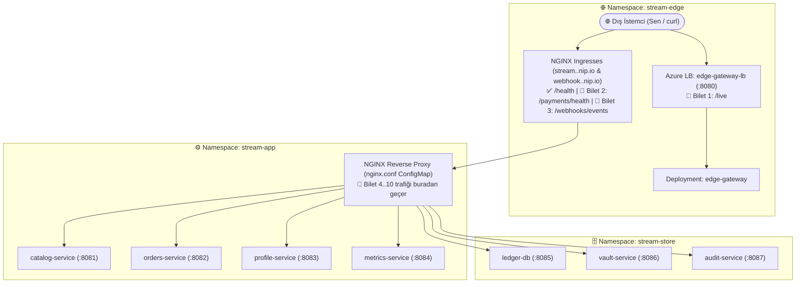

# 🌐 K8s Troubleshoot Lab 31: StreamCart v14.0 — Reverse Proxy & Kör Production Ağ Teşhis Laboratuvarı

> **[🇹🇷 Türkçe](#-türkçe-bölüm) | [🇬🇧 English](#-english-section)**

---

<a id="-türkçe-bölüm"></a>
## 🇹🇷 Türkçe Bölüm

### 📋 Olay Özeti (Incident Briefing)

| Alan | Detay |
| :--- | :--- |
| **Platform** | **StreamCart v14.0** — Dış LoadBalancer + NGINX Ingress + İç **NGINX Reverse Proxy (`ConfigMap`)** + Arka Uç Servisleri |
| **Senaryo** | Kümedeki tüm podlar **`1/1 Running`** durumundadır; ancak dışarıdan test edilen **10 uç noktanın tamamı farklı HTTP hatalarıyla (`000`, `404`, `502`, `503`, `504`) başarısız olmaktadır!** |
| **Kör Teşhis Farkı** | Bilet başlıklarında veya bölümlerde arızanın türü (**DNS mi, NetPol mü, Ingress mi, Reverse Proxy mi**) gizlenmiştir. Önce HTTP durum kodundan hangi katmanları otomatik elediğini çıkar, sonra `kubectl exec -it` ile kanıtla! |
| **Altyapı (Terraform)** | **Azure Kubernetes Service (AKS)** — 2 Düğümlü (`Standard_B2s_v2`), Calico CNI NetworkPolicy, NGINX Ingress Controller |
| **Etkilenen Alanlar** | `stream-edge`, `stream-app`, `stream-store` (3 Namespace, 10 Kör Üretim Bileti) |
| **Canlı Doğrulama** | `./check.sh` |
| **Çözüm Anahtarı** | [`SOLUTION.md`](./SOLUTION.md) — Yalnızca kendi teşhisinden emin olduktan veya tıkandıktan sonra bak |

---

### 🧠 1. Paket Yolculuğu & HTTP Durum Kodu Okuma Sanatı (Saha Notları)

Bir istek dış istemciden hedef pod içindeki uygulamaya ulaşana kadar sırayla şu **6 kapıdan** geçer:

```text
İstemci (curl) ──▶ [1. Azure LB] ──▶ [2. NGINX Ingress (L7)] ──▶ [3. NGINX Reverse Proxy] ──▶ [4. CoreDNS] ──▶ [5. Service / Endpoints] ──▶ [6. Calico NetPol / Pod Soketi]
```

Sıfırdan bir uç noktaya erişemediğinde ilk baktığın **HTTP durum kodu**, arkadaki birçok kapıyı **hiç komut yazmadan otomatik olarak temize çıkarır**:

| Gördüğün HTTP Kodu | Otomatik Elenen Kapılar (Sağlam!) | Gerçek Anlamı & İlk Bakacağın Yer |
| :--- | :--- | :--- |
| **`HTTP 000`** *(Timeout / Bağlantı Yok)* | *Henüz hiçbiri* | Paket Cloud LB veya Ingress ile HTTP el sıkışması bile yapamadı. Önce **1. Kapı (Azure LB port/kural)** ve hedef pod `Pod IP` testiyle başla. |
| **Herhangi bir NGINX Kodu (`404`, `502`, `503`, `504`)** | **✅ Kapı 1 (Azure LoadBalancer) %100 SAĞLAMDIR!** | NGINX seninle HTTP konuşabildiğine göre Cloud LB paketi içeri almıştır. **Sakın Cloud LB ile vakit kaybetme!** |
| **`404 Not Found`** | ✅ Kapı 1 (LB) | Trafik NGINX'e ulaştı ama eşleşen bir `Ingress` kuralı bulamadı (veya uygulama bu URI'yi tanımıyor). İlk iş: `kubectl get ingress -A` (`CLASS`, `HOSTS`, `ADDRESS` sütunları). |
| **`503 Service Temporarily Unavailable`** | ✅ Kapı 1 (LB) <br/> ✅ Kapı 2 (Ingress kuralı eşleşti) | NGINX Ingress isteği tanıdı ama yönlendireceği **Service veya Endpoint (`PodIP:Port`) bulamadı!** DNS veya NetPol'den önce `kubectl get ingress` içindeki backend servis adı/portu ile `kubectl get svc,ep` çıktılarını karşılaştır. |
| **`502 Bad Gateway`** | ✅ Kapı 1 (LB) <br/> ✅ Kapı 2 (Ingress) | Proxy üst akışa (upstream) bağlanmaya çalışırken **anında reddedildi** veya **DNS çözemedi**! Bunu ayırmak için **proxy loguna bak** ve proxy podu içinden hem **`nslookup`** hem **`wget http://<PodIP>:<Port>`** dene:<br/>• `nslookup` bozuksa (veya proxy `resolver` logu hata veriyorsa) $\rightarrow$ **DNS / Resolver**.<br/>• `Pod IP` bile `Connection refused` diyorsa $\rightarrow$ Uygulama yalnızca `127.0.0.1` dinliyordur (**Soket**).<br/>• `Pod IP` çalışıp `Service:Port` reddediliyorsa $\rightarrow$ **Service port / targetPort** veya proxy `nginx.conf` portu yanlıştır! |
| **`504 Gateway Time-out`** | ✅ Kapı 1 (LB) <br/> ✅ Kapı 2 (Ingress) <br/> ✅ İsim çözüldü | Proxy paketi gönderdi ama zaman aşımı dolana kadar yanıt alamadı. İki ihtimal vardır:<br/>1) **Uygulama Proxy'den yavaştır** (`proxy_read_timeout`).<br/>2) **Calico NetworkPolicy paketi sessizce düşürüyordur**.<br/>*Nasıl ayırırsın?* Proxy podu içine girip `wget -T 6 http://<Hedef_Pod_IP>:<Port>/...` at! Birkaç saniyede `200 OK` gelirse sorun **timeout ayarıdır**; yine takılırsa **NetworkPolicy** vardır! (Aynı `Pod IP` testini farklı bir poddan daha atarak sorunun kaynak `Egress` mi hedef `Ingress` mi olduğunu hemen kanıtlarsın.) |

> [!CAUTION]
> **Sıfır Hile Kuralı:** Bir `504` sorununu çözmek için **asla bir `NetworkPolicy` nesnesini silme!** `./check.sh` politikaların aktif kaldığını da denetler.

---

### 🧰 2. Saha Mühendisi Alet Çantası (Genel Kalıplar)

Bu kümedeki podlarda (`nginx:alpine` ve `python:alpine`) `wget`, `nslookup` ve `netstat` araçları hazırdır:

```bash
# 1. Tüm Pod IP'lerini ve Ingress kurallarını görme:
kubectl get pods -A -o wide
kubectl get ingress -A

# 2. Reverse Proxy loglarını ve nginx.conf ayarını inceleme:
kubectl logs -n stream-app deploy/reverse-proxy --tail=30
kubectl get configmap reverse-proxy-conf -n stream-app -o yaml

# 3. Bir podun içine interaktif girip temiz testler yapma:
kubectl exec -it -n <namespace> deploy/<pod-adi> -- sh
# (Podun içindeyken):
wget -qO- -T 5 http://<pod-ip-veya-servis>:<port>/<yol>
nslookup <servis-adi>
netstat -tuln

# 4. ConfigMap'i doğrudan kubectl ile düzenlersen NGINX podunu yenile:
kubectl rollout restart deploy/reverse-proxy -n stream-app
```

---

### 🏗️ 3. Sistem Topolojisi (Kör Şema)



---

### 🚀 4. Kurulum ve Çalışma Komutları

#### 1. Ortamı Kur:
```bash
chmod +x setup.sh check.sh cleanup.sh
./setup.sh
```

> [!NOTE]
> Önceki labdan (`k8-troubleshoot-30`) kalma bir AKS kümesi `denmarkeast` bölgesinde halen açıksa (Azure for Students 6 vCPU kota sınırı), önce o klasörde `./cleanup.sh` çalıştırın. Mevcut AKS kümeniz zaten açıksa `./setup.sh --skip-terraform` kullanabilirsiniz.

#### 2. Test Değişkenlerini Yükle:
```bash
export INGRESS_IP=$(kubectl get svc -n ingress-nginx ingress-nginx-controller -o jsonpath='{.status.loadBalancer.ingress[0].ip}')
export LB_IP=$(kubectl get svc -n stream-edge edge-gateway-lb -o jsonpath='{.status.loadBalancer.ingress[0].ip}')
export HOST="stream.${INGRESS_IP}.nip.io"
export WEBHOOK_HOST="webhook.${INGRESS_IP}.nip.io"
```

Reverse Proxy temel sağlık kontrolünü gör (`200 OK`):
```bash
curl -i --max-time 4 "http://${HOST}/health"
```

#### 3. Düzeltmeleri Uygula & Doğrula:
`helm/streamcart/values.yaml` dosyasını güncelleyip Helm upgrade çalıştır (veya `kubectl` ile düzelt):
```bash
helm upgrade --install streamcart ./helm/streamcart \
  --namespace stream-edge \
  --set global.ingressHost="stream.${INGRESS_IP}.nip.io"

./check.sh
```

---

### 🛠️ 5. 10 Kör Üretim Bileti (Sadece Semptomdan Teşhis!)

> Her bilette **önce canlı `curl` çıktısındaki HTTP kodunu yukarıdaki tabloyla yorumla**, ardından `kubectl exec -it` ile pod içinden izolasyon testleri yaparak sorunu kendin bul.

---

#### 🎫 Bilet 1: `http://${LB_IP}:8080/live` Yanıt Vermiyor
* **Canlı Test:**
  ```bash
  curl -i --connect-timeout 4 "http://${LB_IP}:8080/live"
  ```
* **Nasıl Yaklaşmalısın?**
  1. `HTTP 000` (bağlantı hatası / timeout) aldın — daha HTTP katmanına bile geçilemedi.
  2. Podun sağlam olup olmadığını ayırmak için `edge-gateway` Pod IP'sini gör ve başka pod içinden `PodIP:8080/live` adresine bağlan:
     ```bash
     kubectl get pods -n stream-edge -o wide
     kubectl exec -it -n stream-app deploy/reverse-proxy -- sh
     wget -qO- -T 3 http://<EDGE_GATEWAY_POD_IP>:8080/live
     exit
     ```
  3. Pod IP üzerinden `200 OK` alıyorsan `edge-gateway-lb` Service tanımını (`kubectl get svc -n stream-edge -o yaml`) incele.
* **Doğrulama:** `curl -i --max-time 4 "http://${LB_IP}:8080/live"` $\rightarrow$ `HTTP/1.1 200 OK`.

---

#### 🎫 Bilet 2: `/payments/health` İsteği `404` Dönüyor
* **Canlı Test:**
  ```bash
  curl -i --max-time 4 "http://${HOST}/payments/health"
  ```
* **Nasıl Yaklaşmalısın?**
  1. NGINX `404` verdiğine göre **Azure LB sağlam**! Önce `reverse-proxy` podunun `/payments/health` yoluna içeride yanıt verdiğini doğrula, sonra tüm Ingress nesnelerini listele:
     ```bash
     kubectl exec -it -n stream-app deploy/catalog-service -- sh
     wget -qO- -T 2 http://reverse-proxy:80/payments/health
     exit

     kubectl get ingress -n stream-edge
     ```
  2. Tabloda `ADDRESS` ve `CLASS` sütunlarını karşılaştırıp ilgili Ingress YAML'ını incele.
* **Doğrulama:** `curl -i --max-time 4 "http://${HOST}/payments/health"` $\rightarrow$ `HTTP/1.1 200 OK`.

---

#### 🎫 Bilet 3: `http://${WEBHOOK_HOST}/webhooks/events` İsteği `503` Dönüyor
* **Canlı Test:**
  ```bash
  curl -i --max-time 4 "http://${WEBHOOK_HOST}/webhooks/events"
  ```
* **Nasıl Yaklaşmalısın?**
  1. Yukarıdaki tabloya göre **`503`**: Azure LB sağlam **ve** Ingress kuralın eşleşti; ancak NGINX arka uçta aktif bir Endpoint portuna bağlanamadı!
  2. Ingress'in bağlanmaya çalıştığı Service/Port ile `stream-edge` içindeki `reverse-proxy` Service portunu kıyasla:
     ```bash
     kubectl exec -it -n stream-app deploy/catalog-service -- sh
     wget -qO- -T 2 http://reverse-proxy:80/webhooks/events
     exit

     kubectl get svc reverse-proxy -n stream-edge -o yaml
     kubectl get ingress stream-webhook-ingress -n stream-edge -o yaml
     ```
* **Doğrulama:** `curl -i --max-time 4 "http://${WEBHOOK_HOST}/webhooks/events"` $\rightarrow$ `HTTP/1.1 200 OK`.

---

#### 🎫 Bilet 4: `/api/catalog` İsteği `502` Dönüyor
* **Canlı Test:**
  ```bash
  curl -i --max-time 5 "http://${HOST}/api/catalog"
  ```
* **Nasıl Yaklaşmalısın?**
  1. **`502`** gördüğünde ilk iş **NGINX Reverse Proxy loguna** bakmak ve proxy podunun içinden hedefe `nslookup` + `wget` atmaktır:
     ```bash
     kubectl logs -n stream-app deploy/reverse-proxy --tail=20
     kubectl exec -it -n stream-app deploy/reverse-proxy -- sh
     nslookup catalog-service.stream-app.svc.cluster.local
     wget -qO- -T 2 http://catalog-service.stream-app.svc.cluster.local:8081/api/catalog
     exit
     ```
  2. Pod içindeki shell'de `nslookup` ve `wget` çalışıyor ama **NGINX logu isim çözemediğini söylüyorsa**, NGINX'in kendi yapılandırma dosyasını (`ConfigMap`) incele:
     ```bash
     kubectl get configmap reverse-proxy-conf -n stream-app -o yaml
     ```
* **Doğrulama:** `curl -i --max-time 5 "http://${HOST}/api/catalog"` $\rightarrow$ `HTTP/1.1 200 OK`.

---

#### 🎫 Bilet 5: `/api/orders` İsteği `504` Dönüyor
* **Canlı Test:**
  ```bash
  time curl -i --max-time 6 "http://${HOST}/api/orders"
  ```
* **Nasıl Yaklaşmalısın?**
  1. **`504`** gördüğünde "NetworkPolicy mi düşürüyor, yoksa uygulama mı geç cevap veriyor?" ayrımını hemen yap: `reverse-proxy` içine girip hedefe daha uzun bir timeout (`-T 6`) ile doğrudan istek at ve süreyi gör:
     ```bash
     kubectl get pods -n stream-app -o wide
     kubectl exec -it -n stream-app deploy/reverse-proxy -- sh
     time wget -qO- -T 6 http://orders-service.stream-app.svc.cluster.local:8082/api/orders
     exit
     ```
  2. Doğrudan istek birkaç saniye sonra **`200 OK` ile dönüyorsa NetworkPolicy engeli YOKTUR!** Neden NGINX'in erken vazgeçtiğini anlamak için `reverse-proxy` logunu ve `reverse-proxy-conf` dosyasını incele.
* **Doğrulama:** `curl -i --max-time 6 "http://${HOST}/api/orders"` $\rightarrow$ `HTTP/1.1 200 OK`.

---

#### 🎫 Bilet 6: `/api/profile` İsteği `502` Dönüyor
* **Canlı Test:**
  ```bash
  curl -i --max-time 4 "http://${HOST}/api/profile"
  ```
* **Nasıl Yaklaşmalısın?**
  1. Yine **`502`**! `reverse-proxy` loglarına bak ve içeriden hem `nslookup` hem de `profile-service` Service'inin gerçek portunu test et:
     ```bash
     kubectl logs -n stream-app deploy/reverse-proxy --tail=20
     kubectl get svc profile-service -n stream-app
     kubectl exec -it -n stream-app deploy/reverse-proxy -- sh
     wget -qO- -T 2 http://profile-service.stream-app.svc.cluster.local:8083/api/profile
     exit
     ```
  2. Logda NGINX'in hangi port numarasına bağlanmaya çalışıp `Connection refused` aldığını gör ve `reverse-proxy-conf` ile kıyasla.
* **Doğrulama:** `curl -i --max-time 4 "http://${HOST}/api/profile"` $\rightarrow$ `HTTP/1.1 200 OK`.

---

#### 🎫 Bilet 7: `/api/metrics` İsteği `502` Dönüyor
* **Canlı Test:**
  ```bash
  curl -i --max-time 4 "http://${HOST}/api/metrics"
  ```
* **Nasıl Yaklaşmalısın?**
  1. `502` hatası Bilet 4 ve Bilet 6 ile aynı kodu döndü — hangisi olduğunu el ile ayır! Önce `reverse-proxy` logunu ve `metrics-service` Pod IP'sine doğrudan erişimi dene:
     ```bash
     kubectl logs -n stream-app deploy/reverse-proxy --tail=15
     kubectl get pods -n stream-app -o wide
     kubectl exec -it -n stream-app deploy/reverse-proxy -- sh
     wget -qO- -T 2 http://<METRICS_POD_IP>:8084/api/metrics
     exit
     ```
  2. Doğrudan **Pod IP bile `Connection refused`** veriyorsa sorun NGINX'te veya Service'te değil hedef podun kendisindedir! Şimdi `metrics-service` podunun içine girip `127.0.0.1` ve `netstat -tuln` kontrolü yap:
     ```bash
     kubectl exec -it -n stream-app deploy/metrics-service -- sh
     wget -qO- -T 2 http://127.0.0.1:8084/api/metrics
     netstat -tuln
     exit
     ```
* **Doğrulama:** `curl -i --max-time 4 "http://${HOST}/api/metrics"` $\rightarrow$ `HTTP/1.1 200 OK`.

---

#### 🎫 Bilet 8: `/api/ledger` İsteği `504` Dönüyor
* **Canlı Test:**
  ```bash
  curl -i --max-time 5 "http://${HOST}/api/ledger"
  ```
* **Nasıl Yaklaşmalısın?**
  1. Bilet 5'te olduğu gibi **`504`** gördün. Bakalım burada `wget` bekleyince çalışacak mı yoksa tamamen takılacak mı? Üstelik `ledger-db` Pod IP'sine hem `stream-app` (`reverse-proxy`) içinden hem `stream-store` (`vault-service`) içinden ayrı ayrı dene:
     ```bash
     kubectl get pods -n stream-store -o wide

     # Deney A: Kendi namespace'i (stream-store) içindeki poddan:
     kubectl exec -it -n stream-store deploy/vault-service -- sh
     wget -qO- -T 2 http://<LEDGER_POD_IP>:8085/api/ledger
     exit

     # Deney B: Farklı namespace'teki (stream-app) reverse-proxy podundan:
     kubectl exec -it -n stream-app deploy/reverse-proxy -- sh
     wget -qO- -T 5 http://<LEDGER_POD_IP>:8085/api/ledger
     exit
     ```
  2. İki farklı pod arasındaki bu farkı gördükten sonra `kubectl get netpol -n stream-store -o yaml` çıktısını incele *(politikayı silmeden düzelt)*.
* **Doğrulama:** `curl -i --max-time 5 "http://${HOST}/api/ledger"` $\rightarrow$ `HTTP/1.1 200 OK`.

---

#### 🎫 Bilet 9: `/api/vault` İsteği `502` Dönüyor
* **Canlı Test:**
  ```bash
  curl -i --max-time 4 "http://${HOST}/api/vault"
  ```
* **Nasıl Yaklaşmalısın?**
  1. Bir **`502`** vakası daha! `reverse-proxy` logunu oku, `vault-service` Endpoints tablosuna bak ve **`Pod IP:8086` ile `Service:8086`** testini yan yana yap:
     ```bash
     kubectl get pods,ep -n stream-store -o wide
     kubectl exec -it -n stream-app deploy/reverse-proxy -- sh
     wget -qO- -T 2 http://<VAULT_POD_IP>:8086/api/vault
     wget -qO- -T 2 http://vault-service.stream-store.svc.cluster.local:8086/api/vault
     exit
     ```
  2. Eğer **Pod IP `:8086` çalışıyor** ama **Service `:8086` `Connection refused` veriyorsa** `kubectl get ep vault-service -n stream-store` çıktısındaki hedef port numarasına dikkatle bak ve `svc vault-service -o yaml` ile karşılaştır!
* **Doğrulama:** `curl -i --max-time 4 "http://${HOST}/api/vault"` $\rightarrow$ `HTTP/1.1 200 OK`.

---

#### 🎫 Bilet 10: `/api/audit` İsteği `504` Dönüyor
* **Canlı Test:**
  ```bash
  curl -i --max-time 5 "http://${HOST}/api/audit"
  ```
* **Nasıl Yaklaşmalısın?**
  1. **`504`**! `audit-service` Pod IP'sine ulaşmayı **iki farklı poddan** dene: biri `reverse-proxy`, diğeri aynı namespace'teki `catalog-service`!
     ```bash
     kubectl get pods -n stream-store -o wide

     # Deney A: stream-app içindeki catalog-service podundan:
     kubectl exec -it -n stream-app deploy/catalog-service -- sh
     wget -qO- -T 2 http://<AUDIT_POD_IP>:8087/api/audit
     exit

     # Deney B: stream-app içindeki reverse-proxy podundan:
     kubectl exec -it -n stream-app deploy/reverse-proxy -- sh
     wget -qO- -T 5 http://<AUDIT_POD_IP>:8087/api/audit
     exit
     ```
  2. `catalog-service` `stream-store`'a rahatça gidebiliyorken sadece `reverse-proxy` gidemiyorsa sorun hedef podda (`audit-service`) olamaz; **`reverse-proxy` üzerindeki NetworkPolicy kurallarını** (`kubectl get netpol -n stream-app -o yaml`) incele *(politikayı silmeden düzelt)*.
* **Doğrulama:** `curl -i --max-time 5 "http://${HOST}/api/audit"` $\rightarrow$ `HTTP/1.1 200 OK`.

---

### ✅ 6. Tam Doğrulama & Temizlik

```bash
./check.sh
./cleanup.sh
```

---

<a id="-english-section"></a>
## 🇬🇧 English Section

### 📋 Incident Briefing

| Field | Detail |
| :--- | :--- |
| **Platform** | **StreamCart v14.0** — Azure LB + NGINX Ingress + Internal **NGINX Reverse Proxy (`ConfigMap`)** + Microservices |
| **Scenario** | All Pods report **`1/1 Running`**, yet all 10 live endpoints fail (`000`, `404`, `502`, `503`, `504`). Ticket titles are **intentionally blind** — read the HTTP status code first, eliminate healthy gates, and isolate inside Pods. |
| **Infrastructure (Terraform)** | **Azure Kubernetes Service (AKS)** — 2 Nodes (`Standard_B2s_v2`), Calico CNI NetworkPolicy, NGINX Ingress Controller |
| **Audit / Solution** | `./check.sh` / [`SOLUTION.md`](./SOLUTION.md) |

---

### 🧠 1. HTTP Status Code Elimination Notes

```text
Client (curl) ──▶ [1. Azure LB] ──▶ [2. NGINX Ingress (L7)] ──▶ [3. NGINX Reverse Proxy] ──▶ [4. CoreDNS] ──▶ [5. Service / Endpoints] ──▶ [6. Calico NetPol / Pod Socket]
```

* **`HTTP 000` (No HTTP reply / timeout):** Packet never completed handshake with LB/NGINX -> check Gate 1 (LB ports/probes) and test target Pod IP internally.
* **Any NGINX reply (`404`, `502`, `503`, `504`):** **Gate 1 (Azure LB) is ALREADY healthy!** Don't waste time debugging Cloud LB.
* **`404 Not Found`:** Packet reached NGINX Ingress but matched no `Ingress` rule (check `kubectl get ingress -A`: `CLASS`, `HOSTS`, `ADDRESS`), or backend app rejected the path.
* **`503 Service Temporarily Unavailable`:** Ingress matched the rule, but found **no ready Endpoint (`PodIP:Port`)** for that Service/port -> check `kubectl get svc,ep` and Ingress backend service/port immediately.
* **`502 Bad Gateway`:** Proxy failed immediately (`Connection refused` or DNS lookup failure). Read `kubectl logs deploy/reverse-proxy -n stream-app` and test **`nslookup` + `wget http://<PodIP>:<Port>`** inside the proxy Pod.
* **`504 Gateway Time-out`:** Proxy sent packet and received no timely reply. Separate slow app (`proxy_read_timeout`) from `NetworkPolicy` packet drop by running `wget -T 6 http://<PodIP>:<Port>` from inside the proxy Pod (and comparing against another Pod). **Never delete a `NetworkPolicy`.**

---

### 🧰 2. Setup & Toolbox

```bash
chmod +x setup.sh check.sh cleanup.sh
./setup.sh

export INGRESS_IP=$(kubectl get svc -n ingress-nginx ingress-nginx-controller -o jsonpath='{.status.loadBalancer.ingress[0].ip}')
export LB_IP=$(kubectl get svc -n stream-edge edge-gateway-lb -o jsonpath='{.status.loadBalancer.ingress[0].ip}')
export HOST="stream.${INGRESS_IP}.nip.io"
export WEBHOOK_HOST="webhook.${INGRESS_IP}.nip.io"

curl -i --max-time 4 "http://${HOST}/health"
```

---

### 🛠️ 3. 10 Blind Tickets

1. **Ticket 1 (`curl -i --connect-timeout 4 "http://${LB_IP}:8080/live"`):** `HTTP 000` -> Probe `<EDGE_GATEWAY_POD_IP>:8080/live` from inside `reverse-proxy`, then inspect `svc edge-gateway-lb -n stream-edge`.
2. **Ticket 2 (`curl -i "http://${HOST}/payments/health"`):** `404` -> Test `reverse-proxy:80/payments/health` internally, then inspect `kubectl get ingress -n stream-edge`.
3. **Ticket 3 (`curl -i "http://${WEBHOOK_HOST}/webhooks/events"`):** `503` -> Compare `svc reverse-proxy -n stream-edge` ports with `stream-webhook-ingress`.
4. **Ticket 4 (`curl -i "http://${HOST}/api/catalog"`):** `502` -> Check `kubectl logs -n stream-app deploy/reverse-proxy`, test `nslookup` inside Pod, and inspect `ConfigMap reverse-proxy-conf`.
5. **Ticket 5 (`time curl -i "http://${HOST}/api/orders"`):** `504` -> Time `wget -T 6 http://orders-service.stream-app.svc.cluster.local:8082/api/orders` inside `reverse-proxy` and inspect `reverse-proxy-conf`.
6. **Ticket 6 (`curl -i "http://${HOST}/api/profile"`):** `502` -> Read `reverse-proxy` logs to see which upstream port was refused vs `svc profile-service`.
7. **Ticket 7 (`curl -i "http://${HOST}/api/metrics"`):** `502` -> Test `<METRICS_POD_IP>:8084` from `reverse-proxy`; inside `metrics-service`, run `wget http://127.0.0.1:8084/api/metrics` + `netstat -tuln`.
8. **Ticket 8 (`curl -i "http://${HOST}/api/ledger"`):** `504` -> Compare hitting `<LEDGER_POD_IP>:8085` from `vault-service` (`stream-store`) vs `reverse-proxy` (`stream-app`), then inspect `netpol -n stream-store` (keep active).
9. **Ticket 9 (`curl -i "http://${HOST}/api/vault"`):** `502` -> Compare `wget http://<VAULT_POD_IP>:8086/api/vault` vs `http://vault-service.stream-store.svc.cluster.local:8086/api/vault` and inspect `kubectl get ep vault-service -n stream-store`.
10. **Ticket 10 (`curl -i "http://${HOST}/api/audit"`):** `504` -> Compare hitting `<AUDIT_POD_IP>:8087` from `catalog-service` vs `reverse-proxy`, then inspect `netpol -n stream-app` (keep active).

```bash
./check.sh
./cleanup.sh
```
