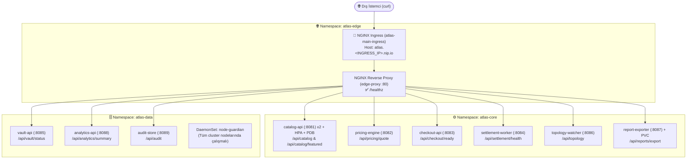

# 🩺 K8s Troubleshoot Lab 32: AtlasFlow v15.0 — Kör Mod Genel Tekrar (Full-Spectrum Mixed Review)

> **[🇹🇷 Türkçe](#-türkçe-bölüm) | [🇬🇧 English](#-english-section)**

---

<a id="-türkçe-bölüm"></a>
## 🇹🇷 Türkçe Bölüm

### 📋 Olay Özeti (Incident Briefing)

| Alan | Detay |
| :--- | :--- |
| **Platform** | **AtlasFlow v15.0** — E-Ticaret, Ödeme, Raporlama & Platform Gözlem Kümesi |
| **Lab Modu** | **%100 Kör Mod Genel Tekrar (Hedef: Maksimum 25 Dakika)** |
| **Kapsam (Karışık)** | Ağ (`Ingress`, `CoreDNS`, `NetPol`, `Socket`) + Uygulama (`Secret`, `Probe`) + Altyapı (`PVC/StorageClass`, `RBAC`, `NodeSelector`, `Taint/Toleration`, `HPA`, `PDB`) |
| **Altyapı (Terraform)** | **Azure Kubernetes Service (AKS)** — 2 Düğümlü (`Standard_B2s_v2`), Calico CNI, NGINX Ingress Controller, `metrics-server`, `managed-csi` |
| **Etkilenen Alanlar** | `atlas-edge`, `atlas-core`, `atlas-data` (3 Namespace, 10 Kör Üretim Bileti) |
| **Canlı Doğrulama** | `./check.sh` *(Varsayılan olarak spoiler vermez; yalnızca tıkandığında `./check.sh --hints` kullan)* |
| **Çözüm Anahtarı** | [`SOLUTION.md`](./SOLUTION.md) — Tüm teşhisten sonra veya 25 dk dolduğunda incele |

> [!IMPORTANT]
> **Kör Mod Kuralları:**
> 1. Bu dokümanda her bilet için **yalnızca Olay Bildirimi (Semptom)** ve **Çözüm Kanıtı** verilmiştir; biletlerin hangi katmanda (`DNS`, `NetPol`, `RBAC`, `PVC`, `Probe`, `HPA` vb.) bozulduğu bilinçli olarak gizlenmiştir.
> 2. İlk refleks olarak hemen aşağıdaki **5 Adımlı Standart Triage Sıranı** çalıştır ve sorunun hangi katmandan geldiğini kendin ayıkla!
> 3. **Sıfır Hile Kuralı:** Arızaları aşmak için **asla** mevcut `NetworkPolicy`, `PodDisruptionBudget`, `HPA` veya node üzerindeki `Taint` yapısını silme — ilgili iş yükünü/kuralı doğru yapılandır.

---

### 🧭 Standart Triage Akışın (Sabah Refleksi)

Hangi bileti araştırıyor olursan ol, önce şu sırayla kümeyi tara:

```bash
# 1. Podlar ayakta mı, Pending / CrashLoopBackOff / CreateContainerConfigError / 0/1 var mı?
kubectl get pods -A -o wide

# 2. Servislerin Endpoints listesi dolu mu, port / targetPort uyuyor mu?
kubectl get svc,ep -A

# 3. Ingress kuralları, host ve pathType tanımları ne durumda?
kubectl get ingress -A

# 4. Aradaki trafiği kesen bir NetworkPolicy var mı?
kubectl get netpol -A

# 5. Podun içinde uygulama gerçekten 0.0.0.0 üzerinde mi dinliyor ve loglar / events ne diyor?
kubectl logs -n <namespace> <pod-adi> --tail=30
kubectl describe <kaynak> -n <namespace> <ad>

# (Gerekli gördüğün katmana göre: PVC/SC, RBAC, DaemonSet, HPA/PDB kontrolleri)
kubectl get pvc,sc -A
kubectl get hpa,pdb,ds -A
```

*(Not: Dışarıdan dönen HTTP kodu da katman elemene yardım eder: herhangi bir NGINX yanıtı (`404`/`502`/`504`) aldıysan Cloud LB sağlamdır; `404` kural/path eşleşmemesi, `502` upstream reddi/DNS hatası, `504` zaman aşımı/NetPol düşürmesidir.)*

---

### 🏗️ Sistem Topolojisi



---

### 🚀 Kurulum & Başlangıç

```bash
chmod +x setup.sh check.sh cleanup.sh
./setup.sh
```

> [!NOTE]
> Önceki bir labdan kalma AKS kümeniz `denmarkeast` bölgesinde açıksa (Azure for Students 6 vCPU kota sınırı) önce o labda `./cleanup.sh` çalıştırın. Mevcut kümeniz zaten hazırsa `./setup.sh --skip-terraform` kullanabilirsiniz.

Değişkenleri yükle ve baseline sağlığını kontrol et (`200 OK`):

```bash
export INGRESS_IP=$(kubectl get svc -n ingress-nginx ingress-nginx-controller -o jsonpath='{.status.loadBalancer.ingress[0].ip}')
export HOST="atlas.${INGRESS_IP}.nip.io"

curl -i --max-time 4 "http://${HOST}/healthz"
./check.sh
```

---

### 🎫 10 Kör Üretim Bileti (Yalnızca Olay & Kanıt)

> **Unutma:** Biletlerde ipucu yoktur. Kendi `kubectl` triage sıranla kök nedeni bulup ister `kubectl edit/patch/apply` ile, ister `helm/atlasflow/values.yaml` dosyasını güncelleyip `helm upgrade atlasflow ./helm/atlasflow --set global.ingressHost="${HOST}"` çalıştırarak düzelt.

---

#### 🎫 Bilet 1: Öne Çıkan Katalog Uç Noktası Açılmıyor
* **Olay Bildirimi:** Ana katalog (`curl -i --max-time 4 "http://${HOST}/api/catalog"`) normal şekilde `200 OK` dönüyor; ancak alt uç nokta başarısız:
  ```bash
  curl -i --max-time 4 "http://${HOST}/api/catalog/featured"
  ```
  *Gözlenen:* `HTTP/1.1 404 Not Found`
* **Çözüm Kanıtı:** `curl -i --max-time 4 "http://${HOST}/api/catalog/featured"` $\rightarrow$ `HTTP/1.1 200 OK` (`"service": "catalog-api"`)

---

#### 🎫 Bilet 2: Fiyat Teklifi Servisi Zaman Aşımına Uğruyor
* **Olay Bildirimi:**
  ```bash
  curl -i --max-time 6 "http://${HOST}/api/pricing/quote"
  ```
  *Gözlenen:* `HTTP/1.1 504 Gateway Time-out` *(Sıfır Hile: Güvenlik politikalarını silme.)*
* **Çözüm Kanıtı:** `curl -i --max-time 6 "http://${HOST}/api/pricing/quote"` $\rightarrow$ `HTTP/1.1 200 OK` (`"service": "pricing-engine"`) ve `core-pricing-netpol` aktif kalır.

---

#### 🎫 Bilet 3: Kasa / Anahtar Doğrulama Servisi Yanıt Vermiyor
* **Olay Bildirimi:**
  ```bash
  curl -i --max-time 4 "http://${HOST}/api/vault/status"
  ```
  *Gözlenen:* `HTTP/1.1 502 Bad Gateway`
* **Çözüm Kanıtı:** `curl -i --max-time 4 "http://${HOST}/api/vault/status"` $\rightarrow$ `HTTP/1.1 200 OK` (`"service": "vault-api"`)

---

#### 🎫 Bilet 4: Ödeme Adımı Hazır Değil
* **Olay Bildirimi:**
  ```bash
  curl -i --max-time 4 "http://${HOST}/api/checkout/ready"
  ```
  *Gözlenen:* `200 OK` dönmüyor (`5xx` hatası).
* **Çözüm Kanıtı:** `curl -i --max-time 4 "http://${HOST}/api/checkout/ready"` $\rightarrow$ `HTTP/1.1 200 OK` (`"service": "checkout-api"`)

---

#### 🎫 Bilet 5: Uzlaştırma İşçisi (Settlement Worker) Ayağa Kalkmıyor
* **Olay Bildirimi:**
  ```bash
  curl -i --max-time 4 "http://${HOST}/api/settlement/health"
  ```
  *Gözlenen:* Uç nokta erişilemiyor (`5xx`) ve arka plandaki iş yükü sağlıklı başlamıyor.
* **Çözüm Kanıtı:** `curl -i --max-time 4 "http://${HOST}/api/settlement/health"` $\rightarrow$ `HTTP/1.1 200 OK` (`"service": "settlement-worker"`)

---

#### 🎫 Bilet 6: Günlük Rapor Dışa Aktarım Servisi Çalışmıyor
* **Olay Bildirimi:**
  ```bash
  curl -i --max-time 4 "http://${HOST}/api/reports/export"
  ```
  *Gözlenen:* Uç nokta yanıt vermiyor (`5xx`) ve `report-exporter` servisi çalışır durumda değil.
* **Çözüm Kanıtı:** `report-archive-pvc` `Bound` durumda ve `curl -i --max-time 4 "http://${HOST}/api/reports/export"` $\rightarrow$ `HTTP/1.1 200 OK` (`"service": "report-exporter"`)

---

#### 🎫 Bilet 7: Topoloji Gözlem Servisi Sürekli Hata Veriyor
* **Olay Bildirimi:**
  ```bash
  curl -i --max-time 4 "http://${HOST}/api/topology"
  ```
  *Gözlenen:* `topology-watcher` ayağa kalkamıyor ve API yanıt vermiyor (`5xx`).
* **Çözüm Kanıtı:** `curl -i --max-time 4 "http://${HOST}/api/topology"` $\rightarrow$ `HTTP/1.1 200 OK` (Namespace içi pod & servis sayılarıyla `"service": "topology-watcher"`)

---

#### 🎫 Bilet 8: Denetim Kaydı Servisi Başlatılamıyor ve Güvenlik Ajanı Eksik Düğümlerde
* **Olay Bildirimi:**
  1. `curl -i --max-time 4 "http://${HOST}/api/audit"` yanıt vermiyor (`5xx`).
  2. Kümedeki düğüm sayısına (`kubectl get nodes`) kıyasla `atlas-data` içindeki güvenlik ajanı tüm düğümlerde aktif değil *(Sıfır Hile: Node üzerindeki taint'i silme)*.
* **Çözüm Kanıtı:** `curl -i --max-time 4 "http://${HOST}/api/audit"` $\rightarrow$ `HTTP/1.1 200 OK` **ve** `node-guardian` kümedeki tüm düğümlerde `READY`.

---

#### 🎫 Bilet 9: Katalog Servisi Ölçekleme ve Bakım Dayanıklılığı Bozuk
* **Olay Bildirimi:** `catalog-api` canlı istekleri karşılıyor; ancak `atlas-core` içindeki kapasite yönetimi ve node bakım (`drain`) koruma kaynakları (`kubectl get hpa,pdb -n atlas-core`) sağlıklı raporlanmıyor *(metrik okunamıyor ve tahliye bütçesi `0`)*.
* **Çözüm Kanıtı:** `catalog-api-hpa` gerçek CPU yüzdesini okuyor (`ScalingActive: True`) ve `catalog-api-pdb` en az `1` kesintiye izin veriyor (`ALLOWED DISRUPTIONS >= 1`).

---

#### 🎫 Bilet 10: Analitik Özet Uç Noktası `502` Dönüyor
* **Olay Bildirimi:**
  ```bash
  curl -i --max-time 4 "http://${HOST}/api/analytics/summary"
  ```
  *Gözlenen:* `HTTP/1.1 502 Bad Gateway`
* **Çözüm Kanıtı:** `curl -i --max-time 4 "http://${HOST}/api/analytics/summary"` $\rightarrow$ `HTTP/1.1 200 OK` (`"service": "analytics-api"`)

---

### ✅ Tam Doğrulama & Temizlik

```bash
# Tüm 10 bileti kör doğrulama ile denetle:
./check.sh

# Lab bitince Azure kaynaklarını temizle:
./cleanup.sh
```

---

<a id="-english-section"></a>
## 🇬🇧 English Section

### 📋 Incident Briefing

| Field | Detail |
| :--- | :--- |
| **Platform** | **AtlasFlow v15.0** — Full-Spectrum Kubernetes General Review Cluster |
| **Mode** | **100% Blind Mode (25-Minute Daily Triage Drill — Zero Hints in README)** |
| **Scope (Mixed)** | Networking (`Ingress`, `CoreDNS`, `NetPol`, `Socket`) + App (`Secret`, `Probe`) + Core Platform (`PVC/StorageClass`, `RBAC`, `NodeSelector`, `Taint/Toleration`, `HPA`, `PDB`) |
| **Infrastructure** | **Azure Kubernetes Service (AKS)** — 2 Nodes (`Standard_B2s_v2`), Calico CNI, NGINX Ingress Controller |
| **Namespaces** | `atlas-edge`, `atlas-core`, `atlas-data` (10 Blind Tickets) |
| **Audit / Key** | `./check.sh` *(zero-spoiler by default; pass `--hints` if stuck)* / [`SOLUTION.md`](./SOLUTION.md) |

### 🧭 5-Step Triage Order

```bash
kubectl get pods -A -o wide
kubectl get svc,ep -A
kubectl get ingress -A
kubectl get netpol -A
kubectl logs -n <ns> <pod> --tail=30
```

### 🚀 Setup

```bash
chmod +x setup.sh check.sh cleanup.sh
./setup.sh

export INGRESS_IP=$(kubectl get svc -n ingress-nginx ingress-nginx-controller -o jsonpath='{.status.loadBalancer.ingress[0].ip}')
export HOST="atlas.${INGRESS_IP}.nip.io"
curl -i --max-time 4 "http://${HOST}/healthz"
./check.sh
```

### 🎫 10 Blind Tickets (Symptoms & Proof Only)

1. **Ticket 1:** `/api/catalog` returns `200`, but `curl -i --max-time 4 "http://${HOST}/api/catalog/featured"` returns `404`. **Proof:** `200 OK` (`catalog-api`).
2. **Ticket 2:** `curl -i --max-time 6 "http://${HOST}/api/pricing/quote"` returns `504` (keep security policies intact). **Proof:** `200 OK` (`pricing-engine`).
3. **Ticket 3:** `curl -i --max-time 4 "http://${HOST}/api/vault/status"` returns `502`. **Proof:** `200 OK` (`vault-api`).
4. **Ticket 4:** `curl -i --max-time 4 "http://${HOST}/api/checkout/ready"` fails (`5xx`). **Proof:** `200 OK` (`checkout-api`).
5. **Ticket 5:** `curl -i --max-time 4 "http://${HOST}/api/settlement/health"` fails (`5xx`) and worker pod does not start. **Proof:** `200 OK` (`settlement-worker`).
6. **Ticket 6:** `curl -i --max-time 4 "http://${HOST}/api/reports/export"` fails (`5xx`) and `report-exporter` is down. **Proof:** PVC `Bound` and `200 OK` (`report-exporter`).
7. **Ticket 7:** `curl -i --max-time 4 "http://${HOST}/api/topology"` fails (`5xx`) and `topology-watcher` keeps failing. **Proof:** `200 OK` (`topology-watcher`).
8. **Ticket 8:** `curl -i --max-time 4 "http://${HOST}/api/audit"` fails (`5xx`) AND security daemon is not active on all cluster nodes (do not remove node taints). **Proof:** `200 OK` (`audit-store`) & `node-guardian` ready on all nodes.
9. **Ticket 9:** `catalog-api` scaling/disruption controls (`kubectl get hpa,pdb -n atlas-core`) fail to read metrics and allow `0` voluntary disruptions. **Proof:** `ScalingActive=True` and `ALLOWED DISRUPTIONS >= 1`.
10. **Ticket 10:** `curl -i --max-time 4 "http://${HOST}/api/analytics/summary"` returns `502`. **Proof:** `200 OK` (`analytics-api`).

```bash
./check.sh
./cleanup.sh
```
