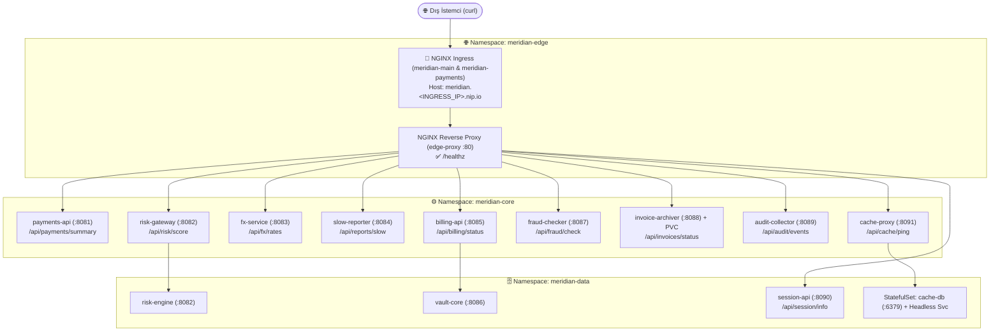

# 🩺 K8s Troubleshoot Lab 33: MeridianPay v16.0 — Kör Mod Genel Tekrar #2 (Full-Spectrum Mixed Review)

> **[🇹🇷 Türkçe](#-türkçe-bölüm) | [🇬🇧 English](#-english-section)**

---

<a id="-türkçe-bölüm"></a>
## 🇹🇷 Türkçe Bölüm

### 📋 Olay Özeti (Incident Briefing)

| Alan | Detay |
| :--- | :--- |
| **Platform** | **MeridianPay v16.0** — Ödeme, Risk, Kur, Fatura Arşivi ve Önbellek Kümesi |
| **Lab Modu** | **%100 Kör Mod Genel Tekrar (Hedef: Maksimum 25 Dakika)** |
| **Kapsam (Karışık)** | Ağ (`Ingress`, `Egress NetPol`, `CoreDNS`, `Named Port`, `Reverse Proxy`) + Uygulama (`Env Precedence`, `OOM / Limits`) + Altyapı (`PVC AccessMode`, `RBAC`, `ResourceQuota`, `StatefulSet Headless DNS`) |
| **Altyapı** | **Azure Kubernetes Service (AKS)** — 2 Düğümlü (`Standard_B2s_v2`), Calico CNI, NGINX Ingress Controller, `managed-csi` |
| **Etkilenen Alanlar** | `meridian-edge`, `meridian-core`, `meridian-data` (3 Namespace, 10 Kör Üretim Bileti) |
| **Canlı Doğrulama** | `./check.sh` *(Varsayılan olarak spoiler vermez; yalnızca tıkandığında `./check.sh --hints` kullan)* |
| **Çözüm Anahtarı** | [`SOLUTION.md`](./SOLUTION.md) — Tüm teşhisten sonra veya 25 dk dolduğunda incele |

> [!IMPORTANT]
> **Kör Mod Kuralları:**
> 1. Bu rehberde her bilet için **yalnızca Olay Bildirimi (Semptom / Canlı Test)** ve **Çözüm Kanıtı** bulunur; arızanın hangi katmanda olduğu gizlenmiştir.
> 2. Önce aşağıdaki **5 Adımlı Standart Triage Sıranı** çalıştır ve sorunun hangi katmanda olduğunu kendin ayır.
> 3. **Sıfır Hile Kuralı:** `NetworkPolicy` veya `ResourceQuota` nesnelerini silmek yasaktır (`./check.sh` aktif kaldıklarını denetler).

---

### 🧭 Standart Triage Akışın (Sabah Refleksi)

```bash
# 1. Podlar ayakta mı, 0/1, OOMKilled, CrashLoopBackOff, Pending veya eksik Pod var mı?
kubectl get pods -A -o wide

# 2. Deployment/StatefulSet/RS hedefleri tutuyor mu, Endpoints dolu mu, portlar doğru mu?
kubectl get deploy,sts,rs,svc,ep -A

# 3. Ingress kuralları, CLASS, HOSTS ve ADDRESS sütunları ne durumda?
kubectl get ingress -A

# 4. Aradaki trafiği kesen bir NetworkPolicy veya ResourceQuota var mı?
kubectl get netpol,resourcequota -A

# 5. Loglar, Events, PVC/StorageClass ve RBAC durumu ne diyor?
kubectl logs -n <namespace> <pod-adi> --tail=30
kubectl describe <kaynak> -n <namespace> <ad>
kubectl get pvc,sc -A
```

---

### 🏗️ Sistem Topolojisi



---

### 🚀 Kurulum & Başlangıç

Önceki lab (`atlasflow`) halen aynı açık AKS kümesinde duruyorsa `kubectl get pods -A` çıktısı temiz görünsün diye önce onu kaldırıp mevcut kümeye `--skip-terraform` ile 10 saniyede kurabilirsin:

```bash
# (İsteğe bağlı - önceki Lab 32 kalıntılarını temizlemek için)
helm uninstall atlasflow 2>/dev/null || true
kubectl delete ns atlas-edge atlas-core atlas-data --ignore-not-found

# Lab 33 kurulumu (mevcut AKS kümesi açıksa --skip-terraform kullan, sıfırdan açacaksan ./setup.sh):
chmod +x setup.sh check.sh cleanup.sh
./setup.sh --skip-terraform
```

Değişkenleri yükle ve baseline sağlığını gör (`200 OK`):

```bash
export INGRESS_IP=$(kubectl get svc -n ingress-nginx ingress-nginx-controller -o jsonpath='{.status.loadBalancer.ingress[0].ip}')
export HOST="meridian.${INGRESS_IP}.nip.io"

curl -i --max-time 4 "http://${HOST}/healthz"
./check.sh
```

> [!TIP]
> `helm/meridianpay/values.yaml` dosyasını düzenleyip uygularken `global.ingressHost` değerini kaybetmemek için:
> `helm upgrade meridianpay ./helm/meridianpay --set global.ingressHost="${HOST}"` komutunu kullan.

---

### 🎫 10 Kör Üretim Bileti (Yalnızca Olay & Kanıt)

#### 🎫 Bilet 1: Ödeme Özeti Uç Noktası Açılmıyor
* **Olay Bildirimi:**
  ```bash
  curl -i --max-time 4 "http://${HOST}/api/payments/summary"
  ```
  *Gözlenen:* `HTTP/1.1 404 Not Found`
* **Çözüm Kanıtı:** `curl -i --max-time 4 "http://${HOST}/api/payments/summary"` $\rightarrow$ `HTTP/1.1 200 OK` (`"service": "payments-api"`)

---

#### 🎫 Bilet 2: Risk Skorlama Servisi Hata Dönüyor
* **Olay Bildirimi:**
  ```bash
  curl -i --max-time 8 "http://${HOST}/api/risk/score"
  ```
  *Gözlenen:* `HTTP/1.1 502 Bad Gateway` *(Sıfır Hile: Güvenlik politikalarını silme.)*
* **Çözüm Kanıtı:** `curl -i --max-time 8 "http://${HOST}/api/risk/score"` $\rightarrow$ `HTTP/1.1 200 OK` (`"service": "risk-gateway"`) ve `risk-gateway-netpol` aktif kalır.

---

#### 🎫 Bilet 3: Döviz Kuru Uç Noktası Yanıt Vermiyor
* **Olay Bildirimi:**
  ```bash
  curl -i --max-time 4 "http://${HOST}/api/fx/rates"
  ```
  *Gözlenen:* `200 OK` dönmüyor (`5xx` hatası).
* **Çözüm Kanıtı:** `curl -i --max-time 4 "http://${HOST}/api/fx/rates"` $\rightarrow$ `HTTP/1.1 200 OK` (`"service": "fx-service"`)

---

#### 🎫 Bilet 4: Ağır Rapor Çıktısı Yarıda Kesiliyor
* **Olay Bildirimi:**
  ```bash
  time curl -i --max-time 7 "http://${HOST}/api/reports/slow"
  ```
  *Gözlenen:* `HTTP/1.1 504 Gateway Time-out`
* **Çözüm Kanıtı:** `curl -i --max-time 7 "http://${HOST}/api/reports/slow"` $\rightarrow$ `HTTP/1.1 200 OK` (`"service": "slow-reporter"`)

---

#### 🎫 Bilet 5: Faturalama Servisi Kasaya Ulaşamıyor
* **Olay Bildirimi:**
  ```bash
  curl -i --max-time 5 "http://${HOST}/api/billing/status"
  ```
  *Gözlenen:* `HTTP/1.1 502 Bad Gateway`
* **Çözüm Kanıtı:** `curl -i --max-time 5 "http://${HOST}/api/billing/status"` $\rightarrow$ `HTTP/1.1 200 OK` (`"service": "billing-api"`)

---

#### 🎫 Bilet 6: Sahtecilik (Fraud) Kontrol Servisi Ayakta Kalamıyor
* **Olay Bildirimi:**
  ```bash
  curl -i --max-time 4 "http://${HOST}/api/fraud/check"
  ```
  *Gözlenen:* Uç nokta yanıt vermiyor (`5xx`) ve arka uçtaki servis kararlı kalmıyor.
* **Çözüm Kanıtı:** `curl -i --max-time 4 "http://${HOST}/api/fraud/check"` $\rightarrow$ `HTTP/1.1 200 OK` (`"service": "fraud-checker"`)

---

#### 🎫 Bilet 7: Fatura Arşiv Servisi Başlatılamıyor
* **Olay Bildirimi:**
  ```bash
  curl -i --max-time 4 "http://${HOST}/api/invoices/status"
  ```
  *Gözlenen:* Uç nokta erişilemiyor (`5xx`) ve `invoice-archiver` servisi hazır değil.
* **Çözüm Kanıtı:** `invoice-archive-pvc` `Bound` durumda ve `curl -i --max-time 4 "http://${HOST}/api/invoices/status"` $\rightarrow$ `HTTP/1.1 200 OK` (`"service": "invoice-archiver"`)

---

#### 🎫 Bilet 8: Denetim Olay Toplayıcısı Çalışmıyor
* **Olay Bildirimi:**
  ```bash
  curl -i --max-time 4 "http://${HOST}/api/audit/events"
  ```
  *Gözlenen:* `audit-collector` ayağa kalkamıyor ve API yanıt vermiyor (`5xx`).
* **Çözüm Kanıtı:** `curl -i --max-time 4 "http://${HOST}/api/audit/events"` $\rightarrow$ `HTTP/1.1 200 OK` (`"service": "audit-collector"`)

---

#### 🎫 Bilet 9: Oturum Servisi Kümede Hiç Oluşmuyor
* **Olay Bildirimi:**
  ```bash
  curl -i --max-time 4 "http://${HOST}/api/session/info"
  ```
  *Gözlenen:* Uç nokta yanıt vermiyor (`5xx`) ve ilgili iş yükünün podu oluşmuyor *(Sıfır Hile: Kota nesnesini silme)*.
* **Çözüm Kanıtı:** `curl -i --max-time 4 "http://${HOST}/api/session/info"` $\rightarrow$ `HTTP/1.1 200 OK` (`"service": "session-api"`) ve `data-resource-quota` aktif kalır.

---

#### 🎫 Bilet 10: Dağıtık Önbellek Doğrulaması `502` Veriyor
* **Olay Bildirimi:**
  ```bash
  curl -i --max-time 4 "http://${HOST}/api/cache/ping"
  ```
  *Gözlenen:* `HTTP/1.1 502 Bad Gateway`
* **Çözüm Kanıtı:** `curl -i --max-time 4 "http://${HOST}/api/cache/ping"` $\rightarrow$ `HTTP/1.1 200 OK` (`"service": "cache-proxy"`)

---

### ✅ Tam Doğrulama & Temizlik

```bash
./check.sh

# Küme açık kalsın, sadece bu labı sil:
./cleanup.sh --skip-terraform
```

---

<a id="-english-section"></a>
## 🇬🇧 English Section

### 📋 Incident Briefing

| Field | Detail |
| :--- | :--- |
| **Platform** | **MeridianPay v16.0** — Full-Spectrum Kubernetes General Review Lab #2 |
| **Mode** | **100% Blind Mode (25-Minute Daily Triage Drill — Zero Hints)** |
| **Scope (Mixed)** | Networking (`ingressClassName`, Egress `:53`, Named `targetPort`, Reverse Proxy timeout) + App (`env` precedence, `OOMKilled 137`) + Platform (`PVC AccessMode`, `RBAC`, `ResourceQuota`, `StatefulSet Headless DNS`) |
| **Audit / Key** | `./check.sh` *(zero-spoiler by default; `--hints` optional)* / [`SOLUTION.md`](./SOLUTION.md) |

### 🎫 10 Blind Tickets (Symptoms & Proof Only)

1. **Ticket 1:** `curl -i "http://${HOST}/api/payments/summary"` $\rightarrow$ `404`. **Proof:** `200 OK` (`payments-api`).
2. **Ticket 2:** `curl -i "http://${HOST}/api/risk/score"` $\rightarrow$ `502` (keep `risk-gateway-netpol` active). **Proof:** `200 OK` (`risk-gateway`).
3. **Ticket 3:** `curl -i "http://${HOST}/api/fx/rates"` fails (`5xx`). **Proof:** `200 OK` (`fx-service`).
4. **Ticket 4:** `time curl -i "http://${HOST}/api/reports/slow"` $\rightarrow$ `504`. **Proof:** `200 OK` (`slow-reporter`).
5. **Ticket 5:** `curl -i "http://${HOST}/api/billing/status"` $\rightarrow$ `502`. **Proof:** `200 OK` (`billing-api`).
6. **Ticket 6:** `curl -i "http://${HOST}/api/fraud/check"` fails (`5xx`) and backend pod fails to stay healthy. **Proof:** `200 OK` (`fraud-checker`).
7. **Ticket 7:** `curl -i "http://${HOST}/api/invoices/status"` fails (`5xx`). **Proof:** PVC `Bound` + `200 OK` (`invoice-archiver`).
8. **Ticket 8:** `curl -i "http://${HOST}/api/audit/events"` fails (`5xx`). **Proof:** `200 OK` (`audit-collector`).
9. **Ticket 9:** `curl -i "http://${HOST}/api/session/info"` fails (`5xx`) and workload pod never spawns (keep `data-resource-quota` active). **Proof:** `200 OK` (`session-api`).
10. **Ticket 10:** `curl -i "http://${HOST}/api/cache/ping"` $\rightarrow$ `502`. **Proof:** `200 OK` (`cache-proxy`).
