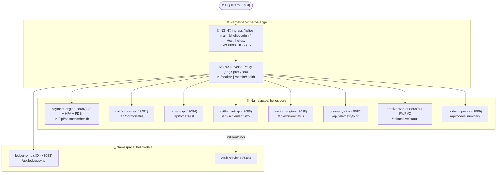

# 🩺 K8s Troubleshoot Lab 34: HeliosCore v17.0 — Kör Mod Genel Tekrar #3 (Full-Spectrum Mixed Review)

> **[🇹🇷 Türkçe](#-türkçe-bölüm) | [🇬🇧 English](#-english-section)**

---

<a id="-türkçe-bölüm"></a>
## 🇹🇷 Türkçe Bölüm

### 📋 Olay Özeti (Incident Briefing)

| Alan | Detay |
| :--- | :--- |
| **Platform** | **HeliosCore v17.0** — Ödeme, Bildirim, Defter Eşitleme, Arşiv ve Küme Telemetri Platformu |
| **Lab Modu** | **%100 Kör Mod Genel Tekrar (Hedef: Maksimum 25 Dakika)** |
| **Kapsam (Karışık)** | Ağ (`Ingress` annotasyon, `Service` protokolü & seçicisi, `Post-DNAT NetPol`) + Yaşam Döngüsü/Güvenlik (`InitContainer`, `LivenessProbe`, `readOnlyRootFilesystem`) + Altyapı (`PV/PVC` eşleşmesi, `ClusterRole` RBAC, `HPA`/`PDB`) |
| **Altyapı** | **Azure Kubernetes Service (AKS)** — 2 Düğümlü (`Standard_B2s_v2`), Calico CNI, NGINX Ingress Controller, `metrics-server` |
| **Etkilenen Alanlar** | `helios-edge`, `helios-core`, `helios-data` (3 Namespace, 10 Kör Üretim Bileti) |
| **Canlı Doğrulama** | `./check.sh` *(Varsayılan olarak spoiler vermez; yalnızca tıkandığında `./check.sh --hints` kullan)* |
| **Çözüm Anahtarı** | [`SOLUTION.md`](./SOLUTION.md) — Tüm teşhisten sonra veya 25 dk dolduğunda incele |

> [!IMPORTANT]
> **Kör Mod Kuralları:**
> 1. Bu dokümanda her bilet için **yalnızca Olay Bildirimi (Semptom / Canlı Test)** ve **Çözüm Kanıtı** yer alır; sorunun hangi Kubernetes katmanında olduğu gizlenmiştir.
> 2. Önce aşağıdaki **5 Adımlı Standart Triage Sıranı** çalıştırıp arızayı kendin izole et.
> 3. **Sıfır Hile Kuralı:** `NetworkPolicy` nesnesini silmek veya container'ın `readOnlyRootFilesystem: true` güvenlik ayarını kapatmak yasaktır (`./check.sh` kontrol eder).

---

### 🧭 Standart Triage Akışın (Sabah Refleksi)

```bash
# 1. Podlar ayakta mı, Init:0/1, CrashLoopBackOff, Pending veya Restart var mı?
kubectl get pods -A -o wide

# 2. Servislerin Endpoints listesi dolu mu, protokol/port/seçici doğru mu?
kubectl get svc,ep -A

# 3. Ingress kuralları ve annotasyonları ne durumda?
kubectl get ingress -A

# 4. Aradaki trafiği kesen bir NetworkPolicy var mı?
kubectl get netpol -A

# 5. Pod/InitContainer logları, Events, PV/PVC ve HPA/PDB ne diyor?
kubectl logs -n <namespace> <pod-adi> --tail=30
kubectl describe <kaynak> -n <namespace> <ad>
kubectl get pv,pvc,hpa,pdb -A
```

---

### 🏗️ Sistem Topolojisi



---

### 🚀 Kurulum & Başlangıç

Önceki lab (`meridianpay`) halen aynı açık AKS kümesinde duruyorsa `kubectl get pods -A` çıktısı temiz görünsün diye onu kaldırıp mevcut kümeye `--skip-terraform` ile kurabilirsin:

```bash
# (İsteğe bağlı - önceki Lab 33 kalıntılarını temizlemek için)
helm uninstall meridianpay 2>/dev/null || true
kubectl delete ns meridian-edge meridian-core meridian-data --ignore-not-found

# Lab 34 kurulumu (mevcut AKS kümesi açıksa --skip-terraform kullan, sıfırdan açacaksan ./setup.sh):
chmod +x setup.sh check.sh cleanup.sh
./setup.sh --skip-terraform
```

Değişkenleri yükle ve baseline sağlığını gör (`200 OK`):

```bash
export INGRESS_IP=$(kubectl get svc -n ingress-nginx ingress-nginx-controller -o jsonpath='{.status.loadBalancer.ingress[0].ip}')
export HOST="helios.${INGRESS_IP}.nip.io"

curl -i --max-time 4 "http://${HOST}/healthz"
./check.sh
```

> [!TIP]
> `helm/helioscore/values.yaml` dosyasını düzenleyip uygularken `global.ingressHost` değerini korumak için:
> `helm upgrade helioscore ./helm/helioscore --set global.ingressHost="${HOST}"` komutunu kullan.

---

### 🎫 10 Kör Üretim Bileti (Yalnızca Olay & Kanıt)

#### 🎫 Bilet 1: Yönetici Konsolu `502` Hatası Veriyor
* **Olay Bildirimi:** Ana ağ geçidi (`http://${HOST}/healthz`) `200 OK` dönerken yönetici yolu başarısız:
  ```bash
  curl -i --max-time 4 "http://${HOST}/admin/health"
  ```
  *Gözlenen:* `HTTP/1.1 502 Bad Gateway`
* **Çözüm Kanıtı:** `curl -i --max-time 4 "http://${HOST}/admin/health"` $\rightarrow$ `HTTP/1.1 200 OK` (`"service": "admin-console"`)

---

#### 🎫 Bilet 2: Bildirim Servisi Erişilemiyor
* **Olay Bildirimi:**
  ```bash
  curl -i --max-time 4 "http://${HOST}/api/notify/status"
  ```
  *Gözlenen:* `200 OK` dönmüyor (`5xx` hatası).
* **Çözüm Kanıtı:** `curl -i --max-time 4 "http://${HOST}/api/notify/status"` $\rightarrow$ `HTTP/1.1 200 OK` (`"service": "notification-api"`)

---

#### 🎫 Bilet 3: Defter Eşitleme Servisi Zaman Aşımına Uğruyor
* **Olay Bildirimi:**
  ```bash
  curl -i --max-time 5 "http://${HOST}/api/ledger/sync"
  ```
  *Gözlenen:* `HTTP/1.1 504 Gateway Time-out` *(Sıfır Hile: Güvenlik politikasını silme.)*
* **Çözüm Kanıtı:** `curl -i --max-time 5 "http://${HOST}/api/ledger/sync"` $\rightarrow$ `HTTP/1.1 200 OK` (`"service": "ledger-sync"`) ve `ledger-sync-netpol` aktif kalır.

---

#### 🎫 Bilet 4: Sipariş Listesi Uç Noktası Yanıt Vermiyor
* **Olay Bildirimi:**
  ```bash
  curl -i --max-time 4 "http://${HOST}/api/orders/list"
  ```
  *Gözlenen:* `200 OK` dönmüyor (`5xx` hatası).
* **Çözüm Kanıtı:** `curl -i --max-time 4 "http://${HOST}/api/orders/list"` $\rightarrow$ `HTTP/1.1 200 OK` (`"service": "orders-api"`)

---

#### 🎫 Bilet 5: Uzlaştırma Servisi Başlangıçta Takılı Kalıyor
* **Olay Bildirimi:**
  ```bash
  curl -i --max-time 4 "http://${HOST}/api/settlement/info"
  ```
  *Gözlenen:* Uç nokta yanıt vermiyor (`5xx`) ve `settlement-api` başlangıç aşamasını geçemiyor.
* **Çözüm Kanıtı:** `curl -i --max-time 4 "http://${HOST}/api/settlement/info"` $\rightarrow$ `HTTP/1.1 200 OK` (`"service": "settlement-api"`)

---

#### 🎫 Bilet 6: İşçi Motoru Sürekli Yeniden Başlıyor
* **Olay Bildirimi:**
  ```bash
  curl -i --max-time 4 "http://${HOST}/api/worker/status"
  ```
  *Gözlenen:* `worker-engine` ayakta kalamıyor ve uç nokta yanıt vermiyor (`5xx`).
* **Çözüm Kanıtı:** `worker-engine` yeniden başlamadan kararlı şekilde `1/1 Running` kalır ve `curl -i --max-time 4 "http://${HOST}/api/worker/status"` $\rightarrow$ `HTTP/1.1 200 OK` (`"service": "worker-engine"`).

---

#### 🎫 Bilet 7: Telemetri Alıcısı Başlatılırken Çöküyor
* **Olay Bildirimi:**
  ```bash
  curl -i --max-time 4 "http://${HOST}/api/telemetry/ping"
  ```
  *Gözlenen:* `telemetry-sink` başlatılamıyor ve `5xx` dönüyor *(Sıfır Hile: `readOnlyRootFilesystem: true` güvenlik ayarını kaldırma)*.
* **Çözüm Kanıtı:** `readOnlyRootFilesystem: true` aktifken `curl -i --max-time 4 "http://${HOST}/api/telemetry/ping"` $\rightarrow$ `HTTP/1.1 200 OK` (`"service": "telemetry-sink"`).

---

#### 🎫 Bilet 8: Arşiv İşçisi Bir Türlü Yerleşemiyor
* **Olay Bildirimi:**
  ```bash
  curl -i --max-time 4 "http://${HOST}/api/archive/status"
  ```
  *Gözlenen:* `archive-worker` bekliyor (`5xx`) ve uç nokta açılmıyor.
* **Çözüm Kanıtı:** `archive-pvc` `Bound` durumda ve `curl -i --max-time 4 "http://${HOST}/api/archive/status"` $\rightarrow$ `HTTP/1.1 200 OK` (`"service": "archive-worker"`).

---

#### 🎫 Bilet 9: Küme Düğüm İzleyicisi Hata Verip Çöküyor
* **Olay Bildirimi:**
  ```bash
  curl -i --max-time 4 "http://${HOST}/api/nodes/summary"
  ```
  *Gözlenen:* `node-inspector` başlatılamıyor ve `5xx` dönüyor.
* **Çözüm Kanıtı:** `curl -i --max-time 4 "http://${HOST}/api/nodes/summary"` $\rightarrow$ `HTTP/1.1 200 OK` (`"service": "node-inspector"`).

---

#### 🎫 Bilet 10: Ödeme Motorunun Ölçekleme ve Tahliye Koruması Pasif
* **Olay Bildirimi:** `http://${HOST}/api/payments/health` `200 OK` dönüyor; ancak `helios-core` içindeki `payment-engine` için tanımlanan otomatik ölçekleme ve kesinti bütçesi (`kubectl get hpa,pdb -n helios-core`) hiçbir hedef/pod eşleştiremiyor (`TARGETS: <unknown>`, `ALLOWED DISRUPTIONS: 0`).
* **Çözüm Kanıtı:** `payment-engine-hpa` `ScalingActive=True` ve `payment-engine-pdb` en az `2` podu kapsayıp `ALLOWED DISRUPTIONS >= 1` gösterir.

---

### ✅ Tam Doğrulama & Temizlik

```bash
./check.sh

# Küme açık kalsın, sadece bu labı sil:
./cleanup.sh --skip-terraform
```

---

<a id="-english-section"></a>
## 🇬🇧 English Section

### 📋 Incident Briefing

| Field | Detail |
| :--- | :--- |
| **Platform** | **HeliosCore v17.0** — Blind-Mode Full-Spectrum Kubernetes General Review Lab #3 |
| **Mode** | **100% Blind Mode (25-Minute Daily Triage Drill — Zero Hints)** |
| **Scope (Mixed)** | Networking (`backend-protocol`, `UDP/TCP`, `Post-DNAT`, `Selector`) + Lifecycle/Security (`InitContainer`, `LivenessProbe`, `readOnlyRootFilesystem`) + Platform (`PV/PVC Capacity`, `ClusterRole` RBAC, `HPA/PDB`) |
| **Audit / Key** | `./check.sh` *(zero-spoiler by default; `--hints` optional)* / [`SOLUTION.md`](./SOLUTION.md) |

### 🎫 10 Blind Tickets (Symptoms & Proof Only)

1. **Ticket 1:** `curl -i "http://${HOST}/admin/health"` $\rightarrow$ `502` (while `/healthz` is `200`). **Proof:** `200 OK` (`admin-console`).
2. **Ticket 2:** `curl -i "http://${HOST}/api/notify/status"` fails (`5xx`). **Proof:** `200 OK` (`notification-api`).
3. **Ticket 3:** `curl -i "http://${HOST}/api/ledger/sync"` $\rightarrow$ `504` (keep `ledger-sync-netpol` active). **Proof:** `200 OK` (`ledger-sync`).
4. **Ticket 4:** `curl -i "http://${HOST}/api/orders/list"` fails (`5xx`). **Proof:** `200 OK` (`orders-api`).
5. **Ticket 5:** `curl -i "http://${HOST}/api/settlement/info"` fails (`5xx`) and `settlement-api` fails startup. **Proof:** `200 OK` (`settlement-api`).
6. **Ticket 6:** `curl -i "http://${HOST}/api/worker/status"` fails (`5xx`) and `worker-engine` keeps restarting. **Proof:** `200 OK` (`worker-engine`).
7. **Ticket 7:** `curl -i "http://${HOST}/api/telemetry/ping"` fails (`5xx`) (keep `readOnlyRootFilesystem: true`). **Proof:** `200 OK` (`telemetry-sink`).
8. **Ticket 8:** `curl -i "http://${HOST}/api/archive/status"` fails (`5xx`). **Proof:** `archive-pvc` `Bound` + `200 OK` (`archive-worker`).
9. **Ticket 9:** `curl -i "http://${HOST}/api/nodes/summary"` fails (`5xx`). **Proof:** `200 OK` (`node-inspector`).
10. **Ticket 10:** `kubectl get hpa,pdb -n helios-core` reports `<unknown>` target and `0` disruptions/expected pods for `payment-engine`. **Proof:** `ScalingActive=True` and `PDB expectedPods >= 2, disruptionsAllowed >= 1`.
