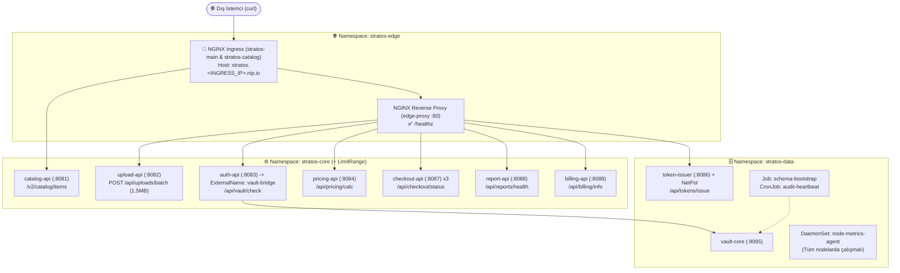

# 🩺 K8s Troubleshoot Lab 35: StratosGrid v18.0 — Kör Mod Genel Tekrar #4 (Sabah Isınma Labı)

> **[🇹🇷 Türkçe](#-türkçe-bölüm) | [🇬🇧 English](#-english-section)**

---

<a id="-türkçe-bölüm"></a>
## 🇹🇷 Türkçe Bölüm

### 📋 Olay Özeti (Incident Briefing)

| Alan | Detay |
| :--- | :--- |
| **Platform** | **StratosGrid v18.0** — Katalog, Toplu Yükleme, Kimlik Doğrulama, Fiyatlama, Ödeme, Raporlama & Faturalama Kümesi |
| **Lab Modu** | **%100 Kör Mod Genel Tekrar — Sabah Isınma (Hedef: Maksimum 25 Dakika)** |
| **Kapsam (Karışık)** | Ağ (`Ingress` regex/rewrite, `proxy-body-size`, `ExternalName`, Cross-NS `NetPol`) + Uygulama/Güvenlik (`ConfigMap`, `runAsNonRoot`) + Altyapı (`podAntiAffinity`, `Job`/`CronJob`, `Taint`/`Toleration`, `LimitRange`) |
| **Altyapı** | **Azure Kubernetes Service (AKS)** — 2 Düğümlü (`Standard_B2s_v2`), Calico CNI, NGINX Ingress Controller |
| **Etkilenen Alanlar** | `stratos-edge`, `stratos-core`, `stratos-data` (3 Namespace, 10 Kör Üretim Bileti) |
| **Canlı Doğrulama** | `./check.sh` *(Varsayılan olarak spoiler vermez; yalnızca tıkandığında `./check.sh --hints` kullan)* |
| **Çözüm Anahtarı** | [`SOLUTION.md`](./SOLUTION.md) — Tüm teşhisten sonra veya 25 dk dolduğunda incele |

> [!IMPORTANT]
> **Kör Mod Kuralları:**
> 1. Bu dokümanda her bilet için **yalnızca Olay Bildirimi (Semptom / Canlı Test)** ve **Çözüm Kanıtı** yer alır; sorunun hangi Kubernetes katmanında olduğu gizlenmiştir.
> 2. Önce aşağıdaki **5 Adımlı Standart Triage Sıranı** çalıştırıp arızayı kendin izole et.
> 3. **Sıfır Hile Kuralı:** `NetworkPolicy`, `LimitRange`, node üzerindeki `Taint` veya container'ın `runAsNonRoot: true` güvenlik ayarını silmek/kapatmak yasaktır (`./check.sh` denetler).

---

### 🧭 Standart Triage Akışın (Sabah Refleksi)

```bash
# 1. Podlar ayakta mı, Pending / CreateContainerConfigError / Error / eksik replica var mı?
kubectl get pods -A -o wide

# 2. Deployment, DaemonSet, Job, CronJob, ReplicaSet ve Service/Endpoints ne durumda?
kubectl get deploy,rs,ds,job,cronjob,svc,ep -A

# 3. Ingress kuralları, host ve annotasyonlar ne durumda?
kubectl get ingress -A

# 4. Aradaki trafiği veya pod üretimini etkileyen NetworkPolicy / LimitRange / Node Taint var mı?
kubectl get netpol,limitrange -A
kubectl describe nodes | grep -E 'Name:|Taints:'

# 5. Pod/Job logları ve Events ne diyor?
kubectl logs -n <namespace> <pod-adi> --tail=30
kubectl describe <kaynak> -n <namespace> <ad>
```

---

### 🏗️ Sistem Topolojisi



---

### 🚀 Kurulum & Başlangıç

Önceki lab (`helioscore`) halen aynı açık AKS kümesinde duruyorsa onu kaldırıp mevcut kümeye `--skip-terraform` ile 10 saniyede kurabilirsin:

```bash
# (İsteğe bağlı - önceki Lab 34 kalıntılarını temizlemek için)
helm uninstall helioscore 2>/dev/null || true
kubectl delete ns helios-edge helios-core helios-data --ignore-not-found

# Lab 35 kurulumu (mevcut AKS açıksa --skip-terraform kullan; sıfırdan açacaksan ./setup.sh):
chmod +x setup.sh check.sh cleanup.sh broken-manifests/setup-broken.sh
./setup.sh --skip-terraform
```

Değişkenleri yükle ve baseline sağlığını gör (`200 OK`):

```bash
export INGRESS_IP=$(kubectl get svc -n ingress-nginx ingress-nginx-controller -o jsonpath='{.status.loadBalancer.ingress[0].ip}')
export HOST="stratos.${INGRESS_IP}.nip.io"

curl -i --max-time 4 "http://${HOST}/healthz"
./check.sh
```

> [!TIP]
> `helm/stratosgrid/values.yaml` dosyasını düzenleyip uygularken `global.ingressHost` değerini korumak için:
> `helm upgrade stratosgrid ./helm/stratosgrid --set global.ingressHost="${HOST}"` komutunu kullan.  
> Labı dilediğin zaman sıfırdan bozuk haline döndürmek için `./broken-manifests/setup-broken.sh --skip-terraform` çalıştırabilirsin.

---

### 🎫 10 Kör Üretim Bileti (Yalnızca Olay & Kanıt)

#### 🎫 Bilet 1: Katalog Listesi `404` Dönüyor
* **Olay Bildirimi:**
  ```bash
  curl -i --max-time 4 "http://${HOST}/v2/catalog/items"
  ```
  *Gözlenen:* `HTTP/1.1 404 Not Found`
* **Çözüm Kanıtı:** `curl -i --max-time 4 "http://${HOST}/v2/catalog/items"` $\rightarrow$ `HTTP/1.1 200 OK` (`"service": "catalog-api"`)

---

#### 🎫 Bilet 2: Toplu Dosya Yüklemesi Büyük İsteklerde Reddediliyor
* **Olay Bildirimi:** Küçük bir POST isteği (`curl -X POST -d 'ok' "http://${HOST}/api/uploads/batch"`) `200 OK` dönerken `1.5 MB` boyutundaki yükleme reddediliyor (`413`).
* **Çözüm Kanıtı:** `1.5 MB` POST isteği $\rightarrow$ `HTTP/1.1 200 OK` (`"service": "upload-api"`)

---

#### 🎫 Bilet 3: Kimlik Doğrulama Servisi Kasaya Ulaşamıyor
* **Olay Bildirimi:**
  ```bash
  curl -i --max-time 4 "http://${HOST}/api/vault/check"
  ```
  *Gözlenen:* `HTTP/1.1 502 Bad Gateway`
* **Çözüm Kanıtı:** `curl -i --max-time 4 "http://${HOST}/api/vault/check"` $\rightarrow$ `HTTP/1.1 200 OK` (`"status": "verified"`)

---

#### 🎫 Bilet 4: Token Üretici Zaman Aşımına Uğruyor
* **Olay Bildirimi:**
  ```bash
  curl -i --max-time 5 "http://${HOST}/api/tokens/issue"
  ```
  *Gözlenen:* `HTTP/1.1 504 Gateway Time-out` *(Sıfır Hile: Güvenlik politikasını silme.)*
* **Çözüm Kanıtı:** `curl -i --max-time 5 "http://${HOST}/api/tokens/issue"` $\rightarrow$ `HTTP/1.1 200 OK` (`"service": "token-issuer"`) ve `token-issuer-netpol` aktif kalır.

---

#### 🎫 Bilet 5: Fiyatlama Servisi Başlatılamıyor
* **Olay Bildirimi:**
  ```bash
  curl -i --max-time 4 "http://${HOST}/api/pricing/calc"
  ```
  *Gözlenen:* Uç nokta yanıt vermiyor (`5xx`) ve `pricing-api` podu başlamıyor.
* **Çözüm Kanıtı:** `curl -i --max-time 4 "http://${HOST}/api/pricing/calc"` $\rightarrow$ `HTTP/1.1 200 OK` (`"service": "pricing-api"`, `"meta": "EUR"`)

---

#### 🎫 Bilet 6: Ödeme (Checkout) Servisi Tam Kapasiteye Ulaşamıyor
* **Olay Bildirimi:** `http://${HOST}/api/checkout/status` yanıt veriyor; ancak `stratos-core` içindeki `checkout-api` dağıtımı istenen replika sayısına ulaşamıyor ve takılı kalan (`Pending`) pod bulunuyor.
* **Çözüm Kanıtı:** `checkout-api` için `0 Pending` pod, `READY == DESIRED (>= 2)` ve `/api/checkout/status` `HTTP/1.1 200 OK`.

---

#### 🎫 Bilet 7: Raporlama Servisi Başlatılırken Reddediliyor
* **Olay Bildirimi:**
  ```bash
  curl -i --max-time 4 "http://${HOST}/api/reports/health"
  ```
  *Gözlenen:* `report-api` başlatılamıyor ve `5xx` dönüyor *(Sıfır Hile: `runAsNonRoot: true` güvenlik kuralını kapatma)*.
* **Çözüm Kanıtı:** `runAsNonRoot: true` aktifken `curl -i --max-time 4 "http://${HOST}/api/reports/health"` $\rightarrow$ `HTTP/1.1 200 OK` (`"service": "report-api"`).

---

#### 🎫 Bilet 8: Veri Katmanı Başlangıç İşi ve Periyodik Denetim Çalışmıyor
* **Olay Bildirimi:** `stratos-data` içindeki `schema-bootstrap` `Job` nesnesi tamamlanmıyor (`Failed`/`0/1`) ve `audit-heartbeat` `CronJob` nesnesi pasif (`SUSPEND: True`) durumda.
* **Çözüm Kanıtı:** `Job/schema-bootstrap` `1/1 Completed` **ve** `CronJob/audit-heartbeat` `SUSPEND: False`.

---

#### 🎫 Bilet 9: Düğüm Metrik Ajanı Tüm Küme Düğümlerinde Çalışmıyor
* **Olay Bildirimi:** Kümedeki tüm düğümlerle kıyaslandığında `stratos-data` altındaki `node-metrics-agent` DaemonSet'i düğümlerden birinde hiç planlanmıyor *(Sıfır Hile: Node üzerindeki taint'i silme)*.
* **Çözüm Kanıtı:** Node taint'i korunurken `node-metrics-agent` tüm düğümlerde `READY`.

---

#### 🎫 Bilet 10: Faturalama Servisinin Podu Kümede Hiç Oluşmuyor
* **Olay Bildirimi:**
  ```bash
  curl -i --max-time 4 "http://${HOST}/api/billing/info"
  ```
  *Gözlenen:* Uç nokta yanıt vermiyor (`5xx`) ve `billing-api` Deployment'ı altında hiç pod oluşmuyor *(Sıfır Hile: `LimitRange` nesnesini silme)*.
* **Çözüm Kanıtı:** `core-limit-range` aktifken `curl -i --max-time 4 "http://${HOST}/api/billing/info"` $\rightarrow$ `HTTP/1.1 200 OK` (`"service": "billing-api"`).

---

### ✅ Tam Doğrulama & Temizlik

```bash
./check.sh

# Küme açık kalsın, sadece bu labı sil:
./cleanup.sh --skip-terraform
```

---

<a id="-english-section"></a>
## 🇬🇧 English Section

### 📋 Incident Briefing

| Field | Detail |
| :--- | :--- |
| **Platform** | **StratosGrid v18.0** — Blind-Mode Full-Spectrum Kubernetes General Review #4 (Morning Warm-Up) |
| **Mode** | **100% Blind Mode (25-Minute Daily Triage Drill — Zero Hints)** |
| **Scope (Mixed)** | Networking (`Ingress` regex/rewrite, `proxy-body-size`, `ExternalName`, Cross-NS `NetPol`) + App/Security (`ConfigMap`, `runAsNonRoot`) + Platform (`podAntiAffinity`, `Job`/`CronJob`, `Taint`/`Toleration`, `LimitRange`) |
| **Audit / Key** | `./check.sh` *(zero-spoiler by default; `--hints` optional)* / [`SOLUTION.md`](./SOLUTION.md) |

### 🎫 10 Blind Tickets (Symptoms & Proof Only)

1. **Ticket 1:** `curl -i "http://${HOST}/v2/catalog/items"` $\rightarrow$ `404`. **Proof:** `200 OK` (`catalog-api`).
2. **Ticket 2:** Small POST succeeds, but 1.5MB `POST http://${HOST}/api/uploads/batch` $\rightarrow$ `413`. **Proof:** `200 OK` (`upload-api`).
3. **Ticket 3:** `curl -i "http://${HOST}/api/vault/check"` $\rightarrow$ `502`. **Proof:** `200 OK` (`verified`).
4. **Ticket 4:** `curl -i "http://${HOST}/api/tokens/issue"` $\rightarrow$ `504` (keep `token-issuer-netpol` active). **Proof:** `200 OK` (`token-issuer`).
5. **Ticket 5:** `curl -i "http://${HOST}/api/pricing/calc"` fails (`5xx`) and `pricing-api` fails startup. **Proof:** `200 OK` (`pricing-api`, `EUR`).
6. **Ticket 6:** `checkout-api` has a stuck `Pending` replica on the 2-node cluster. **Proof:** `0 Pending`, `READY == DESIRED (>= 2)`, `200 OK`.
7. **Ticket 7:** `curl -i "http://${HOST}/api/reports/health"` fails (`5xx`) (keep `runAsNonRoot: true`). **Proof:** `200 OK` (`report-api`).
8. **Ticket 8:** `Job/schema-bootstrap` fails and `CronJob/audit-heartbeat` is suspended in `stratos-data`. **Proof:** Job `1/1 Completed` & CronJob `SUSPEND: False`.
9. **Ticket 9:** `DaemonSet/node-metrics-agent` does not run on every cluster node (do not remove node taints). **Proof:** `READY == total nodes` with taint preserved.
10. **Ticket 10:** `curl -i "http://${HOST}/api/billing/info"` fails (`5xx`) and `billing-api` spawns `0` pods (keep `core-limit-range` active). **Proof:** `200 OK` (`billing-api`).
