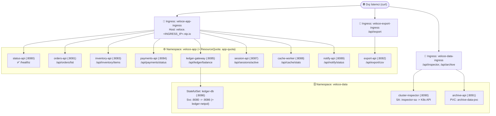

# 🩺 K8s Troubleshoot Lab 36: VeloceCloud v19.0 — Kör Mod Genel Tekrar #5 (Doğrudan Ingress Mimarisi)

> **[🇹🇷 Türkçe](#-türkçe-bölüm) | [🇬🇧 English](#-english-section)**

---

<a id="-türkçe-bölüm"></a>
## 🇹🇷 Türkçe Bölüm

### 📋 Olay Özeti (Incident Briefing)

| Alan | Detay |
| :--- | :--- |
| **Platform** | **VeloceCloud v19.0** — Sipariş, Dışa Aktarım, Stok, Ödeme, Muhasebe, Oturum, Önbellek, Bildirim, Denetçi & Arşiv Platformu |
| **Lab Modu** | **%100 Kör Mod Genel Tekrar (Hedef: Maksimum 25 Dakika)** |
| **Trafik Mimarisi** | **Doğrudan Kubernetes Ingress (`Ingress -> Service -> Pod`)** — Ekstra reverse proxy podu yok |
| **Altyapı** | **Azure Kubernetes Service (AKS)** — 2 Düğümlü (`Standard_B2s_v2`), Calico CNI, NGINX Ingress Controller *(veya `--skip-terraform` ile mevcut küme)* |
| **Etkilenen Alanlar** | `veloce-app`, `veloce-data` (2 Namespace, 10 Kör Üretim Bileti) |
| **Canlı Doğrulama** | `./check.sh` *(Varsayılan olarak spoiler vermez; yalnızca tıkandığında `./check.sh --hints` kullan)* |
| **Çözüm Anahtarı** | [`SOLUTION.md`](./SOLUTION.md) — Tüm teşhisten sonra veya 25 dk dolduğunda incele |

> [!IMPORTANT]
> **Kör Mod Kuralları:**
> 1. Bu dokümanda her bilet için **yalnızca Olay Bildirimi (Semptom / Canlı Test)** ve **Çözüm Kanıtı** yer alır; sorunun hangi Kubernetes katmanında olduğu gizlenmiştir.
> 2. Önce aşağıdaki **5 Adımlı Standart Triage Sıranı** çalıştırıp arızayı kendin izole et.
> 3. **Sıfır Hile Kuralı:** `ledger-netpol` ağ politikasını silmek, `session-api` üzerindeki `readOnlyRootFilesystem: true` ayarını kapatmak, `app-quota` nesnesini silmek, `inspector-sa` hesabına `cluster-admin` vermek veya `archive-data-pvc` yerine geçici disk kullanmak yasaktır (`./check.sh` denetler).

---

### 🧭 Standart Triage Akışın

```bash
# 1. Podlar ayakta mı, Pending / CrashLoopBackOff / 0/1 Running veya eksik pod var mı?
kubectl get pods -n veloce-app -o wide
kubectl get pods -n veloce-data -o wide

# 2. Deployment, StatefulSet, ReplicaSet, Service ve Endpoints ne durumda?
kubectl get deploy,sts,rs,svc,ep -n veloce-app
kubectl get deploy,sts,rs,svc,ep -n veloce-data

# 3. Doğrudan Ingress kuralları, path tipleri ve annotasyonlar ne durumda?
kubectl get ingress -A
kubectl describe ingress -n veloce-app

# 4. Ağ politikası, kota, RBAC ve PVC durumları ne durumda?
kubectl get netpol,quota,role,rolebinding,pvc -A

# 5. Pod logları ve Events ne diyor?
kubectl logs -n <namespace> <pod-adi> --tail=30
kubectl describe <kaynak> -n <namespace> <ad>
```

---

### 🏗️ Sistem Topolojisi (Doğrudan Ingress)



---

### 🚀 Kurulum & Başlangıç

```bash
# Önce scriptleri çalıştırılabilir yap:
chmod +x setup.sh check.sh cleanup.sh broken-manifests/setup-broken.sh

# Mevcut AKS/Minikube (ingress-nginx + Calico) açıksa:
./setup.sh --skip-terraform

# Veya Terraform ile sıfırdan 2-node AKS kümesi açmak için:
# ./setup.sh
```

Değişkenleri yükle ve baseline sağlığını gör (`200 OK`):

```bash
export INGRESS_IP=$(kubectl get svc -n ingress-nginx ingress-nginx-controller -o jsonpath='{.status.loadBalancer.ingress[0].ip}')
export HOST="veloce.${INGRESS_IP}.nip.io"

curl -i --max-time 4 "http://${HOST}/healthz"
./check.sh
```

> [!TIP]
> `helm/velocecloud/values.yaml` dosyasını düzenleyip uygularken `global.ingressHost` değerini korumak için:
> `helm upgrade velocecloud ./helm/velocecloud --set global.ingressHost="${HOST}"` komutunu kullan.
> Labı dilediğin zaman sıfırdan bozuk haline döndürmek için `./broken-manifests/setup-broken.sh --skip-terraform` çalıştırabilirsin.

---

### 🎫 10 Kör Üretim Bileti (Yalnızca Olay & Kanıt)

#### 🎫 Bilet 1: Sipariş Listesi Alt Yolu `404` Dönüyor
* **Olay Bildirimi:** `curl -i "http://${HOST}/api/orders"` isteği `200 OK` dönerken, alt yol isteği başarısız oluyor:
  ```bash
  curl -i --max-time 4 "http://${HOST}/api/orders/list"
  ```
  *Gözlenen:* `HTTP/1.1 404 Not Found`
* **Çözüm Kanıtı:** `curl -i --max-time 4 "http://${HOST}/api/orders/list"` -> `HTTP/1.1 200 OK` (`"service": "orders-api"`, `"ord-101"`).

---

#### 🎫 Bilet 2: CSV Dışa Aktarım İsteği Yanıt Dönmeden Kesiliyor
* **Olay Bildirimi:**
  ```bash
  curl -i --max-time 10 "http://${HOST}/api/export/csv"
  ```
  *Gözlenen:* `HTTP/1.1 504 Gateway Time-out`
* **Çözüm Kanıtı:** `curl -i --max-time 10 "http://${HOST}/api/export/csv"` -> `HTTP/1.1 200 OK` (`"service": "export-api"`, `"status": "exported"`).

---

#### 🎫 Bilet 3: Stok Servisine Dışarıdan Ulaşılamıyor
* **Olay Bildirimi:**
  ```bash
  curl -i --max-time 4 "http://${HOST}/api/inventory/items"
  ```
  *Gözlenen:* `HTTP/1.1 503 Service Temporarily Unavailable`
* **Çözüm Kanıtı:** `curl -i --max-time 4 "http://${HOST}/api/inventory/items"` -> `HTTP/1.1 200 OK` (`"service": "inventory-api"`).

---

#### 🎫 Bilet 4: Ödeme Servisi Trafik Almıyor
* **Olay Bildirimi:**
  ```bash
  curl -i --max-time 4 "http://${HOST}/api/payments/status"
  ```
  *Gözlenen:* `HTTP/1.1 503 Service Temporarily Unavailable`
* **Çözüm Kanıtı:** `curl -i --max-time 4 "http://${HOST}/api/payments/status"` -> `HTTP/1.1 200 OK` (`"service": "payments-api"`).

---

#### 🎫 Bilet 5: Muhasebe Ağ Geçidi Veri Katmanına Ulaşamıyor
* **Olay Bildirimi:**
  ```bash
  curl -i --max-time 6 "http://${HOST}/api/ledger/balance"
  ```
  *Gözlenen:* `HTTP/1.1 502 Bad Gateway` *(Sıfır Hile: `ledger-netpol` ağ politikasını silme veya gevşetme.)*
* **Çözüm Kanıtı:** `ledger-netpol` aktifken `curl -i --max-time 6 "http://${HOST}/api/ledger/balance"` -> `HTTP/1.1 200 OK` (`"service": "ledger-db"`).

---

#### 🎫 Bilet 6: Oturum Servisi Başlangıçta Çöküyor
* **Olay Bildirimi:**
  ```bash
  curl -i --max-time 4 "http://${HOST}/api/sessions/active"
  ```
  *Gözlenen:* `HTTP/1.1 503 Service Temporarily Unavailable` *(Sıfır Hile: `readOnlyRootFilesystem: true` kuralını kapatma.)*
* **Çözüm Kanıtı:** `readOnlyRootFilesystem: true` aktifken `curl -i --max-time 4 "http://${HOST}/api/sessions/active"` -> `HTTP/1.1 200 OK` (`"service": "session-api"`).

---

#### 🎫 Bilet 7: Önbellek İşçisi Sürekli Yeniden Başlıyor
* **Olay Bildirimi:**
  ```bash
  curl -i --max-time 4 "http://${HOST}/api/cache/stats"
  ```
  *Gözlenen:* `HTTP/1.1 503 Service Temporarily Unavailable` ve `cache-worker` podu döngüye giriyor.
* **Çözüm Kanıtı:** `curl -i --max-time 4 "http://${HOST}/api/cache/stats"` -> `HTTP/1.1 200 OK` (`"service": "cache-worker"`).

---

#### 🎫 Bilet 8: Bildirim Servisinin Podu Hiç Oluşturulmuyor
* **Olay Bildirimi:**
  ```bash
  curl -i --max-time 4 "http://${HOST}/api/notify/status"
  ```
  *Gözlenen:* `HTTP/1.1 503 Service Temporarily Unavailable` ve `notify-api` altında hiç pod oluşmuyor *(Sıfır Hile: `app-quota` nesnesini silme)*.
* **Çözüm Kanıtı:** `app-quota` aktifken `curl -i --max-time 4 "http://${HOST}/api/notify/status"` -> `HTTP/1.1 200 OK` (`"service": "notify-api"`).

---

#### 🎫 Bilet 9: Küme Denetçisi `403 Forbidden` Dönüyor
* **Olay Bildirimi:**
  ```bash
  curl -i --max-time 6 "http://${HOST}/api/inspector/pods"
  ```
  *Gözlenen:* `HTTP/1.1 403 Forbidden` *(Sıfır Hile: `inspector-sa` hesabına `cluster-admin` verme; en az yetki prensibiyle `inspector-role` üzerinden çöz.)*
* **Çözüm Kanıtı:** En az yetki (`inspector-role`) korunurken `curl -i --max-time 6 "http://${HOST}/api/inspector/pods"` -> `HTTP/1.1 200 OK` (`"pod_count"`).

---

#### 🎫 Bilet 10: Arşiv Servisi Başlayamıyor (`Pending`)
* **Olay Bildirimi:**
  ```bash
  curl -i --max-time 4 "http://${HOST}/api/archive/status"
  ```
  *Gözlenen:* `HTTP/1.1 503 Service Temporarily Unavailable` ve `archive-api` podu `Pending` kalıyor *(Sıfır Hile: `archive-data-pvc` kalıcı diski `Bound` olmalıdır)*.
* **Çözüm Kanıtı:** `archive-data-pvc` `Bound` durumdayken `curl -i --max-time 4 "http://${HOST}/api/archive/status"` -> `HTTP/1.1 200 OK` (`"storage": "mounted"`).

---

### ✅ Tam Doğrulama & Temizlik

```bash
./check.sh

# Küme açık kalsın, sadece bu labı sil:
./cleanup.sh --skip-terraform

# Veya Terraform ile tüm AKS altyapısını sil:
# ./cleanup.sh
```

---

<a id="-english-section"></a>
## 🇬🇧 English Section

### 📋 Incident Briefing

| Field | Detail |
| :--- | :--- |
| **Platform** | **VeloceCloud v19.0** — Blind-Mode Full-Spectrum Kubernetes General Review #5 (Direct Ingress Edition) |
| **Mode** | **100% Blind Mode (25-Minute Daily Triage Drill — Zero Hints)** |
| **Routing Architecture** | **Direct Kubernetes Ingress (`Ingress -> Service -> Pod`)** — No custom edge-proxy pod |
| **Namespaces** | `veloce-app`, `veloce-data` (2 Namespaces, 10 Blind Production Tickets) |
| **Audit / Key** | `./check.sh` *(zero-spoiler by default; `--hints` optional)* / [`SOLUTION.md`](./SOLUTION.md) |

### 🎫 10 Blind Tickets (Symptoms & Proof Only)

1. **Ticket 1:** `GET /api/orders` returns `200`, but `GET http://${HOST}/api/orders/list` -> `404`. **Proof:** `200 OK` (`orders-api`, `ord-101`).
2. **Ticket 2:** `GET http://${HOST}/api/export/csv` -> `504 Gateway Time-out`. **Proof:** `200 OK` (`export-api`, `exported`).
3. **Ticket 3:** `GET http://${HOST}/api/inventory/items` -> `503`. **Proof:** `200 OK` (`inventory-api`).
4. **Ticket 4:** `GET http://${HOST}/api/payments/status` -> `503`. **Proof:** `200 OK` (`payments-api`).
5. **Ticket 5:** `GET http://${HOST}/api/ledger/balance` -> `502` (keep `ledger-netpol` active). **Proof:** `200 OK` (`ledger-db`).
6. **Ticket 6:** `GET http://${HOST}/api/sessions/active` -> `503` (keep `readOnlyRootFilesystem: true`). **Proof:** `200 OK` (`session-api`).
7. **Ticket 7:** `GET http://${HOST}/api/cache/stats` -> `503` and pod crashes repeatedly. **Proof:** `200 OK` (`cache-worker`).
8. **Ticket 8:** `GET http://${HOST}/api/notify/status` -> `503` and `notify-api` spawns `0` pods (keep `app-quota` active). **Proof:** `200 OK` (`notify-api`).
9. **Ticket 9:** `GET http://${HOST}/api/inspector/pods` -> `403` (least-privilege `inspector-role`, no `cluster-admin`). **Proof:** `200 OK` (`pod_count`).
10. **Ticket 10:** `GET http://${HOST}/api/archive/status` -> `503` and `archive-api` stays `Pending` (keep `archive-data-pvc` `Bound`). **Proof:** `200 OK` (`storage: mounted`).
