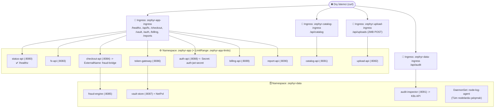

# 🩺 K8s Troubleshoot Lab 37: ZephyrMesh v20.0 — Kör Mod Genel Tekrar #6 (Sabah Isınma Labı)

> **[🇹🇷 Türkçe](#-türkçe-bölüm) | [🇬🇧 English](#-english-section)**

---

<a id="-türkçe-bölüm"></a>
## 🇹🇷 Türkçe Bölüm

### 📋 Olay Özeti (Incident Briefing)

| Alan | Detay |
| :--- | :--- |
| **Platform** | **ZephyrMesh v20.0** — Katalog, Doküman Yükleme, Döviz, Ödeme Doğrulama, Kasa Token, Kimlik, Faturalama, Raporlama & Denetim Kümesi |
| **Lab Modu** | **%100 Kör Mod Genel Tekrar — Sabah Isınma (Hedef: Maksimum 25 Dakika)** |
| **Trafik Mimarisi** | **Doğrudan Kubernetes Ingress (`Ingress -> Service -> Pod`)** — Ekstra reverse proxy podu yok |
| **Altyapı** | **Azure Kubernetes Service (AKS)** — 2 Düğümlü (`Standard_B2s_v2`), Calico CNI, NGINX Ingress Controller *(veya `--skip-terraform` ile mevcut küme)* |
| **Etkilenen Alanlar** | `zephyr-app`, `zephyr-data` (2 Namespace, 10 Kör Üretim Bileti) |
| **Canlı Doğrulama** | `./check.sh` *(Varsayılan olarak spoiler vermez; yalnızca tıkandığında `./check.sh --hints` kullan)* |
| **Çözüm Anahtarı** | [`SOLUTION.md`](./SOLUTION.md) — Tüm teşhisten sonra veya 25 dk dolduğunda incele |

> [!IMPORTANT]
> **Kör Mod Kuralları:**
> 1. Bu dokümanda her bilet için **yalnızca Olay Bildirimi (Semptom / Canlı Test)** ve **Çözüm Kanıtı** yer alır; sorunun hangi Kubernetes katmanında olduğu gizlenmiştir.
> 2. Önce aşağıdaki **5 Adımlı Standart Triage Sıranı** çalıştırıp arızayı kendin izole et.
> 3. **Sıfır Hile Kuralı:** `vault-store-netpol` ağ politikasını silmek, `zephyr-app-limits` (`max.memory: 512Mi`) limitini kaldırmak/artırmak, `audit-role` içine `*` wildcard koymak veya node üzerindeki `zephyr-pool=analytics:NoSchedule` taint'ini silmek yasaktır (`./check.sh` denetler).

---

### 🧭 Standart Triage Akışın (Sabah Refleksi)

```bash
# 1. Podlar ayakta mı, CreateContainerConfigError / 0/1 Running / CrashLoopBackOff var mı?
kubectl get pods -n zephyr-app -o wide
kubectl get pods -n zephyr-data -o wide

# 2. Deployment, ReplicaSet, DaemonSet, Service ve Endpoints ne durumda?
kubectl get deploy,rs,ds,svc,ep -n zephyr-app
kubectl get deploy,rs,ds,svc,ep -n zephyr-data

# 3. Doğrudan Ingress kuralları, ingressClassName ve annotasyonlar ne durumda?
kubectl get ingress -A
kubectl describe ingress -n zephyr-app

# 4. Ağ politikası, LimitRange, RBAC ve Node Taint ne durumda?
kubectl get netpol,limitrange,role,rolebinding -A
kubectl describe nodes | grep -E 'Name:|Taints:'

# 5. Pod logları ve Events ne diyor?
kubectl logs -n <namespace> <pod-adi> --tail=30
kubectl describe <kaynak> -n <namespace> <ad>
```

---

### 🏗️ Sistem Topolojisi (Doğrudan Ingress)



---

### 🚀 Kurulum & Başlangıç

```bash
# Scriptleri çalıştırılabilir yap:
chmod +x setup.sh check.sh cleanup.sh broken-manifests/setup-broken.sh

# Mevcut AKS/Minikube (ingress-nginx + Calico) açıksa 10 saniyede kur:
./setup.sh --skip-terraform

# Veya Terraform ile sıfırdan 2-node AKS kümesi açmak için:
# ./setup.sh
```

Değişkenleri yükle ve baseline sağlığını gör (`200 OK`):

```bash
export INGRESS_IP=$(kubectl get svc -n ingress-nginx ingress-nginx-controller -o jsonpath='{.status.loadBalancer.ingress[0].ip}')
export HOST="zephyr.${INGRESS_IP}.nip.io"

curl -i --max-time 4 "http://${HOST}/healthz"
./check.sh
```

> [!TIP]
> `helm/zephyrmesh/values.yaml` dosyasını düzenleyip uygularken `global.ingressHost` değerini korumak için:
> `helm upgrade zephyrmesh ./helm/zephyrmesh --set global.ingressHost="${HOST}"` komutunu kullan.
> Labı dilediğin zaman sıfırdan bozuk haline döndürmek için `./broken-manifests/setup-broken.sh --skip-terraform` çalıştırabilirsin.

---

### 🎫 10 Kör Üretim Bileti (Yalnızca Olay & Kanıt)

#### 🎫 Bilet 1: Katalog İstekleri `404` Dönüyor
* **Olay Bildirimi:** `catalog-api` podu `1/1 Running` olmasına rağmen dış istekler başarısız oluyor:
  ```bash
  curl -i --max-time 4 "http://${HOST}/api/catalog/items"
  ```
  *Gözlenen:* `HTTP/1.1 404 Not Found`
* **Çözüm Kanıtı:** `curl -i --max-time 4 "http://${HOST}/api/catalog/items"` → `HTTP/1.1 200 OK` (`"service": "catalog-api"`).

---

#### 🎫 Bilet 2: 2 MB Doküman Yüklemesi `413` ile Reddediliyor
* **Olay Bildirimi:** Küçük istekler geçerken 2 MB boyutunda bir dosya gönderildiğinde istek reddediliyor:
  ```bash
  dd if=/dev/zero bs=1024 count=2048 2>/dev/null | tr '\0' 'z' > /tmp/doc.txt
  curl -i --max-time 6 -X POST --data-binary "@/tmp/doc.txt" "http://${HOST}/api/uploads/document"
  ```
  *Gözlenen:* `HTTP/1.1 413 Request Entity Too Large`
* **Çözüm Kanıtı:** Aynı 2 MB POST isteği → `HTTP/1.1 200 OK` (`"bytes_received": 2097152`, `"status": "accepted"`).

---

#### 🎫 Bilet 3: Döviz Kuru Servisi `502 Bad Gateway` Veriyor
* **Olay Bildirimi:** `fx-api` podu çalışıyor ve kendi iç portuna yanıt veriyor, ancak dış trafik kopuyor:
  ```bash
  curl -i --max-time 4 "http://${HOST}/api/fx/rates"
  ```
  *Gözlenen:* `HTTP/1.1 502 Bad Gateway`
* **Çözüm Kanıtı:** `curl -i --max-time 4 "http://${HOST}/api/fx/rates"` → `HTTP/1.1 200 OK` (`"service": "fx-api"`, `"base": "EUR"`).

---

#### 🎫 Bilet 4: Ödeme Doğrulama (`checkout`) Upstream DNS Hatası Alıyor
* **Olay Bildirimi:** `fraud-engine` çalışır durumda olmasına rağmen `checkout-api` sahtekarlık skorlamasına ulaşamıyor:
  ```bash
  curl -i --max-time 5 "http://${HOST}/api/checkout/verify"
  ```
  *Gözlenen:* `HTTP/1.1 502 Bad Gateway` (`"verified": false`, `"error"` içinde isim çözümleme hatası)
* **Çözüm Kanıtı:** `curl -i --max-time 5 "http://${HOST}/api/checkout/verify"` → `HTTP/1.1 200 OK` (`"verified": true`, `"service": "fraud-engine"`).

---

#### 🎫 Bilet 5: Kasa Token İstekleri Zaman Aşımına Düşüyor (`504`)
* **Olay Bildirimi:** `token-gateway` ve `vault-store` podlarının ikisi de `1/1 Running`, ancak servisler arası çağrı yanıt vermiyor:
  ```bash
  curl -i --max-time 5 "http://${HOST}/api/vault/token"
  ```
  *Gözlenen:* `HTTP/1.1 504 Gateway Timeout` (`"issued": false`)
* **Çözüm Kanıtı:** `vault-store-netpol` silinmeden `curl -i "http://${HOST}/api/vault/token"` → `HTTP/1.1 200 OK` (`"issued": true`, `"token_id": "vlt-9041"`).

---

#### 🎫 Bilet 6: Kimlik Doğrulama Servisi Podu Açılmıyor (`503`)
* **Olay Bildirimi:** `auth-api` ucu hizmet dışı:
  ```bash
  curl -i --max-time 4 "http://${HOST}/api/auth/verify"
  ```
  *Gözlenen:* `HTTP/1.1 503 Service Temporarily Unavailable` (pod `Running` değil)
* **Çözüm Kanıtı:** `auth-api` podu `1/1 Running` ve `curl -i "http://${HOST}/api/auth/verify"` → `HTTP/1.1 200 OK` (`"authenticated": true`).

---

#### 🎫 Bilet 7: Faturalama Servisi `0/1` Kalıp Yeniden Başlıyor (`503`)
* **Olay Bildirimi:** `billing-api` container'ı çalışmaya başlasa da `Ready` olamıyor ve dış trafiğe kapalı:
  ```bash
  curl -i --max-time 4 "http://${HOST}/api/billing/charge"
  ```
  *Gözlenen:* `HTTP/1.1 503 Service Temporarily Unavailable`
* **Çözüm Kanıtı:** `billing-api` `1/1 Running` ve `curl -i "http://${HOST}/api/billing/charge"` → `HTTP/1.1 200 OK` (`"charged": true`).

---

#### 🎫 Bilet 8: Raporlama Servisinde Hiç Pod Üretilmiyor (`0/1` / `503`)
* **Olay Bildirimi:** `report-api` Deployment'ı `replicas: 1` olmasına rağmen `zephyr-app` altında podu hiç oluşmamış:
  ```bash
  curl -i --max-time 4 "http://${HOST}/api/reports/generate"
  ```
  *Gözlenen:* `HTTP/1.1 503 Service Temporarily Unavailable`
* **Çözüm Kanıtı:** `zephyr-app-limits` (`max.memory: 512Mi`) korunarak `report-api` `1/1 Running` ve `curl -i "http://${HOST}/api/reports/generate"` → `HTTP/1.1 200 OK`.

---

#### 🎫 Bilet 9: Denetçi Servisi Küme İçi İstekten `500 Forbidden` Alıyor
* **Olay Bildirimi:** `audit-inspector` podu `1/1 Running`, ancak `zephyr-data` içindeki servis listesini çekerken yetki hatası alıyor:
  ```bash
  curl -i --max-time 5 "http://${HOST}/api/audit/services"
  ```
  *Gözlenen:* `HTTP/1.1 500 Internal Server Error` (`"HTTP Error 403: Forbidden"`)
* **Çözüm Kanıtı:** `audit-role` en az yetki (*least-privilege*, wildcard yok) korunarak `curl -i "http://${HOST}/api/audit/services"` → `HTTP/1.1 200 OK` (`"discovered_services"`).

---

#### 🎫 Bilet 10: Log Ajanı DaemonSet Tüm Düğümlere Dağılmıyor
* **Olay Bildirimi:** 2 düğümlü kümede `zephyr-data` içindeki `node-log-agent` DaemonSet'i düğümlerden yalnızca birinde çalışıyor (`1/2`):
  ```bash
  kubectl get ds node-log-agent -n zephyr-data
  kubectl get pods -n zephyr-data -l app=node-log-agent -o wide
  ```
  *Gözlenen:* `DESIRED: 2, READY: 1` (ya da 2. düğümde schedule edilmemiş)
* **Çözüm Kanıtı:** Düğümdeki `zephyr-pool=analytics:NoSchedule` taint'i silinmeden `DESIRED == READY == node sayısı` (ör. `2/2 Running`).

---

### 🧹 Sıfırlama & Temizlik

```bash
./broken-manifests/setup-broken.sh --skip-terraform   # Labı ilk bozuk haline döndür
./cleanup.sh --skip-terraform                         # Sadece lab nesnelerini kaldır
./cleanup.sh                                          # Terraform AKS dahil komple sil
```

---

<a id="-english-section"></a>
## 🇬🇧 English Section

### 📋 Incident Briefing

| Field | Detail |
| :--- | :--- |
| **Platform** | **ZephyrMesh v20.0** — Catalog, Uploads, FX, Checkout, Vault Gateway, Auth, Billing, Reporting & Audit Platform |
| **Mode** | **100% Blind-Mode General Review Warm-Up (Target: <= 25 min)** |
| **Traffic Architecture** | **Direct Kubernetes Ingress (`Ingress -> Service -> Pod`)** — No custom edge-proxy pod |
| **Infrastructure** | **Azure Kubernetes Service (AKS)** — 2 nodes (`Standard_B2s_v2`), Calico CNI, NGINX Ingress *(or `--skip-terraform` on existing cluster)* |
| **Affected Namespaces** | `zephyr-app`, `zephyr-data` (10 Blind Production Tickets) |
| **Verification** | `./check.sh` *(Zero-spoiler by default; run `./check.sh --hints` only if stuck)* |
| **Answer Key** | [`SOLUTION.md`](./SOLUTION.md) |

> [!IMPORTANT]
> **Zero-Cheat Rules:** Do not delete `vault-store-netpol`, raise `zephyr-app-limits` (`max.memory: 512Mi`), add wildcard `*` permissions to `audit-role`, or remove the node taint `zephyr-pool=analytics:NoSchedule`.

### 🚀 Quick Start

```bash
chmod +x setup.sh check.sh cleanup.sh broken-manifests/setup-broken.sh
./setup.sh --skip-terraform

export INGRESS_IP=$(kubectl get svc -n ingress-nginx ingress-nginx-controller -o jsonpath='{.status.loadBalancer.ingress[0].ip}')
export HOST="zephyr.${INGRESS_IP}.nip.io"

./check.sh
```

### 🎫 10 Blind Tickets

1. **Ticket 1:** `GET http://${HOST}/api/catalog/items` returns `404` -> expect `200 OK` (`catalog-api`).
2. **Ticket 2:** `POST http://${HOST}/api/uploads/document` (2 MB) returns `413` -> expect `200 OK` (`"bytes_received": 2097152`).
3. **Ticket 3:** `GET http://${HOST}/api/fx/rates` returns `502 Bad Gateway` -> expect `200 OK` (`fx-api`).
4. **Ticket 4:** `GET http://${HOST}/api/checkout/verify` fails upstream name resolution (`502`) -> expect `200 OK` (`"verified": true`, `fraud-engine`).
5. **Ticket 5:** `GET http://${HOST}/api/vault/token` times out (`504`) -> expect `200 OK` with `vault-store-netpol` intact.
6. **Ticket 6:** `GET http://${HOST}/api/auth/verify` returns `503` (pod cannot start) -> expect `200 OK` (`"authenticated": true`).
7. **Ticket 7:** `GET http://${HOST}/api/billing/charge` returns `503` (pod stuck unready/restarting) -> expect `200 OK` (`"charged": true`).
8. **Ticket 8:** `GET http://${HOST}/api/reports/generate` returns `503` (`0/1` pods created) -> expect `200 OK` with `LimitRange` `max.memory: 512Mi` intact.
9. **Ticket 9:** `GET http://${HOST}/api/audit/services` returns `500` (`403 Forbidden` from Kubernetes API) -> expect `200 OK` with least-privilege `audit-role`.
10. **Ticket 10:** `DaemonSet/node-log-agent` in `zephyr-data` misses the tainted node -> expect `READY == cluster node count` with `zephyr-pool=analytics:NoSchedule` intact.

### 🧹 Reset & Cleanup

```bash
./broken-manifests/setup-broken.sh --skip-terraform   # Reset to initial broken state
./cleanup.sh --skip-terraform                         # Remove lab namespaces & taint
./cleanup.sh                                          # Full teardown incl. Terraform AKS
```
